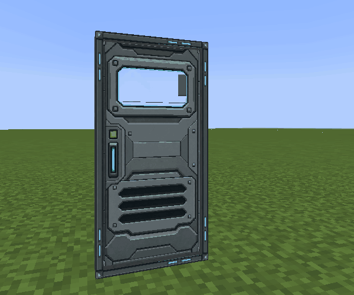

# Animated documentation

The canopy, door, trapdoor and Ramp Controller guides use live in-game GIFs showing complete opening/deployment and closing/retraction cycles. The [version 1.6 guide](gallery/version-1.6.md) adds channel-linked control demonstrations: a Thruster Lever drives a Rocket Thruster, and a Wall Slider drives a Programmable Light. The clips are **420×350**, 70% of the prototype's 600×500 dimensions. Design, configuration and selection-outline illustrations remain still images where motion would hide the relevant detail.



The recorder changes normal server-side block states or redstone inputs and captures the real renderer and animation clocks. It holds each endpoint, buffers cropped framebuffer images during motion, and writes PNGs after the cycle. A fixed camera and hidden HUD keep clips readable. Motion scenes use noon lighting; signal demonstrations use nighttime lighting with a fixed fill light to show changes in emitted light. The capture client uses G1 garbage collection and a small view distance to avoid long collection/render stalls in the software renderer; these are documentation launch settings, with no changes to gameplay animation speed.

The encoder uses a shared 256-color palette and a regular 50 ms output timeline for motion clips and 100 ms for signal demonstrations, selecting the nearest real captured pose. It does not interpolate geometry or alter motion speed. GIFs loop continuously; palette colors have less precision than the original screenshots. Viewers that render GIF animations show movement; print/PDF exports may show a still.

The [2.3 feature guide](gallery/version-2.3.md) adds captures of the cockpit screen lift, sliding seat and armrests, Advanced Pilot Chair height steps, card/chip insertion and secured doors. These use the live Minecraft renderers at deterministic animation poses. Motion captures use a 50 ms timeline; the chair-height example holds each discrete setting. Door pulse examples retain the five-second opening window.

## Reproduce

With the existing testclient runtime installed:

```bash
# Every documented scene
bash testclient/capture_animations.sh

# One motion or a comma-separated subset
bash testclient/capture_animations.sh --filter door-rotating,ramp-lift

# Signal-level control demonstrations
bash testclient/capture_animations.sh --filter signal-thruster-lever,signal-wall-slider

# Compatibility shortcut for the original door example
bash testclient/capture_door_gif.sh
```

The script builds the standard Java 8 mod JAR in `build/libs/`, installs it into the disposable testclient runtime, records all selected scenes, then validates and encodes their GIFs. Raw PNGs, `frames.tsv`, scene metadata, GC/client logs, artifact checksum and decoded-GIF review sheets remain in the ignored `testclient/door-animation.*` directory. The source directory is printed when capture finishes.

To re-encode without restarting Minecraft:

```bash
python3 testclient/encode_animations.py testclient/door-animation.RUN
# Or just one scene in that directory
python3 testclient/encode_animations.py testclient/door-animation.RUN/door-rotating
```

Deployment clips must contain synchronized closed/open/closed states, visible intermediate geometry in both transitions, a returned endpoint and a motion footprint inside the crop. The encoder checks dimensions, frame count, exact loop duration and loop settings, and writes timing/size results plus a decoded contact sheet for review. Escalator clips instead verify stopped/running/stopped movement while retaining the extended staircase. Windows can capture only these two scenes with `python testclient/run_windows.py --focus ramps`. Doors and trapdoors have 2.6-second cycles; ramps have 4.6-second cycles. Signal demonstrations have six-second cycles, with real control clicks selecting 0, 5, 10, 15 and then 0; recorded consumer levels and particle thresholds are checked at each setting. See [capture validation](animation-validation.md) for the current results.

## Canopy captures on Windows

Build the standard Java 8 JAR, then run:

```text
python testclient/run_windows.py --focus canopy-animations
# Optional single-scene capture
python testclient/run_windows.py --focus canopy-animations --animation-filter canopy-large-left
python testclient/encode_animations.py <capture-directory> --report docs/canopy-animation-validation.json
```

This records nine scenes using the actual renderer and sixteen-tick canopy clocks. The six narrow-shell scenes cover single Flat, double Angled and triple Long Angled profiles in both opening modes. The remaining scenes show a large top hinge, a 5 × 5 left hinge and an inverted double Canopy. Camera crops include the complete moving geometry. See [the canopy guide](canopies.md) and [2.0 highlights](gallery/version-2.0.md).

## Landing gear animations

The twelve scenes cover standard and Large Extenders and Swing Arms with Plates, Skis and matching Wheels. Each 4.2-second clip uses the real 24-tick gear clock, holds the deployed endpoint and returns to the stowed endpoint. The encoder checks visible motion in both directions, intermediate poses, an unobstructed crop and the returned geometry. See the [combination gallery](modular-landing-gear.md#animated-combinations). Fixed mounts are illustrated separately because they stay deployed.

## Motion index

- [Modular landing gear](modular-landing-gear.md#animated-combinations): both sizes, Extender/Swing Arm motion and Plate/Ski/Wheel feet.
- [Canopies](canopies.md): single/double/triple sliding and rear-hinged shells, large-window hinges and ceiling mounting.
- [Programmable Door](gallery/doors.md): four motions.
- [Programmable Trapdoor](gallery/programmable-trapdoor.md): three in-block motions, two next-block motions and opposing mounts.
- [Programmable Diagonal Trapdoor](gallery/programmable-diagonal-trapdoor.md): three motions, all three shapes, rectangular/staggered/partial groups and joined slope orientations.
- [Ramp Controller](gallery/ramp-controller.md): four deployment modes, four slope/tread examples, and uphill/downhill escalators controlled by redstone.
- [Version 1.6 signal levels](gallery/version-1.6.md): linked levers, sliders, thrusters and lights.
- [Version 1.3 highlights](gallery/version-1.3.md): selected animations with the new features.

The complete capture set:

| Scene | GIF |
| --- | --- |
| signal-thruster-lever | [Open clip](images/gallery/controls/signal-thruster-lever.gif) |
| signal-wall-slider | [Open clip](images/gallery/lights/signal-wall-slider.gif) |
| door-rotating | [Open clip](images/gallery/doors/observation-rotating.gif) |
| door-sideways | [Open clip](images/gallery/doors/observation-sideways.gif) |
| door-up | [Open clip](images/gallery/doors/observation-up.gif) |
| door-down | [Open clip](images/gallery/doors/observation-down.gif) |
| trapdoor-flat-rotating | [Open clip](images/gallery/tasks/trapdoor-flat-rotating.gif) |
| trapdoor-flat-sliding | [Open clip](images/gallery/tasks/trapdoor-flat-sliding.gif) |
| trapdoor-flat-over-surface | [Open clip](images/gallery/tasks/trapdoor-flat-over-surface.gif) |
| trapdoor-next-rotating | [Open clip](images/gallery/tasks/trapdoor-next-rotating.gif) |
| trapdoor-next-sliding | [Open clip](images/gallery/tasks/trapdoor-next-sliding.gif) |
| trapdoor-opposing-next | [Open clip](images/gallery/tasks/trapdoor-opposing-next.gif) |
| trapdoor-v-rotating | [Open clip](images/gallery/tasks/trapdoor-v-rotating.gif) |
| trapdoor-v-sliding | [Open clip](images/gallery/tasks/trapdoor-v-sliding.gif) |
| trapdoor-rectangle-rotating | [Open clip](images/gallery/tasks/trapdoor-rectangle-rotating.gif) |
| trapdoor-rectangle-sliding | [Open clip](images/gallery/tasks/trapdoor-rectangle-sliding.gif) |
| trapdoor-stagger-rotating | [Open clip](images/gallery/tasks/trapdoor-stagger-rotating.gif) |
| trapdoor-stagger-sliding | [Open clip](images/gallery/tasks/trapdoor-stagger-sliding.gif) |
| trapdoor-stagger-halfwidth-rotating | [Open clip](images/gallery/tasks/trapdoor-stagger-halfwidth-rotating.gif) |
| trapdoor-stagger-halfwidth-sliding | [Open clip](images/gallery/tasks/trapdoor-stagger-halfwidth-sliding.gif) |
| trapdoor-stagger-shallow-rotating | [Open clip](images/gallery/tasks/trapdoor-stagger-shallow-rotating.gif) |
| trapdoor-stagger-shallow-sliding | [Open clip](images/gallery/tasks/trapdoor-stagger-shallow-sliding.gif) |
| trapdoor-rectangle-inset-sliding | [Open clip](images/gallery/tasks/trapdoor-rectangle-inset-sliding.gif) |
| trapdoor-patch-halfwidth-horizontal-rotating | [Open clip](images/gallery/tasks/trapdoor-patch-halfwidth-horizontal-rotating.gif) |
| trapdoor-patch-halfwidth-horizontal-sliding | [Open clip](images/gallery/tasks/trapdoor-patch-halfwidth-horizontal-sliding.gif) |
| trapdoor-patch-halfwidth-horizontal-inset-sliding | [Open clip](images/gallery/tasks/trapdoor-patch-halfwidth-horizontal-inset-sliding.gif) |
| trapdoor-patch-halfwidth-stagger-rotating | [Open clip](images/gallery/tasks/trapdoor-patch-halfwidth-stagger-rotating.gif) |
| trapdoor-patch-halfwidth-stagger-sliding | [Open clip](images/gallery/tasks/trapdoor-patch-halfwidth-stagger-sliding.gif) |
| trapdoor-patch-halfwidth-stagger-inset-sliding | [Open clip](images/gallery/tasks/trapdoor-patch-halfwidth-stagger-inset-sliding.gif) |
| trapdoor-patch-shallow-horizontal-rotating | [Open clip](images/gallery/tasks/trapdoor-patch-shallow-horizontal-rotating.gif) |
| trapdoor-patch-shallow-horizontal-sliding | [Open clip](images/gallery/tasks/trapdoor-patch-shallow-horizontal-sliding.gif) |
| trapdoor-patch-shallow-horizontal-inset-sliding | [Open clip](images/gallery/tasks/trapdoor-patch-shallow-horizontal-inset-sliding.gif) |
| trapdoor-patch-shallow-stagger-rotating | [Open clip](images/gallery/tasks/trapdoor-patch-shallow-stagger-rotating.gif) |
| trapdoor-patch-shallow-stagger-sliding | [Open clip](images/gallery/tasks/trapdoor-patch-shallow-stagger-sliding.gif) |
| trapdoor-patch-shallow-stagger-inset-sliding | [Open clip](images/gallery/tasks/trapdoor-patch-shallow-stagger-inset-sliding.gif) |
| trapdoor-diagonal-opposite-slopes-rotating | [Open clip](images/gallery/tasks/trapdoor-diagonal-opposite-slopes-rotating.gif) |
| trapdoor-diagonal-opposite-slopes-sliding | [Open clip](images/gallery/tasks/trapdoor-diagonal-opposite-slopes-sliding.gif) |
| trapdoor-diagonal-reversed-plane-rotating | [Open clip](images/gallery/tasks/trapdoor-diagonal-reversed-plane-rotating.gif) |
| trapdoor-diagonal-reversed-plane-sliding | [Open clip](images/gallery/tasks/trapdoor-diagonal-reversed-plane-sliding.gif) |
| trapdoor-diagonal-slide-wall | [Open clip](images/gallery/tasks/trapdoor-diagonal-slide-wall.gif) |
| trapdoor-flat-rotate-neighbors | [Open clip](images/gallery/tasks/trapdoor-flat-rotate-neighbors.gif) |
| ramp-ramp | [Open clip](images/gallery/ramp-controller/ramp.gif) |
| ramp-filled | [Open clip](images/gallery/ramp-controller/filled.gif) |
| ramp-lift | [Open clip](images/gallery/ramp-controller/lift.gif) |
| ramp-extend | [Open clip](images/gallery/ramp-controller/extend.gif) |
| ramp-up-smooth | [Open clip](images/gallery/ramp-controller/up-smooth.gif) |
| ramp-up-stairs | [Open clip](images/gallery/ramp-controller/up-stairs.gif) |
| ramp-down-smooth | [Open clip](images/gallery/ramp-controller/down-smooth.gif) |
| ramp-down-stairs | [Open clip](images/gallery/ramp-controller/down-stairs.gif) |
| trapdoor-stagger-inset-sliding | [Open clip](images/gallery/tasks/trapdoor-stagger-inset-sliding.gif) |
| trapdoor-stagger-halfwidth-inset-sliding | [Open clip](images/gallery/tasks/trapdoor-stagger-halfwidth-inset-sliding.gif) |
| trapdoor-stagger-shallow-inset-sliding | [Open clip](images/gallery/tasks/trapdoor-stagger-shallow-inset-sliding.gif) |
| canopy-slide-1 | [Open clip](images/gallery/canopies/slide-1.gif) |
| canopy-slide-2 | [Open clip](images/gallery/canopies/slide-2.gif) |
| canopy-slide-3 | [Open clip](images/gallery/canopies/slide-3.gif) |
| canopy-hinge-1 | [Open clip](images/gallery/canopies/hinge-1.gif) |
| canopy-hinge-2 | [Open clip](images/gallery/canopies/hinge-2.gif) |
| canopy-hinge-3 | [Open clip](images/gallery/canopies/hinge-3.gif) |
| canopy-large-top | [Open clip](images/gallery/canopies/large-top.gif) |
| canopy-large-left | [Open clip](images/gallery/canopies/large-left.gif) |
| canopy-ceiling | [Open clip](images/gallery/canopies/ceiling.gif) |
| gear-small-extender-plate | [Open clip](images/gallery/landing-gear/gear-small-extender-plate.gif) |
| gear-small-extender-ski | [Open clip](images/gallery/landing-gear/gear-small-extender-ski.gif) |
| gear-small-extender-wheel | [Open clip](images/gallery/landing-gear/gear-small-extender-wheel.gif) |
| gear-small-swing-plate | [Open clip](images/gallery/landing-gear/gear-small-swing-plate.gif) |
| gear-small-swing-ski | [Open clip](images/gallery/landing-gear/gear-small-swing-ski.gif) |
| gear-small-swing-wheel | [Open clip](images/gallery/landing-gear/gear-small-swing-wheel.gif) |
| gear-large-extender-plate | [Open clip](images/gallery/landing-gear/gear-large-extender-plate.gif) |
| gear-large-extender-ski | [Open clip](images/gallery/landing-gear/gear-large-extender-ski.gif) |
| gear-large-extender-wheel | [Open clip](images/gallery/landing-gear/gear-large-extender-wheel.gif) |
| gear-large-swing-plate | [Open clip](images/gallery/landing-gear/gear-large-swing-plate.gif) |
| gear-large-swing-ski | [Open clip](images/gallery/landing-gear/gear-large-swing-ski.gif) |
| gear-large-swing-wheel | [Open clip](images/gallery/landing-gear/gear-large-swing-wheel.gif) |
