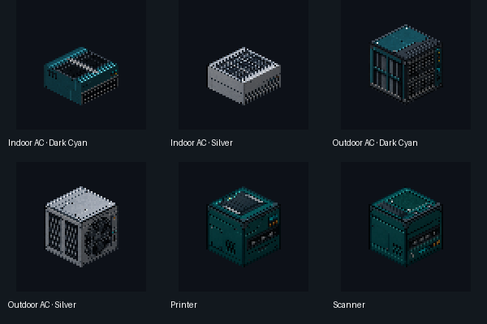

# Appliances

The creative block list includes four ready-to-place AC finishes:

| Entry | Placed block |
| --- | --- |
| Indoor AC (Dark Cyan) | Programmable Slab |
| Indoor AC (Silver) | Programmable Slab |
| Outdoor AC (Dark Cyan) | Programmable Block |
| Outdoor AC (Silver) | Programmable Block |

These entries are configured stacks of the existing programmable items, with
six individual face textures. They do not register separate AC block or item
identities. Place them facing the player; indoor units support the normal upper
and lower slab placement and slab combination. Use the normal Configurizer to
change a face or any other programmable-block setting. Mining preserves the
appearance on the ordinary programmable item.

Printer and Scanner are solid blocks with four horizontal orientations. Each has a Chip Mount at the upper-left of its front and a half-size Push Button at the upper-right. Right-click the housing, or use the Configurizer, to open the standard inventory dialog.

The Printer accepts a Data Chip, ink sacs and paper. Press its front button or **Print** in the dialog. Each successful print uses one ink sac and one paper, keeps the chip, and ejects the result upward. Leave the space above clear.

| Chip | Printed item |
| --- | --- |
| Journal | Written Book with the journal text |
| Navigation | Filled Map at scale 0, with prefilled navigation terrain pixels |
| Catalog | Written Book containing complete construction recipes that fit |
| Vehicle | No print; inputs remain untouched |

Print Navigation Chips in their recorded dimension. Map generation uses the same seed terrain as the navigation displays without loading chunks; scanned map pixels take precedence. Vanilla map colors approximate the navigation display palette.

The Scanner has an upward-facing item frame built into its top. Place one Filled Map, Written Book or Enchanted Book in it, insert a Data Chip, then press the front button or **Scan**. The original document remains in the frame. An empty-hand click on the frame retrieves it.

Maps program Navigation Chips with their center, dimension, scale and original 128×128 pixels. Navigation displays can show the complete saved square without a linked Survey Dish or Sentinel Array, including the corners of scale-4 maps. Original unexplored pixels remain blank. Written Books produce Journal Chips containing up to 4,096 characters of plain text; Enchanted Books produce random journal text shown in the enchanting alphabet. Scanning replaces the chip's previous document type and keeps its company design.

All supplied artwork retains its native 64×64 size. The appliance face textures
also appear in the **Appliances** category of the regular texture picker and
[texture browser](texture-browser/index.html).

