# Canopies

Build a cockpit from connected glass, angled noses, openable shells and broad front windows. Use the Configurizer, or sneak-use with configuration permission, to change settings on any occupied cell. Changes apply immediately; all settings share one screen beside a large categorized texture list.

## Components and placement

| Component | Size | Shapeless conversion from Canopy Glass |
| --- | --- | --- |
| Canopy Glass | 1 × 1 × 1 | Base recipe |
| Angled Front Canopy Glass | 1 × 1 × 1 | 1 iron nugget |
| Long Angled Front Canopy Glass | 1 × 2 × 1 | 2 iron nuggets |
| Canopy | 1 × 2 × 1; joins up to nine wide | 3 iron nuggets |
| Long Canopy | 1 × 3 × 1; joins up to nine wide | Canopy + Canopy Glass |
| Front Canopy Glass | 3 × 3 outer frame; adjustable depth | 8 iron nuggets |
| Large Front Canopy Glass | 5 × 5 outer frame; adjustable depth | Front Canopy Glass surrounded by 8 iron ingots (shaped) |

The base recipe has three glass blocks across the top, Programmable Matter Ingots at both middle edges, and three more ingots across the bottom. Visor, Wide Visor, Extra-Wide Visor and Tall Extra-Wide Visor remain available as fixed front windows. Their widths are two, three, five and five blocks; the Tall variant is two blocks high. They have no roof, rear or bottom, and a one-pixel border follows the upper outline. Visors center on the clicked block, including the two-wide variant's half-block alignment.

Click a wall to mount an angled nose or Canopy with its rear against that wall. Long noses extend outward instead of requiring space inside the support. Click the underside of a ceiling to place either angled nose or Canopy upside down. The large windows mount against any of the six block faces: their broad rear opening stays centered on the clicked location and their smaller front projects outward, towards the player.

Placement checks the complete owned footprint and editing permissions before writing blocks. Breaking an owned cell removes its component and returns one configured item in survival. Joined Canopies lose only the broken constituent and reconnect the survivors where possible. Pistons cannot move these assemblies. Aim at the constituent you want to remove; picking follows that column even when the shared shell is open.

Removing an open Front Canopy Glass or Large Front Canopy Glass releases its closed placement cells as well as its moved collision surfaces. Unrelated blocks and Programmable Ramp sections remain intact. Older orphan canopy cells become removable targets, and loaded followers with a missing owner are cleared within twenty world ticks. A remaining `controlled_ramp` cell belongs to a Programmable Ramp: retract or remove its controller to restore that platform.

Canopy and Canopy Glass can share their open lower space with a Pilot Seat's backrest in either placement order. Hold the canopy item and click the seat's upper backrest area to place the shell; the seat passes that click through instead of boarding or opening its settings.

Hold a Canopy and click the rear glazing of another Canopy to place it facing the opposite direction. The placement uses the clicked rear cell and retains ceiling mounting; the shared rear glazing opens into a continuous cabin. Empty-hand use still opens or closes the mechanism.

## Glass and materials

The **Glass** category in the shared texture list offers Clear, soft Vandor shades and all sixteen Minecraft colors. **Tint** selects Mild, Normal or Strong intensity. The same list includes the normal Programmable Block texture catalog, trapdoor artwork, filesystem materials and custom sampled textures. Selecting a glass entry restores glazing; selecting a material replaces the glazed surfaces while preserving the frame and shape. **Texture layout: Fit** maps the whole artwork to each panel; **Tile** repeats it once per block of surface distance, including slopes. Both avoid the old zoomed glass UVs. The setting follows configured items and Taxi Mode snapshots.

For non-glass materials, **Tint** controls artwork opacity: **Mild 35%**, **Normal 65%**, **Strong 100%**. This applies to Canopy, both Front Canopy Glass sizes, fixed canopy glass and visors, including their configured item icons and Taxi Mode appearance. Frames stay opaque at every strength. Strong makes the replacement panels opaque; texture cutouts remain cutouts. The original glass finishes retain their own texture alpha and tint behavior.

The Duplifier copies glass shade and intensity between canopies, visors, regular programmable glass and diagonal glass walls. Joined opening shells share their finish. Pick-block and harvested items retain their settings.

| Canopy settings | Front-window settings (same layout for both sizes) |
| --- | --- |
| 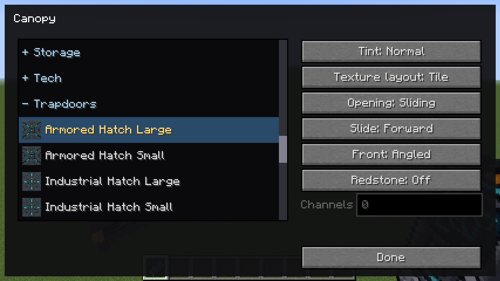 | 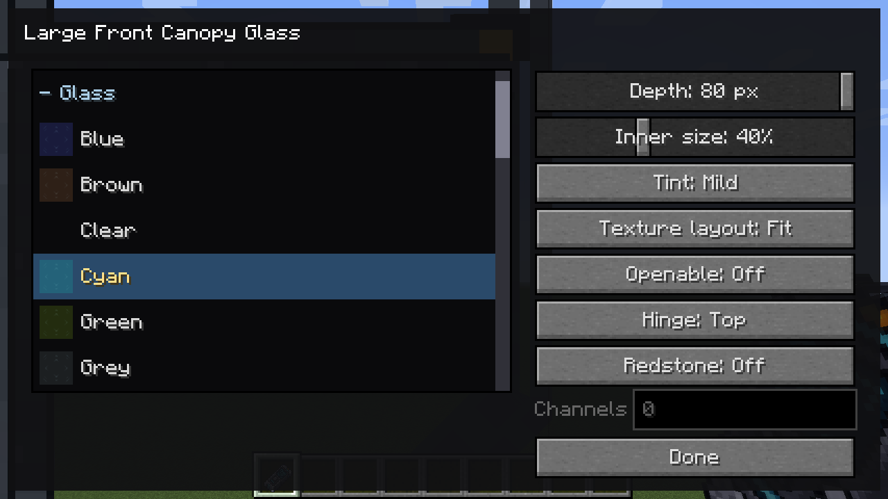 |

The same ribbed material on a five-wide front window, without changing its geometry:

| Fit: complete artwork per panel | Tile: repeats at block scale |
| --- | --- |
| 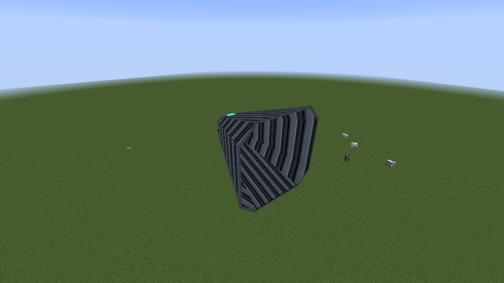 | 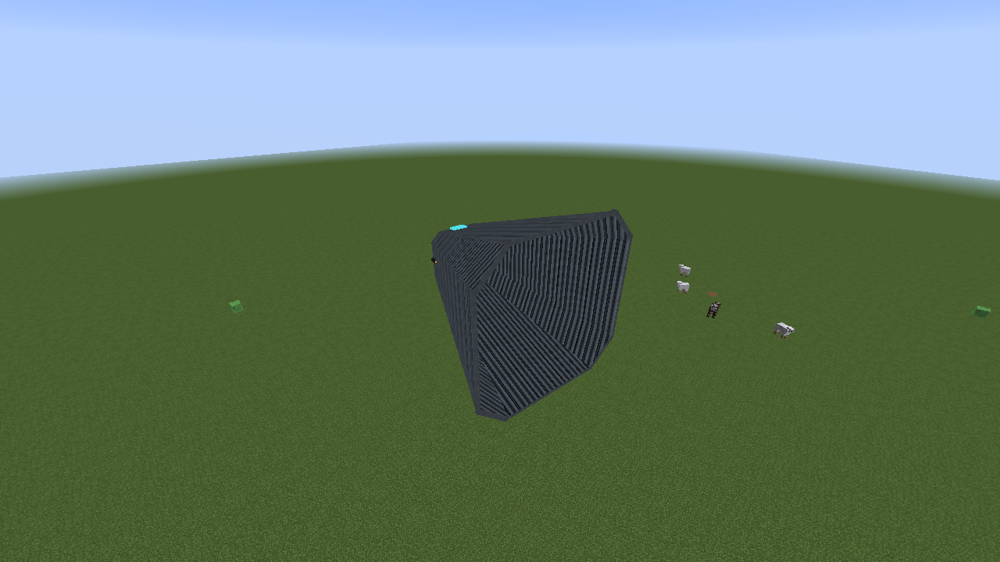 |


## Connected fixed glass

Canopy Glass joins neighboring tiles at the same elevation and mounting orientation, regardless of horizontal facing. Shared glazing and perimeter rails disappear. Matching angled noses join sideways and connect to regular glass behind their complete footprint. Regular glass also opens its side towards the rear of a Canopy. Ceiling-mounted parts use the same local joins after inversion.

An opening Canopy keeps its complete rear frame when joined to Canopy Glass: top crossbar, vertical uprights and bottom sill. The fixed glass also retains its own top frame at that connection, so the border stays complete when the shell moves away. Joins between fixed glass still remove their internal rails. Click the moving frame or an exposed stationary mounting rail to close the Canopy. The mounting rails remain selectable when surrounding bodywork covers the opened shell, for rear hinges and either sliding direction.

| Joined shell closed | Shell slid backward |
| --- | --- |
| 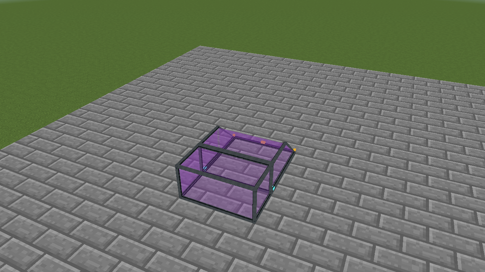 | 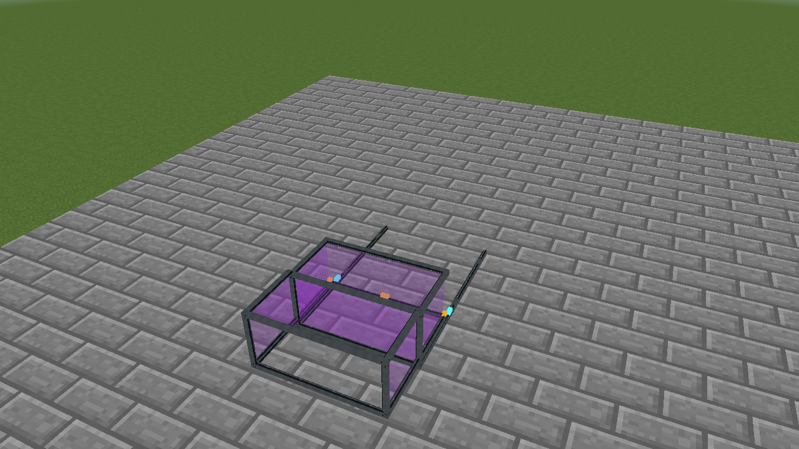 |

| Shell slid forward | Shell hinged open |
| --- | --- |
| 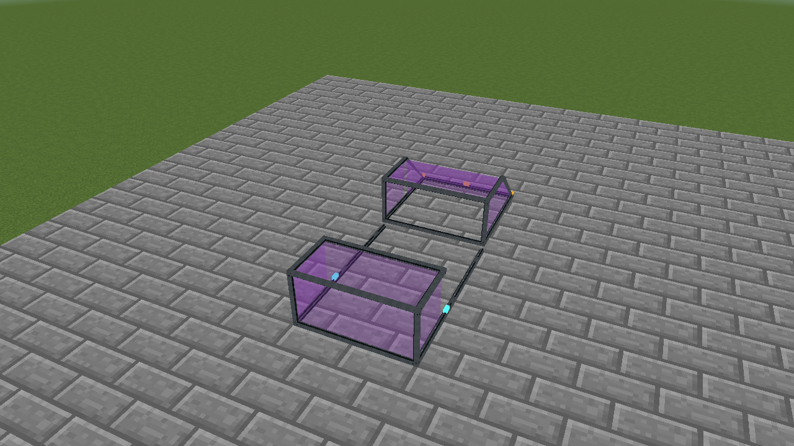 | 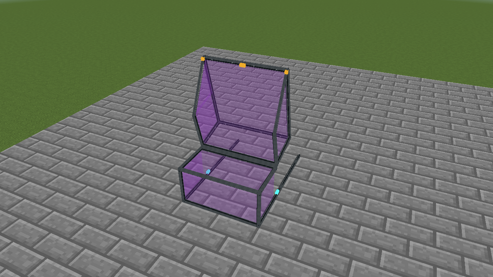 |

## One Canopy, two opening modes

Choose **Sliding** or **Rear hinge** in the Canopy dialog. Place up to nine matching closed Canopies or Long Canopies side by side to form a shared shell. Their opening mode, sliding direction, front profile and mount must match. A tenth constituent stays independent. The two lengths form separate assemblies.

- **Flat** has a vertical front matching Canopy Glass.
- **Angled** uses the short angled nose followed by a roof section.
- **Long Angled** uses the two-block nose profile.
- Long Canopy extends Flat, Angled and Long Angled with a flat rear block, preserving the nose angles. Its **Extra Long Angled** profile slopes across the complete three-block length.

Both motions take sixteen ticks and can reverse during movement. Sliding lifts the shell by one pixel and carries it its full length (two or three blocks) in the selected direction. In the dialog, choose **Slide: Backward** (the default) or **Slide: Forward**. Directions follow the canopy’s front, including ceiling mounts. Close the canopy before changing direction; joined shells change together. Rear hinge raises the front through 105 degrees around the rear upper edge. The stationary mounts stay in place. Right-click an occupied cell or the actual moved shell to operate it. Select **Trigger: redstone ON** or **Trigger: redstone OFF** to follow physical power or any configured comma-separated channel. **Disabled** retains manual control. The channel field accepts the same lists as other programmable blocks.

Manual operation remains available with a redstone trigger enabled. A manual command lasts until the input changes or the trigger settings change; updates to the canopy's helper blocks do not repeat the current redstone command.

Fully open canopies release helper cells that contain no part of the open shell. A ramp on the same channel waits for that clearance before extending. When closing, the canopy waits for the ramp to retract or for any placed obstruction to be removed, then restores its helpers and completes the animation. Foreign blocks are preserved.

| Width / profile | Sliding | Rear hinge |
| --- | --- | --- |
| Single / Flat | 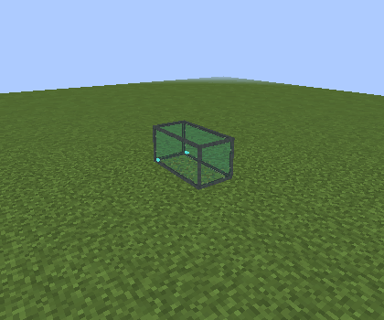 | 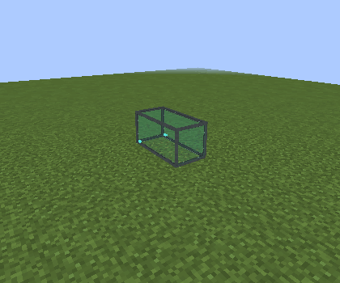 |
| Double / Angled |  | 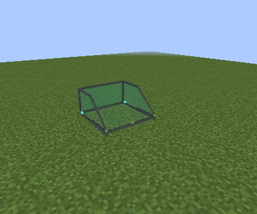 |
| Triple / Long Angled |  | 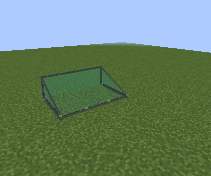 |

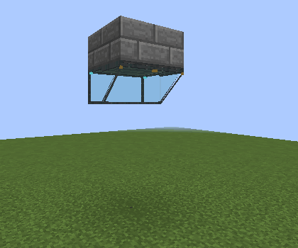

Opening shells intentionally pass through bodywork. Opening does not reserve the destination cells. Collision and exact face picking follow the moving surfaces; the selection outline encloses the complete posed shell. Keep a footwell below an upright canopy for a standing player: it has no bottom panel. Canopy Glass and opening Canopies can share the backrest space of a Pilot Seat directly below them, in either placement order.

## Front Canopy Glass and Large Front Canopy Glass

Both frame sizes provide **Depth: 0–80 pixels**, **Inner size: 10–100%**, glass/material selection and optional opening. Sixteen pixels equals one block. The defaults are sixteen pixels deep and 71% inner size. Zero depth keeps a thin physical frame for usable collision and selection. Drag either slider continuously; the thumb follows the pointer while world previews update at most ten times per second. Releasing applies the final value immediately.

Changing depth moves the front while the broad rear stays fixed. Floor and ceiling mounts keep a fixed clearance of just over one pixel between the broad frame and its supporting surface, including at zero depth. Only cells touched by the closed surfaces are reserved; clear cabin cells can hold other blocks. Open the front canopy or enter the cabin to place blocks inside; closed glazing follows normal block placement and does not pass clicks through to the cabin. A blocked resize preserves the original geometry and all cabin blocks.

### Depth and nosecone comparisons

Each live view shows **Front Canopy Glass (3 × 3) on the left** and **Large Front Canopy Glass (5 × 5) on the right**, with the same camera and glass finish. Depth controls the projection; Inner size controls the front nosecone relative to the fixed outer frame.

| Depth | Small nosecone: Inner size 25% | Large nosecone: Inner size 90% |
| --- | --- | --- |
| Shallow: 8 px (half a block) | 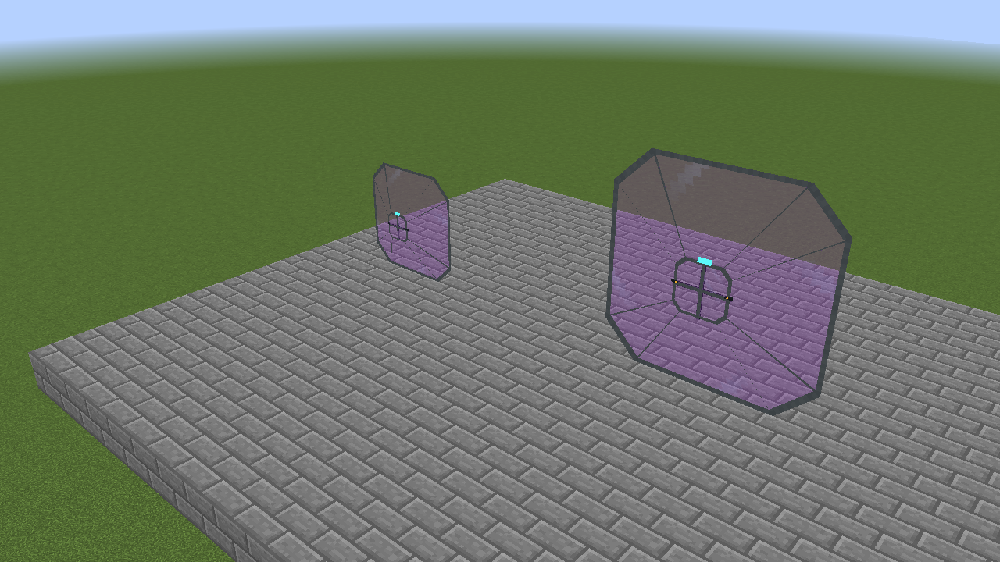 | 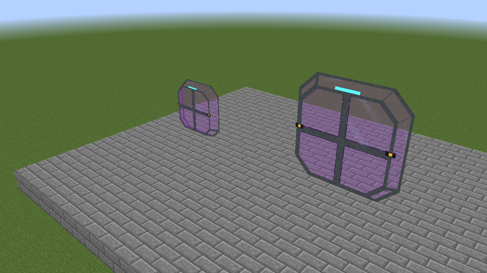 |
| Deep: 64 px (four blocks) | 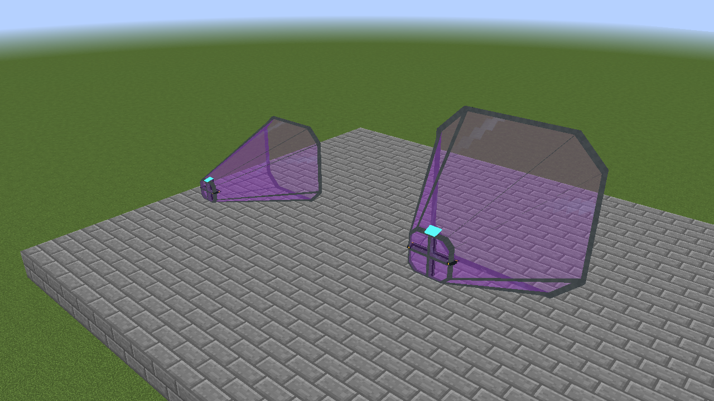 | 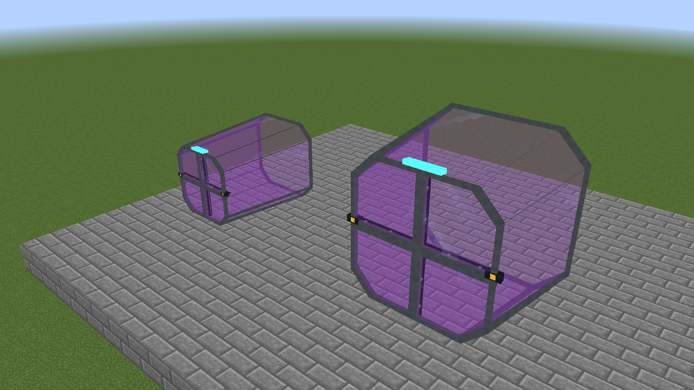 |

### Floor and ceiling mounting

The broad rear frame stays clear of its support at both shallow and deep settings. These live views show the 3 × 3 frame on the left and 5 × 5 frame on the right, with Inner size set to 45%. The ceiling fixture is lit to make its lower border visible.

| Mount | Shallow: 8 px | Deep: 64 px |
| --- | --- | --- |
| Floor, facing upward | 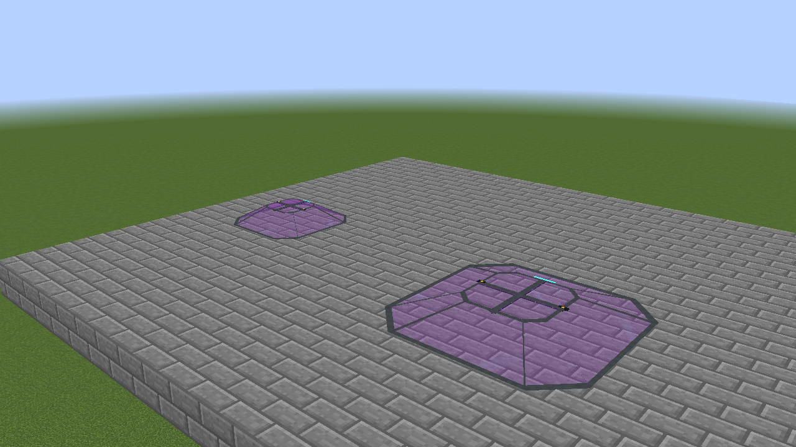 | 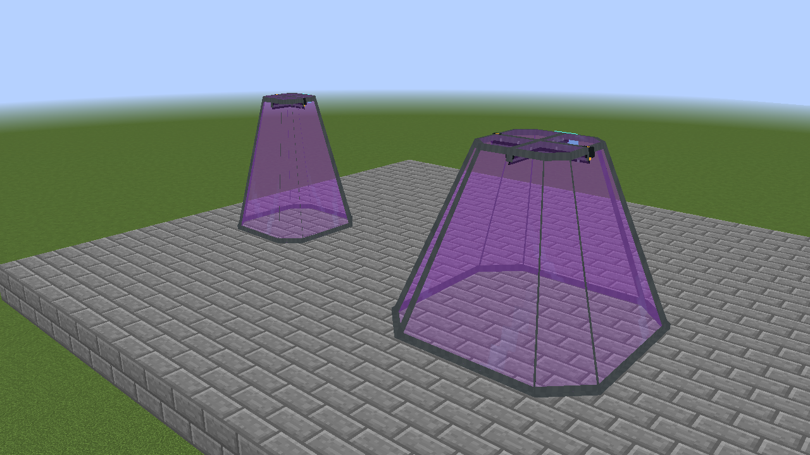 |
| Ceiling, facing downward | 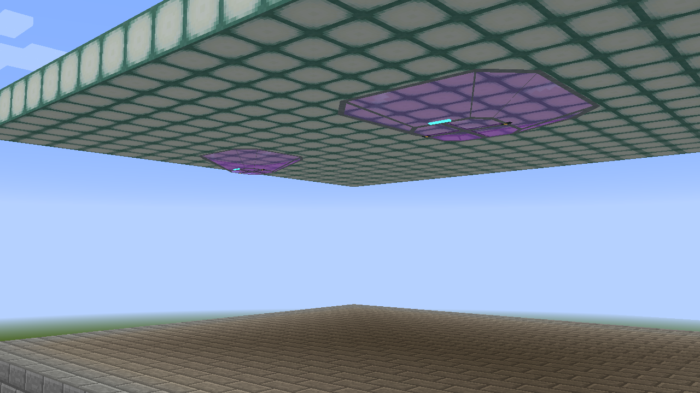 | 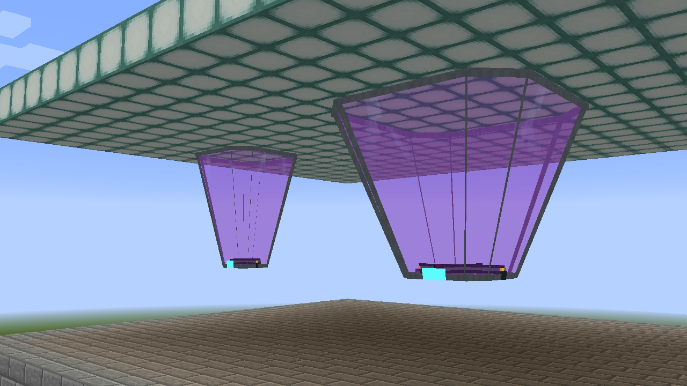 |

Enable **Openable** and choose a **Left**, **Right**, **Top** or **Bottom** hinge. These directions follow the frame's local orientation, including floor and ceiling mounts. The complete frame rotates through 105 degrees. Choose **Trigger: redstone ON** to open while powered, **Trigger: redstone OFF** to open while unpowered, or **Disabled** for manual control. Local physical power and any selected channel count as powered. The same trigger options apply to Canopy and Long Canopy; old configurations retain ON behavior. Trigger settings survive configured items, Duplifier copying, saving and captured vehicles. Close the canopy before changing its hinge or opening mode. Deep or moved surfaces remain operable and configurable even when their anchor lies farther away; interaction validates the reached surface and intervening terrain.

| Large top hinge | 5 × 5 left hinge |
| --- | --- |
| 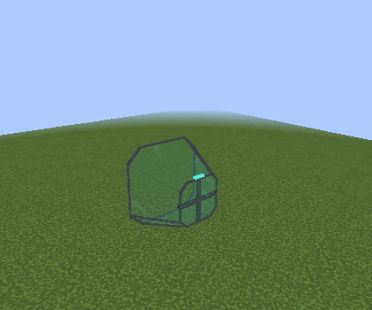 | 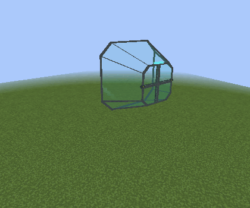 |

## Taxi Mode and ownership

Canopy and enabled large-window hinges remain manually openable aboard a Taxi Mode vehicle. Click the actual surface with an empty hand. Motion, collision, target, geometry, finish, mount and owned cells survive saving, parking and cardinal rotation. Captured canopies retain their selected ON/OFF polarity and subscribe to the parent world redstone channels. Physical block redstone simulation and settings menus resume after parking.

The final registry IDs are `canopy`, `front_canopy_glass` (3 × 3) and `large_front_canopy_glass` (5 × 5). Retired canopy blocks and their assets are removed; renamed IDs have no remapping aliases.

Owned-cell offsets are saved explicitly. Resizing replaces that footprint only after validation, and removing a canopy uses its recorded cells. Loaded follower cells whose owner no longer includes them clean themselves up without deleting foreign blocks. These safeguards also cover translated and rotated vehicle snapshots.

## Rendering and validation

Rendering, collision, picking and Taxi Mode use one posed mesh. Settled shells reuse prepared vertices and sprite lookups; animation rebuilds only the moving pose. Ordinary four-vertex faces submit a quad directly instead of two triangle-shaped quads, halving vertex submission for those faces. Transparent glazing remains sorted separately from opaque frames. Large-window collision uses glazing triangles and thin rails along their edges, avoiding thousands of boxes for decorative frame bevels during rotation. Detailed face picking still follows the complete mesh. Captured selection tests each canopy owner once per ray instead of repeating the same mesh for every owned cell. These are CPU and submission reductions; they are not a measured frame-rate guarantee.

Dynmap uses the mounted closed overview geometry. Item models fit after GUI rotation so every configured variant retains inventory padding.

Run the standard Java 8 build, then the live suites:

```text
python testclient/run_windows.py --focus canopies
python testclient/run_windows.py --focus large-canopy
python testclient/run_windows.py --focus vehicle-taxi
python testclient/run_windows.py --focus canopy-animations
```

The canopy release checks exercise six-face large-window placement, mounted hinges, closed-glazing placement protection and floor/ceiling frame clearance, exact ownership, removal, ceiling joins, all front/opening combinations, channel operation, finish copying, floor-button dust output and armrest masking. Animation capture records the actual client renderer; encode and validate it with `testclient/encode_animations.py`.
