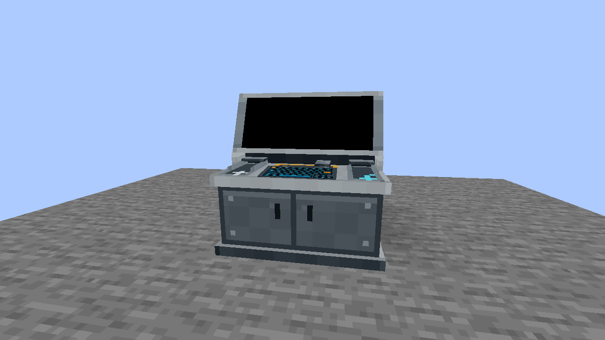
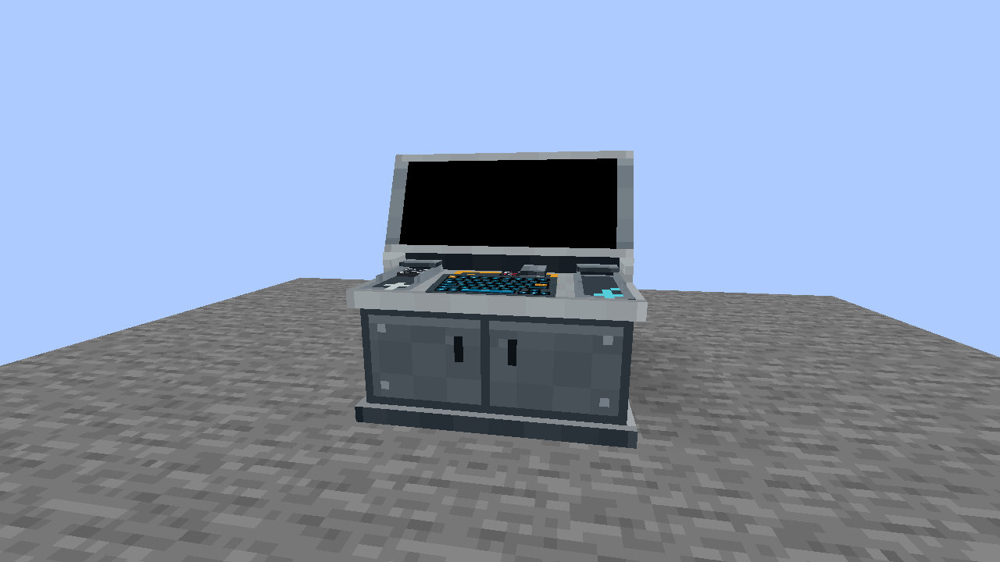

# Card / Chip Programmer in NeoForge

The experimental NeoForge 1.21.1 build supports company Access Cards, Master Data Chips, Journal Chips and Copy. Vehicle Chip operations remain deferred. The original registry identity is `vandorlabs:data_chip_programmer`.

## Build the console

1. Clear a space two blocks wide, two blocks high and one block deep. Select **Card / Chip Programmer** in the Vandor Labs creative catalog and place one item. It faces the player and creates all four linked cells. The original Programmer has no dedicated crafting recipe.

   

2. Insert a company Access Card or Master Data Chip into **Master**. Right-click its physical pad with the held item, or open the console body and use the labeled dialog slot. Each slot retains one item. A Journal can also be written without a company Master.

   

3. Insert the card or chip to write into **Input** and keep **Output** empty. The retained models show which physical items are installed. Use an empty hand on an occupied pad to return its item.

   

## Program or copy

Right-click the console body to open its dedicated dialog. Use the main-hand Configurizer on the console body to open the same dialog, including while sneaking.

For an Access Card, choose the company through the inserted Master and click **Program**. For a Data Chip, choose **Master** or **Journal** with Type. Right-click Type to select the previous value. Journal editing supports a forty-character title and eight entries of up to 512 characters each, keyboard editing, wheel scrolling and a draggable scrollbar. Draft edits save after a short pause and when closing the dialog.

**Program** consumes the Input item and places one written result into Output. Master stays inserted. **Copy** instead reads the committed Input item and overwrites an occupied Output item of the same base kind. Input, Master and the pending draft stay unchanged. Move the result out before programming another item. Imported items with unsupported owned contents refuse Copy intact.

The large screen shows the Input Journal draft, or the committed Output Journal when no Input draft is selected. Previous and Next on that screen only change the displayed view. Long entries continue across views without changing the saved text.

## Dismantle and recover

Breaking any occupied cell removes the complete console. Its three physical items are released separately and exactly once; ordinary picked or dropped Programmer items contain no copy of that inventory. The original member-break and tool behavior is retained.

Unsupported saved ownership remains inert and retains its original data. Dismantling such a console produces a recovery item that refuses ordinary placement. Keep that item for recovery rather than replacing or discarding its data.

See [Access Card and Data Chip Mounts](data-mounts.md) for readers, and the [Forge Programmer guide](card-chip-programmer.md) for the Forge 1.12.2 feature set.
