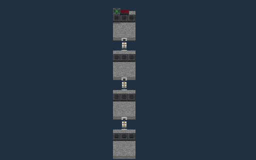
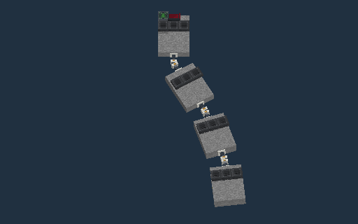

# Vehicle Couplers

Vehicle Couplers join sections through opposing coupling heads. The full block retains its original `square_coupler` identifier and saved settings. It supports all six mounting directions. Each half has its own channel list and **Lock when: On / Off** setting; physical redstone and the configured channel bank control the connection. Couplers consume signals and emit no redstone or channel power.

Ordinary right-click toggles coupling without opening a dialog. Sneak-right-click or use the Configurizer to open the authorized Vehicle Coupler dialog, then use **Done** to close it. Right-click the behavior option to select its previous value. A manual choice persists until the redstone input changes or the settings are changed. The status line explains pending connection work or an unsuccessful operation.

**Vehicle Coupler Slab** uses the same settings in half the height. Click a wall below its midpoint for the bottom half or above the midpoint for the top half. Clicking a floor places the bottom half; clicking a ceiling places the top half. Floor and ceiling placement keep the head horizontal, oriented from the player's facing. Its native panels retain the original artwork proportions by cropping vertical UV regions instead of stretching the textures. Collision, selection and the two connection endpoints follow the same flattened geometry.

Craft a Vehicle Coupler from a Programmable Block, two iron ingots and two redstone dust. One full coupler converts to two slab couplers; two slab couplers recombine into one full coupler. Placed couplers retain their channels and activation behavior through saving and vehicle transport.

## Joining a section in Vehicle Mode

An existing Taxi or Hover vehicle can pick up a section that is still made of world blocks. Put a coupler on each side of the connection, facing the heads toward one another, and activate both halves. Slab heads must use matching heights. Stop the vehicle and line it up precisely with the block grid. The controller scans the opposing section automatically; its blocks and inventories become part of the same vehicle entity.

The player who assembled the vehicle or authorized its carried Coupler dialog, or the current driver, must be online, alive and in the same dimension, with permission to modify the complete section. Older saved vehicles need a driver or one authorized visit to the carried Coupler dialog before automatic transfers are enabled. Copied block settings do not copy another player's building authority. The entire section and its boundaries must be loaded. Leave its seats empty and move other entities clear. The piloted physical segment keeps one Vehicle Controller; controllers in other coupled segments remain saved blocks and do not control the vehicle. A joined vehicle keeps at most one Autopilot and the configured vehicle block, size and saved-data limits. Unsupported blocks and incomplete assemblies are refused under the same [Vehicle Mode compatibility policy](vehicle-compatibility.md). This operation picks up world blocks; it does not merge two existing vehicle entities.

## Hover lift per section

Each section connected through enabled couplers needs at least three
Antigravity Plates, Repulsor Arrays or Vertical Hover Thrusters before the
vehicle can enter Hover. Lift in one section cannot support another section.
This also applies to rigid connections and sections joined by parallel coupler
pairs. Taxi keeps its existing support requirements and does not require lift
blocks in every section. An ordinary block bridge makes the adjoining sections
one rigid body.

## Articulated trailers

1. Build each section separately. Put one pair of opposing, enabled coupling heads between the sections; leave room around the hitch for the sections to turn.
2. Open either head's dialog with sneak-right-click or the Configurizer and select **Articulation: Yes**. Either head enables the hinge. The default **No** retains rigid vehicle behavior.
3. Join the sections as described above. Additional trailers can have their own single-pair hitches. Each joint follows independently in Taxi and Hover, including vertical changes in terrain or altitude.
4. Drive forward to straighten the train before parking, attaching or restoring a cargo section as blocks. These operations materialize blocks on the world grid and require aligned joints. Separating two complete vehicles keeps their current positions and headings instead. Parking accepts up to five degrees of yaw and three degrees of pitch per joint, with no more than 0.75 block of accumulated displacement and 7.5 degrees of accumulated rotation. Final snapped destinations must still be clear and editable. Carried Ramp Controllers also wait for alignment before rebuilding their endpoints.

A joint cannot exceed a combined angle of 75 degrees. Terrain and the actual collision shapes of the other sections can stop it sooner. Wide hulls need more clearance than narrow drawbars. Two or more coupling pairs between the same sections keep that connection rigid even when Articulation is enabled. A solid block path or a closed loop also prevents the affected joint from bending.

Connected trailers share one vehicle owner and inventory ownership. Releasing a connection can create two vehicle entities when both halves are complete vehicles. Saved vehicles retain each joint's pose. Clicking a carried control, boarding a seat and opening a container use its section's current position. Trailer wheels follow their own section rather than steering with the tractor.

## Releasing a section

Right-click either carried coupling head, without sneaking or holding the Configurizer, to request separation in Taxi or Hover. Clicking records the current authorized player; there is no need to open the dialog first. The manual choice lasts until the physical/channel input changes. Releasing either half's activation input also requests separation.

1. Stop the vehicle and leave the detached section's seats empty.
2. Give each half its own Vehicle Controller, Pilot Seat and required supports. In Hover, each half also needs propulsion and three lift blocks in every connected section. Taxi halves need wheels or skis.
3. Level the segment containing the detached half's driver controls. Its root must be horizontal; any remaining joints must be representable without changing the saved geometry.
4. Click the carried coupler. Both halves retain their current position, heading, mode, block settings and inventories as separate vehicles. This operation does not place blocks on the terrain and does not require a cardinal heading. The current driver stays with the retained Pilot Seat.

A cargo section without its own controller and seat retains the world-block release behavior: straighten the joints, stop near a cardinal heading and leave its snapped parking destination clear. The retained vehicle keeps its actual position and heading. Terrain, players, other mechanisms and the retained hull must leave enough room for the complete parked geometry. A section with a controller and seat that fails independent vehicle validation stays attached instead of being converted silently.

If another block path or active coupler still connects the section to the controller, releasing one head leaves that section on the vehicle. Unavailable chunks, invalid equipment, occupied detached seats or denied permissions also leave the complete original vehicle intact. The Coupler dialog reports the reason. Terrain visible through empty space inside a bent vehicle's bounds remains selectable and editable.

Hover sections follow vertical movement with a short delay and settle horizontal after the height stops changing, including near the ground. Where leveling would dip a section into the ground, a clear upward translation can lift the existing pose first. Actual terrain and self-collision checks still apply to every accepted step. Once stopped and level near the ground, Hover can select Park directly with fully extended gear; a Taxi transition is not required. This avoids re-tilting mixed wheel/track sections before the ordinary parking preflight.

Separation writes and syncs an ownership journal before changing either entity. Both outputs remain inert until their affected chunks have been checkpointed. Interrupted work recovers the original vehicle or the committed pair without duplicating blocks or inventories. World-block release retains its exact-destination checks and durable recovery.

The startup setting `vehicles.maxArticulationPoints` in `config/vandorlabs-blocks.cfg` limits independent hinge points in new assemblies and attachments. Its default of `7` permits eight independently articulated segments; `0` permits rigid assemblies only. The accepted range is 0–16384, with the existing block, axis, data, collision and per-step work limits still applying. Restart Minecraft or the server after editing it. Parallel pairs, rigid links and bridged sections do not add independent segments. Lowering the limit does not prevent longer saved vehicles from loading, being recovered or parking. Four- and eight-segment driving regressions cover acceleration from a slight initial bend, terrain collision and saved poses.
