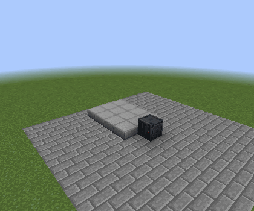
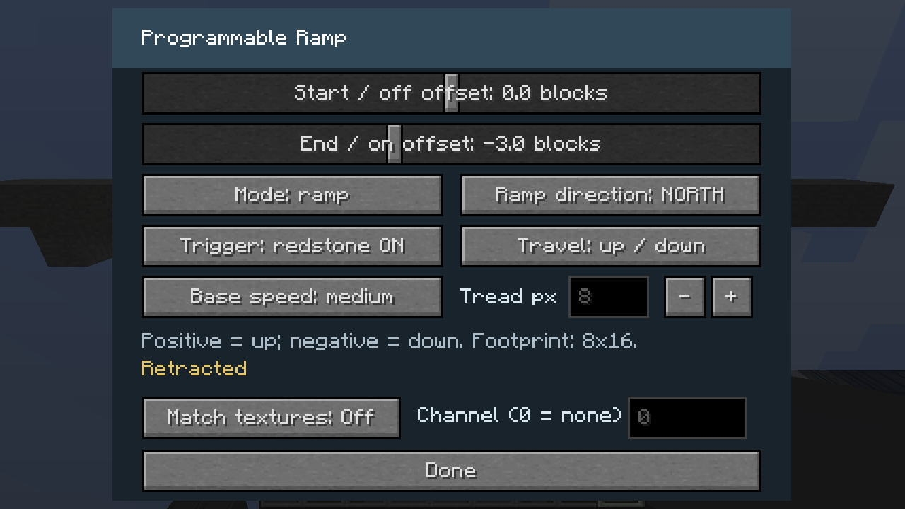
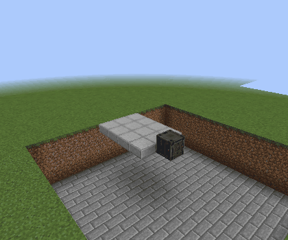
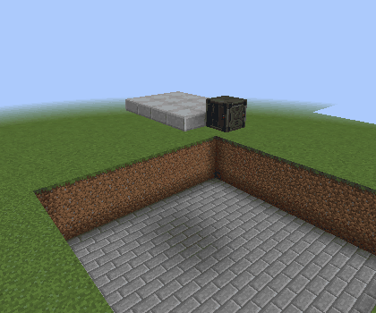
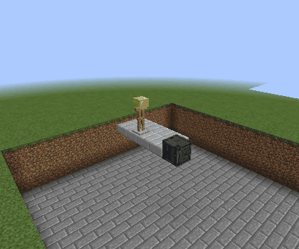

# Programmable Ramp

Version 1.1 seals transparent controller texture edges. See the
[controller close-up](version-1.1.md#placement-and-compatibility-fixes).

The Programmable Ramp controls a platform of matching slabs or solid blocks. It can form a slope, fill the space beneath that slope, lift the whole platform, or extend it into a solid run. The clips show each mode deploying and returning to its off position.

| Mode | Deploying and retracting |
| --- | --- |
| Ramp |  |
| Filled ramp |  |
| Lift |  |
| Extend |  |

**Ramp** moves successive treads by different amounts. **Filled ramp** follows the same slope and fills from each tread's starting point. **Lift** moves the whole platform together. **Extend** moves the leading surface and fills the space behind it. Ramp and lift carry standing entities; filled ramp and extend are intended as changing structure.

Settled ramps reuse their geometry and collision boxes between frames and collision queries. Pose, shape settings, source-origin or facing changes invalidate that cache, including direct edits and restored saves. Moving ramps and running escalators still update their surfaces normally. This reduces repeated CPU work on large extended structures.

## Craft and place

Place a piston in the center of a crafting grid and surround it with eight Programmable Matter Ingots. Place the controller beside a flat platform and point its top arrow toward the first slab or block. It selects face-connected blocks of the same type and complete block state on that level. Diagonal contact does not count; gaps remain gaps. Different slab halves and material variants stay separate.

Immersive Engineering regular and scaffold slabs are supported. Their material and half settings survive movement.

The platform can be up to **8 blocks wide and 16 blocks long**. Its length follows the Ramp direction setting, independent of the controller arrow. The controller protects moving cells and restores the source blocks when it retracts or is removed.

## Configure motion

Creative shift-right-click the controller to open its settings, or use the Configurizer. Valid changes apply immediately.

1. Choose **Ramp**, **Filled Ramp**, **Lift**, or **Extend**.
2. Choose **Up/Down** or **Left/Right** travel. Left and right are relative to the selected ramp direction.
3. Set **Start / off offset** and **End / on offset** from `-16` to `+16` blocks in half-block steps. Positive vertical offsets rise; negative ones descend. Positive horizontal offsets move right. Opposite endpoints can create a 32-block stroke.
4. Choose whether redstone **On** or **Off** deploys the platform. Physical power and virtual redstone channels are supported.
5. Set **Match textures** (On by default). Turn it Off to include differently textured Programmable Blocks or Slabs; block type and slab half still must match. Individual finishes are preserved.
6. Choose **Fast**, **Medium**, or **Slow**. Ramp and Filled Ramp offer **1, 2, 4, 8, or 16 pixel** treads. Lift and Extend have no treads.

The off endpoint can be displaced too: Start `2`, End `-3` moves from two blocks above the original platform to three below it. Equal endpoints are valid. An edit first resets the previous platform, then evaluates the current signal with the new settings.

## Direction and tread size

Ramp direction can be north, east, south, or west. Small treads make a smoother slope; large treads form visible steps.

| Direction | Smooth, 2 px | Stairs, 8 px |
| --- | --- | --- |
| Up |  |  |
| Down |  |  |

## Escalators

**Escalator Up** and **Escalator Down** keep the ramp extended. Redstone starts
and stops the moving steps; it never retracts the staircase in these modes.
Each recording starts with stopped stairs, turns redstone on, then turns it off
again with the staircase still in place.

| Uphill | Downhill |
| --- | --- |
|  |  |

For the examples, build a matching slab platform **2 blocks wide × 4 long**.
Select **8 px** treads, **Ramp height: 3**, **Medium** speed and **Trigger:
redstone ON**, then choose the uphill or downhill mode. Place a lever beside the
controller or use a virtual channel to switch movement. Stand on the steps to
ride; you can walk or jump off. Choose trigger OFF for stairs that run while
unpowered. Negative heights are supported; Up always means uphill.

Escalators need a rectangular platform and at least two treads.
Choose **Linear**, **Curve In**, or **Curve Out** interpolation for the height profile.
Set **Ramp height: 0** for a horizontal moving walkway: Escalator Up moves forward and Escalator Down moves backward relative to Ramp direction. Mode names stay the same at every height. The selected source texture scrolls across the top without additional stripe markings.

| Horizontal walkway | Curve In escalator |
| --- | --- |
|  |  |

For a walkway, use a 2×4 slab platform, height 0, 8 px treads and Medium speed. For a curved escalator, use height 3 and select Curve In or Curve Out.

With no player within 32 blocks they stay
asleep; running stairs stop once all players are beyond 40 blocks. Nearby players
wake them within one second if redstone permits movement. Sleeping stairs stay
walkable and perform no recurring controller block updates or rider scans.

See the [escalator reference](../landing-ramps.md#escalators) for speeds,
clearance, obstruction handling and save/load behavior.

## Troubleshooting

The source and travel space must be clear, loaded, and within world height. Clearance accounts for slab thickness: top slabs can move down `2.5` blocks to meet the ground without overlapping it; bottom slabs can likewise meet a ceiling after moving up `2.5` blocks. Chests, machines, unbreakable blocks, and non-cuboid shapes cannot be selected. An obstruction stops motion without replacing the obstructing block. Remove it, then change a setting or toggle the signal to retry. The dialog retains validation errors. Breaking the controller restores its saved source blocks.

For exact selection, timing, rider, and persistence rules, see the [Programmable Ramp reference](../landing-ramps.md).
