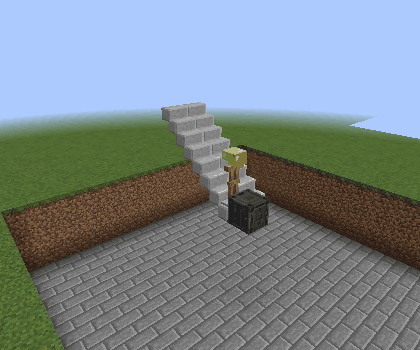
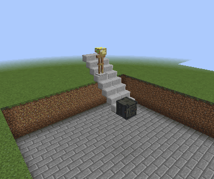
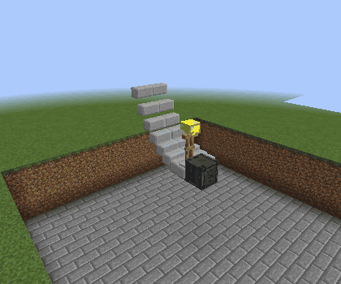

# Vandor Labs 2.0: build it, board it, drive it

Your cockpit can now be part of a working ground craft. Version 2.0 brings Taxi Mode, a configurable Pilot Seat, moving cockpit shells, broad adjustable windows and escalators, alongside more flexible glass and cleaner panel connections.

## Turn a build into a vehicle

Place a **Pilot Seat** in a connected craft with landing gear. Sit down and Taxi Mode assembles it; use **W/S** to drive and **A/D** to steer. Leave the seat to park it back as ordinary blocks. Disable Taxi Mode for manual Configurizer conversion, with an assembly/parking preview before confirming.

The craft keeps its block types, inventories and saved settings. Open doors, normal and diagonal trapdoors, and cockpit Canopies while aboard. Propulsion brightness follows movement, third-person camera distance is adjustable, and supported craft can park at cardinal headings. A blocked parking area keeps the vehicle intact so you can clear the space or reboard.

Bring your controls aboard too: Redstone Screen buttons and level sliders operate while driving. Channel-controlled doors, Canopies, lights and landing gear keep communicating with placed controls in the same dimension. Parking extends the landing gear first and checks the space needed by its wheels and pistons.

The Pilot Seat offers four cushion heights, channel activation with Redstone ON/OFF polarity, and settings in the Configurizer preview. Armrests disappear independently beside solid cabin walls. Safe exits check supporting surfaces and standing room.

See [Pilot Seat and Taxi Mode](../pilot-seat-taxi.md) and the [ground vehicle guide](../ground-vehicles-analysis.md) for building limits, supported components and parking behavior. Ground-craft turning and presentation remain areas for continued refinement; captured machines do not simulate while driving.

## A cockpit that opens your way

**Canopy** combines sliding and rear-hinged opening in one configurable block. Choose a vertical **Flat**, short **Angled** or **Long Angled** front, then place matching neighbors for a single, double or triple shell. Ceiling mounts invert the complete mechanism. Sliding can move forward or backward, lifting the shell one pixel to clear surrounding bodywork; physical redstone and channel lists can operate either motion.

Animation reuses prepared shell surfaces and tiled artwork, reducing repeated geometry work while opening or closing, including the broad hinged front windows. Canopy and Canopy Glass also fit over an existing Pilot Seat, so cockpit construction works in either order.

| Single / Flat | Double / Angled | Triple / Long Angled |
| --- | --- | --- |
|  |  |  |
|  |  |  |

**Front Canopy Glass** has a 3 × 3 outer frame; **Large Front Canopy Glass** expands it to 5 × 5. Keep the broad back exactly where you click, adjust the nose from flat to five blocks deep, and choose an inner frame from 10–100% size. Mount it against a wall, floor or ceiling. Enable opening and select a left, right, top or bottom hinge, with optional redstone/channel control.

See the [live shallow/deep and small/large nosecone comparisons](../canopies.md#depth-and-nosecone-comparisons) for both frame sizes.

Only the shell reserves space. Build in the empty cabin by aiming through the outside glazing with a block in hand. The live dialog puts every setting beside a large texture list, with glass shades and ordinary materials in one picker. Exact saved ownership and stale-follower cleanup keep removal and resizing from leaving invisible reservations behind.

Regular Canopy Glass connects to the rear of opening Canopies. Both angled fixed noses mount against walls and upside down beneath ceilings. Visors retain their thin framed outlines and centered placement. See the [complete canopy guide](../canopies.md).

## Glass or hull: the same shapes, more finishes

Canopies and visors offer clear glass, soft Vandor shades, all sixteen Minecraft colors and three tint strengths. Their shared texture picker also accepts normal Programmable Block textures, including trapdoor artwork, so the same geometry can become an opaque hull shell. Choose **Fit** for complete panel artwork or **Tile** for repeats at block scale.

Non-glass canopy materials also respond to Tint: Mild and Normal give 35% and 65% opacity, while Strong creates opaque panels. This includes opening Canopy and both front-window sizes; metal frames stay opaque throughout.

The **Duplifier** transfers glass shade and intensity between canopy pieces, visors, regular programmable glass and diagonal glass walls. Programmable Diagonal Glass adds half-width/full-height, full-width/full-height and full-width/half-height shapes, with optional frames and the same color system. Regular and diagonal wall/glass junctions have reciprocal seams and improved corner and intersection geometry.

**Programmable Glass** and **Programmable Diagonal Glass** also accept the regular material catalog from the same texture list. Turn panel artwork into a translucent screen with Mild or Normal Tint, or select Strong for opaque surfaces. Material choices follow configured items and Duplifier copies across glass and canopy families.

Join non-glass panels to stretch a single image across a larger surface, or tile artwork at block scale. **Programmable Porthole** and **Diagonal Porthole** add a separate **Glass** tab beside Main and Side, with all glass colors, regular textures, tint strength and the same Tile/Stretch choice for joined window artwork. Full-depth portholes share these controls.

## Moving stairs and better everyday building

Programmable Ramp gains **Escalator Up** and **Escalator Down** modes. The extended treads carry riders, respond to redstone and sleep when nobody is nearby. Curved profiles and moving walkways use the same controller settings. Capturing an extended ramp preserves its actual segments and source materials; escalators pause while driving and resume after parking.

Stationary ramps reuse their prepared geometry and collision boxes, reducing repeated work while large extended structures are visible.

| Uphill | Downhill | Curved steps |
| --- | --- | --- |
|  |  |  |

Floor-mounted Push Buttons now update adjacent redstone dust immediately. Sliding trapdoors remain selectable after leaving their original block cell. Canopy rendering reuses settled poses and submits four-vertex faces directly, reducing vertex work for detailed shells. Vehicle rendering caches hull meshes and limits offscreen tile work.

Block-category settings let a pack choose the available building families while preserving existing placed blocks. See [category settings](../block-categories.md), [ramp examples](ramp-controller.md) and the [changelog](../../CHANGELOG.md).
