# Vandor Labs 2.3: working cockpits, access control and smoother movement

Build a cockpit with animated machinery and independent displays, secure a door with company cards, and link redstone across a vehicle or base. Version 2.3 also brings configurable turntable surfaces, two-sided fluid panels, more materials and improvements to capture, restoration and moving-model rendering.

## A cockpit you can operate

The **Cockpit** combines a red Pilot Chair, a three-screen console, four touch areas and two physical thrust levers. The center screen starts in **Vehicle Status**; the side screens start with **Bridge Bare Pilot** and **Bridge Bare Engineering**. Each display has its own texture, animation and channel settings.

The left input deck uses **Console Controls Navigation Controls**, the right uses **Console Controls Sensor Controls**, and the center deck uses **Bare Personal Terminal**. All three decks share the same angle and 2:1 proportions. These surfaces remain configurable. Screen animation speeds match Programmable Screen defaults, and selecting Redstone opens its row editor. The extended bank is two pixels lower. Side screens have a shallower tilt and larger usable faces, and the keyboards are separated to leave room for their surrounds.

Press the small button between the right input deck and armrest to lower the whole screen bank into its housing. Press again to raise it.

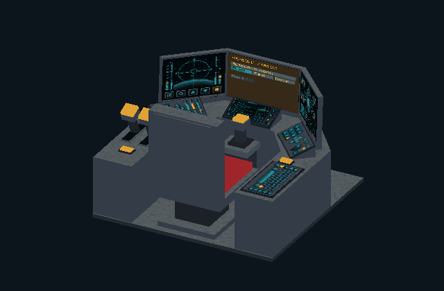

The button behind the two left-armrest levers slides the seat and both armrests one block backwards, opening room to get out. The return press slides it forwards. Movement checks the rear space first, preserves the seated player's position relative to the cushion, and works on an assembled vehicle as well as a parked build.

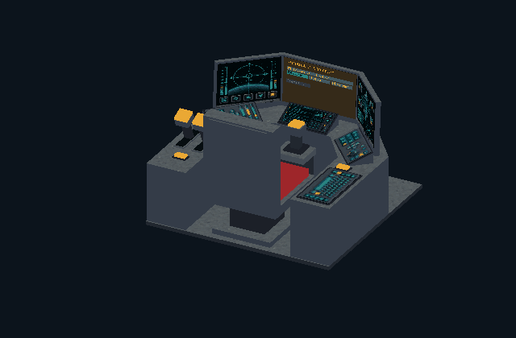

**Advanced Pilot Chair** offers the same configurable casing and an armrest touch surface in a smaller assembly. Height adjusts in 2px steps: **+0, +2, +4 and +6px**. The new default is 6px below the former height; +6 restores the former position. The chair, side rests, touch controls and seated player move together.

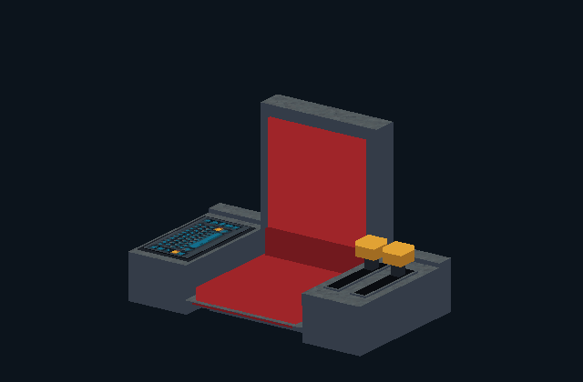

**Yoke and Screen** provides a standalone input deck and display, with Vehicle Status as its initial screen mode. It has a configurable casing and does not add a passenger seat.

All option buttons use left-click for the next value and right-click for the previous one. Texture lists support both wheel scrolling and dragging their scrollbar. See [cockpits and peripheral controls](../cockpits.md).

## Cards and chips that do something

**Data Card Mount** and **Data Chip Mount** accept a real item through their open top. Cards are rectangular, chips square, and both have thin solid edges and clipped corners. The seven designs cover the unbranded family plus Pinnacle, Ashiro, Paladyne, Vektor, Seyr and Vandor.

Select company icons to restrict access. The plain icon means **Any Card** or **Any Chip**. With Any selected, the empty mount keeps an unbranded background. Company-only mounts cycle through accepted logos every three seconds while a player is nearby. Rejected items remain in the player's hand and briefly flash an amber X on the reader.

| Keep the item inserted | Scan, pulse and return the item |
| --- | --- |
| 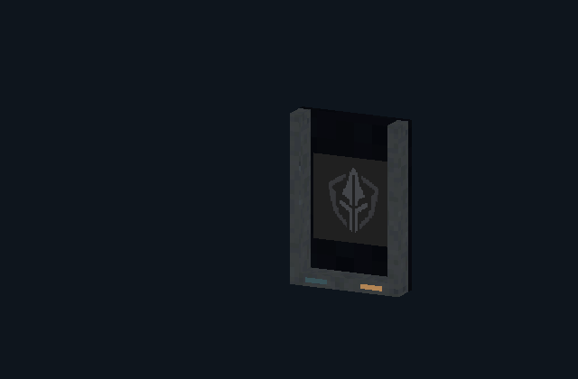 | 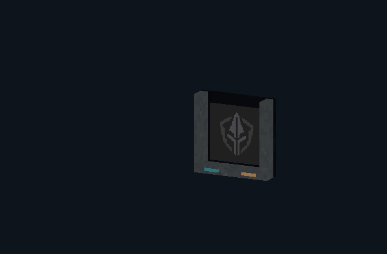 |

Choose the behavior that fits the circuit:

| Behavior | Result |
| --- | --- |
| Stay Inserted | Output remains active while an allowed item is inserted. |
| Stay Inserted: Pulse | Insertion starts a pulse and retains the item. |
| Return After Open: Toggle | Scan toggles the saved output and returns the item. |
| Return After Open: Pulse | Scan emits a pulse and returns the item. |

The filters consume nothing. Insertion borrows one real item, including in Creative; a pending return stays safe if the player's inventory is full or they disconnect. See [Data Card and Data Chip Mounts](../data-mounts.md).

## Programmable Doors with access control

The door's **Security** controls replace its ordinary panel with a card reader and use the same a company-card sample filter and four behaviors. Use a valid card anywhere on the door leaf to insert it in the panel on that side. Centered doors can have panels on **Both** sides, with a separate physical card on each side.

| Stay Inserted | Return After Open: Pulse |
| --- | --- |
| 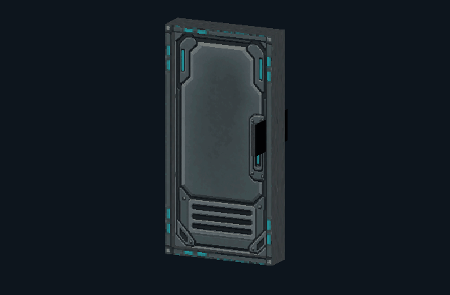 | 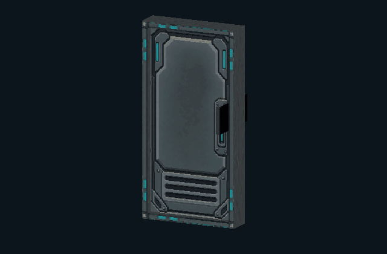 |

Toggle opens until the next accepted scan. Pulse provides a five-second opening window; returning the card after one second does not end that window. Security takes precedence over ordinary manual and redstone opening. See [Programmable Doors](../space-doors.md#card-security).

## Redstone between blocks, without a wire run

**Redstone Transmitter** reads one physical port and transmits on one or more selected channels. **Redstone Receiver** listens to its selected channels and powers only its output port. Both support six placement directions and Analog/Digital modes; the receiver also has separate On and Off output-level sliders. Side arrows lead towards the port, and the opposite face identifies the block type. See [Redstone ports](../redstone-ports.md).

## Turntables, vehicles and landing gear

Turntable surfaces can use the general material catalog as well as their own designs, with independent On and Off selections. Non-stateful artwork works in either slot. The **Turntable** material category makes both states available to other programmable blocks too.

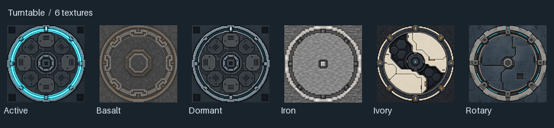

Capture and restoration share a transfer coordinator with vehicles. Journal work runs in the background, while lighting, neighbor updates, incoming snapshots and mesh preparation use bounded work budgets. Inventory changes made while a transfer prepares are revalidated. Durability checks inspect affected chunk markers before completing the transfer.

Rigid turntable artwork is cached, translucent tiles are sorted selectively, and modular landing gear shares batched rendering and collision caches. Cockpit motion uses a single rigid screen bank and a separate seat/armrest transform; display corners and overlay matrices are cached. Card readers batch their indicators and rejection overlay and reuse inserted-item matrices. These changes reduce render work and allocation without reducing animation frame rate.

Supported **Programmable Chair** passengers keep their seats, style and height through vehicle assembly, travel and parking. The two decorative chair blocks remain outside this passenger support. 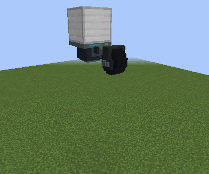

See [turntables](../turntables.md), [modular landing gear](../modular-landing-gear.md) and [vehicle compatibility](../vehicle-compatibility.md).

## More surfaces, including fluid behind glass

Programmable walls, portholes and glass panels, including diagonal variants, store fluid independently on each side. Use a supported fluid bucket on a side to fill it; an empty bucket clears that side. Opposite sides can hold different fluids. Fluid surfaces follow the panel geometry, fill glass recesses and avoid internal seams between matching neighbors.

Programmable Doors, Trapdoors and Diagonal Trapdoors also support two fluid sides. Water fills the passage while the leaf is open; closing restores the original sides and clears temporary water from a previously dry side.

The shared fluid renderer uses fewer draw calls and allocations; see the [rendering measurements and regression coverage](../performance/waterlogged-2.3.md).

Underwater fog and eye immersion follow the occupied fluid compartment, including the center of an open door. Looking out through a dry compartment restores the normal air view.

A door stores water independently in each of its two blocks. In this one-block-deep pool, only the lower half is waterlogged; the upper half stays dry. Water effects stop when the player's eyes rise into that dry upper half.

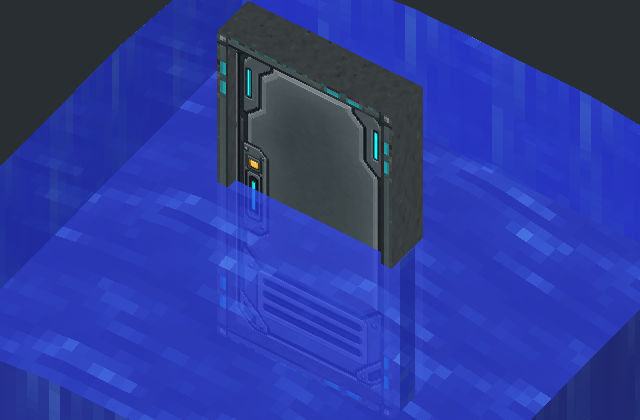

A half-width, full-height diagonal glass wall can hold water on one side while leaving the other side dry. The water follows the slope and the frame remains visible around the pane.

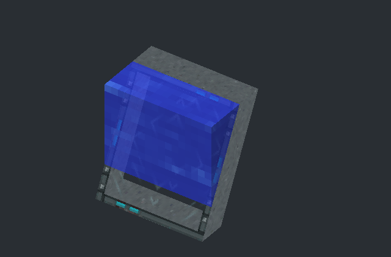

The material catalog adds four Security Glass designs, three Ancient Relief textures under Tech, and ceiling-tile finishes with plain and speaker panels plus paired light artwork. Directional lights place their illuminated face away from the supporting face, including floor and ceiling placements.

Browse the whole catalog through the [interactive texture browser and category collages](../texture-browser.md). It uses the same categories and selectable artwork as the mod.

The Advanced Pilot Chair armrest sliders remain independently selectable at every height and detent. Hold a regular or Long Canopy and use it on a Cockpit to share the raised upper part, preserving cockpit collision and controls; removing the canopy preserves the cockpit.

Programmable Stairs offer a 1, 2, 4 or 8 pixel step-size slider and Normal / Sideways orientation. Placement follows vanilla stairs, including on vertical faces. Select Sideways in the dialog to make a wing; its textures rotate with the geometry and exposed neighboring block faces remain visible. Shape settings persist in the world, configured items and Duplifier copies. Sneak-use the Duplifier on a vanilla solid block to sample its material and metadata.

Programmable Diagonal Trapdoors also have a per-leaf **Rotation: Normal / Reverse** control. Fresh rotating leaves placed vertically against another trapdoor inherit its rotation direction. Configured items retain their saved direction.
