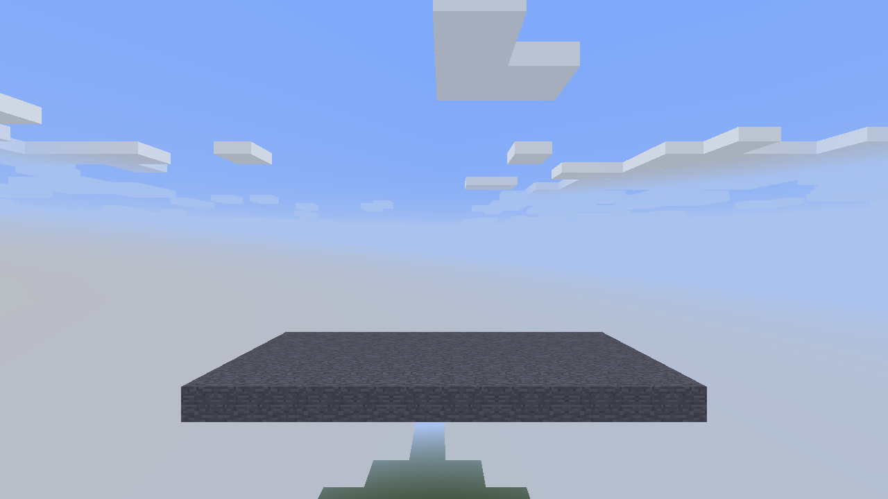
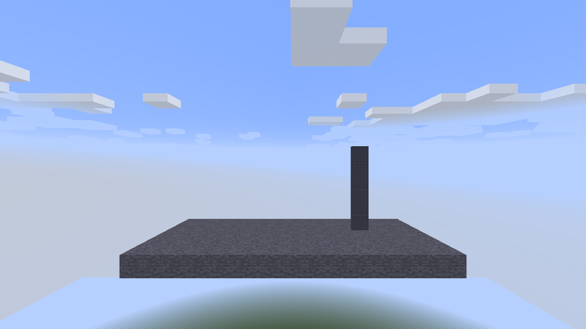
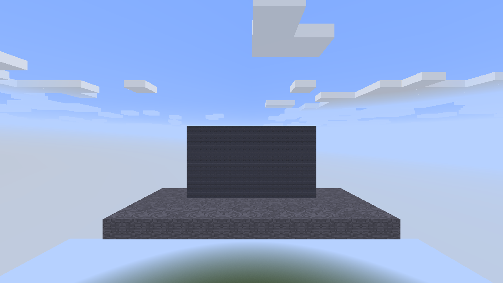
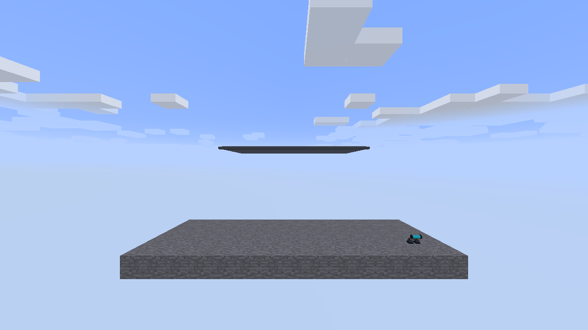
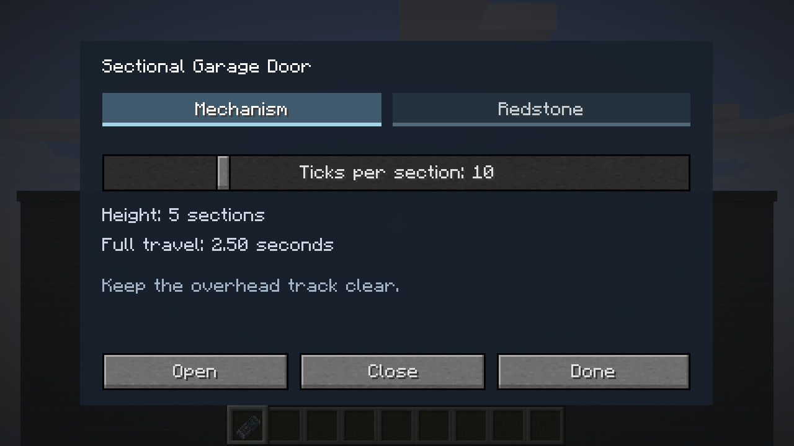
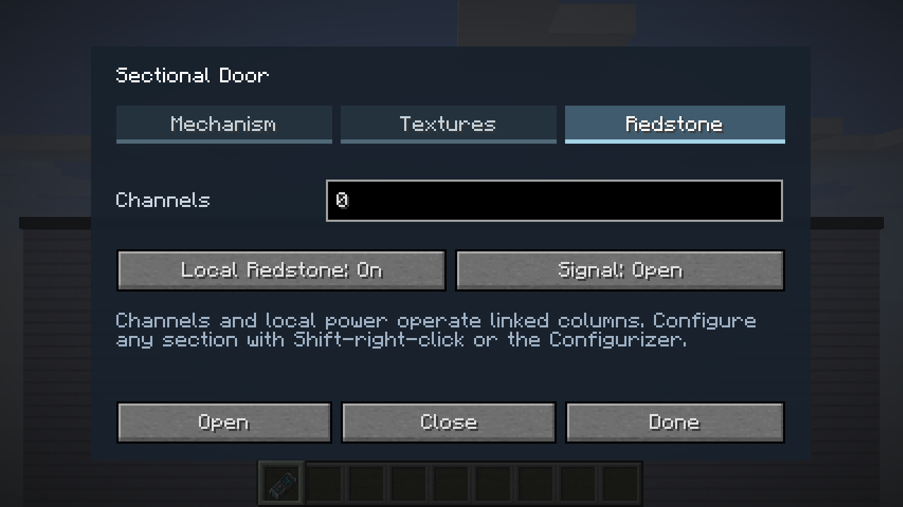

# Garage doors

Garage Door sections form a vertically lifting, overhead door. Equal-height neighbouring columns facing the same way operate together. Each column may contain 1–32 sections; a linked door may contain up to 32 columns.

## Construction

1. Build a level sill across the opening. Leave room above and behind the header for the raised panels. A five-section column extends approximately five blocks behind its closed plane when open.

   

2. Face the opening and place the first column from bottom to top. A section placed against a section above or below inherits its facing. The top section supplies its own narrow header.

   

3. Place adjacent columns to the same height and facing. The example is nine columns wide and five sections high. Columns of a different height remain separate.

   

4. Right-click a section to toggle the linked door. The panels rise, turn over the header and retract overhead. Once open, use the header to interact with the door.

   

5. Use the Configurizer, or sneak-right-click, to open the same dedicated configuration dialog. The Mechanism tab sets travel time per section and provides Open and Close buttons. Settings apply to the linked door. Right-click an option to cycle backwards.

   

6. In Redstone, enter the usual channel list and choose whether to accept local redstone. Select whether a powered signal opens or closes the door. Any enabled powered input on the linked door supplies its signal. With local redstone disabled and no channels assigned, use manual operation.

   

Craft eight sections from six iron ingots, two pistons and one redstone dust. Mining the top section promotes the remaining top section and preserves its column settings. Changing a door requires its complete linked structure to be loaded and editable.

## Rendering and saved state

Closed, settled panels render in Minecraft's chunk geometry. Moving panels share the atlas batch and reuse bounded geometry templates at a 120 Hz animation cadence. Raised panels use the same template cache. The cache retains vertex-format information and clears on atlas reload or a format change.

The client retains closed fallback panels until all affected chunk sections finish uploading their replacement mesh. Off-screen sections are queued asynchronously through Minecraft's chunk dispatcher, with duplicate sections combined and at most eight submissions per client tick. Opening begins after the closed terrain panels are removed; closing switches back to terrain only after the closed panels have uploaded. Cosmetic animation uses a pause-aware local clock. Repeated or older motion packets do not restart it.

The server owns collision and the saved motion timeline. Sections remain native world blocks throughout motion; opening never transfers blocks or inventories. Only the top tile of each column advances motion, and only those owners send motion updates. Channel and topology work runs after chunk loading, with bounded loaded-block searches.

## Panel artwork

Open **Textures** to select general materials, Trapdoors, Doors or Large Doors artwork. Selection applies to every section in the linked door. The original dark slatted panel remains the default; **Industrial → Sectional Panel** and **Sectional Panel Light Grey** expose its two finishes to other programmable blocks too. The original artwork is the standalone `garage/garage_panel.png` texture. Changing artwork preserves the door’s channels, motion and saved section ownership.
