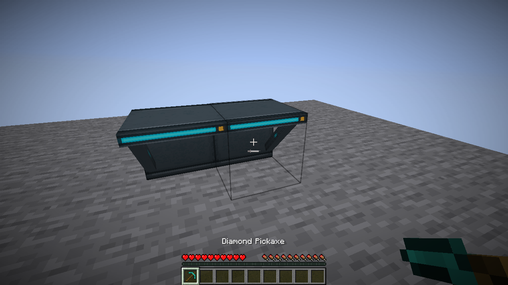

# Industrial Tables

Industrial Tables are available on Forge 1.12.2 and NeoForge 1.21.1. Each module is one block. Matching neighboring modules hide their shared end struts.

1. Craft a module from five Industrial Alloy Ingots arranged as `III / I I`.
2. Place it while facing the desired working direction. Place another module beside it with the same direction to extend the table. A differently facing or inverted neighbor keeps its end strut.
3. Click the underside of a block for an inverted table. Its tabletop supports blocks on the downward face. Ordinary tables support blocks on their upward tabletop.
4. Mine either module with a stone-tier or better pickaxe. The surviving module restores its end strut and remains a separate block.

The native table uses ordinary block rendering and has no block entity or configuration dialog. Its material, facing and inversion survive saving and loading. The authored hanging visual struts and collision approximations retain their existing distinct reflection rules.
