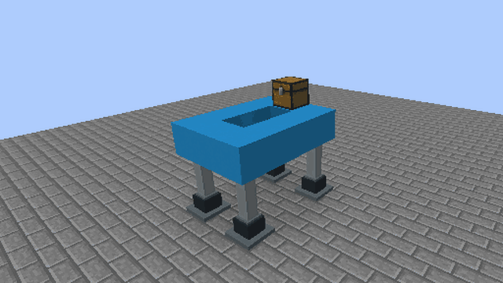
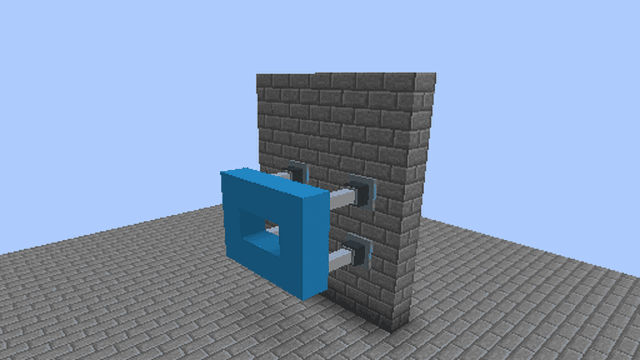
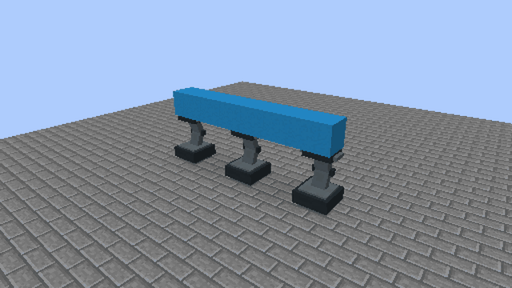
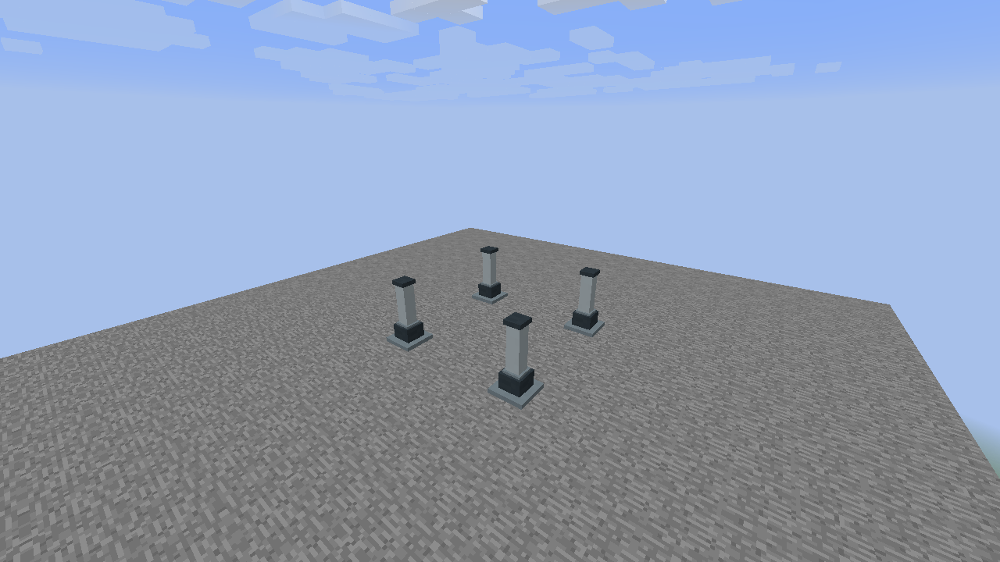
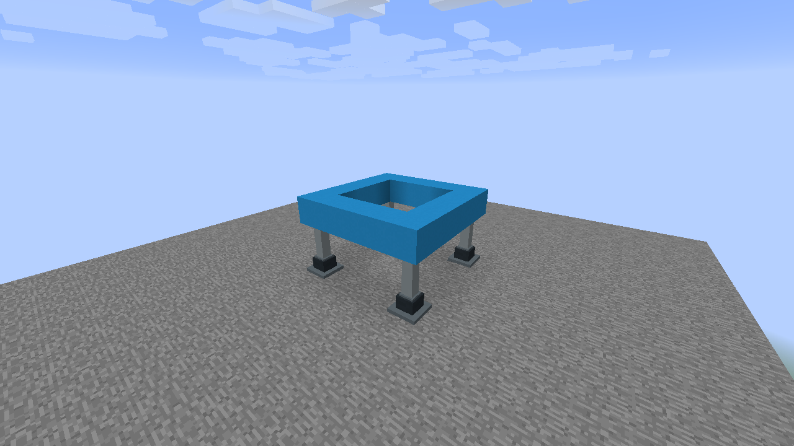
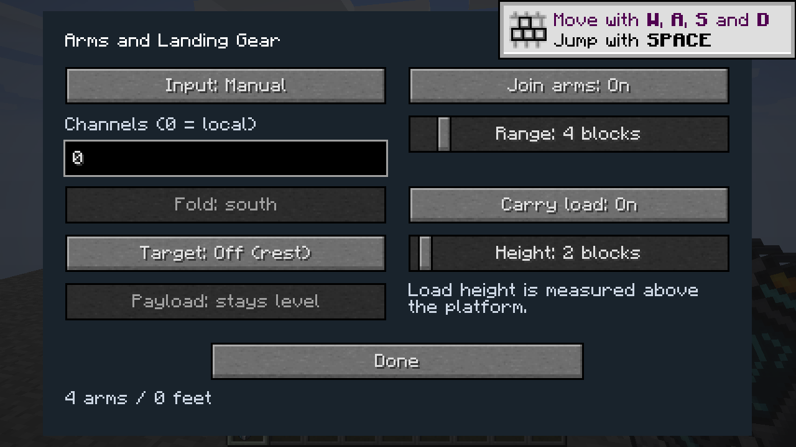
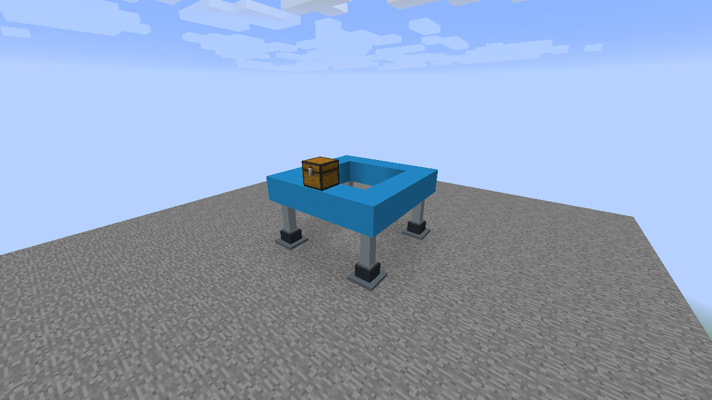
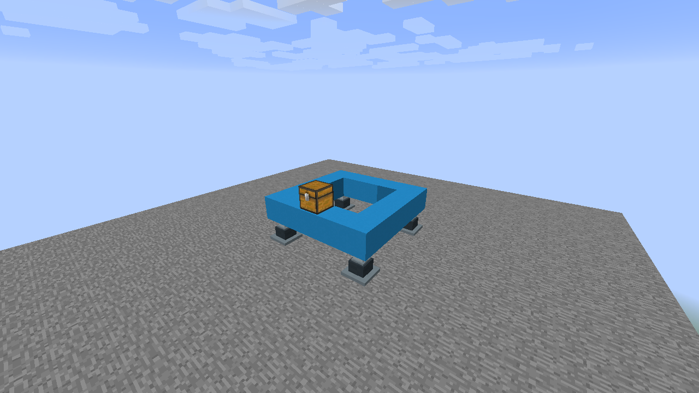
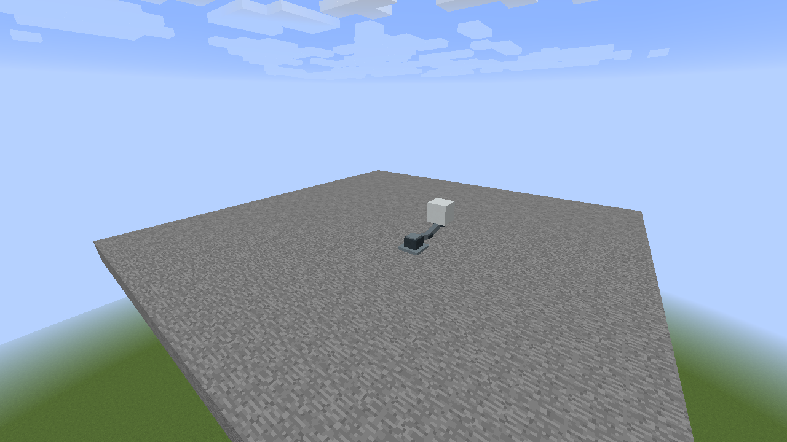

# Joined arm platforms

An unjoined Extender moves the block at its tip. When that block is a Programmable Surface, either arm type also selects its face-connected Surface neighbors in the same layer perpendicular to the mounting direction. Stacked layers and ordinary neighboring walls or floors remain outside that selection. Both regular and Large Extenders support
joined platforms across two axes; Rotating Arms join along their hinge axis. Use
one arm type and size within each group, with matching section counts and settings.

## Joined motion in game

Four Extenders move this hollow 3×4 frame together. The chest rides within the
selected load height. At each aligned endpoint the platform becomes ordinary
blocks again, including while retracted.

A sideways mount uses the same platform layer and joins across the two axes
perpendicular to travel. Carry load is unavailable for sideways movement.

Three matching Large Rotating Arms share one hinge axis. Their **stays level**
payload moves with the swivelling tips throughout the fold and return.

## Build an Extender platform

1. Place matching arms at the corners of a rectangle. Use the same mounting
   face and number of stacked sections at every corner. Keep their supporting
   blocks in place. Intermediate supports are allowed: a 2×3 arrangement of
   six arms works, as does a straight row of three arms.

   

2. Build one layer of blocks between the arm tips. Air holes are allowed.
   Face-adjacent platform blocks must connect every support; diagonal contact
   alone does not connect a corner. Connect any loose blocks inside the rectangle
   before moving it. A hollow frame is a valid platform.

   

3. With the arms fully extended, open each arm's dialog using the Configurizer.
   Enable **Join arms** in the same dialog and set
   **Range** from 1 to 32 blocks. Range is the distance to a neighbouring arm,
   so intermediate arms can connect a longer platform. Every participating arm
   must opt in and use identical configuration and section counts. Differently
   configured or shorter/longer neighbouring arms are ignored. Both neighbours
   must have sufficient range.

   

4. Activate an arm to move the joined group. The default selection contains only
   the platform layer. For vertically moving Extenders, **Carry load** adds
   supported blocks above the platform; **Load height** selects 1–32 blocks above
   its surface. Vehicles, boats and minecarts must fit entirely inside the platform
   rectangle and selected load height; their inventories stay with them. Sideways Extenders and Rotating Arms use the platform layer only.
   A load extending outside the selected area or height must be separated before
   moving it.

   
   

The group is bounded to 64 arms, a 64-block span per platform axis, and 32,768
captured blocks. Saved-data and network size limits also apply: data-heavy loads
may reach those limits before the block-count limit. Unsupported or oversized
loads are refused as a whole. Keep all platform chunks loaded while moving.
Extend fully before changing the group or its load settings. The dialog stays
open when joining selects a different controller. Large arms need enough room
for their wider moving parts; use a joined group to move a continuous platform.

## Editing an Extender platform

At whole-block endpoints the platform becomes ordinary world blocks, including
when retracted. This works on floors, ceilings and all wall faces. The controller
stores the displaced arm sections separately, preserving each column's length.
One-section Extenders stop halfway between blocks and keep a captured payload.

You can mine or replace platform blocks while retracted. On the next move, arms
capture the current connected platform, including newly added blocks inside the
supported rectangle. Removed blocks stay removed. Air holes are allowed, but a
remaining platform must still connect every corner with face-adjacent blocks.
A disconnected platform stays in place with an error. Removing the entire
platform lets the empty arms extend normally.

Extend fully before removing arm sections or changing joining/load settings.
Matching neighbours are reconsidered at the extended position; newly placed
arms stay independent until they can join a compatible extended group. An arm
with a different section count or configuration is ignored. Removing an extended
arm changes the available supports; the next platform move still requires all
corners of its resulting rectangle to be supported and connected.

## Joined Rotating Arms

1. Place two or more matching Rotating Arm columns in a straight row along
   their hinge axis. Keep the mounting blocks in place. Use the same arm size,
   mounting face, section count, fold direction and payload mode.
2. Connect their extended tips with one face-connected layer of blocks. A row
   can contain three or more arms, as shown in the animation above.
3. Enable **Join Arms** on every column and give each the same neighbour range,
   large enough to reach the next arm (1–32 blocks). Keep their other settings
   identical too. Rotating Arms join along one axis only.
4. Close the dialog and activate an arm to fold the whole joined row. Extend
   fully before changing arm sections or joining settings.

**Payload: stays level** keeps the platform attached to the swivelling tips
throughout the stroke. **Payload: rotates** turns it with the arms. At a
representable endpoint, supported payloads return to ordinary block mode. You can
remove or replace those blocks while folded as well as extended. The next move
checks the current platform between the tips: replacements travel with it, removed
blocks stay removed, and the remaining platform must still connect every support.
Removing the whole platform leaves empty arms that keep their original length.
Blocks outside that platform remain in place and can still obstruct the stroke.

## Surface layers on a single arm

Place a Programmable Surface on the arm tip, then extend the layer along the two axes perpendicular to the arm. Edge-connected Surfaces move together without enabling **Join arms** or adding support arms. A second layer along the mounting axis stays outside this implicit selection. All selected cells must remain loaded and within the bounded attachment limits. Use the existing joined-arm arrangement when you need multiple supporting mechanisms or an explicit load region.

## Push with a horizontal Large Extender

With the arm at rest, open **Mechanism** and enable **Push blocks**. This option is available to horizontal regular and Large Extenders without landing feet. Use a whole-block outward stroke. Place the first block directly against the arm tip; a contiguous row of ordinary solid blocks can be pushed with it. Pushing refuses tile entities, protected or immovable blocks, and chains requiring more than twelve additional blocks.

At the active endpoint the pushed blocks become ordinary world blocks. Returning the arm brings its original attached platform back; additional blocks encountered and pushed during extension stay forward. A blocked stroke retains the last valid ownership state and reports its obstruction. The original attachment follows the ordinary joined-platform and connected-Surface discovery rules while pushing is enabled.

## Set a rotating angle

Return the Rotating Arm to rest before changing **Start** or **End** in the **Mechanism** tab. Both sliders step in 15-degree increments from −180 to 180 degrees. **Payload: rotates** turns the attachment with the arm; **Payload: stays level** preserves its orientation. Non-grid-aligned endpoints retain the attachment as a captured mechanism until it returns to a representable native endpoint.

Rotating payloads may briefly graze a block that touches a face at either endpoint, up to a quarter-block penetration of the swept bounds. The remaining arc and final endpoint must remain clear. Unrelated obstacles and the arm linkage retain the strict quarter-pixel tolerance; final overlap is never allowed.

### Start and end angles

Rotating Arms have separate **Start** and **End** sliders in 15-degree steps. Return the arm to its starting position before changing Start. The arm moves its attachment to the new starting angle and checks the complete adjustment path before moving the attachment. End selects the destination of the next normal stroke. Both settings are saved with the arm. Start is the left slider and End the right. A blocked Start change leaves the previous pose and configuration available; valid stationary arbitrary-angle poses also permit configuration.

### Horizontal pushing

Enable **Push blocks** at either stationary endpoint of a horizontal Extender Arm. Its constructed length remains its maximum extension. Blocks move forward only when contacted: an air gap reduces how far a later block is pushed. Retraction returns the original attached platform and leaves additional contacted blocks in place. The arm checks the complete path before moving an attached Surface layer and supports up to twelve additional ordinary solid blocks; pushing additional inventories or machinery is refused.
