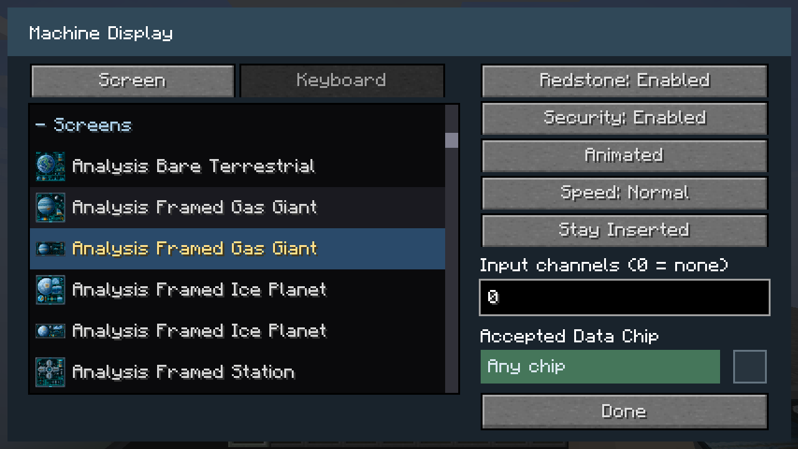
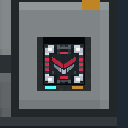

# Machine display settings

Use the **Configurizer** on a formed Core-based multiblock or one of its reserved cells to open its shared dialog. The following new models have configurable surfaces:

| Model | Surface tabs | Optional Data Chip Mount |
| --- | --- | --- |
| Pinnacle Meridian Drive | Half Screen, Keyboard | Yes |
| Pinnacle Vector Fold Array | Half Screen, Keyboard | Yes |
| Vektor Longburn Drive | Screen, Keyboard | Yes |
| Paladyne Navigation Computer | Half Screen | No |
| Seyr Navigation Computer | Half Screen | No |

Each surface keeps its own artwork selection. **Model artwork** preserves the supplied design. **Black** and the standard Programmable Block material and screen/panel catalogs are also available, including half-screen and keyboard designs. **Custom...** samples a block material. Static/Animated playback and Slow/Normal/Fast speed apply to the fitted displays.

The original Constructor frames have no authored display surfaces or chip reader. Their surface and Security controls are unavailable.

## Activation

Machines consume physical redstone or configured Vandor Labs input channels. Apply physical power to any reserved cell or the Core. `0` means disconnected from channels. No Core or reserved cell emits physical or channel power, including with a chip inserted.

Redstone and Security are disabled by default. Their independent gates match [navigation-table activation](navigation-displays.md):

| Redstone | Security | Active appearance and selected artwork |
| --- | --- | --- |
| Disabled | Disabled | Always active |
| Enabled | Disabled | Active while powered |
| Disabled | Enabled | Active while a matching chip is inserted |
| Enabled | Enabled | Active while powered and a matching chip is inserted |

Inactive screens and keyboards are black. Drives use their idle casing artwork while inactive. Navigation computers use their Off appearance; when activated, their saved Off/Idle/Computing appearance remains available through ordinary right-click cycling.

These settings control appearances; they do not add propulsion, dimension travel, crafting or navigation calculations.

## Optional native chip mount

Enable **Security** to show the mount on models that have one. The mount uses the standalone Data Chip Mount's native frame, size, insertion animation and physical item retention. In **Stay Inserted**, the chip stays visible after insertion; empty-hand right-click removes it. The company filter accepts the chosen company or Any chip.

Disabling Security hides the entire mount. An already inserted chip remains safely stored and appears again when Security is re-enabled. Returning chips retain their original return owner. Hiding a mount never creates, consumes or drops another chip.

| Security enabled, retained chip | Security disabled, chip safely stored |
| --- | --- |
|  |  |

Return modes keep the normal borrowing/return animation, but integrated readers do not latch an output or keep a secured machine active after the chip leaves. For continuous chip authorization, choose **Stay Inserted**. Standalone mount and door behavior is described in [Data Chip Mounts](data-mounts.md).

Screen choices, gates, channels and the chip's full item data persist through saving and reloading. Manual dismantling retains a chip in its Core; reassembly restores access. Breaking the Core releases the held chip once. Mining a reserved cell dismantles the machine and removes the selected cell; rapid removal safely skips stale renderers.

[Step-by-step multiblock build guides](multiblocks/README.md)
