# Modular landing gear

**Extender Arm**, **Rotating Arm** and **Fixed Arm** are general mounting mechanisms,
available in standard and Large sizes. Their existing saved block and item IDs remain readable.
Attach a Landing Gear Plate, Ski, Wheel or Track to use an arm as a vehicle support,
or attach ordinary building blocks to move an independent structure.

**Landing Gear Plate**, **Landing Gear Ski** and **Landing Gear Wheel** form their connected feet. These
parts replace the integrated wheel gear for new construction. Saved integrated
wheel gear can migrate to these parts; older skis and struts remain readable.

Build a column of one to eight matching arm sections. Arms join immediately, even
without a mounting block or attached foot. For landing gear, place a Plate, Ski, Wheel
or Track directly below the column, then connect more
matching feet horizontally. A group can contain up to 64 feet within a 16×16
footprint. Align all connected skis in the same direction.

More columns can attach to the same foot group. They must use the same strut type
and height. The entire connected
group shares one controller, target and animation. Fully deploy it before
changing its topology. Replacing the controlling mount during a valid rebuild
retains the group's settings.

Swing Arms stack from one to eight sections per column, like Extenders. Align connected arms in the same
direction. The arms hinge upward while the lower swivels keep the entire foot
group horizontal. Straight Extenders retract the feet vertically. Fixed mounting
caps and sleeves stay attached to the hull.

Right click a strut or its visible landing foot with an empty hand to deploy or stow it. Use the Configurizer
on an arm to open its motion dialog. Tracks open their own appearance dialog with either right click or the Configurizer. Select Manual, ON deploys or OFF deploys,
and enter channels as comma-separated positive numbers. Zero uses local redstone;
configured lists require all channels to be powered. Fold direction can be
changed while fully deployed. Manual mode exposes a deployed/stowed target.

Landing-foot source blocks remain at their construction positions during animation.
General Extenders save displaced arm sections separately when an aligned retracted
payload becomes ordinary world blocks.
Collision follows the moving feet and linkages, including beyond those cells.
Movement pauses at a block obstruction or unloaded boundary and resumes when the path
clears. Contacted entities move with the mechanism instead of stopping it; they can
be pushed into surrounding blocks. Missing
controllers fall back to visible, collidable construction parts. Breaking the
assembly releases its surviving parts without deleting them.

Modular gear supports Hover conversion. Complete and fully deploy each group
before scanning a craft. Each mounting strut counts as a physical support; the
group still shares one control input. Plates require Hover; ski-only craft can
Taxi over ice. Use the configured channels to operate captured gear,
and deploy it before landing and parking. Member links, foot orientation and
fold direction rotate together when the craft is parked at a cardinal heading.

The native part models, connection masks and pixel textures are adapted from the
supplied MCTrek landing-gear kit. Inventory models have separate display
transforms to leave visible padding around the rendered icon.

Five Programmable Matter Ingots in a U shape craft two Plates. This recipe is
distinct from the existing Diagonal Half Console recipe.

Controls apply immediately as you change them. The fold direction describes the
foot movement; the elbow bows toward that direction to remain above the level
foot while stowed. The lower swivel has a closed, textured underside even when
no foot is mounted.

Extend a ski row by clicking an existing ski: the new ski inherits its facing,
including when the clicked ski belongs to an assembled extender group.

Large Mounts, Extenders and Swing Arms occupy one block per section, with a
compact mounting cap and a heavier mechanism than standard arms. Mount each column on the desired face. Existing four-cell arm sections automatically
release their old companion cells when loaded; independent neighboring arms
remain in place. Large parts rotate with captured craft.

Separate Wheel feet reuse the tires, hubs and brackets from the telescopic
Landing Gear. The standard wheel fits one-block arms; the wide Large Wheel
reserves a 2x2 footprint for Large arms. Align adjacent wheels as for skis.
Wheels work under both Extenders and Swing Arms, retract with their arm, and
allow Taxi mode when all supports use wheels. Tires roll with vehicle travel.

Craft a Large Extender or Large Swing Arm from four matching standard arms.
Craft a Wheel from three Programmable Matter Ingots, one Slimeball and one Iron
Ingot. Four Wheels craft one Large Wheel. These recipes are shapeless.

Ski-only vehicles can use Taxi mode on ice, packed ice and frosted ice. Every runner must remain above ice; mixed plate/wheel/ski supports do not qualify for this exception. Taxi movement stops before a runner leaves the ice. Lift blocks are not required for ski Taxi mode; Hover still needs its usual lift and thruster hardware.

The modular wheels roll with actual Taxi travel, reverse their roll when backing up and steer with the vehicle controls. Hover pauses wheel roll and steering.

Adjacent Programmable Trapdoors configured to move into the next block can cover modular gear shafts. Aim the trapdoor toward any arm, wheel or other foot member. Covers open for deployment, remain open throughout retraction, and resume their own redstone setting only once fully stowed. Covers follow the gear into a vehicle and retain the same protection against closing through deployed feet.

Legacy integrated Landing Gear is removed from crafting and creative/search catalogs. Its saved block ID remains readable for migration. Saved wheel gear converts on chunk load, or when right-clicked, into an Extender column and separate Wheel. Small, Medium and Large gear use the standard parts; Extra Large variants use compact Large arms and oversized Wheels. Travel rounds up to whole-block column sections. Facing, deployment and redstone/channel settings are retained. Migrated controllers retain the legacy input rule: local power or any listed channel; their dialog labels this rule. Conversion checks the entire footprint and the mounting support first; blocked or incomplete mounts remain intact until there is room to convert. Existing inventory stacks and dropped items split into the corresponding arm sections and wheels; excess parts drop if the inventory is full. Captured legacy vehicles retain their saved representation during transfers and can convert after a later chunk reload or interaction.

A manual deployment override on modular gear lasts until its configured redstone input changes, including across saves and migration.

Extender-mounted wheels retain clearance beneath the fixed casing when fully retracted. The wheel bracket, socket and rod use the same adjusted pose for rendering and collision.

Large Extenders and Large Swing Arms each occupy one source block.
The Large Wheel has the legacy Extra Large tyre diameter (1.75 blocks), reaches
one block below its source cells, and requires a matching large Mount, Extender or Swing Arm. Standard
wheels require standard arms. Click any quadrant of a large part to align a new
large arm or wheel with its anchor and orientation. Connected straight Large Extenders may face different ways.

Right-click an option button to cycle to its previous value. Settings apply immediately.

## General arm movement

The clicked mounting face sets the arm's direction. Ceiling mounts point down,
floor mounts point up, and wall mounts point outward. Additional matching arm
sections inherit the existing column's mounting axis. Placing an arm against a
landing foot points it toward that foot. Existing saved arms continue to point down.

Use the Configurizer for the arm dialog. Input, channels, fold direction and
payload orientation use the same single-page dialog as joining and load settings.
The dialog has no Angle or Active Reach editors.
For standalone regular and Large Extender Arms, Off is the fully extended construction
pose. On retracts a single section by half a block, leaving clearance for its base.
Two sections retract by one block; longer stacks retract by one fewer block than
their section count. Arms never extend beyond their placed length. Redstone modes
select ON activates or OFF activates. Previously saved mechanisms already moving
through an older extension stroke retain that stroke until they return to Off.
The existing landing-foot deployment semantics remain available on landing assemblies.
Edit the column at its construction pose; stationary Track feet can be removed and replaced without rebuilding the arm.

At the construction pose, click the arm's outward tip to place a block directly
against it. This works on floors, ceilings and walls, including stacked regular
or large arms. The attachment starts in the adjacent block cell; it does not need
to be placed inside the arm. Matching arm sections placed at that tip lengthen
the same mechanism before attaching the payload.

**Payload: stays level** keeps the attachment's original orientation as a Rotating
Arm swings. **Payload: rotates with arm** makes the attachment turn with its linkage;
this choice also works with landing plates, skis, wheels and tracks.

An unjoined Extender or Rotating Arm selects its single tip block, leaving
contacting walls, floors and surrounding blocks in place. Enable **Join Arms**
on compatible neighbouring columns to move a connected platform instead.
[Build a joined platform](joined-arm-platforms.md) for the complete construction
steps, matching settings, range and optional load-height controls. Earlier saved
multi-block attachments keep their authorized footprint.

| Joined Extenders | Joined Large Rotating Arms |
| --- | --- |
|  |  |

Joined Extenders work on floors, ceilings and walls. A rectangle may contain air
holes, provided its blocks connect every supported corner. Matching intermediate
arms are allowed, including six-arm 2×3 layouts. Rotating Arms join along their
hinge axis and share a fold direction. Different arm types, sizes, lengths or
settings stay independent.

Retracted Extender platforms at whole-block positions are normal world blocks.
Mine or replace them there; the next move checks the current connections and
includes new blocks within the supported rectangle. Removed blocks stay removed.
An entirely removed platform leaves empty arms with their original section
counts. Extend fully before removing arm sections or changing the joined group.
Capture checks editing permissions and protection hooks, preserves tile data,
and pauses captured machinery. Liquids, unbreakable blocks and moving pistons
cannot be carried. Keep the complete platform and its boundary loaded.

Whole-block translation endpoints restore ordinary blocks in the world, including
their saved tile contents. New rotating attachments align to the block grid at
quarter-turn endpoints. Full blocks with safely representable rotated states can
materialize there. At either native endpoint, an independent arm rechecks its tip
block and joined arms recheck the connected platform between their tips before
moving. Removed blocks stay removed and replacement blocks travel with the arms;
unsupported rotations and fractional positions remain captured,
rendered and collidable, and survive saves. Existing snapshots preserve their alignment. Reversing returns the same attachment
to its construction position. An obstruction pauses the stroke without deleting
its snapshot. Clear the original position before dismantling an arm that still
holds captured contents. Breaking its controller drops an arm item containing a
recovery snapshot; placing that item retains the captured data. If a transfer and
its rollback both fail, the snapshot stays inert and records the original copied
cells. Recovery reconciles those exact loaded cells before allowing the snapshot
to materialize elsewhere, preventing duplicate inventories. World transfers write a
recovery journal before changing blocks. Affected inventories stay locked until
the changed chunks are durably saved, and interrupted transfers recover on restart.
Cosmetic animation uses a pause-aware client clock while collision and saved
motion remain authoritative on the server.

General arms remain usable inside Taxi and Hover craft. Their moving attachments
use nested retained snapshots, with the same collision and loaded-world checks;
only landing supports are locked against retraction in Taxi mode. Cardinal parking
rotates mounting axes, saved links, track connections and attachment snapshots together.

## Tracks

The Creative inventory and item browser contain one **Track** block. Right-click it,
or use the Configurizer, to select **Compact**, **Armoured** or **Bogie** in its dialog.
The Track dialog contains style, operating status and Done. Slab-mounted Tracks are
ready without an arm assembly. Tracks on arms report that controller's deployment
errors; style changes leave its input channels and motion settings intact. Fully deploy
the arm before changing its Tracks' style.
Style changes stay in the same blocks and tiles, preserving mechanism ownership and
settings. Existing Armoured/Bogie registry IDs remain readable as hidden compatibility
blocks; their old appearance becomes the default until a saved style is selected.
Picking or breaking those older blocks returns the canonical Track item with its
selected style saved. Survival copying also uses the obtainable canonical Track material.

Attach a Track by clicking the visible end of an arm in its **Off/rest** construction
pose. This works at the last section of a stacked arm and on every mounting axis.
The new Track inherits the arm's travel orientation and becomes its native foot,
including the entire connected tread group. A stationary straight arm at an active,
whole-block active endpoint also accepts a Track on its visible outward tip.
Additional Tracks can be attached by clicking an existing posed Track's side; they inherit its orientation and style.
The Track is stored at the mechanism's logical rest cell and displayed at the clicked
pose; the arm retains its current stroke and does not jump or create a second
world block. Both the visible placement area and rest cell must be clear and
editable. Fractional endpoints, moving arms and active rotating poses show an
explicit error and retain the held item. Return those arms to Off/rest before
attaching the Track. Clicking another Track inherits that
Track's facing, regardless of player direction. Clicking a slab side aligns the tread
at ninety degrees to that mounting face. Top and bottom slab brackets follow their
actual selected half.

Matching styles and travel directions connect into continuous tread runs, including
unequal adjacent lanes. A group supports up to 64 track blocks within a 16×16
footprint. Different styles or facings remain separate groups. Incomplete or
unloaded groups show independent parts until their full topology is available.
A Large arm can retain a connected Track that still overlaps its wider mounting footprint when the directly anchored Track is removed. Regular arms require a Track directly beneath their column. Removing and replacing stationary Track feet updates the existing assembly without resetting its pose.

Tracks beneath a rotating arm use the arm's lower swivel instead of drawing a second
overlapping socket. **Payload: rotates** rotates the complete tread group with the arm;
**Payload: stays level** preserves its orientation. A blocked first step of a standalone arm returns its attachment to the previous endpoint and resets its target; clear the obstruction and activate it again. If restoration itself fails, the original attachment snapshot remains available for recovery. A blocked stroke shows an **ERROR** in the dialog. Selection and collision bounds follow the native style, mounting brackets and mechanism pose.

Two physical Track blocks provide enough supports for a vehicle, including two
connected blocks beneath one arm. A single Track does not. Only ground-facing outer
landing groups count toward this rule. Tracks support Taxi operation. Their tread artwork moves with each track’s physical travel, including reverse travel and different left/right travel while turning. Treads stay still when the vehicle is idle or in Hover; housings, sockets and mounts remain fixed. This animation applies to all three styles, whether directly mounted or attached to an arm.

## Animated combinations

These in-game clips show complete deployment and retraction. The foot stays level as a Swing Arm folds; an Extender lifts its foot vertically. Large arms have a one-block mounting footprint; Large Wheels retain four source cells. Wheels use the matching arm size; Plates and Skis can form shared connected feet under either arm size.

| Foot | Small Extender | Small Swing Arm |
| --- | --- | --- |
| Plate | 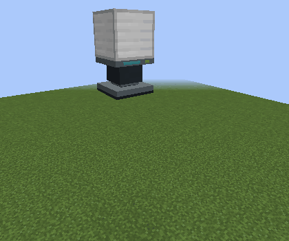 |  |
| Ski | 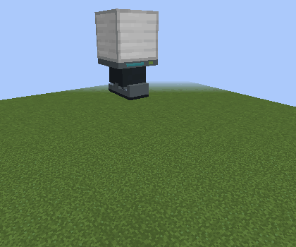 | 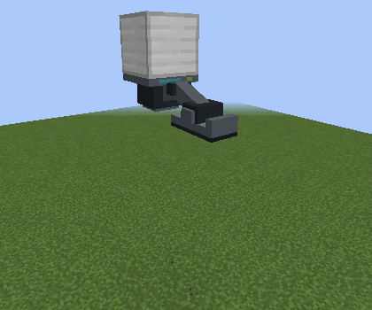 |
| Wheel | 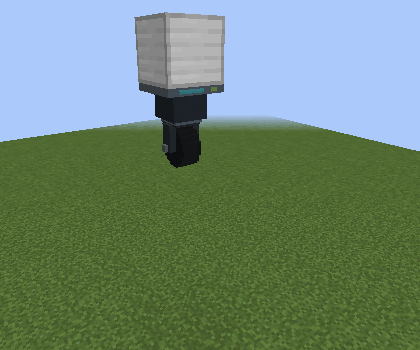 |  |

| Foot | Large Extender | Large Swing Arm |
| --- | --- | --- |
| Plate | 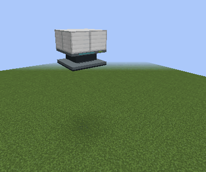 | 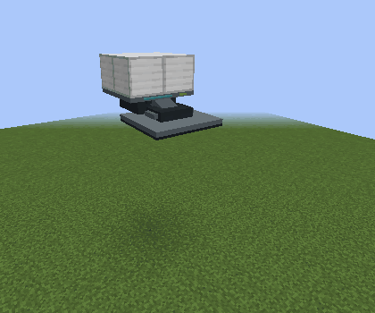 |
| Ski | 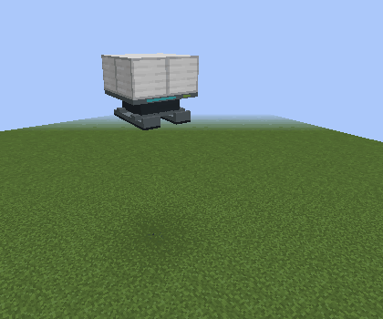 | 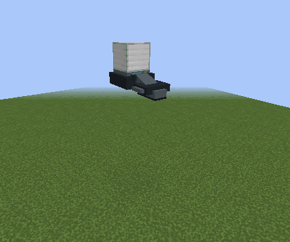 |
| Wheel | 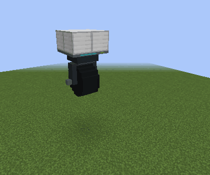 | 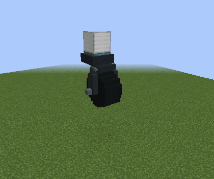 |

Fixed Mounts hold the same three foot types permanently deployed. They use the same standard/large compatibility rules and do not animate.

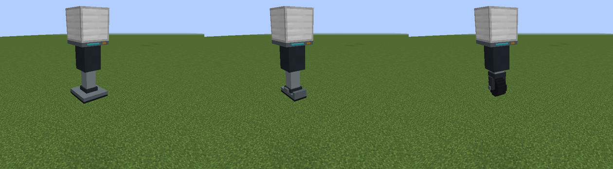

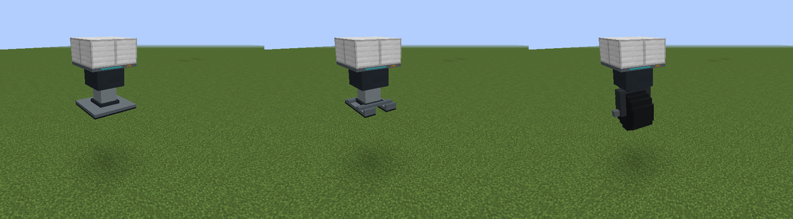
