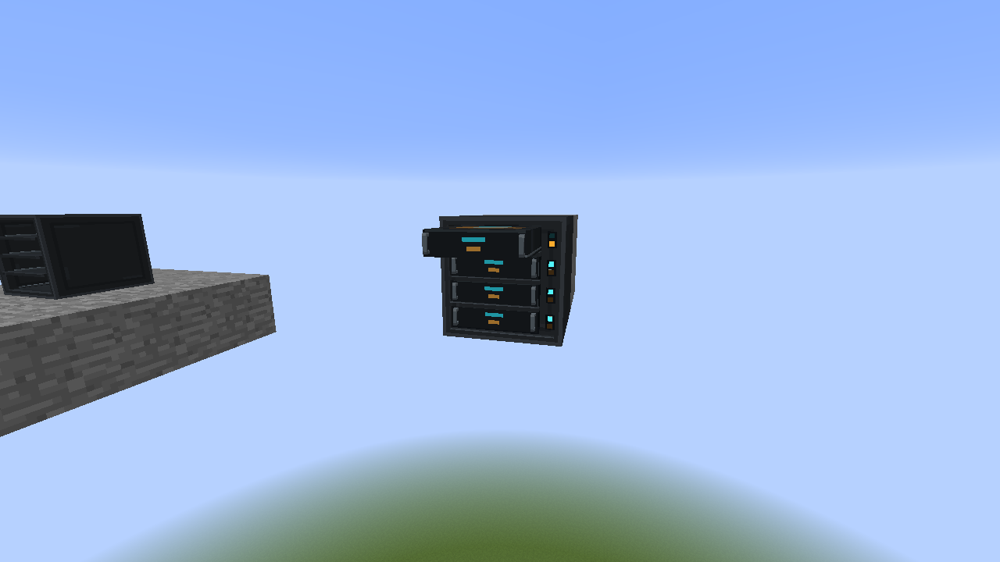
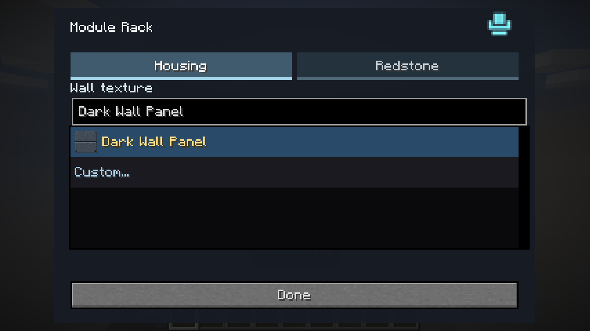
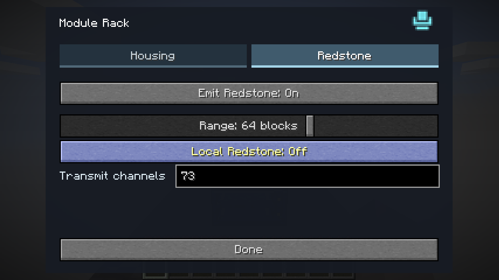
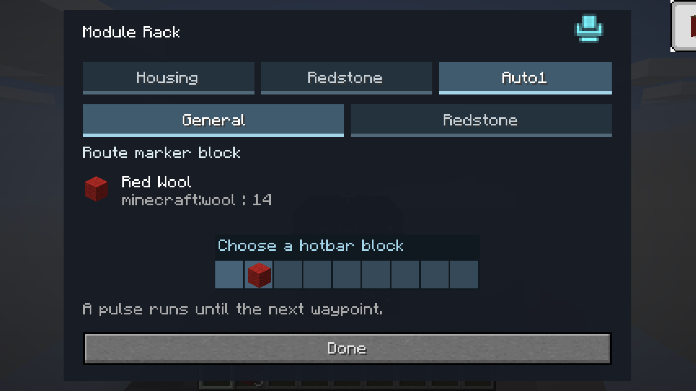
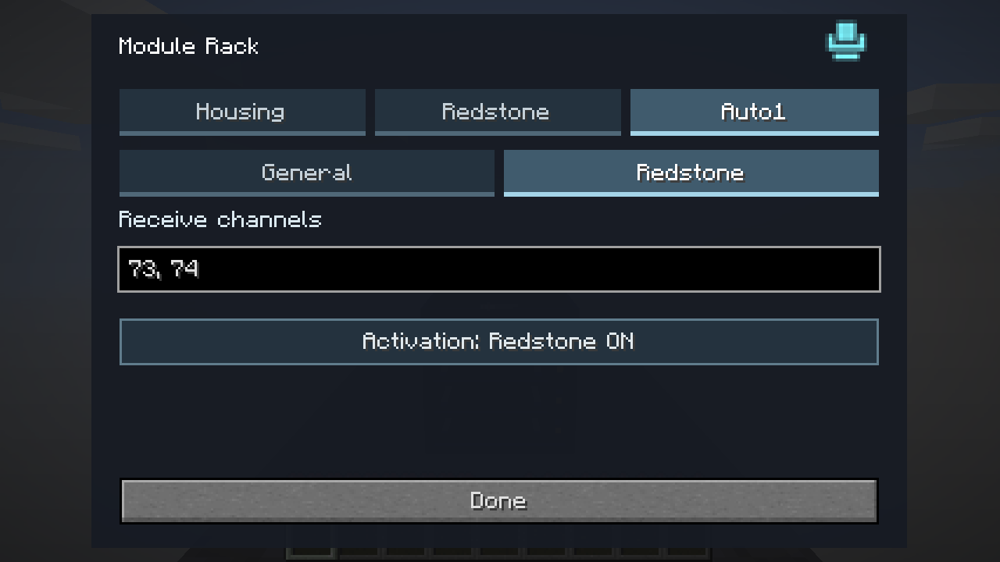

# Module Rack

The Module Rack holds four **Blank Modules** or **Autopilot Modules** in independently selectable horizontal bays. It is available in the Vandor Labs creative tab on Forge 1.12.2.

## Use

- Place the rack against any block face. Its open front faces toward your view, using the same placement rule as Programmable Light. A shallow floor click faces you horizontally; looking steeply down or up places an upward- or downward-facing rack.
- Hold a module and right-click the front of the intended bay. The module slides into that bay; the other bays remain unchanged.
- Each row has two tiny vertically stacked indicators in the recessed right-hand panel: bright cyan above for an occupied bay, or amber below for an empty bay. A row's buttons select the same bay as its opening.
- Use an empty hand on an occupied bay or its buttons to retrieve its module. If the inventory cannot accept it, the module remains in the rack.
- Breaking the rack releases its contained modules. Middle-clicking the rack picks the empty block, without duplicating the contents.

Insertion consumes one module in Survival. Creative insertion follows ordinary creative placement and leaves the held stack unchanged. Stored modules retain their item data, including custom names. Blank Modules are decorative inserts. Every occupied bay contributes to the rack's optional proportional Redstone output.

## Housing and Redstone

Click the casing with an empty hand, or use the Configurizer, to open the same dedicated dialog. Empty-hand clicks on occupied bays still retrieve their modules.

The **Housing** tab selects the casing's wall texture. **Original artwork** restores the graphite casing. The picker supports search, mouse-wheel scrolling and dragging its scrollbar. Changing the finish preserves all inserted modules.

In **Redstone**, turn **Emit Redstone** on to publish the occupied-bay count as a proportional level. Emission starts off. All inserted modules count:

| Occupied bays | Level |
| --- | --- |
| 0 | 0 |
| 1 | 4 |
| 2 | 8 |
| 3 | 11 |
| 4 | 15 |

Use the standard transmit-channel list, range slider and **Local Redstone** switch to choose where this level is available. Local output drives all six sides. Turning emission off clears both local and transmitted output. Right-clicking a toggle selects its previous value.

Housing and transmission settings survive saving and reloading. Dialog packets contain public settings, never the stored module items or their private item data.

## Autopilot Module

The Autopilot Module has a cyan **NAV** label and route arrow on its front. To add navigation to a Forge 1.12.2 craft:

1. Place a rack at the craft's route-sensor position, normally on its underside. Its facing controls access to the bays; the Pilot Seat determines driving direction.
2. Insert one Autopilot Module into any free bay. A craft can have at most one Autopilot Module across its racks. Multiple modules keep their items and settings, but prevent ambiguous vehicle conversion. Blank Modules do not count as navigation controllers.
3. Open the rack dialog and choose **Auto1** through **Auto4**, matching the occupied bay. In **General**, sample a route-marker block from the hotbar. Sampling preserves the exact block variant and does not consume it.
4. In the module's **Redstone** sub-tab, set its receiving channels and activation mode. Each installed module receives its own configured channels and local power. These inputs are separate from the rack's proportional output settings.
5. Build the route, Waypoints and complete vehicle as described in [Autopilot and waypoints](vehicle-autopilot.md). A short activation pulse starts the existing latched journey; normal Vehicle Controller, owner, terrain and transfer checks still apply.

Removing and reinserting a module preserves its configuration and private item data. Manual insertion at a new location clears an old departure location and running journey; it does not transfer automation authority from another craft.

Existing Autopilot blocks convert to a rack containing one Autopilot Module when their physical chunk finishes loading. The conversion preserves facing, receiving settings, navigation/departure state, existing automation authorization and opaque saved data. It waits for an existing world transfer to finish. Waypoint blocks keep their behavior. Older saved vehicles and pending recovery snapshots retain their original IDs and remain readable; conversion applies when the legacy block is physically installed. The old block/item registry IDs remain available for compatibility, while creative/search/browser lists show the module.

## Shape and artwork

The front is a 16 by 16 model-pixel square. The top, bottom, left and right rims are one pixel thick and reach the front of the casing. The two-pixel control strip inside the right rim stays recessed by one pixel; it has no card or chip mount. Four three-pixel-high module faces are separated by half-pixel rails, with quarter-pixel clearance above and below the group.

The rack and modules use darker graphite-grey housing, restrained amber/cyan details, and raised vertical handles at both ends of each module face. The module body has side runners and rear contacts. The inventory item is a padded three-dimensional model of the same cassette.

On a floor-facing rack the top row points north; on a ceiling-facing rack it points south. Slots, buttons and insertion travel use the same local orientation in all six mounting directions.

## Crafting

One rack requires six Industrial Alloy Ingots and one Redstone Dust. Arrange the ingots in the left and right columns, with the Redstone Dust in the center.

One Blank Module requires three Iron Ingots, two Gold Nuggets and one Redstone Dust. Put the three ingots in one row and Gold Nugget / Redstone Dust / Gold Nugget immediately below.

One Autopilot Module uses the former Autopilot recipe: Iron / Redstone / Iron, Redstone / Comparator / Redstone, then three Iron Ingots. The recipe produces the module; the rack is crafted separately.

## Rendering

The casing, populated indicators and seated modules are ordinary opaque chunk geometry. Prepared quads are shared across equivalent rack states. Stationary racks have no tile-entity renderer and no ticking tile entity. Inventory contents are serialized for saves and actual interactions, never by the rendering loop.

Insertion and extraction use a temporary client animation. Only racks with an active slide enter that renderer. At the end of the slide, the module transfers to the chunk mesh after the replacement section has uploaded. Removing a seated module slides it outward, and rapid reversals retain the displayed offset. Repeated state packets do not replay a slide; loading an existing populated rack displays its seated modules immediately. The visual clock pauses with the game.

The indicators do not emit world light. Their visual brightness changes with occupancy, avoiding a lighting update whenever a module is inserted or removed.

Dynmap uses the same native model parts and displays the rack's saved slot occupancy and each module's front artwork on all six mounting faces.

The implementation targets Forge 1.12.2. The experimental NeoForge adapter is not included in this feature.
