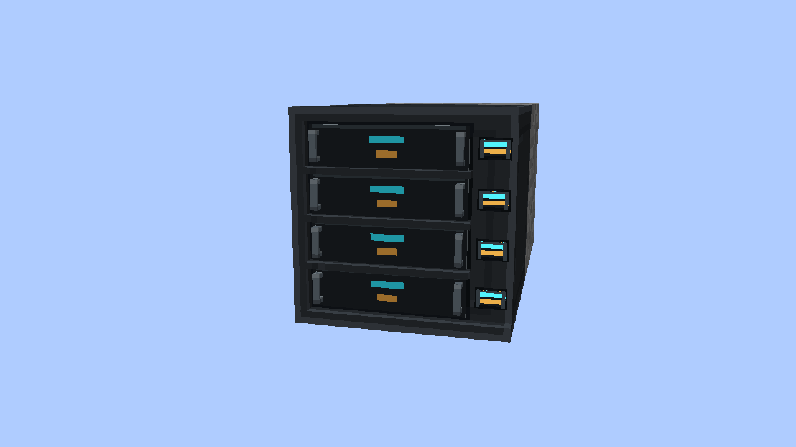
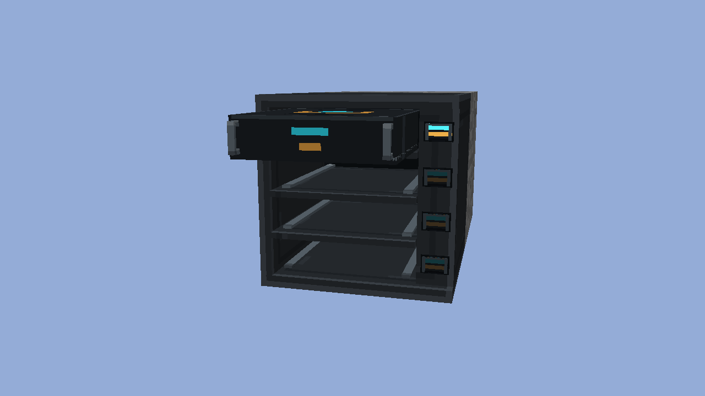

# Module Rack

The Module Rack holds four **Blank Modules** in independently selectable horizontal bays. It is available in the Vandor Labs creative tab on Forge 1.12.2.

## Use

- Place the rack against any block face. Its open front faces out from the clicked surface: four wall directions, upward from a floor, or downward from a ceiling.
- Hold a Blank Module and right-click the front of the intended bay. The module slides into that bay; the other bays remain unchanged.
- Each row has its own cyan/amber buttons in the recessed right-hand panel. Their bright state indicates that the corresponding bay is occupied. A row's buttons select the same bay as its opening.
- Use an empty hand on an occupied bay or its buttons to retrieve its module. If the inventory cannot accept it, the module remains in the rack.
- Breaking the rack releases its contained modules. Middle-clicking the rack picks the empty block, without duplicating the contents.

Insertion consumes one module in Survival. Creative insertion follows ordinary creative placement and leaves the held stack unchanged. Stored modules retain their item data, including custom names. Blank Modules are decorative inserts; this initial item does not provide a machine function or redstone output.

## Shape and artwork

The front is a 16 by 16 model-pixel square. The top, bottom and left rim are one pixel thick. The right panel is three pixels wide and sits one pixel behind the front of the casing; it has no card or chip mount. Four three-pixel-high module faces are separated by half-pixel rails, with quarter-pixel clearance above and below the group.

The rack and modules use darker graphite-grey housing, restrained amber/cyan details, and raised vertical handles at both ends of each module face. The module body has side runners and rear contacts. The inventory item is a padded three-dimensional model of the same cassette.

On a floor-facing rack the top row points north; on a ceiling-facing rack it points south. Slots, buttons and insertion travel use the same local orientation in all six mounting directions.

## Crafting

One rack requires six Industrial Alloy Ingots and one Redstone Dust. Arrange the ingots in the left and right columns, with the Redstone Dust in the center.

One Blank Module requires three Iron Ingots, two Gold Nuggets and one Redstone Dust. Put the three ingots in one row and Gold Nugget / Redstone Dust / Gold Nugget immediately below.

## Rendering

The casing, populated indicators and seated modules are ordinary opaque chunk geometry. Prepared quads are shared across equivalent rack states. Stationary racks have no tile-entity renderer and no ticking tile entity. Inventory contents are serialized for saves and actual interactions, never by the rendering loop.

Insertion uses a temporary client animation. Only racks with active insertions enter that renderer. At the end of the slide, the module transfers to the chunk mesh after the replacement section has uploaded. Repeated state packets do not replay an insertion; loading an existing populated rack displays its seated modules immediately. The visual clock pauses with the game.

The indicators do not emit world light. Their visual brightness changes with occupancy, avoiding a lighting update whenever a module is inserted or removed.

Dynmap uses the same native model parts and displays the rack's saved slot occupancy on all six mounting faces.

The implementation targets Forge 1.12.2. The experimental NeoForge adapter is not included in this feature.
