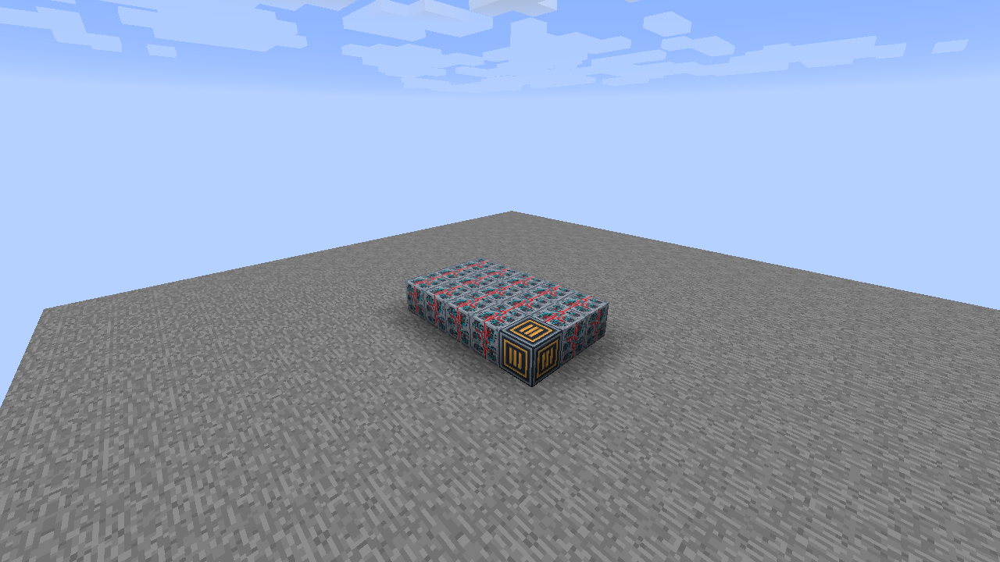
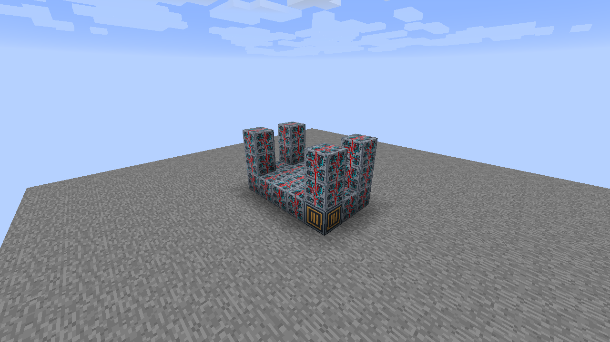
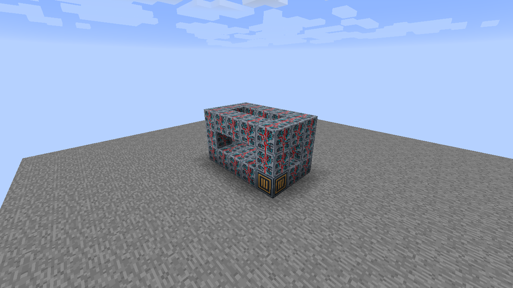
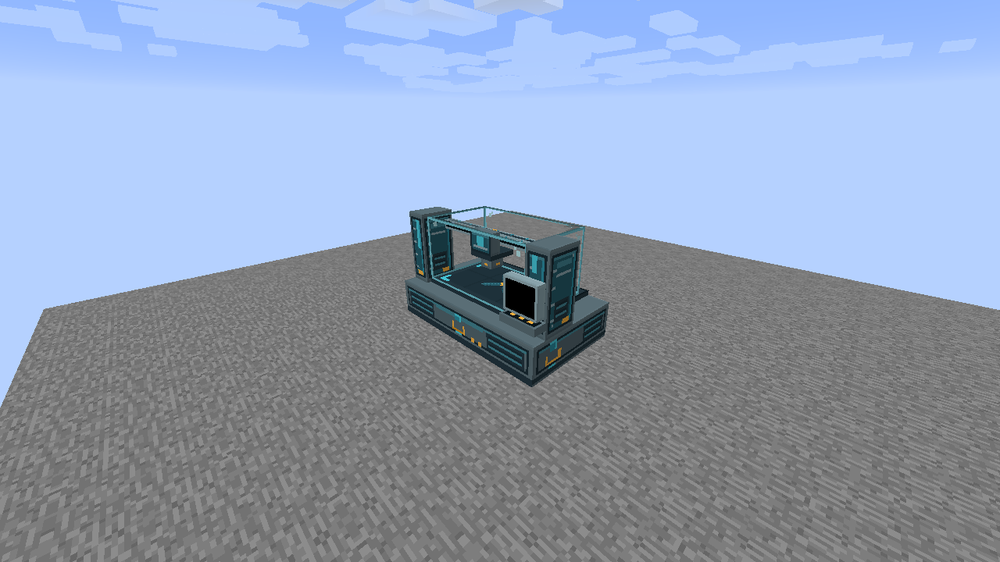

# Enclosed Gantry

Build a **5 wide × 3 deep × 3 high** assembly with **30 Programmable Matter Blocks** and **one Enclosed Gantry Core**. Core blocks are available in Creative, following the existing Universal Constructor system.

## 1. Build the base

Lay out a solid 5 × 3 bottom layer. Put the matching Core in the front-left corner, facing you, and fill every other cell with Programmable Matter Blocks.

## 2. Raise the corner pillars

At each of the four corners, build up to a total height of 3 blocks, including the bottom layer. Leave the interior empty.

## 3. Connect the top rim

Connect the four pillar tops with a rectangular rim of Programmable Matter Blocks. Keep the middle of the roof open; do not fill the interior.

## 4. Assemble

Right-click the Core. The frame becomes the complete model, and its occupied cells are reserved. If formation fails, use the reported cell to check the frame and its empty interior.

## Facing and removal

The same frame works along either horizontal axis and with the Core in any bottom corner. The placed facing is preferred when it fits. Sneak-right-click the Core to dismantle; on a machine with a holder, aim away from the holder to dismantle rather than configure it. Mining a reserved part dismantles the frame and removes that cell. Breaking the Core restores the remaining Matter Blocks.

These models do not yet perform crafting, propulsion, navigation calculations or dimension transfer. Their status appearances are visual states.

[All multiblock guides](../README.md) · [Data Chip Mount behavior](../../data-mounts.md)
