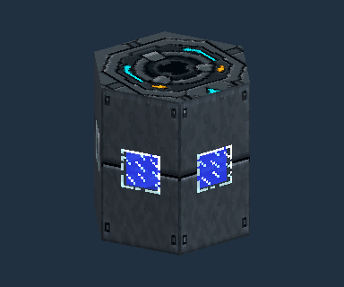
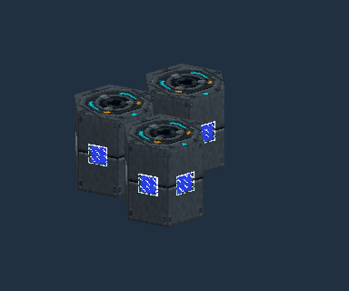
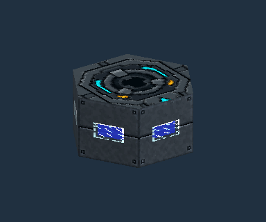
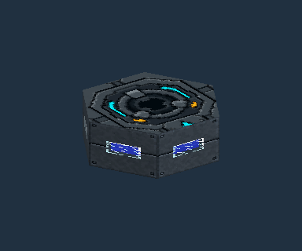

# Joined Hexagonal Tanks

Hexagonal Fuel Tanks join complete **2 × 2** and **3 × 3** squares across their cross section. Every placed block retains its own 16,000 mB storage. A one-block-deep 2 × 2 tank holds 64,000 mB; a 3 × 3 tank holds 144,000 mB. Axial stacks connect these sections into a longer tank.

## 1. Place the first tank

Place a Hexagonal Fuel Tank with its port axis pointing along the intended tank length. For an upright tank, place it against the top of a supporting block. Leave its shape set to Hexagonal.

## 2. Build a square cross section

Place the next two tanks beside it in an L. Use the same port axis, casing texture and texture layout. Incomplete sections retain their individual shells.

## 3. Complete the 2 × 2 section

Fill the fourth corner. The four blocks now draw one larger hexagonal shell. The port remains on the axial end; fluid handlers connect through the axial faces of any member. Opening any member displays the connected capacity and contents.

## 4. Choose 3 × 3 or extend the length

For a wider tank, build a complete 3 × 3 cross section instead. To extend either size, repeat the section along the port axis. Horizontal tanks use the same construction, with the square standing perpendicular to their horizontal port axis.

Only complete sections join. Removing a member separates incomplete sections; the remaining blocks retain their own stored fluid. Empty cells accept the fluid already present in their connected network. Existing cells containing different fluids retain separate shells and do not mix. A block-shaped tank keeps its existing square shell and axial stack behavior.

Joining checks inspect only loaded chunks and bounded components. Keep matching sections inside the supported 256-cell connected storage network.
