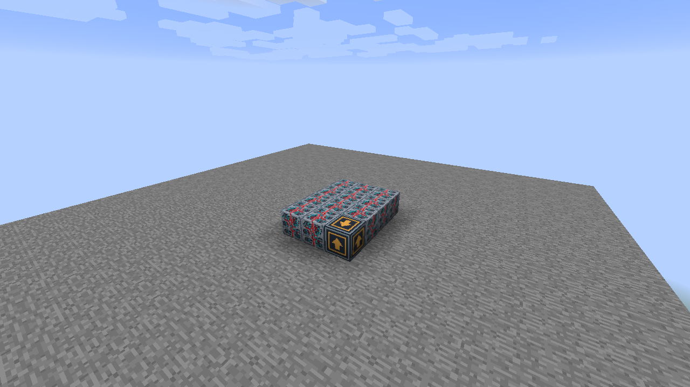
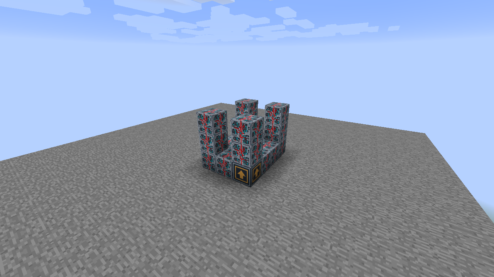
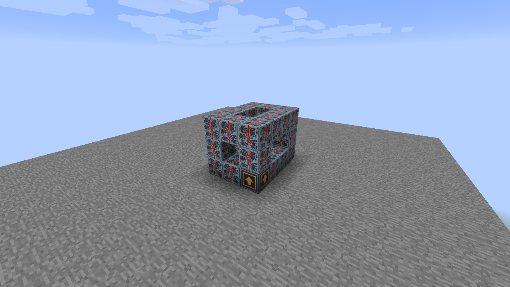
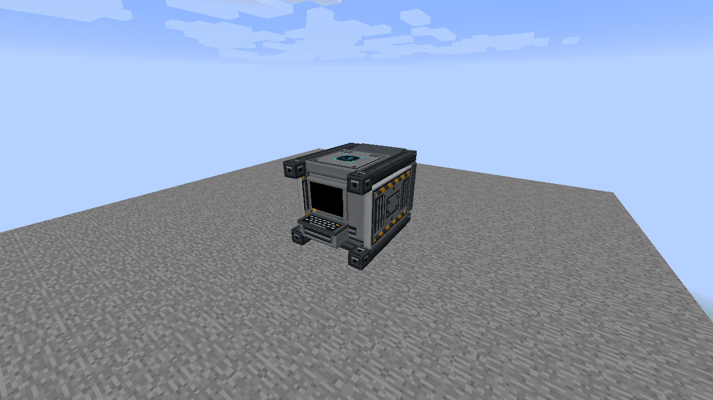

# Vektor Longburn Drive

Build a **3 wide × 4 deep × 3 high** assembly with **25 Programmable Matter Blocks** and **one Longburn Drive Core**. Core blocks are available in Creative, following the existing Universal Constructor system.

## 1. Build the base

Lay out a solid 3 × 4 bottom layer. Put the matching Core in the front-left corner, facing you, and fill every other cell with Programmable Matter Blocks.

## 2. Raise the corner pillars

At each of the four corners, build up to a total height of 3 blocks, including the bottom layer. Leave the interior empty.

## 3. Connect the top rim

Connect the four pillar tops with a rectangular rim of Programmable Matter Blocks. Keep the middle of the roof open; do not fill the interior.

## 4. Assemble

Right-click the Core. The frame becomes the complete model, and its occupied cells are reserved. If formation fails, use the reported cell to check the frame and its empty interior.

## 5. Enable Security and insert a Data Chip

Use the Configurizer on the formed machine, enable Security, and choose the accepted company. The native Data Chip Mount now appears. Right-click it with a matching Data Chip; Stay Inserted keeps the chip visible after insertion. This example leaves Redstone disabled, so the chip authorizes the active appearance. The machine never emits a redstone signal.

## Facing and removal

The same frame works along either horizontal axis and with the Core in any bottom corner. The placed facing is preferred when it fits. Sneak-right-click the Core to dismantle; on a machine with a holder, aim away from the holder to dismantle rather than configure it. Mining a reserved part dismantles the frame and removes that cell. Breaking the Core restores the remaining Matter Blocks.

A retained chip stays in the Core during manual dismantling and works again after reassembly. Breaking the Core releases it once. Remove chips before rebuilding a machine when you want to keep them in your inventory.

Use the Configurizer to select artwork independently for the fitted screen/half-screen and keyboard surfaces. Model artwork preserves the original design; Black and the standard material/screen/panel catalog are also available. See [Machine display settings](../../machine-displays.md) for redstone activation and optional chip security.

These models do not yet perform crafting, propulsion, navigation calculations or dimension transfer. Their status appearances are visual states.

[All multiblock guides](../README.md) · [Data Chip Mount behavior](../../data-mounts.md)
