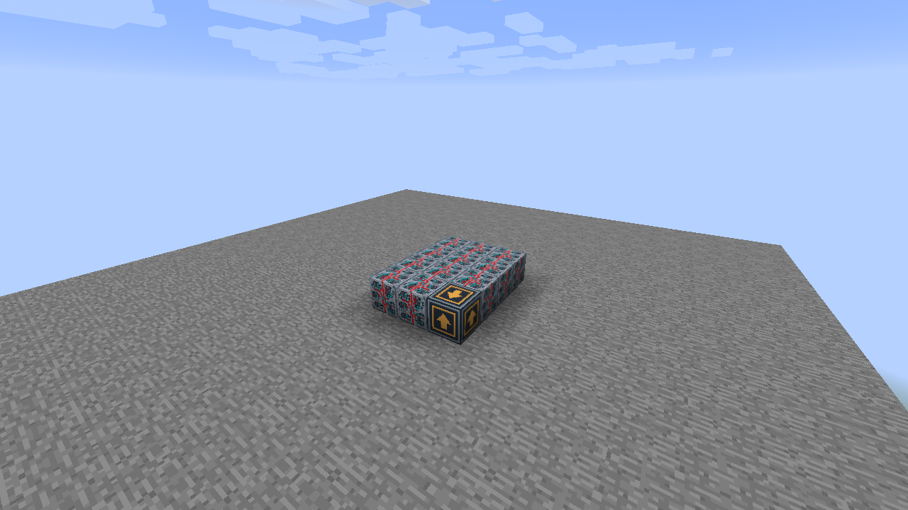
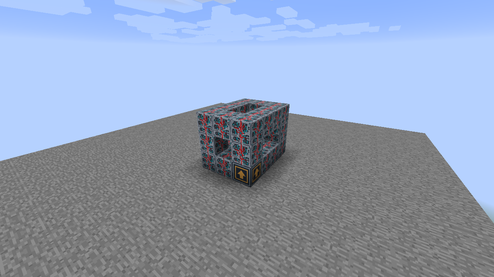

# Maxwell Drive

The Maxwell Drive supplies thrust for Flight on Forge 1.12.2 and NeoForge 1.21.1. Build it with one Maxwell Drive Core and [Programmable Blocks](../README.md).

| Width × height × depth | Programmable Blocks |
| --- | ---: |
| 3 × 3 × 4 | 25 |
| 4 × 4 × 5 | 41 |
| 5 × 5 × 7 | 66 |
| 6 × 6 × 8 | 87 |
| 9 × 9 × 12 | 173 |

The construction below shows the 3 × 3 × 4 frame. Use the same base, pillars and roof rim for each size. Thrust and tank size increase with the enclosed volume. On Forge, larger drives weigh less for their thrust but burn more fuel per thrust unit; see the [3.1 drive table](../../versions/version-3.1.md#maxwell-drive-fuel).

## How many drives do I need?

Read the **effective weight** on the Vehicle Controller. It includes the installed drives and cargo, after lift from Antigravity Plates and Repulsor Arrays. Each column below shows the maximum whole weight units **one fueled drive at full thrust** can support at that altitude in the Overworld.

| Drive size | Takeoff / Y=256 | Y=1,000 | Y=5,000 | Y=10,000 | Example ceiling with one drive |
| --- | ---: | ---: | ---: | ---: | --- |
| 3 × 3 × 4 | 1,024 | 867 | 465 | 284 | 800 units reach Y≈1,406 |
| 4 × 4 × 5 | 2,275 | 1,927 | 1,035 | 632 | 2,000 units reach Y≈825 |
| 5 × 5 × 7 | 4,977 | 4,217 | 2,264 | 1,383 | 2,000 units reach Y≈6,082 |
| 6 × 6 × 8 | 8,192 | 6,940 | 3,726 | 2,276 | 2,000 units reach Y=10,000 |
| 9 × 9 × 12 | 27,648 | 23,423 | 12,575 | 7,683 | 10,000 units reach Y≈7,088 |

Choose the column for your target altitude and add the capacities of the drives you plan to run. For example, a finished craft weighing **1,000 effective units** can take off with **one 3 × 3 × 4 drive** (1,024), but needs **three** of that size for Y=5,000 (3 × 465). **One 5 × 5 × 7** also covers that climb. Recheck the weight after adding engines or loading cargo.

To plan a whole craft, use the [flight calculator](https://htmlpreview.github.io/?https://github.com/rheide/vandorlabs/blob/master/docs/flight-calculator.html). Enter the hull weight, lift blocks, thrusters and drives to see Hover and Flight readiness, the altitude ceiling, top speed, a takeoff and climb profile, and range for your fuel. For offline use, open `docs/flight-calculator.html` from a checkout.

The Controller’s **Theoretical Max Takeoff Weight** includes every installed drive at full power. The **current takeoff limit** responds to fuel and redstone throttle. The altitude ceiling uses that current thrust.

## 1. Build the base

Lay out a solid 3-block-wide by 4-block-deep floor. Place the Core in a bottom corner, facing the front of the drive. The nozzle will point toward the opposite end.

## 2. Raise the corner pillars

Build up from each of the four corners until the pillars are three blocks tall, counting the base. Leave the middle layer empty between the pillars.

## 3. Connect the top rim

Join the pillar tops with a continuous rectangular rim. Leave the middle of the roof open.

## 4. Assemble

Right-click the Core to form the drive and reserve the frame volume. If assembly fails, check the reported frame cell and clear the interior.

An already placed Fluiduct next to an inlet connects as soon as the drive forms.

The assembled drive shown here has fuel in its tank.

## Fuel and throttle

The front and sides each have a Fluid Port In that feeds the same tank. On Forge it holds 250 mB per thrust unit, from 250 mB for a 3 × 3 × 4 to 6,750 mB for a 9 × 9 × 12; on NeoForge every drive holds 1,000 mB. On even-sized faces the side inlet is in the center cell closer to the front. The bars beside the front inlet show the remaining fuel. Fill the drive with Thermal Refined Fuel, Ethanol, MrCrayfish’s Fuelium, or Rocket Fuel from Advanced Rocketry or Galacticraft. Use one fuel at a time. On NeoForge, the `vandorlabs:maxwell_fuels` fluid tag can add other registered fuels.

On Forge 1.12.2, a powered Thermal Dynamics fluid servo also fills its fluiduct network. For refined fuel, each standard fluiduct can hold 3,000 mB. Starting with 16,000 mB and an empty drive, two ducts can leave 9,000 mB in the source tank, 6,000 mB in the ducts and 1,000 mB in the drive. Five ducts can hold the remaining 15,000 mB and empty the source tank. The buffered fuel supplies the drive as it burns. To keep more fuel in the source tank, use fewer ducts or switch off the servo once the drive fills.

Right-click the formed drive or use the Configurizer to open its **Engine** and **Redstone** tabs. The Engine tab shows the tank level and has a **Purge Tank** button that discards its contents.

- **Activation: Disabled** lets the drive run automatically during powered Flight and its takeoff roll.
- **Activation: Redstone ON** uses the stronger of the physical input and any assigned receiving channel. **Activation: Redstone OFF** inverts that signal.
- **Signal: Digital** applies full thrust when the effective signal is positive. **Signal: Analog** scales thrust and consumption from 0 to 15. On Forge, full throttle burns 100 mB per minute per thrust unit at the takeoff limit and less when the craft is lightly loaded; on NeoForge it uses 1 mB every 10 seconds per drive. Full throttle produces a yellow-white afterburner plume.

An active redstone input consumes fuel at the full-load rate in **Block** mode. At full throttle a placed 3 × 3 × 4 shows one whole millibucket less every 12 server ticks on Forge, or every 200 server ticks on NeoForge. The front bars show coarser changes in the tank level.

A redstone command can burn fuel when the drive is parked, for example to test the exhaust before flight. Vehicles can use several drives. Their weight contributes to takeoff and altitude limits.

On Forge, reducing an analog signal in flight lowers the supported altitude. The aircraft retains forward speed and lowers its nose until the remaining thrust can support its altitude. If every drive stops, it glides before landing or returning to Hover where equipped. See [Flight controls and recovery](../../versions/version-3.0.md#taking-off).

## Removal

Sneak-right-click to dismantle, keeping the tank in its Core. Breaking the Core restores the remaining frame blocks. Mining a reserved cell dismantles the machine and removes that cell.

[All multiblock guides](../README.md)
