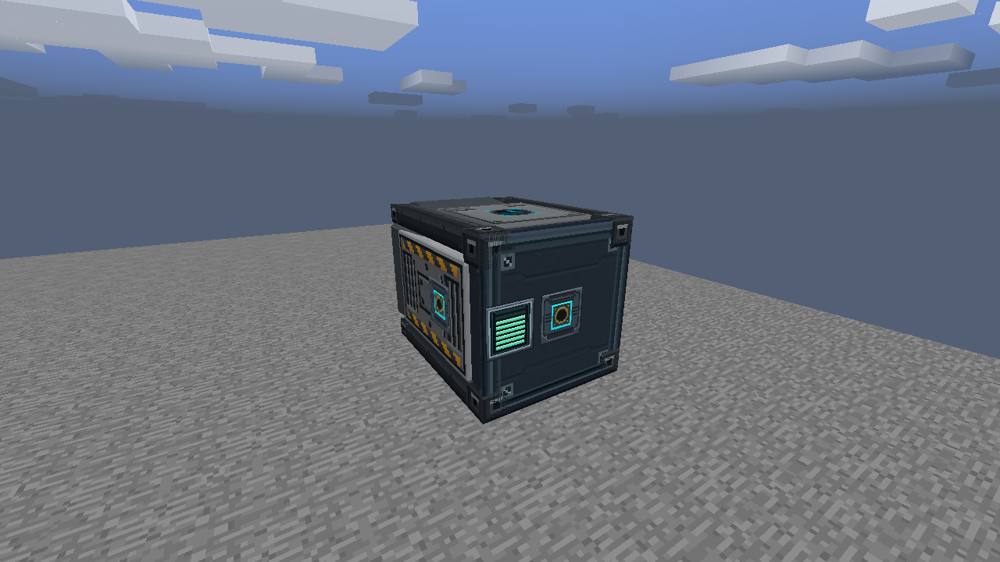

# Maxwell Drive

The Maxwell Drive supplies thrust for Flight on Forge 1.12.2. Build it with one Maxwell Drive Core and [Programmable Blocks](../README.md).

| Width × height × depth | Programmable Blocks |
| --- | ---: |
| 3 × 3 × 4 | 25 |
| 4 × 4 × 5 | 41 |
| 5 × 5 × 7 | 66 |
| 6 × 6 × 8 | 87 |
| 9 × 9 × 12 | 173 |

The construction below shows the 3 × 3 × 4 frame. Use the same base, pillars and roof rim for each size. Drive mass and thrust increase with the enclosed volume.

## 1. Build the base

Lay out a solid 3-block-wide by 4-block-deep floor. Place the Core in a bottom corner, facing the front of the drive. The nozzle will point toward the opposite end.

## 2. Raise the corner pillars

Build up from each of the four corners until the pillars are three blocks tall, counting the base. Leave the middle layer empty between the pillars.

## 3. Connect the top rim

Join the pillar tops with a continuous rectangular rim. Leave the middle of the roof open.

## 4. Assemble

Right-click the Core to form the drive and reserve the frame volume. If assembly fails, check the reported frame cell and clear the interior.

The assembled drive shown here has fuel in its tank.

## Fuel and throttle

The front and sides each have a Fluid Port In that feeds the same 1,000 mB tank. On even-sized faces the side inlet is in the center cell closer to the front. The bars beside the front inlet show the remaining fuel. Fill the drive with Thermal Refined Fuel, Ethanol, MrCrayfish’s Fuelium, or Rocket Fuel from Advanced Rocketry or Galacticraft. Use one fuel at a time.

Right-click the formed drive or use the Configurizer to open its **Engine** and **Redstone** tabs. The Engine tab shows the tank level and has a **Purge Tank** button that discards its contents.

- **Activation: Automatic** runs the drive automatically during Flight and its takeoff roll.
- **Activation: Redstone** uses the stronger of the physical input and any assigned receiving channel. **Redstone OFF** inverts the signal.
- **Digital** applies full thrust when the effective signal is positive. **Analog** scales thrust and consumption from 0 to 15. Full throttle uses 1 mB every 10 seconds and produces a yellow-white afterburner plume.

A redstone command can burn fuel when the drive is parked, for example to test the exhaust before flight. Vehicles can use several drives. Their weight contributes to takeoff and altitude limits.

## Removal

Sneak-right-click to dismantle, keeping the tank in its Core. Breaking the Core restores the remaining frame blocks. Mining a reserved cell dismantles the machine and removes that cell.

[All multiblock guides](../README.md)
