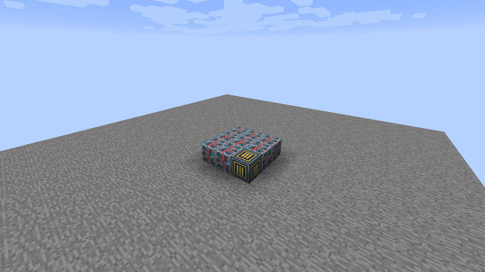
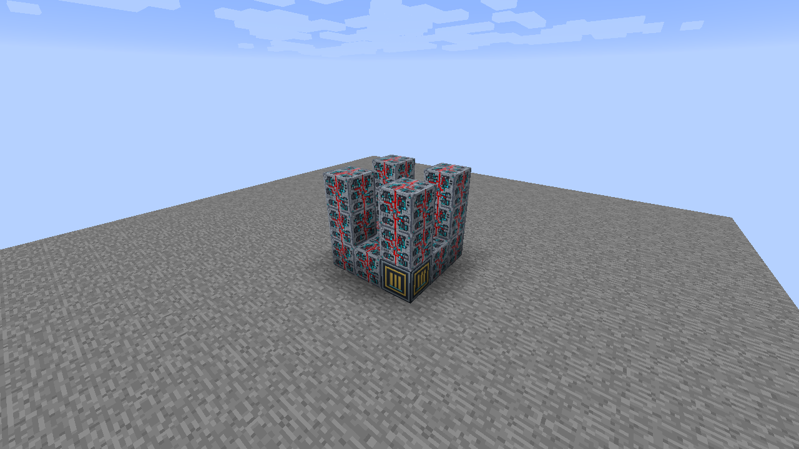
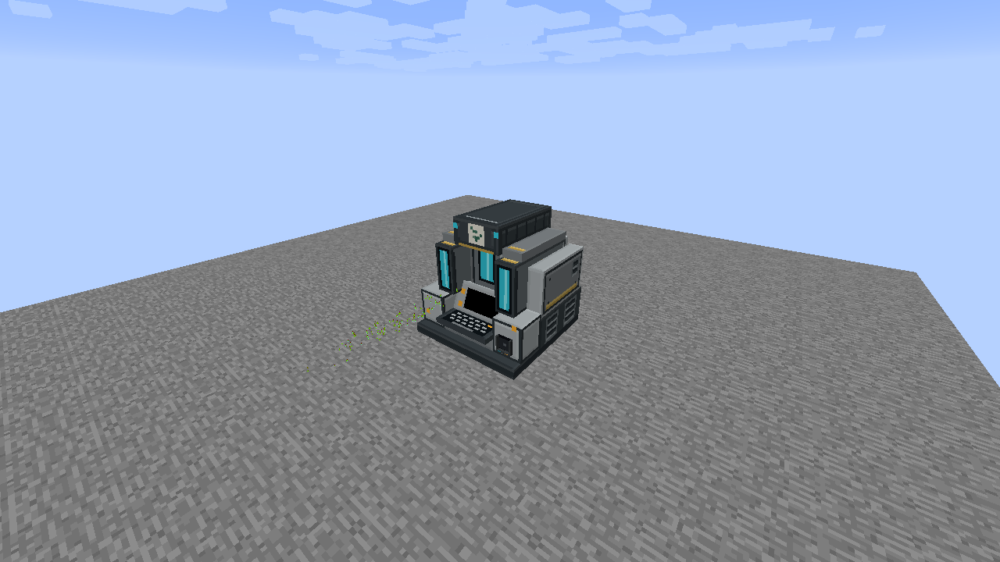
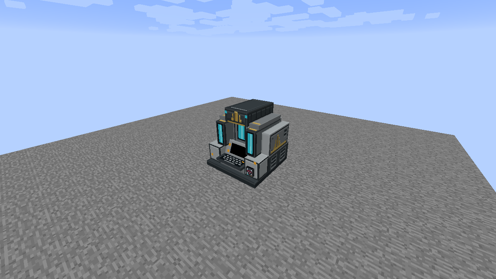

# Seyr Meridian Drive

Build a **3 wide × 3 deep × 3 high** assembly with **20 Programmable Matter Blocks** and **one Seyr Meridian Drive Core**. Core blocks are available in Creative, following the existing Universal Constructor system.

## 1. Build the base

Lay out a solid 3 × 3 bottom layer. Put the matching Core in the front-left corner, facing you, and fill every other cell with Programmable Matter Blocks.

## 2. Raise the corner pillars

At each of the four corners, build up to a total height of 3 blocks, including the bottom layer. Leave the interior empty.

## 3. Connect the top rim

Connect the four pillar tops with a rectangular rim of Programmable Matter Blocks. Keep the middle of the roof open; do not fill the interior.

## 4. Assemble

Right-click the Core. The frame becomes the complete model, and its occupied cells are reserved. If formation fails, use the reported cell to check the frame and its empty interior.

## 5. Insert a Data Chip

The native Data Chip Mount is always visible on this model. Right-click it with any Data Chip to insert one physical item; empty-hand right-click removes it. The chip stays inserted and does not gate activation. Redstone settings alone control optional power activation. The machine never emits a redstone signal.

## Operation and activation

The active front cyan lights pulse. The cosmetic pulse pauses with the client; signal brightness scales its intensity.

Open the **Engine** tab with the Configurizer. Redstone Disabled keeps the drive powered at level 15. With Redstone Enabled, the strongest physical or configured channel input supplies a level from 0 to 15; channel 0 means disconnected. Activate on ON uses this level; OFF uses 15 minus this level. Zero switches the drive off. Brightness On/Off gives the active lighting full brightness; Signal scales it by the resulting level divided by 15. Defaults are Redstone Disabled, Activate on ON and On/Off brightness. Right-click an option to select its previous value.

This drive has **no particles**, including with legacy particle settings, and offers no particle controls. It supplies no vehicle thrust and does not qualify a craft for Taxi or Hover. Data Chips are optional retained data from every company, with no Security or activation gate.

Select screen and keyboard artwork independently in their surface tabs. Model artwork preserves the supplied design.

## Facing and removal

The same frame works along either horizontal axis and with the Core in any bottom corner. The placed facing is preferred when it fits. Sneak-right-click the Core to dismantle; on a machine with a holder, aim away from the holder to dismantle rather than configure it. Mining a reserved part dismantles the frame and removes that cell. Breaking the Core restores the remaining Matter Blocks.

A retained chip stays in the Core during manual dismantling and works again after reassembly. Breaking the Core releases it once. Remove chips before rebuilding a machine when you want to keep them in your inventory.

Use the Configurizer to select artwork independently for the fitted screen/half-screen and keyboard surfaces. Model artwork preserves the original design; Black and the standard material/screen/panel catalog are also available. See [Machine display settings](../../machine-displays.md) for redstone activation and optional retained Data Chips.

These models do not yet perform crafting, propulsion, navigation calculations or dimension transfer. Their status appearances are visual states.

[All multiblock guides](../README.md) · [Data Chip Mount behavior](../../data-mounts.md)
