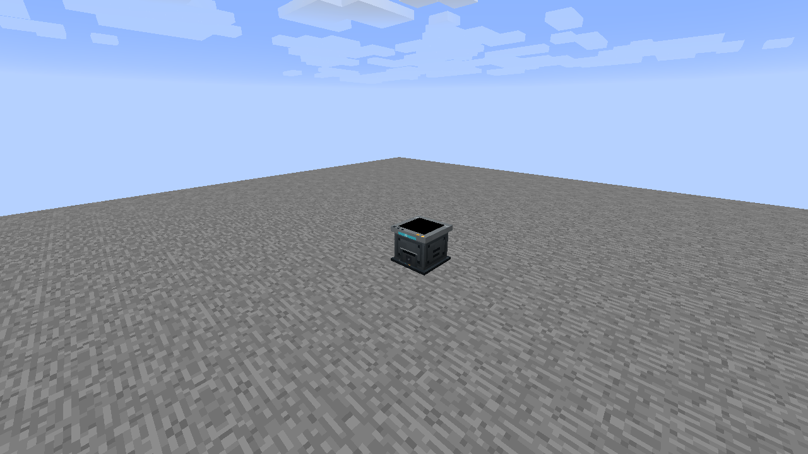
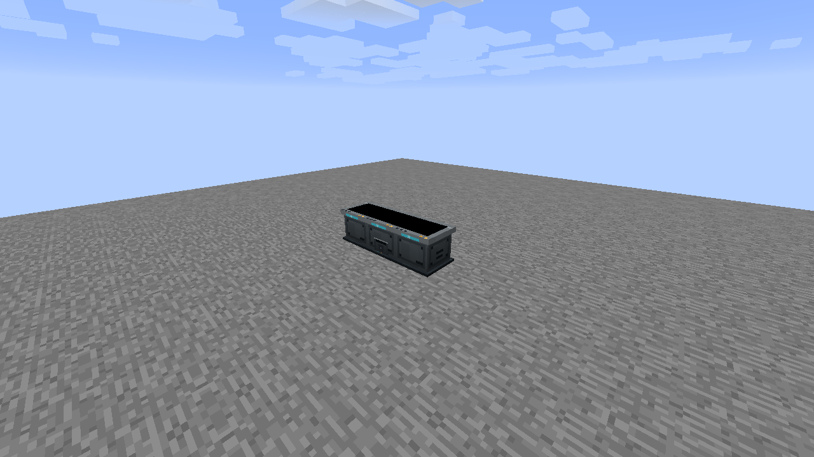
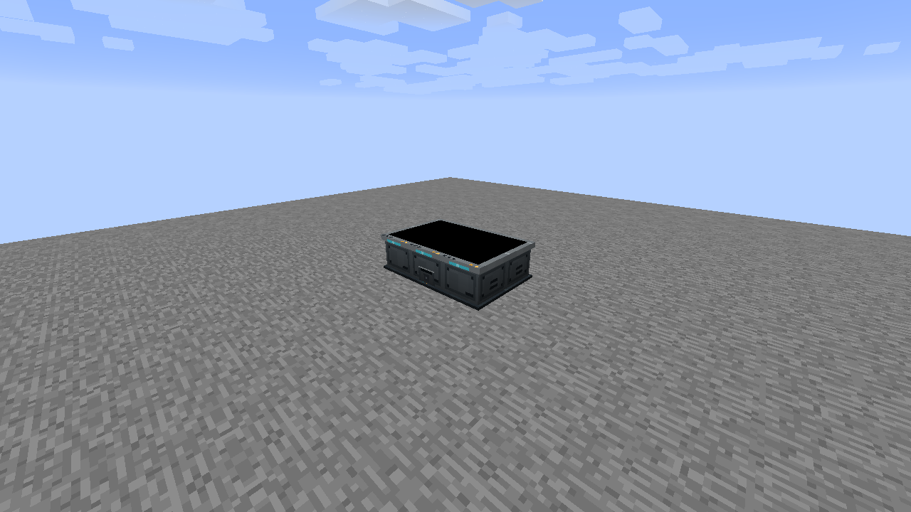
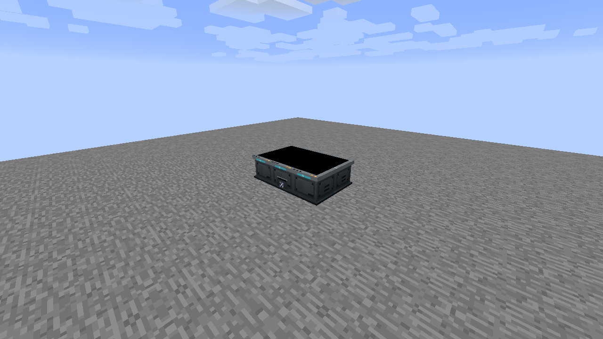

# Flat Navigation Table

These are placeable modules, so they use **no Core block and no Matter frame**. The example needs **six Flat Navigation Tables** and optionally one Data Chip.

## 1. Place the first module

Place a navigation module facing the operating side. A standalone module has one chip holder.

## 2. Extend the front row

Place matching modules side by side, facing the same way. Complete a three-module front row.

## 3. Complete the layout

Add a second complete row behind the first to make a 3 × 2 rectangle.

## 4. Use the shared chip mount

Insert a Data Chip into the one front-center holder. Use the Configurizer or sneak-right-click for the standard company filter, channels and insertion/return behavior.

## Joining and editing

All members must have the same type, facing and height. Flat tables require a filled rectangle; holes and L shapes remain unjoined. Angled consoles require one row. Assemblies are limited to 256 loaded modules. A group touching an unloaded boundary waits for complete discovery rather than inventing another chip owner.

There is exactly one holder on a valid assembly, at the center of its front row. Even widths choose the smaller local-X cell. If resizing moves the holder, its chip and configuration move with it. Remove chips before merging occupied tables: only one retained chip can occupy the shared holder, and extras are dropped once. Chips awaiting return keep their original return owner.

Screens remain blank for future navigation gameplay. Ordinary redstone output comes from the holder module; configured virtual channels use the existing dimension-wide channel bank.

[All multiblock guides](../README.md) · [Data Chip Mount behavior](../../data-mounts.md)
