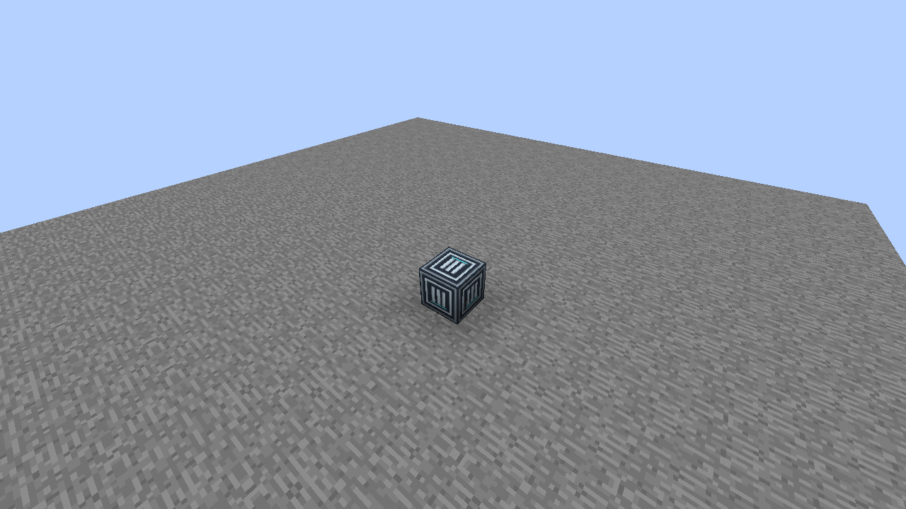
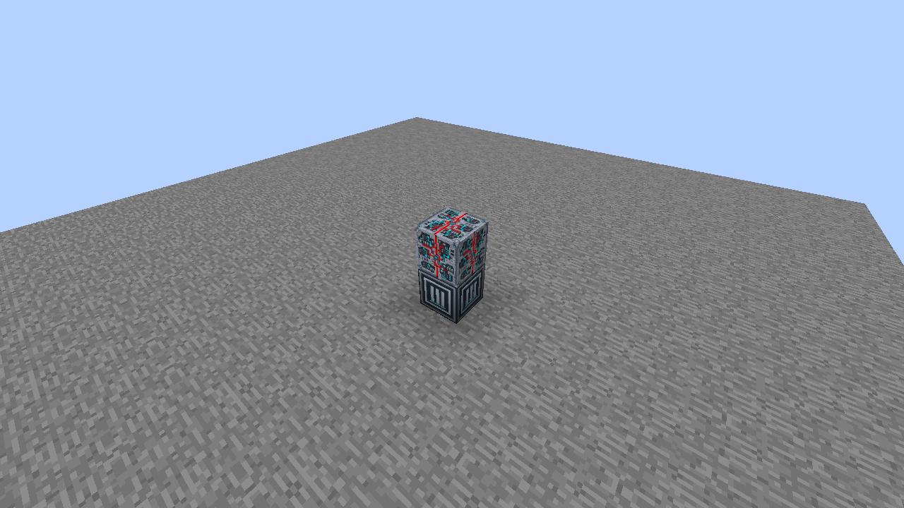
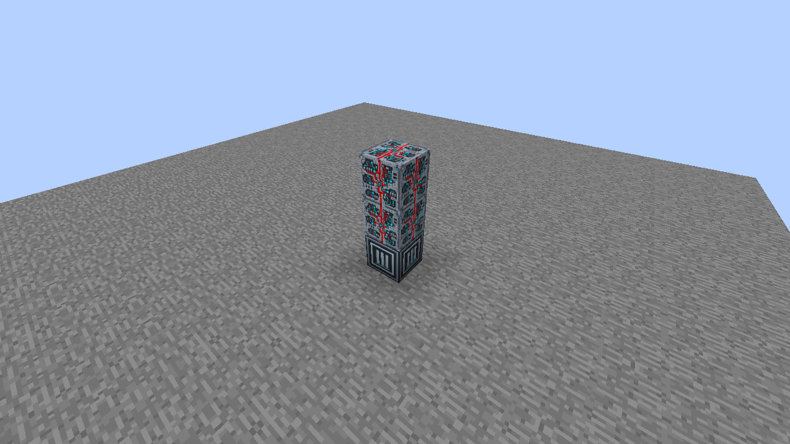
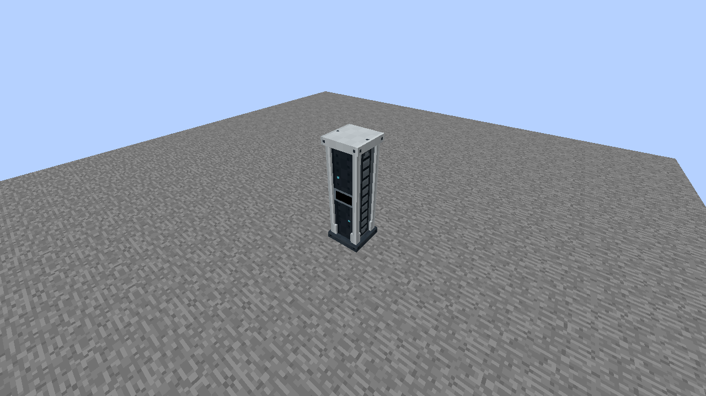

# Paladyne Navigation Computer

Build a **1 wide × 1 deep × 3 high** assembly with **2 Programmable Matter Blocks** and **one Paladyne Navigation Computer Core**. Core blocks are available in Creative, following the existing Universal Constructor system.

## 1. Place the Core

Place the matching Core on the ground, with its operating face toward you.

## 2. Add the middle block

Place one Programmable Matter Block directly above the Core.

## 3. Add the top block

Place the second Programmable Matter Block above the first. The column is now three blocks high.

## 4. Assemble

Right-click the Core to form the complete computer. The normal appearance is Idle. Right-click the formed computer to cycle Idle → Computing → Off; sneak-right-click to restore the three-block construction.

## Facing and removal

The same frame works along either horizontal axis and with the Core in any bottom corner. The placed facing is preferred when it fits. Sneak-right-click the Core to dismantle; on a machine with a holder, aim away from the holder to dismantle rather than configure it. Mining a reserved part dismantles the frame and removes that cell. Breaking the Core restores the remaining Matter Blocks.

Use the Configurizer to select artwork independently for the fitted screen/half-screen and keyboard surfaces. Model artwork preserves the original design; Black and the standard material/screen/panel catalog are also available. See [Machine display settings](../../machine-displays.md) for redstone activation and optional chip security.

These models do not yet perform crafting, propulsion, navigation calculations or dimension transfer. Their status appearances are visual states.

[All multiblock guides](../README.md) · [Data Chip Mount behavior](../../data-mounts.md)
