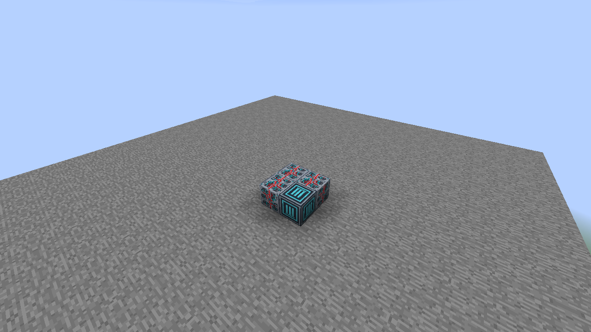
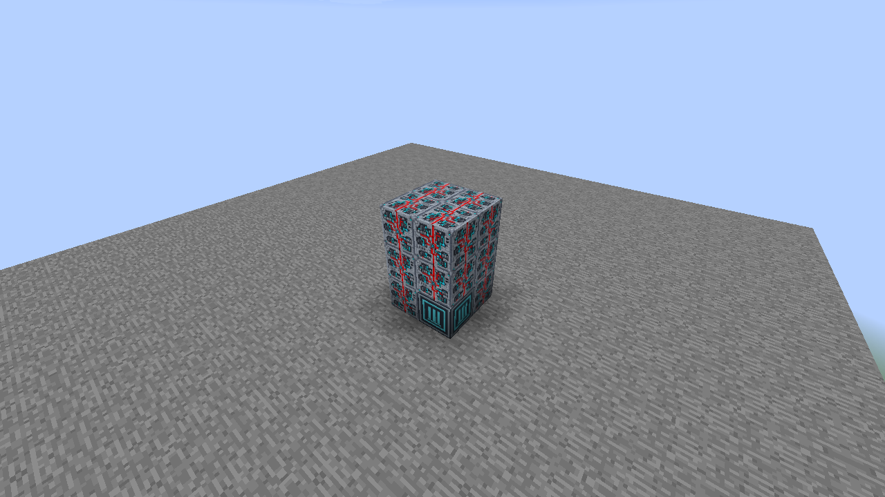
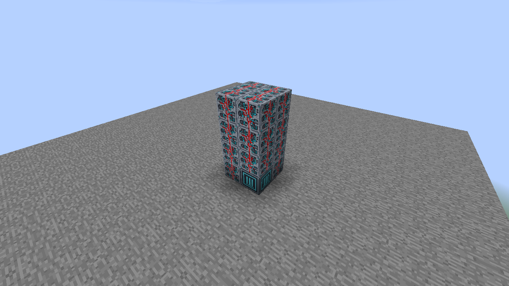
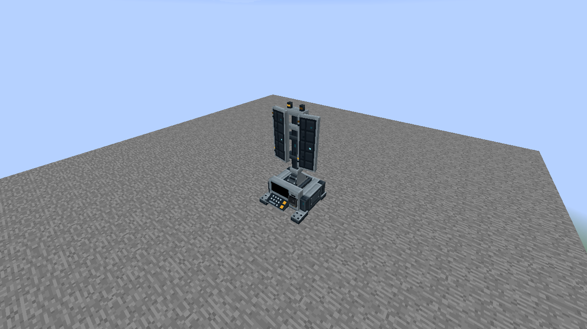

# Sentinel Array

Build a **2 wide × 2 deep × 4 high** assembly with **15 Programmable Matter Blocks** and **one Sentinel Array Core**. Core blocks are available in Creative, following the existing Universal Constructor system.

## 1. Build the base

Place a solid **2 × 2** bottom layer: one matching Core in the front-left corner, facing you, and **three Programmable Matter Blocks**.

## 2. Add the two middle layers

Add **two solid 2 × 2 layers** of Programmable Matter Blocks above the base: **eight Matter Blocks** in total. The construction is now three blocks high; leave the fourth layer empty for the next step.

## 3. Complete the top layer

Add **four Matter Blocks** as the final 2 × 2 layer. The finished construction is **four blocks high**. Every position in each 2 × 2 layer is a frame corner, so this design has **no hollow interior or open roof center**.

## 4. Assemble

Right-click the Core to form the machine. Its occupied cells are reserved. If formation fails, correct the cell reported in chat and retry.

## 5. Insert a Data Chip

The native Data Chip Mount is always visible on this model. Right-click it with any Data Chip to insert one physical item; empty-hand right-click removes it. The chip stays inserted and does not gate activation. Redstone settings alone control optional power activation. The machine never emits a redstone signal.

## Operation and activation

The default activity is **Scanning**. Right-click away from the reader to cycle Off → Idle → Scanning. The mast stays fixed while the cyan and amber indicators animate.

Use the Configurizer on the Core or any reserved cell to open the shared machine dialog. Enable Redstone to require physical power or configured input channels. Data Chips are optional retained data items and never gate activation; integrated mounts accept every Data Chip company.

Select screen and keyboard artwork independently in the same dialog. Model artwork preserves the supplied design; Black and the standard material/screen catalog are also available.

The machine emits no physical or channel redstone power. These appearances do not perform propulsion, dimensional travel, radar detection or navigation calculations.

## Facing and removal

The same frame works along either horizontal axis and with the Core in any bottom corner. The placed facing is preferred when it fits. Sneak-right-click the Core to dismantle; on a machine with a holder, aim away from the holder to dismantle rather than configure it. Mining a reserved part dismantles the frame and removes that cell. Breaking the Core restores the remaining Matter Blocks.

A retained chip stays in the Core during manual dismantling and works again after reassembly. Breaking the Core releases it once. Remove chips before rebuilding a machine when you want to keep them in your inventory.
