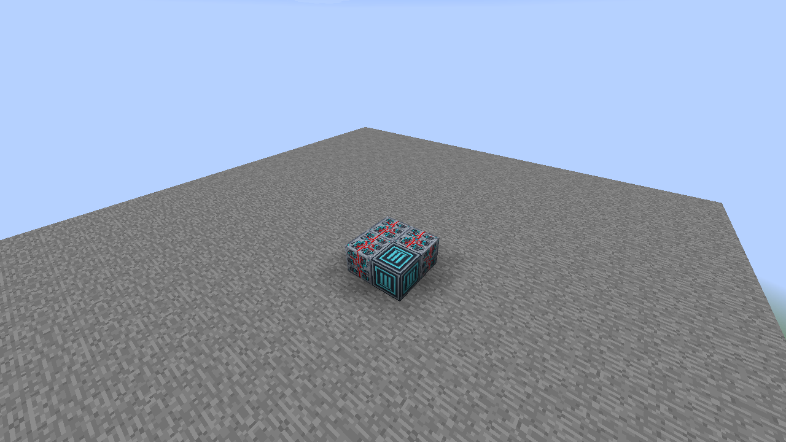
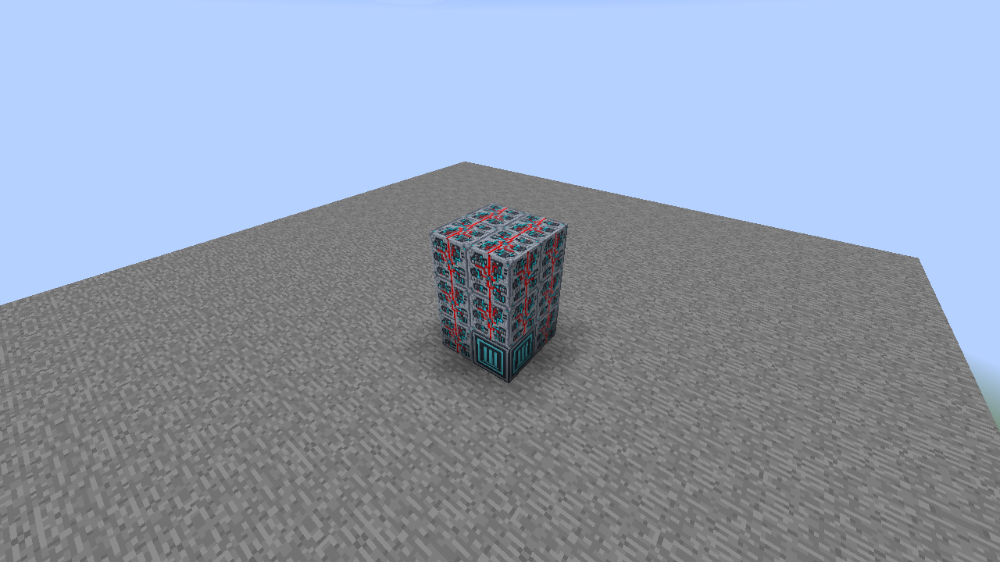
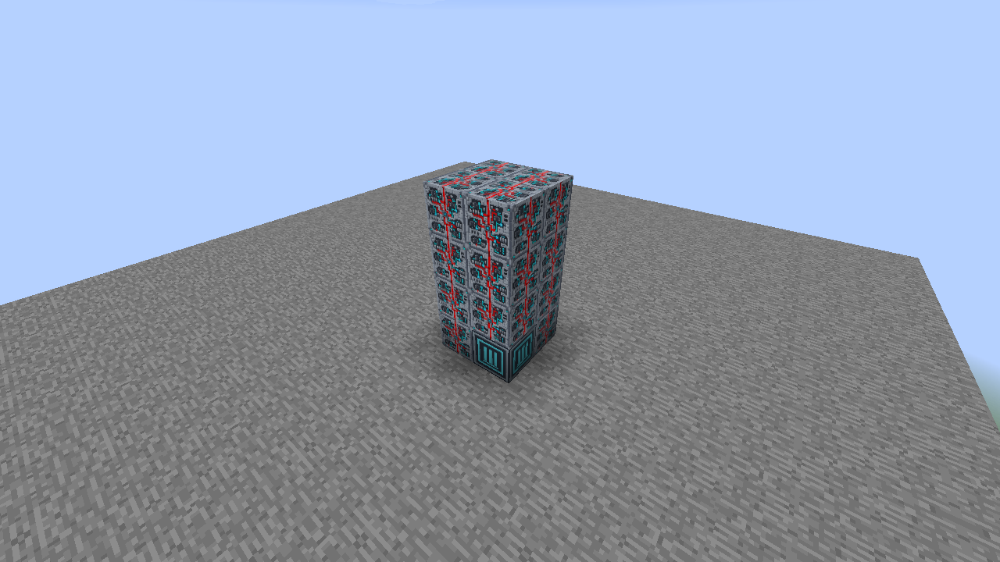
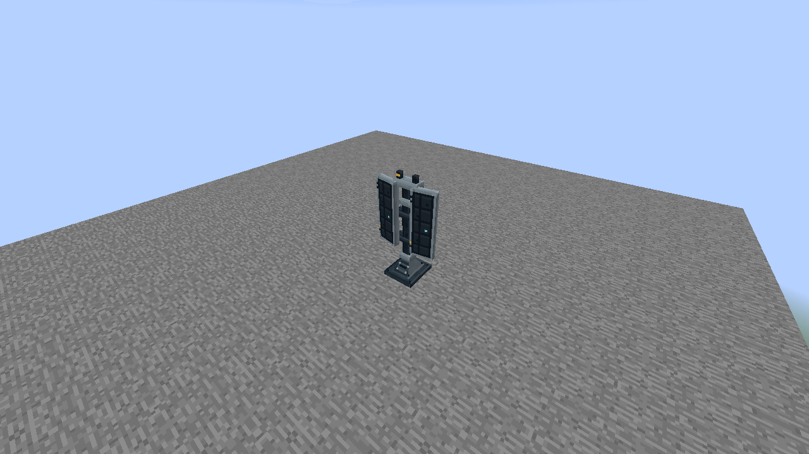

# Sentinel Array

Build a **2 wide × 2 deep × 4 high** assembly with **15 Programmable Matter Blocks** and **one Sentinel Array Core**. Core blocks are available in Creative, following the existing Universal Constructor system.

## 1. Build the base

Place a solid **2 × 2** bottom layer: one matching Core in the front-left corner, facing you, and **three Programmable Matter Blocks**.

## 2. Add the two middle layers

Add **two solid 2 × 2 layers** of Programmable Matter Blocks above the base: **eight Matter Blocks** in total. The construction is now three blocks high; leave the fourth layer empty for the next step.

## 3. Complete the top layer

Add **four Matter Blocks** as the final 2 × 2 layer. The finished construction is **four blocks high**. Every position in each 2 × 2 layer is a frame corner, so this design has **no hollow interior or open roof center**.

## 4. Assemble

Right-click the Core to form the machine. Its occupied cells are reserved. If formation fails, correct the cell reported in chat and retry.

## Operation and scanning

This standalone observer has no operator screen, keyboard or chip slot. Use the
Configurizer on the Core or any reserved cell to open its Redstone dialog. Set
Transmit channels and the connection range for nearby navigation displays. The
current **Scanning radius** appears below these controls. Scanning needs a
formed, loaded assembly; power and the cosmetic activity state do not gate it.

At Y=64, the Sentinel Array radius is 500 blocks and the Survey Dish radius is
2,500 blocks. Range rises linearly to 1,000 / 5,000 blocks at Y=128, then stays
capped for the base size. Minimum radii below Y=64 are 125 / 625 blocks. An arm's current physical pose determines the height and
coverage center while extending, retracting or rotating.

### Larger proportional frames

Use the same four construction stages for a larger frame: build a solid N×N
base with one Core at a corner, raise only the four corner pillars through the
middle layers, then connect the final N×N perimeter. Leave every other cell
air. For an inverted build, follow these stages downward from the top Core.
The assembled model scales uniformly to fit the frame.

Survey Dishes accept N×N×N frames for N=3–16. Sentinel Arrays accept N×N×2N
frames for N=2–8 (dimensions are width × depth × height). The existing limit is
16 blocks per axis. The frame needs `N² + 4H + 4N − 13` Matter Blocks plus one
Core, where H is its height.

| Observer | Frame | Matter Blocks | Radius at Y=64 | Radius at Y=128+ |
| --- | --- | ---: | ---: | ---: |
| Survey Dish | 3×3×3 | 20 | 2,500 | 5,000 |
| Survey Dish | 4×4×4 | 35 | 2,500 | 6,667 |
| Survey Dish | 5×5×5 | 52 | 2,500 | 8,333 |
| Survey Dish | 6×6×6 | 71 | 2,500 | 10,000 |
| Sentinel Array | 2×2×4 | 15 | 500 | 1,000 |
| Sentinel Array | 3×3×6 | 32 | 500 | 1,500 |
| Sentinel Array | 4×4×8 | 51 | 500 | 2,000 |

The size bonus rises linearly from zero at Y=64 to its full value at Y=128.
Twice the base linear dimensions gives +100% radius; larger frames retain that
cap. Height below Y=64 follows the base observer rule without a size bonus.
The Core's current physical height is used, including on moving arms.

## Upside-down construction

Mirror steps 1–3 vertically: start with the solid base overhead and its Core in
a corner, build the pillars downward, and finish the open rim at the bottom.
Right-click the top Core to form the inverted observer. All four horizontal
facings and corner placements work in either orientation. Sneak-right-click
the Core to dismantle it and restore the frame.

Older non-standalone variants remap to this model. Previously inserted chips
remain saved safely and return once when dismantling or breaking the owner.
New chips cannot be inserted.

[Navigation displays and scanning](../../navigation-displays.md#seed-navigation-forge-1122)

## Formed model footprint

The Sentinel Array keeps its 2×2 base footprint and existing save/arm layout.
Its mounting plate spans 1.875 blocks in both horizontal directions, with
a margin inside the reserved cells. The body is enlarged within those same
limits; the Dish containment check includes its complete ±55-degree sweep.
Proportional larger frames and inverted builds retain this fit.
