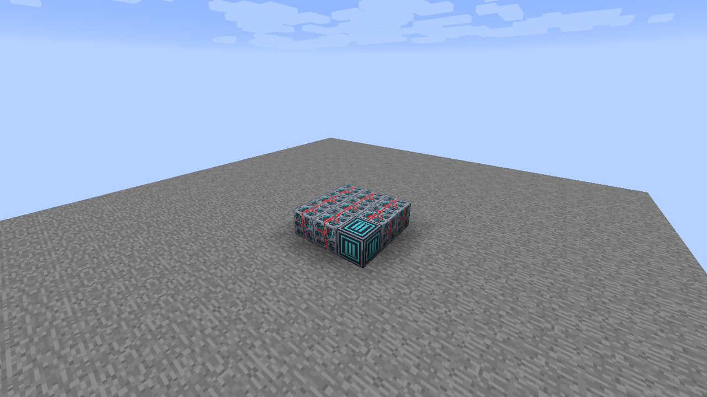
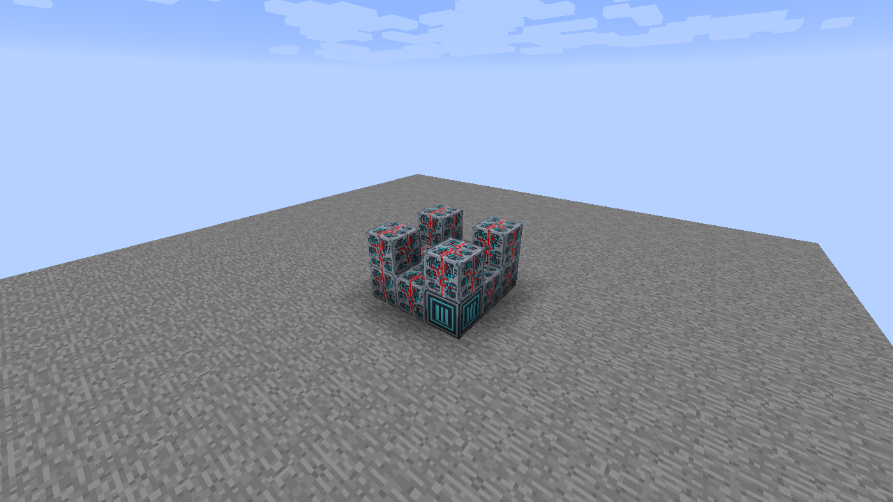
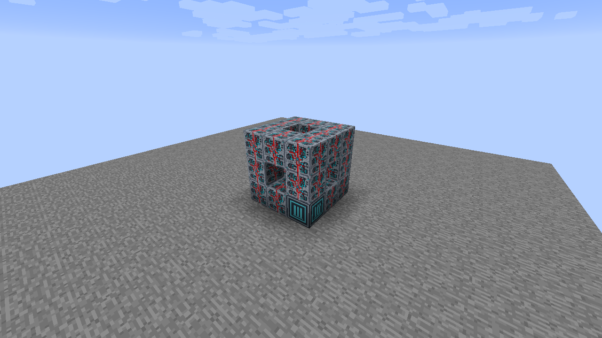
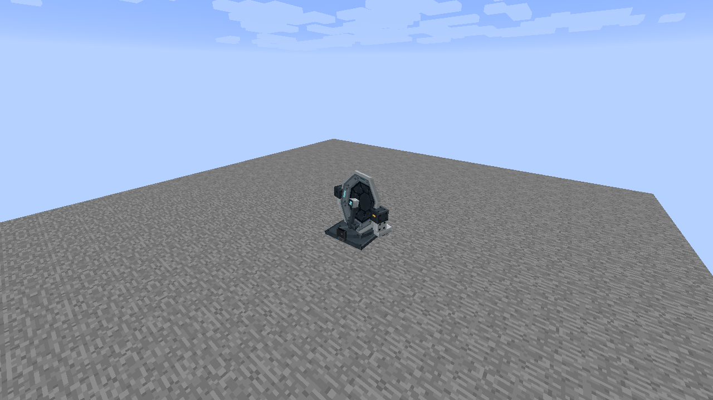
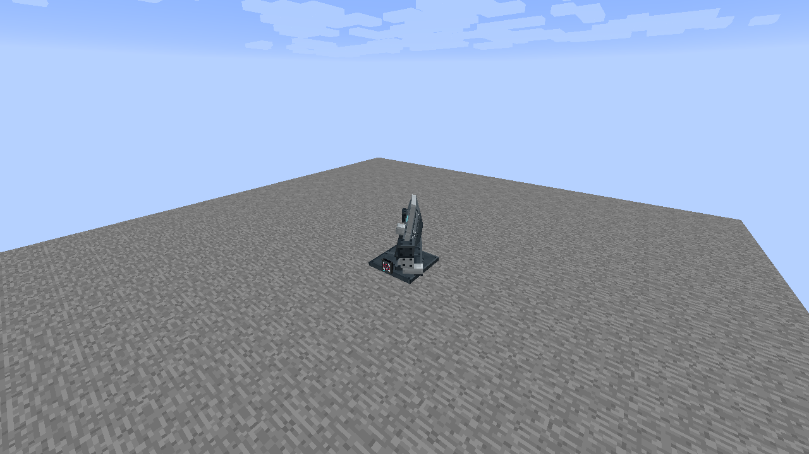

# Standalone Dish

Build a **3 wide × 3 deep × 3 high** assembly with **20 Programmable Matter Blocks** and **one Standalone Dish Core**. Core blocks are available in Creative, following the existing Universal Constructor system.

## 1. Build the base

Place a solid **3 × 3** bottom layer: one matching Core in the front-left corner, facing you, and **eight Programmable Matter Blocks**.

## 2. Raise the corner pillars

Add one Matter Block above each of the **four corners**. This adds **four Matter Blocks** and makes each pillar two blocks high. Leave the other five positions in this middle layer empty.

## 3. Connect the top rim

Add a **3 × 3 perimeter** as the third and final layer: **eight Matter Blocks**, with the center left empty. The completed frame uses twenty Matter Blocks plus its Core. Keep the middle-layer interior and the roof center empty.

## 4. Assemble

Right-click the Core to form the machine. Its occupied cells are reserved. If formation fails, correct the cell reported in chat and retry.

## 5. Insert a Data Chip

The native Data Chip Mount is always visible on this model. Right-click it with any Data Chip to insert one physical item; empty-hand right-click removes it. The chip stays inserted and does not gate activation. Redstone settings alone control optional power activation. The machine never emits a redstone signal.

## Operation and activation

The default activity is **Scanning**. Right-click away from the reader to cycle Off → Idle → Scanning. The dish, feed and yoke sweep together through ±55° on an eight-second loop. Starting and stopping fades the sweep over half a second; the base stays fixed.

Use the Configurizer on the Core or any reserved cell to open the shared machine dialog. Enable Redstone to require physical power or configured input channels. Data Chips are optional retained data items and never gate activation; integrated mounts accept every Data Chip company.

This standalone design has no operator screen or keyboard. Its native Data Chip Mount is always visible on the front of the compact base; inserting a chip is optional.

The machine emits no physical or channel redstone power. These appearances do not perform propulsion, dimensional travel, radar detection or navigation calculations.

## Facing and removal

The same frame works along either horizontal axis and with the Core in any bottom corner. The placed facing is preferred when it fits. Sneak-right-click the Core to dismantle; on a machine with a holder, aim away from the holder to dismantle rather than configure it. Mining a reserved part dismantles the frame and removes that cell. Breaking the Core restores the remaining Matter Blocks.

A retained chip stays in the Core during manual dismantling and works again after reassembly. Breaking the Core releases it once. Remove chips before rebuilding a machine when you want to keep them in your inventory.
