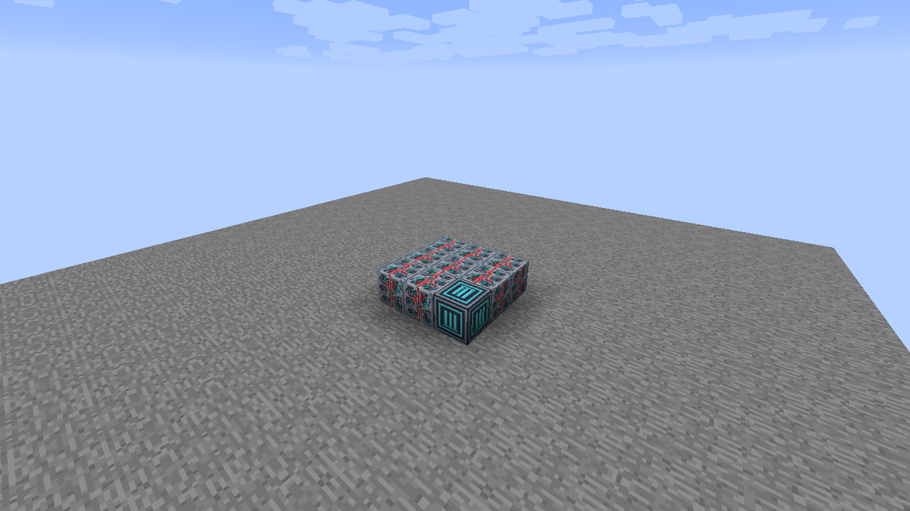
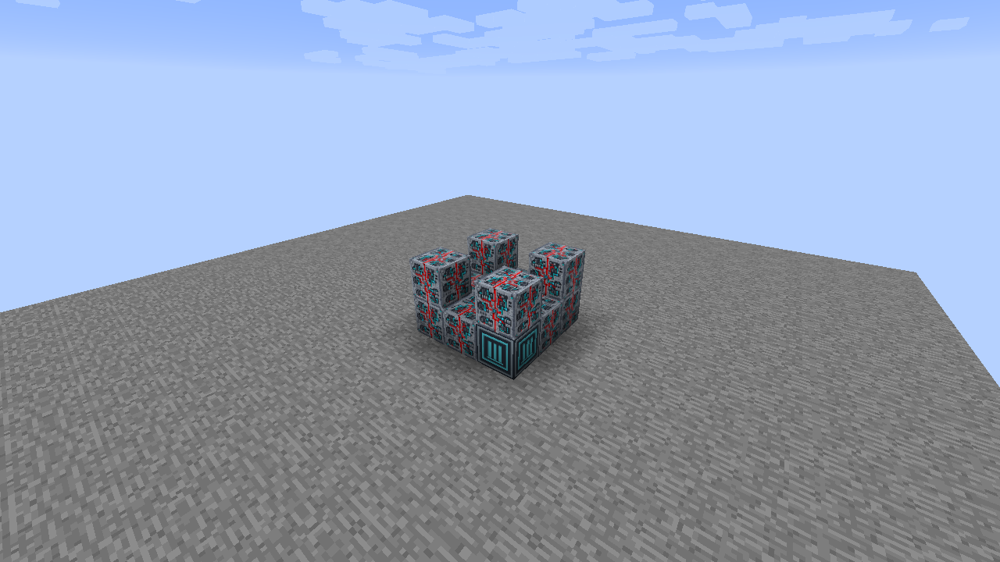
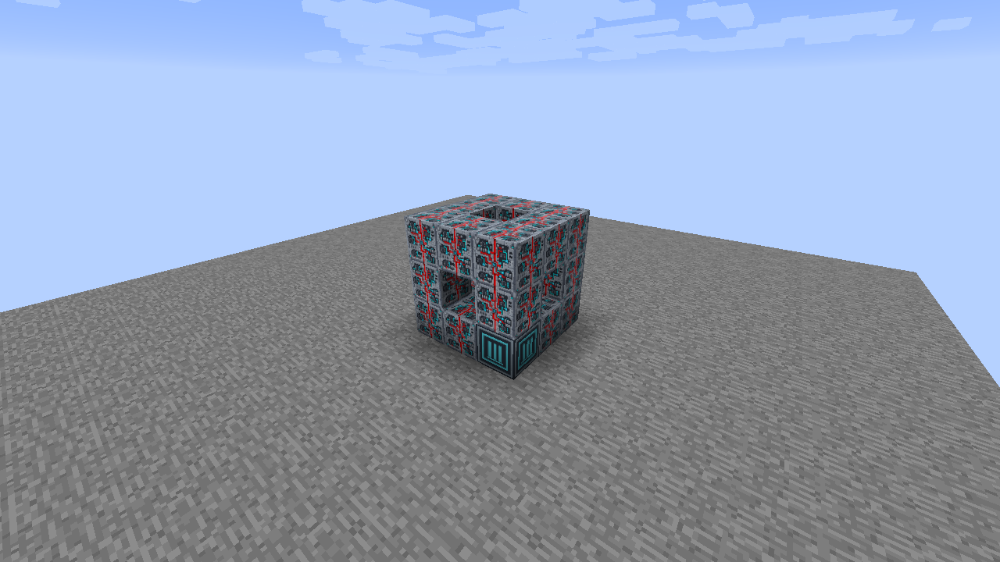
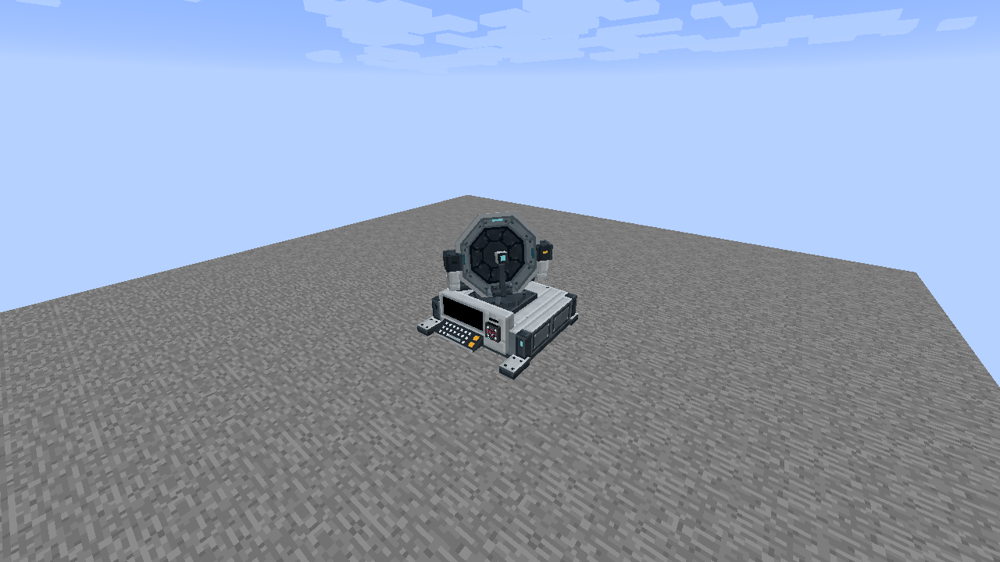

# Survey Dish

Build a **3 wide × 3 deep × 3 high** assembly with **20 Programmable Matter Blocks** and **one Survey Dish Core**. Core blocks are available in Creative, following the existing Universal Constructor system.

## 1. Build the base

Place a solid **3 × 3** bottom layer: one matching Core in the front-left corner, facing you, and **eight Programmable Matter Blocks**.

## 2. Raise the corner pillars

Add one Matter Block above each of the **four corners**. This adds **four Matter Blocks** and makes each pillar two blocks high. Leave the other five positions in this middle layer empty.

## 3. Connect the top rim

Add a **3 × 3 perimeter** as the third and final layer: **eight Matter Blocks**, with the center left empty. The completed frame uses twenty Matter Blocks plus its Core. Keep the middle-layer interior and the roof center empty.

## 4. Assemble

Right-click the Core to form the machine. Its occupied cells are reserved. If formation fails, correct the cell reported in chat and retry.

## 5. Enable Security and insert a Data Chip

Use the Configurizer on the formed machine, enable Security, and choose the accepted company. The native Data Chip Mount now appears. Right-click it with a matching Data Chip; Stay Inserted keeps the chip visible after insertion. This example leaves Redstone disabled, so the chip authorizes the active appearance. The machine never emits a redstone signal.

## Operation and activation

The default activity is **Scanning**. Right-click away from the reader to cycle Off → Idle → Scanning. The dish, feed and yoke sweep together through ±55° on an eight-second loop. Starting and stopping fades the sweep over half a second; the base stays fixed.

Use the Configurizer on the Core or any reserved cell to open the shared machine dialog. Redstone and Security are independent input gates. Enable Redstone to require physical power or configured input channels; enable Security to require a matching inserted Data Chip. Both gates must pass when both are enabled.

Select screen and keyboard artwork independently in the same dialog. Model artwork preserves the supplied design; Black and the standard material/screen catalog are also available.

The machine emits no physical or channel redstone power. These appearances do not perform propulsion, dimensional travel, radar detection or navigation calculations.

## Facing and removal

The frame works along either horizontal axis, with its Core in any bottom corner. The placed facing is preferred when it fits. Sneak-right-click away from the chip holder to dismantle and recover the Matter frame. Mining a reserved part dismantles the machine and removes that cell; breaking the Core restores the remaining Matter Blocks.

A retained chip stays in the Core during manual dismantling and is available after reassembly. Breaking the Core releases the chip once.

[All multiblock guides](../README.md) · [Machine display settings](../../machine-displays.md) · [Data Chip Mounts](../../data-mounts.md)
