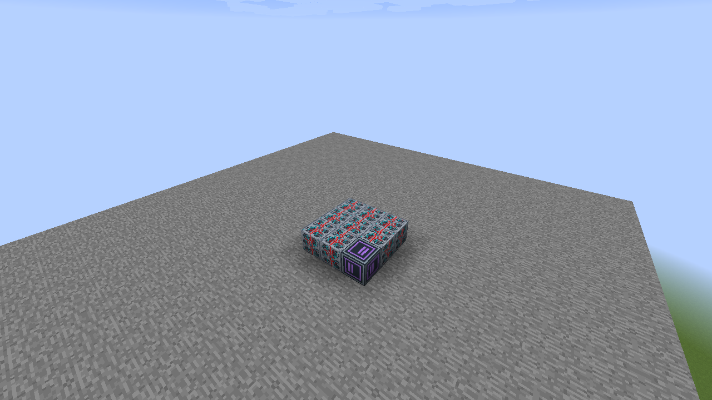
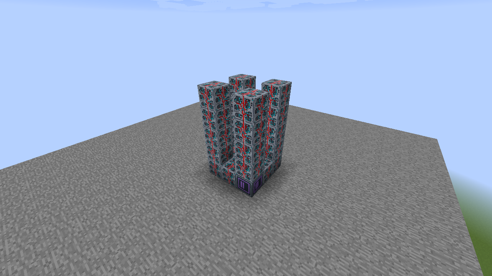
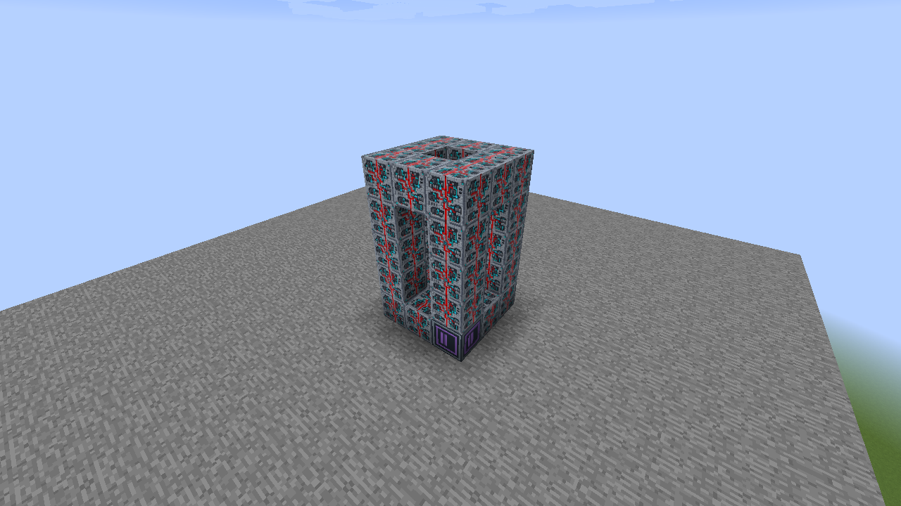
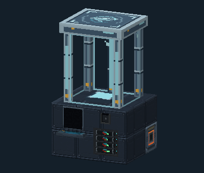
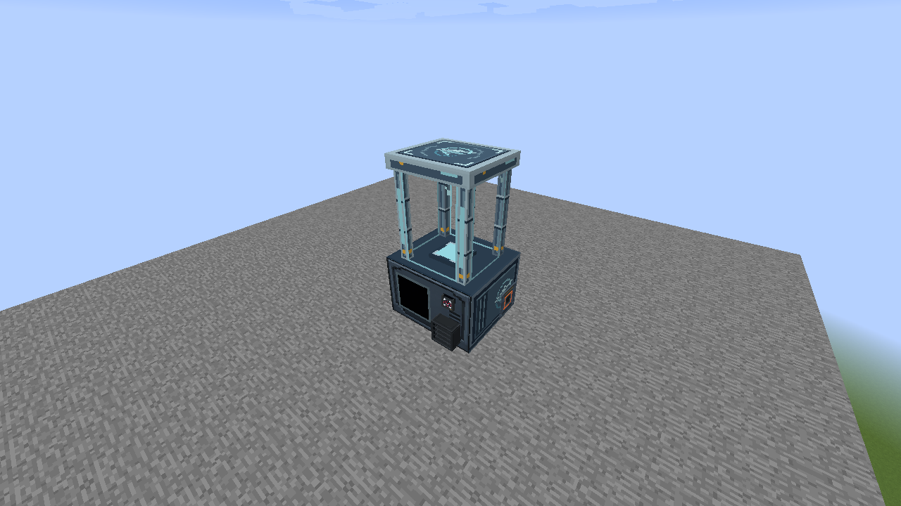

# Synthesis Tower

Build a **3 wide × 3 deep × 5 high** assembly with **28 Programmable Matter Blocks** and **one Synthesis Tower Core**. Core blocks are available in Creative, following the existing Universal Constructor system.

## 1. Build the base

Lay out a solid 3 × 3 bottom layer. Put the matching Core in the front-left corner, facing you, and fill every other cell with Programmable Matter Blocks.

## 2. Raise the corner pillars

At each of the four corners, build up to a total height of 5 blocks, including the bottom layer. Leave the interior empty.

## 3. Connect the top rim

Connect the four pillar tops with a rectangular rim of Programmable Matter Blocks. Keep the middle of the roof open; do not fill the interior.

## 4. Assemble

Right-click the Core. The frame becomes the complete model, and its occupied cells are reserved. If formation fails, use the reported cell to check the frame and its empty interior.

The assembled view also shows four optional Battery Modules installed in the fitted rack.

## 5. Insert a Data Chip

The native Data Chip Mount is always visible on this model. Right-click it with any Data Chip to insert one physical item; empty-hand right-click removes it. The chip stays inserted and does not gate activation. Redstone settings alone control optional power activation. The machine never emits a redstone signal.

The operating view shows the retained chip alongside a powered Core build.

## Facing and removal

The same frame works along either horizontal axis and with the Core in any bottom corner. The placed facing is preferred when it fits. Sneak-right-click the Core to dismantle; on a machine with a holder, aim away from the holder to dismantle rather than configure it. Mining a reserved part dismantles the frame and removes that cell. Breaking the Core restores the remaining Matter Blocks.

On Forge 1.12.2 and NeoForge 1.21.1, the formed Synthesis Tower produces constructor Cores from Programmable Matter and RF. Right-click it to select a design, supply up to four charged Battery Modules (40,000 RF total) or external RF, and insert Matter. Its Redstone tab controls physical and receiving-channel activation. See [production and ports](../../universal-constructors.md#synthesis-tower-production) for operating details.

Each Core consumes one Matter Block and 16,000 RF over at least forty seconds.
The front left has a smaller square preview screen and projecting keyboard;
the right has the chip mount and a flush four-bay rack. A chest beside either
item-output face receives finished Cores automatically. The original frame
size, twenty-eight Matter Blocks and Core placement are unchanged.

Use the Production tab's **Mode** button to switch to **Digitize**. Insert a
Data Chip and one eligible block into Input, or place the held block into the
chamber. The reverse scan consumes the block and 8,000 RF and replaces the chip
with a one-block Catalog. Insert that Catalog to synthesize the same design.
See [Digitize a block](../../universal-constructors.md#digitize-a-block) for
supported blocks, appearance retention and cancellation behavior.
