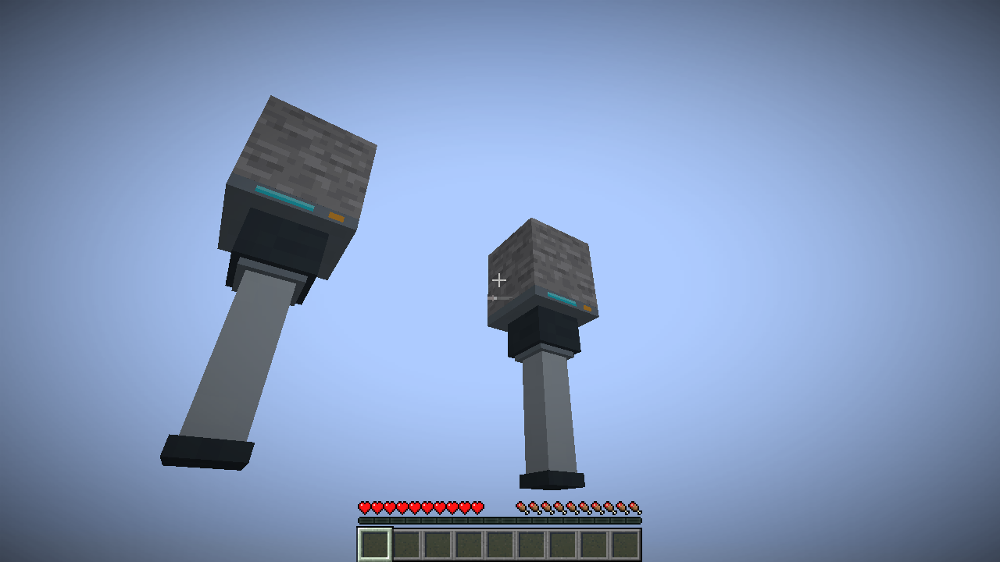
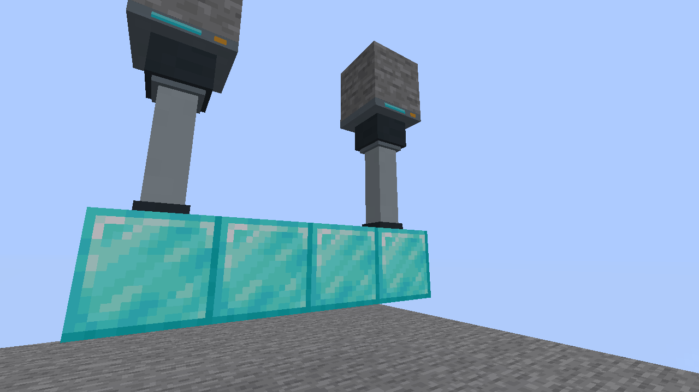
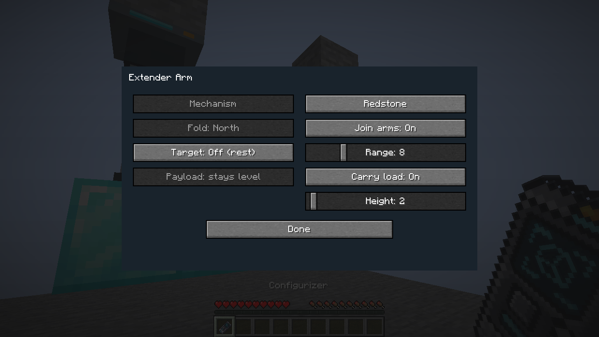

# Joined arm platforms in Minecraft 1.21.1

This guide describes the native NeoForge arm implementation. Regular and Large arms, mounts, Plates, Skis and Wheels are available in the Vandor Labs creative tab and vanilla item search. Regular and Large Extenders and Rotating Arms use the same construction rules. Keep one arm type, size, mounting face and section count within each group. Tracks, **Push blocks** and Vehicle Mode are unavailable on this target.

## Build a supported platform

1. Place solid mounting blocks first. Place matching Extender columns at both ends of a row or at the corners of a rectangular platform. Each column must contain the same number of sections. Two or more sections allow a whole-block retracted endpoint; a one-section Extender stops between blocks. Keep the mounting blocks in place throughout the stroke.

   

2. Connect all tips with one face-connected layer of blocks. A hollow frame is allowed. Diagonal contact alone does not join a corner. Keep surrounding walls, floor and ceiling clear of the moving mechanism and its load.

   

3. Hold the Configurizer and use each column to open its dedicated arm dialog. With every arm at rest, turn **Join arms** on. Give all columns the same **Range** (1–32 blocks), large enough to reach each neighbouring column. Keep the other settings identical. Intermediate columns can connect a longer platform. The dialog stays open when joining chooses another primary controller.

   

4. For a vertical Extender, turn **Carry load** on to include supported blocks above the platform. Set **Height** to the required 1–32 blocks. Put a chest or other ordinary supported load inside the selected platform region and height. Sideways Extenders and Rotating Arms select the platform layer only.

5. Set **Activation: Manual**, then choose **Target: On (active)** to move the platform. Empty-hand use of the mechanism also toggles its manual target. The Configurizer always opens the same dedicated dialog. Use **Target: Off (rest)** to return before altering the columns, joining settings or selected load.

The images show a two-column native ceiling installation built with Survival placement. For larger hollow frames and load arrangements, see the [joined platform construction examples](joined-arm-platforms.md). Keep all participating chunks loaded. Unloaded, disconnected or obstructed layouts retain ownership and report an error instead of discarding the load. Clear an obstruction and toggle the target to retry.

## Mounting and rotating arms

Arms support the floor, ceiling and all four wall mounting faces. Place sections outward from the mounting block. A sideways Extender joins in the plane perpendicular to its travel. Large arms need clearance for their wider parts.

For a rotating platform, place matching Rotating Arm columns in a straight row along their hinge axis and connect their extended tips with one layer. Enable **Join arms** and matching **Range** on every column. Set the same world-facing **Fold** direction and payload mode throughout the row. **Payload: rotates** turns the platform with the arm; **Payload: stays level** preserves its orientation. **Start** and **End** use 15-degree steps. **Hinge: Middle** is available with a zero start angle. Return to rest before changing these choices. Non-grid endpoints keep a captured, selectable payload rather than placing fractional world blocks.

A formed Ski or Wheel assembly also exposes a separate **Foot** direction. This changes the foot's facing without changing **Fold**. Landing Plates do not need that control. To construct landing feet and their Large footprints, see [Modular landing gear](modular-landing-gear.md).

## Controls and editing

Use the **Redstone** tab to select Manual, Powered or Unpowered activation and its receive channels. Right-click an option to choose its previous value; left-click chooses the next. Sliders and channels are acknowledged by the server. Unsupported changes while moving retain the previous configuration.

At a grid-aligned materialized endpoint, edit the native platform blocks in place. The next move captures the connected platform as it exists then. Removing the entire platform allows the empty arms to return. Keep every corner connected when removing individual blocks. Mine the visible captured blocks at a fractional endpoint. They are not ordinary world blocks until materialized.

Some vanilla block states cannot represent a quarter-turn orientation. Those attachments remain captured and selectable until a representable endpoint is reached; mine the visible captured block if it must be removed there. Native inventory interaction is available when the payload has materialized as world blocks.
