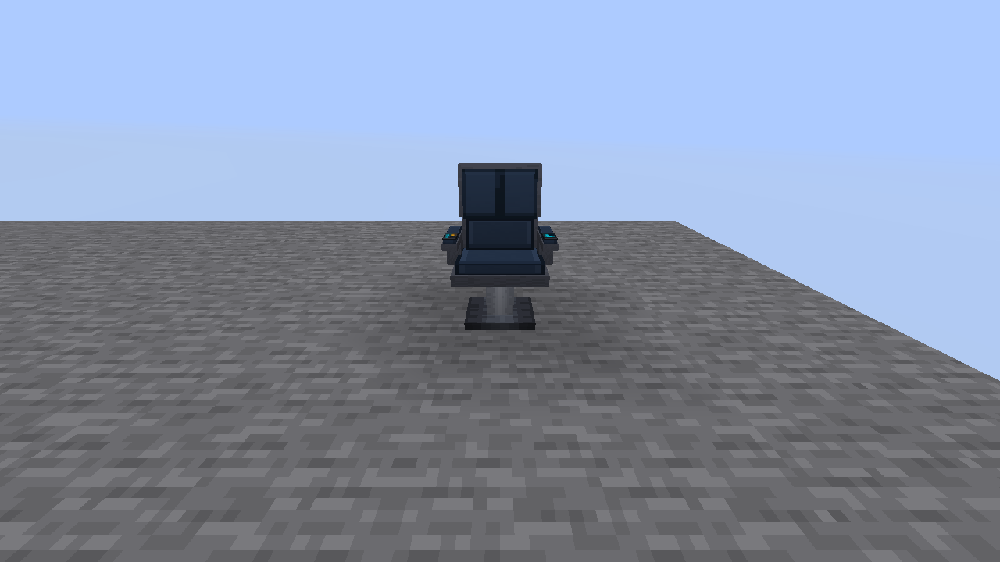
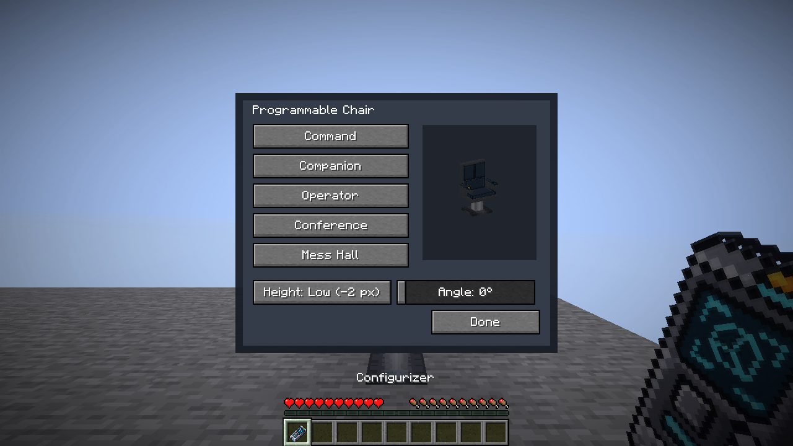
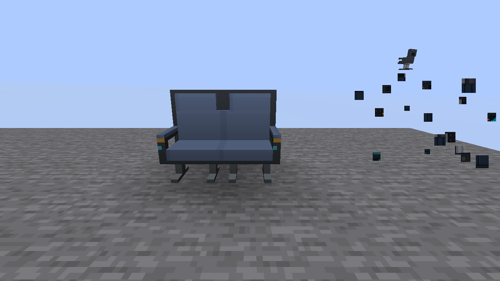

# Chairs and Seats on Minecraft 1.21.1

Programmable Chair, Luxury Seat, Military Seat and Pilot Seat use the authored furniture models. Each seat reserves the block above its lower cell. Leave that space clear before placing it.

1. Place the seat on a floor. The lower cell owns the saved settings; its upper cell is the backrest reservation.
2. Right-click to sit. Sneak to dismount onto nearby clear ground.
3. Use the Configurizer, or sneak-right-click in Creative, to open the same dedicated settings dialog. Right-click a cycling option to choose its previous value.
4. Pick or mine either seat cell to obtain one configured seat item. Mining either cell removes the two-cell seat.

Programmable Chair offers five styles, three heights and eight angles in 45° steps. The model and seated facing turn together. The configured item retains the selected style, height and angle.

Luxury and Military Seats join adjacent seats of the same kind, facing and height when both have **Join** enabled. Their default legs are one pixel taller than the original authored model; Low and High shift the seat by two pixels. Different heights, facings, kinds or disabled joining keep independent ends. Removing a module restores the surviving module's end.

Pilot Seat provides four stationary seating heights and hides armrests against adjacent full blocks. Its upper reservation may share compatible Canopy Glass. Saved Pilot Seat data, including dormant Taxi settings, survives configured picking and replacement. Vehicle assembly, driving, Taxi behavior and preview controls are unavailable in this native stationary adapter.

All four native families remain world furniture. Arms and ramps refuse seating cells before ownership transfer; moving two-cell seats and carried passengers are not supported. The existing Minecraft 1.12.2 moving-seat behavior is unchanged.

The [chair gallery](gallery/chairs.md) shows the shared authored styles. The construction and settings images above show native placement and the same dedicated editor used by the Configurizer.
