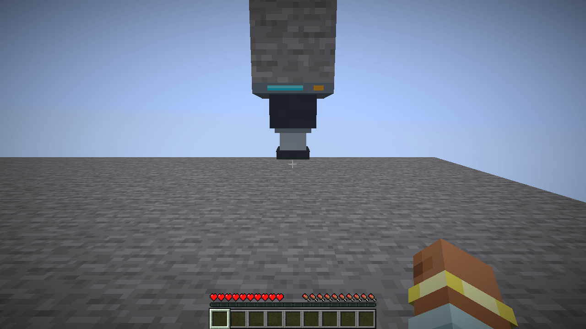
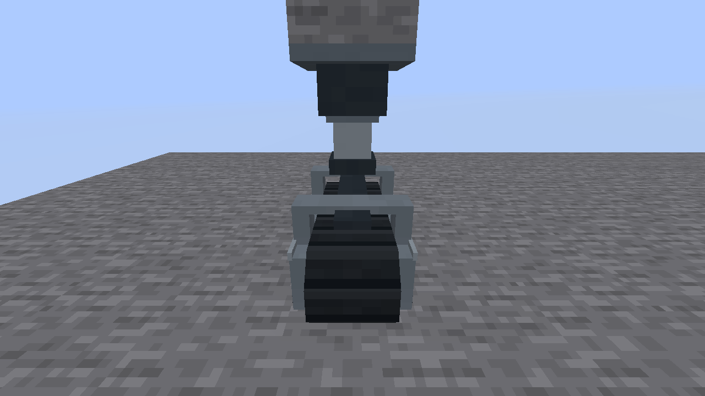
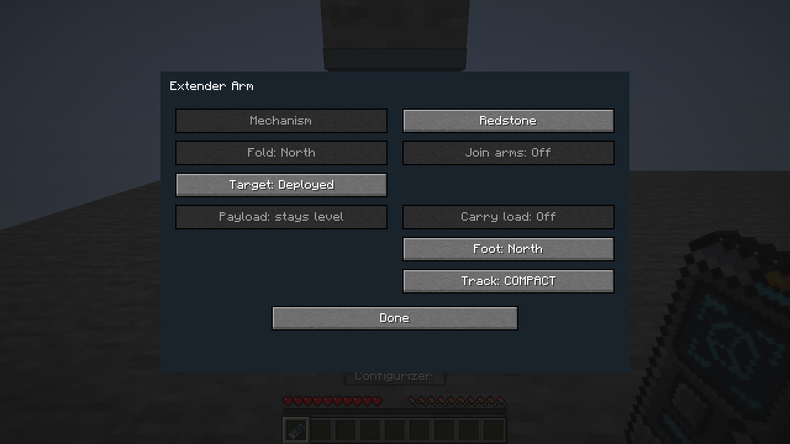
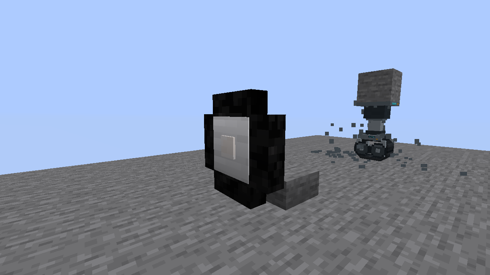

# Tracks and side wheels on NeoForge 1.21.1

Tracks and Small, Medium and Large side wheels are available in the normal Vandor Labs catalog. These use the existing Forge artwork and block identities. The older integrated telescoping landing-gear variants are a separate compatibility family.

## Build a Track landing group

1. Place an Extender Arm, Rotating Arm or Fixed Mount against its support. Regular and Large arms can mount on all six faces. Leave the intended stroke clear.
2. Place a Track against the deployed arm tip. Add adjacent Tracks in the same foot plane; matching orientation and style form one group. Keep the group and its boundary loaded while building or changing it.
3. Use the Configurizer on a member to open the mechanism dialog. Select Compact, Armoured or Bogie. Changing style updates the complete connected group. Right-click an option to select its previous value.
4. Configure manual or Redstone activation through the normal mechanism and Redstone tabs. Fully deploy the group before changing its style or foot direction. A Rotating Arm can rotate the foot or keep it level.

An unattached Track opens a smaller style dialog. The canonical Track item retains its selected style when picked or mined; older Armoured/Bogie registry IDs remain readable without adding duplicate catalog items. The Duplifier copies style and mechanism choices, including Undo, without copying resource or assembly ownership.

Discovery is bounded to 64 connected Tracks and a 16-block horizontal span. Different orientations or styles form separate groups. A formed moving group renders once through its controller; stationary Tracks use cached terrain geometry.

## Place a side wheel

1. Place a vanilla, programmable or programmable-light slab as the mounting support.
2. Select a Small, Medium or Large side wheel and click a horizontal side of the slab. A Large Wheel needs a clear two-by-two vertical footprint: the clicked cell, its neighbor to the wheel's right, and the two cells above them.
3. Mine a wheel with a stone-tier or better pickaxe. Mining any Large Wheel cell removes its companions and drops one wheel item.

Side wheels are stationary native blocks without block entities or tickers. They are separate from the modular Landing Wheel foot used on arms. For the Forge construction reference and existing arm layouts, see [Modular Landing Gear](modular-landing-gear.md).
