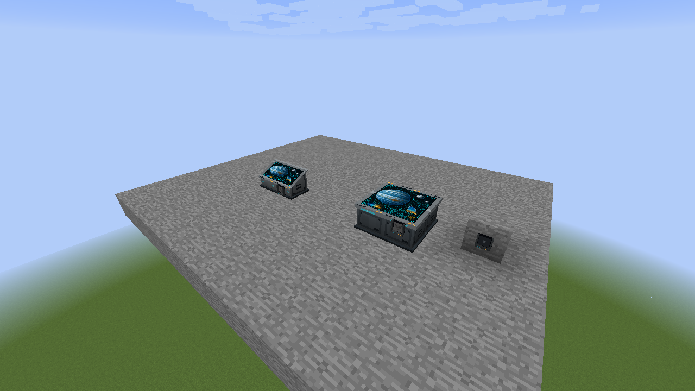
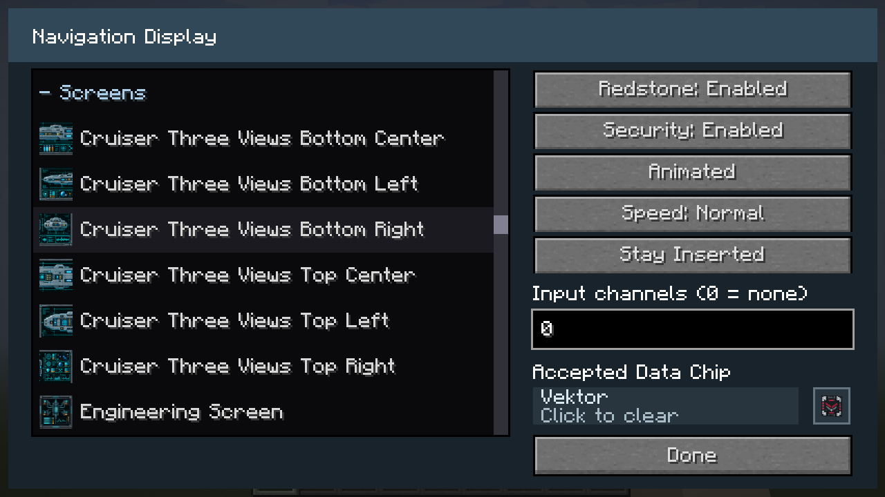
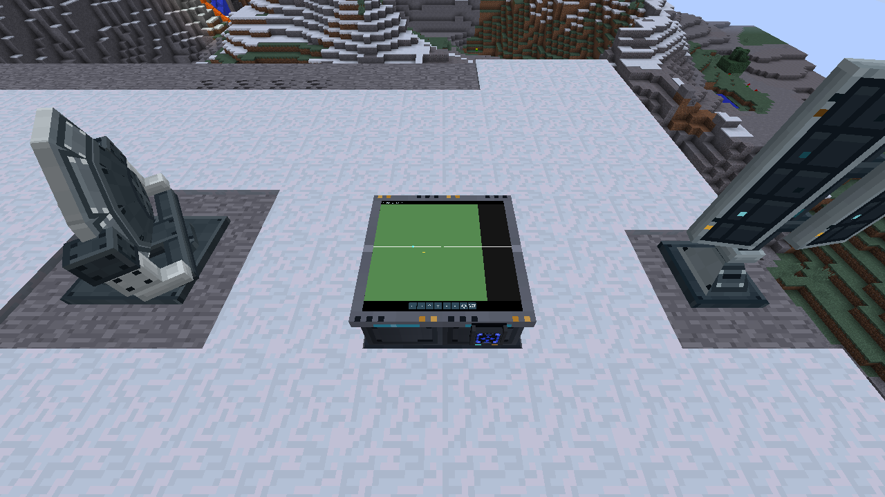
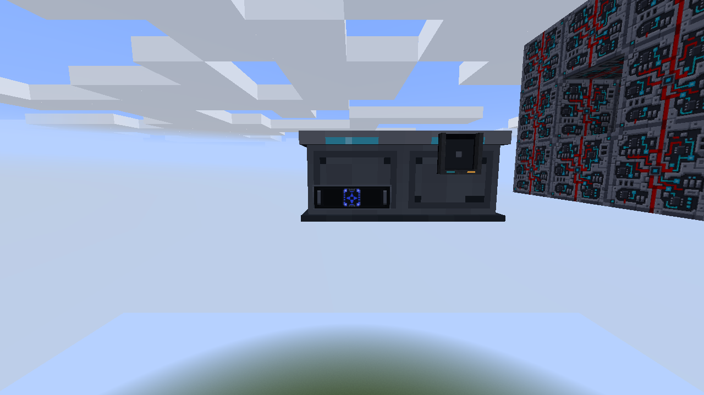

# Navigation display settings

[Flat Navigation Tables](multiblocks/navigation-table-flat/README.md) join into filled rectangles, including opposite-facing rows. Put their button panels around the outside to create one continuous inner screen. [Angled Navigation Consoles](multiblocks/navigation-table-angled/README.md) join sideways in a row facing the same direction.



Use the Configurizer or sneak-right-click any module to edit the shared display. Choose a Programmable Block material or any screen/panel artwork, including the keyboard and half-screen designs. The shared **Custom...** picker also accepts sampled block materials. **Black** remains available; new tables default to **Navigation**. Animated artwork offers Static/Animated playback and Slow/Normal/Fast speed. The image spans the joined display; it does not repeat separately on each module.



**Redstone** is disabled by default. With it disabled, the selected artwork is visible without a chip. Enable Redstone to require physical power on any member or ordinary Vandor Labs input channels; `0` means disconnected. Without power an enabled display is black. Every navigation module has **zero physical and channel output**, including when a chip is inserted. These activation settings apply to artwork. Navigation mode uses observer/channel matching instead of redstone power.

Every valid assembly shares one always-visible Data Chip Mount. Any Data Chip company or type is accepted. Inserting or removing the chip never changes display activation. New chips stay inserted until removed with an empty hand. The integrated dialog has no Security, company filter or return-mode controls. Older saved Security/filter/behavior selections are ignored; an already pending return still completes to its original owner, preserving the actual item and animation state.

The frame and chip use the standalone mount's native size, with half a pixel of clearance below the top of the front panel. Resizing moves the mount, chip and settings together. Settings are saved on every member so a split retains its display configuration; the physical chip remains one item on its owning component. Remove chips before merging occupied assemblies, since extra retained chips are dropped once. Standalone Data Chip Mount and Access Card reader settings remain independent; see [Data Chip Mounts](data-mounts.md).

Assemblies require a complete loaded rectangle of at most 256 modules. Holes, incomplete rows and unloaded boundaries do not create extra mount owners. Screens keep their configured orientation when carried structures rotate.

[Core-based machine display settings](machine-displays.md)

## Seed navigation (Forge 1.12.2)



New Flat Navigation Tables and Angled Navigation Consoles select **Navigation**
by default. Existing saved artwork remains selected. Choose Navigation at the
bottom of a supported display's texture list to use the map. Programmable
Screens, Diagonal Screens and the Console/Half Console variants use their
existing chip readers; a plain Programmable Screen can use an attached Data Chip
Mount. Other screen families are unchanged.

1. Assemble a Sentinel Array or Survey Dish. Only the standalone models remain.
2. Open its configuration and select **Redstone**. Enter its **Transmit channels**
   and choose a connection range of 4, 8, 16, 32, 64, 128 or 256 blocks
   (default 16).
3. Set the display's **Receive channels** to include one or more source channels.
4. Use the bottom buttons to pan west/east/north/south and zoom in/out. The map
   is north-up; X/Z coordinates above it identify the center.

Sources must be formed and loaded in the same dimension. They need no power,
redstone signal or chip. Transmission range is the three-dimensional distance
from the source Core to the display; it controls the connection, not observation.
At Y=64, Sentinel Arrays observe a **500-block radius** and Survey Dishes a
**2,500-block radius**, measured horizontally from their Cores. Range rises
linearly to **1,000 / 5,000 blocks at Y=128** for the base sizes, then stays capped. Below Y=64,
the same linear rule applies down to minimum radii of 125 / 625 blocks. The dialog shows the
current scanning radius. Extending and rotating arms update it from the
observer's physical position, including during movement. All matching
sources and selected receive channels contribute to the same coverage area.
Ordinary redstone transmitters cannot supply navigation.

Enlarged observers render the same mesh once per controller; their reserved
cells do not add renderers. See [observer rendering measurements](performance/navigation-observers.md).
The Array has an animated scanning texture; the Dish has a moving rotor.

Larger proportional frames increase only the altitude bonus above Y=64. A
Survey Dish accepts N×N×N (N=3–16); a Sentinel Array accepts N×N×2N (N=2–8).
Doubling every base dimension reaches +100% radius at Y=128: a 6×6×6 Dish
reaches 10,000 blocks and a 4×4×8 Array reaches 2,000. Larger frames stay capped
there. Intermediate sizes and heights interpolate linearly; all sizes keep the
same radius at Y=64. See the construction guides for frame stages and counts.


The server samples the current dimension's biome generator from its seed. The
map never requests terrain chunks, and does not show player builds, live terrain
edits, structures or exact heights. Colors distinguish water, beaches, dry and
cold biomes; shading gives approximate relief from biome height. Dark navy is
outside coverage. Purple indicates a generator sampling error within coverage.
**No signal** means no matching source or usable saved chip location is available.

### Navigation Chips

Insert a Data Chip into a navigation table or angled console. White crosshair
lines and an open center square mark the selected location. Press **SET** to
save the center, converting the chip to a Navigation Chip while retaining its
company appearance and other item data. The center must be inside available
coverage. Navigation records the dimension, X/Z and an unused Y value (64 on a
new location; an existing Navigation Y value is retained).

A programmed chip highlights its location with a yellow ring. Ejecting and
reinserting it recenters the map. Tables and supported screens can read it;
only navigation tables/consoles write locations. The chip supplies a
**1,000-block radius** around its saved point without an array or dish. The saved
point applies in its recorded dimension; navigation does not switch dimensions.
The chip remains one physical item through saving and joined-table resizing.

### Map controls, detail and reuse

Joining modules reveals more map at the same physical scale. Buttons and marker
sizes stay constant. The **crosshair button** recenters on the inserted saved location, or on the
player when no usable saved location is present. A cyan arrow marks the player
and facing; an arrow at the edge points toward an off-screen player. During pan and zoom, the current image moves smoothly toward the new view.
Newly exposed areas pulse slowly between black and dark grey until their map
data arrives. There is no spinner.

Deep zoom samples biome boundaries down to individual blocks, without loading
chunks. Relief remains an approximation of the seed generator, rather than a
survey of placed blocks or player edits. Previously sampled geographic squares
are shared across displays and revisited views. They do not expire with time;
bounded caches evict older entries when full and clear on world unload or a
generator change. Sampling failures retry rather than being stored permanently.

An unlinked table displays:

```text
Seek a Survey Dish
Or a Sentinel Array
Set redstone channels
```

### Observer mounting and older saves

Dish and array models have no chip slots. Existing non-standalone block/item IDs
remap to their standalone equivalents, preserving formed footprints and tile
data. A chip retained from an older save stays in that owner until dismantling
or breaking returns it once.

To form an upside-down observer, mirror the normal construction vertically:
place its solid base layer overhead with the Core in a corner, build the corner
pillars downward, and complete the open rim below. Right-click the Core to form
it. The Core stays at the top. Both upright and upside-down observers can be
carried by arms.

### Navigation Data Module



Manufacture a **Navigation Data Module** in an Assembly Press using one
Programmable Matter Ingot and 8,000 RF. Install a Catalog Chip containing its
design (the Master catalog includes it), select the module, and supply power.
Its cassette uses the Navigation Chip artwork.

A joined table with at least two modules has one chip holder and one separate
cassette bay on another member. The bay sits low in the front recess, above the
bottom plate. Right-click it with a Navigation Data Module to insert one; use
an empty hand to remove it. Insertion and withdrawal use the standard rack
cassette animation. The bay accepts one module and is not a full Module Rack.

While installed, the module automatically records each linked Survey Dish or
Sentinel Array's **entire coverage circle**. A loaded table in Navigation mode
keeps recording even when nobody is looking at its display. It binds permanently to the current
dimension on its first recording. A bounded square-tile index accelerates coverage lookups while keeping exact
block-coordinate circle checks along partial edges. Stored circles combine, so the table can
browse them after the source is disconnected or the module is moved to another
table in that dimension. Data is stored as coverage coordinates, not loaded
chunks or copies of map images; terrain is reconstructed from the world seed.

A module retains up to 1,024 circles. Contained scans are deduplicated without
adding unobserved space. Full modules retain their existing data. Tooltips show
the bound dimension and stored-area count. A different dimension cannot replace
or use the recorded coverage.

Resizing retains the same physical item and exactly one visible bay. If the
assembly becomes a singleton or otherwise loses its valid bay, the module is
ejected once with its recorded data intact. Temporarily unloaded assemblies
retain their stored item until their layout can be checked safely.

### Navigation aboard vehicles (Forge 1.12.2)

Navigation Tables, Navigation Screens and formed Survey Dishes/Sentinel Arrays
operate while captured in Vehicle Mode. Link them through their existing
redstone channels and transmitter connection range. Observation circles follow
the source's physical position; rising increases radius using its actual height,
including observers mounted on moving arms aboard the craft.

A Navigation Screen follows the vehicle center and displays a crosshair when
an onboard Dish or Array is formed. Tables initially follow too; panning lets
you browse independently, and the crosshair button resumes following. Zoom
continues to work while following. A Screen without an onboard observer shows:

> No scans reach this ship<br>
> Fit a Dish or Array here<br>
> Then the maps will wake

An installed Navigation Data Module records full linked-source coverage along
the route even without a viewer. Its dimension and saved areas remain on the
same physical module through vehicle saves, reloads and native parking. Terrain
sampling reconstructs the map without requesting world chunks.
