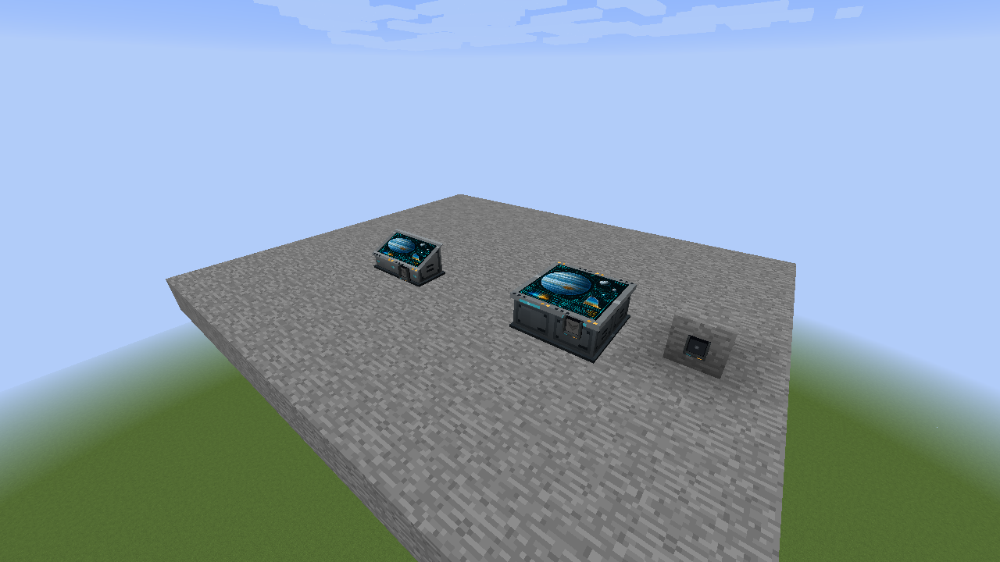
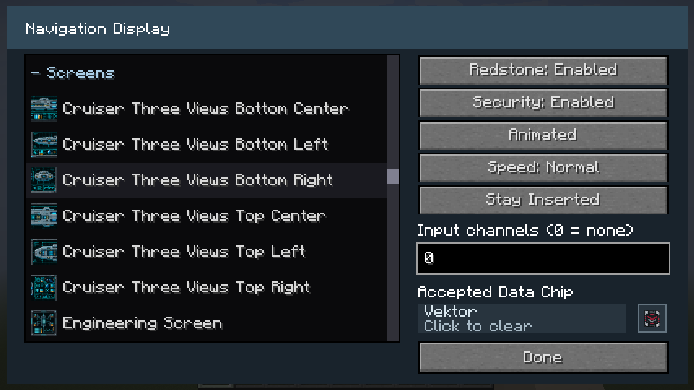

# Navigation display settings

[Flat Navigation Tables](multiblocks/navigation-table-flat/README.md) join into filled rectangles, including opposite-facing rows. Put their button panels around the outside to create one continuous inner screen. [Angled Navigation Consoles](multiblocks/navigation-table-angled/README.md) join sideways in a row facing the same direction.

Use the Configurizer or sneak-right-click any module to edit the shared display. Choose a Programmable Block material or any Programmable Screen artwork. The shared **Custom...** picker also accepts sampled block materials. **Black** is the default. Animated artwork offers Static/Animated playback and Slow/Normal/Fast speed. The image spans the joined display; it does not repeat separately on each module.

**Redstone** and **Security** are disabled by default. Enable either gate independently:

| Redstone | Security | Selected artwork is visible when |
| --- | --- | --- |
| Disabled | Disabled | Always |
| Enabled | Disabled | The assembly receives power |
| Disabled | Enabled | A matching Data Chip is inserted |
| Enabled | Enabled | The assembly receives power and a matching Data Chip is inserted |

Otherwise the screen is black. Physical redstone can power any member. Input channels accept ordinary Vandor Labs channel sources; `0` means disconnected. Every navigation module has **zero physical and channel output**, including when a chip is inserted. These settings do not add navigation or propulsion gameplay.

Security uses the existing Data Chip company filter. An incorrect chip is rejected. With Security disabled, a chip is optional and does not control visibility. A returning chip only authorizes the display while it remains inserted; return modes never latch the screen on after removal. For a screen that stays visible with its chip, choose the retained insertion mode.

An assembly shares exactly one Data Chip Mount. Its frame and chip use the standalone mount's native size, with half a pixel of clearance below the top of the front panel. Resizing moves the mount, chip and settings together. Settings are saved on every member so a split retains its display configuration; the physical chip remains a single item on its owning component. Remove chips before merging occupied assemblies, since extra retained chips are dropped once.

Assemblies require a complete loaded rectangle of at most 256 modules. Holes, incomplete rows and unloaded boundaries do not create extra mount owners. Screens keep their configured orientation when carried structures rotate.
