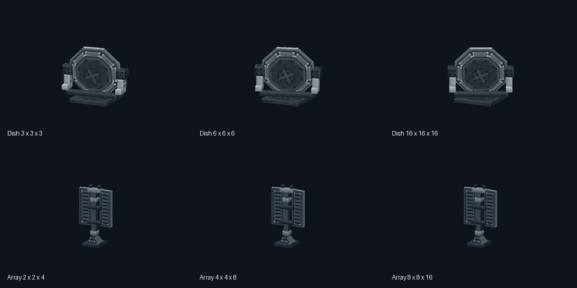

# Enlarged navigation observer rendering

Survey Dish and Sentinel Array models render once per controller. Reservation
cells have no tile renderer. Enlarging a frame scales the same authored mesh:
145 quads for a Dish and 114 for an Array, including at the largest supported
16×16×16 and 8×8×16 frames. Geometry and the number of render submissions do
not grow with the reserved volume.

The observer path caches its immutable footprint, pivot, origin offset and
model lookup keys. It creates no model-path strings during a settled draw.
Model keys resolve against the current baked-mesh map on every draw, retaining
resource-reload behavior. Facing, width, corner, inversion and saved-data
changes invalidate the relevant layout/pivot cache. Prepared mesh coordinates
remain in base model units, so different sizes share them.

## Focused measurements

Run the exclusive live focus with the standard Forge JAR:

```sh
VANDOR_LABS_TEST_SKIP_BUILD=true testclient/test_viewscreen.sh --focus observer-performance
```

The diagnostic submits the actual FastTESR, using 128 warm-up draws and 61
samples for each base, doubled and maximum footprint, upright and inverted.
Each object occupies the same projected screen area in a 512×512 framebuffer.
The fixture asserts constant vertex counts and visible textured geometry.

| Maximum frame | Quads | Median emitter CPU | Allocation per draw |
| --- | ---: | ---: | ---: |
| Dish 16×16×16 | 145 | 18.8–19.3 µs | 24 bytes |
| Array 8×8×16 | 114 | 13.8–15.8 µs | 24 bytes |

Before the metadata/path caching change, allocation was 1,584–1,608 bytes per
Dish draw and 928–952 bytes per Array draw. The remaining allocation is a light
sample position. Neither allocation nor geometry increases with frame size.
Timing variation between sizes includes JVM warm-up and measurement noise;
larger frames should not be interpreted as intrinsically faster.

[Before raw samples](navigation-observers/before.csv) record emitter CPU and
allocation on artifact `69038545c193e2b24475ba1e2d27ed5da9619248e1438e6416e9e44d8a9c95c1`.
Their frame-completion column is excluded from comparisons: screenshot capture
left the benchmark texture binding changed between variants. The final harness
restores the atlas per variant and asserts visible geometry.
[Final raw samples](navigation-observers/after.csv) and the image below use
artifact `6b30ad7673b3c285ce3b8e1592a480802cf9b07c604a8742ea381a9bcf4dad58`.



The final gameplay artifact `3eb22b03b1b16c52e3d3bab2fd4a0319a99cf07a09570c652643327cb79fcad2`
adds the far-member configuration fix. Its nine renderer/benchmark classes are
byte-identical to the measured artifact; rendering code is unchanged.

These are isolated software-renderer diagnostics, not hardware FPS or shader-pack
acceptance. A larger object covering more screen pixels can increase GPU fill
cost even though its geometry stays unchanged.

## Array animation history

The former console-equipped Sentinel Array and the standalone Array both use a
static model with the same animated `sentinel_array_scanning` atlas: 16 frames,
two ticks per frame. Neither has a rotating geometry part or a rotation motion
in the original Core catalog/renderer. Survey Dishes have the separate rotor
and a ±55-degree scanning sweep. Consolidating Array models did not remove a
physical rotation animation.
