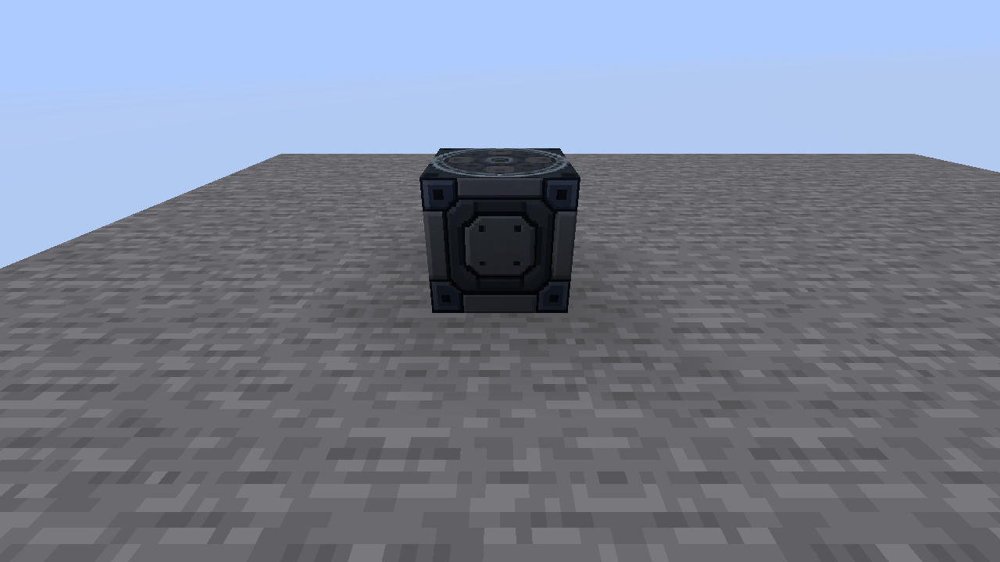
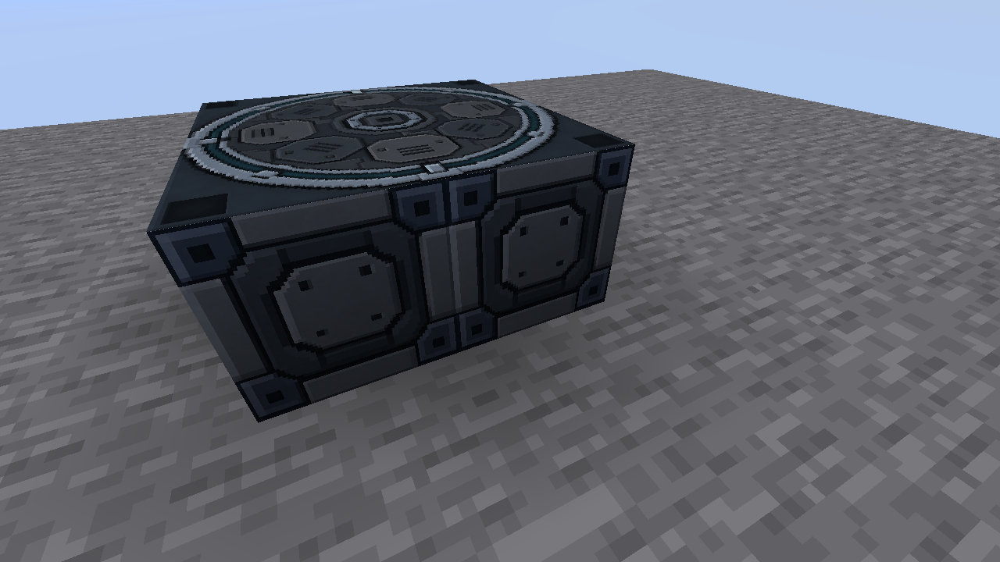
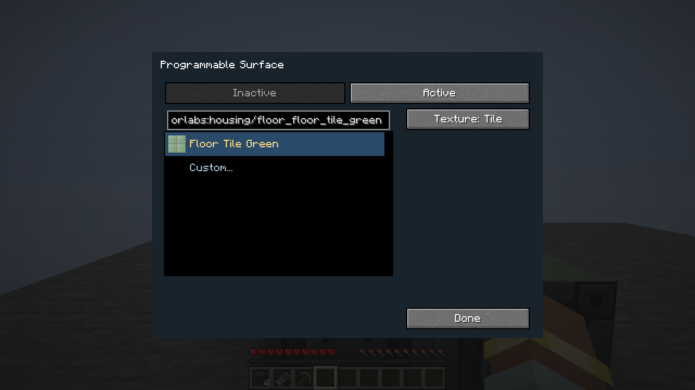

# Programmable Surfaces

Programmable Surfaces provide configurable artwork on floors, walls and ceilings in Forge 1.12.2 and NeoForge 1.21.1. Their registry ID remains `vandorlabs:turntable_surface`.

1. Place the first Surface by clicking the face that should carry the artwork. Click the top of a supporting block for a floor, its side for a wall, or its underside for a ceiling.

   

2. Extend the drawing with adjacent Surfaces. Clicking the side of an existing Surface continues its active plane. Matching artwork joins across a filled square or rectangle, up to 32 blocks along each surface axis. The example is a 2 × 2 square.

   

3. Sneak-right-click a Surface with an empty hand, or use the Configurizer, to open the same dedicated dialog. Choose independent **Inactive** and **Active** artwork. The standard material picker supports searching, wheel scrolling, scrollbar dragging and custom block samples. Click the texture-layout option to advance; right-click it to select the previous value.

   

**Stretch** spans one image across the drawing. **Tile** repeats the image at block scale while preserving its aspect ratio. **Fit (Aspect)** keeps the complete image with opaque margins. New Surfaces use Fit. On unequal rectangles, Fit keeps independent cell faces; select Stretch or Tile for a shared rectangular drawing.

Changes apply immediately to the drawing containing the selected cell. Different active/inactive artwork forms a drawing boundary. The settings remain on the Surfaces when a controller is detached. A configured creative pick retains the selected artwork and layout for placement.

Removing a drawing root or opening a hole leaves surviving cells visible. Incomplete shapes fall back to independent faces. Fill the hole and give the new cell matching artwork to rebuild the shared drawing; settled pads do not continuously rescan.

Forge 1.12.2 also supports [Turntable Controllers](turntables.md) and [Copy Controllers](copy-controller.md). Turntables require a filled square. Copy input and output pads require matching filled rectangles; Copy ownership can span different artwork without changing each cell's drawing settings. Surfaces claimed by an operation cannot be removed while that operation owns their contents.
