# Segmented doors

Segmented Door sections form a sliding door with configurable travel. The default rises and bends onto an overhead track. Equal-height neighbouring columns facing the same way operate together. Each column may contain 1–32 sections; a linked door may contain up to 32 columns.

## Construction

1. Build a level sill across the opening. Leave room above and behind the header for the raised panels. A five-section column extends approximately five blocks behind its closed plane when open.

   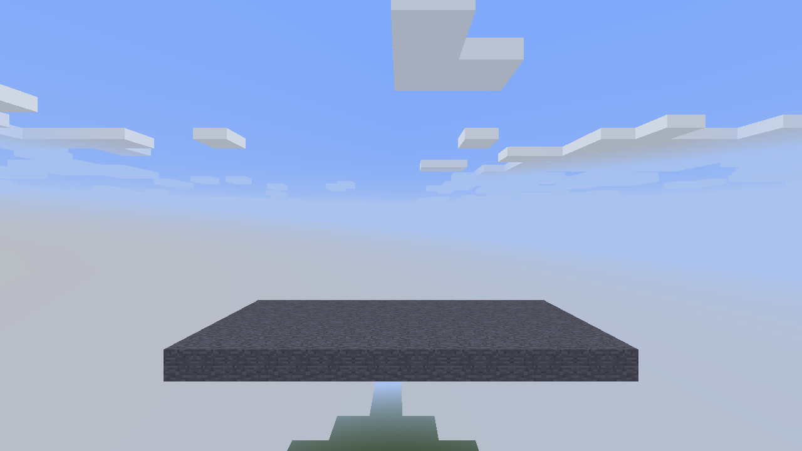

2. Face the opening and place the first column from bottom to top. A section placed against a section above or below inherits its facing and plane. A fresh section chooses Middle/Near/Far from the clicked face, like a Programmable Wall. The top section supplies its own narrow header.

   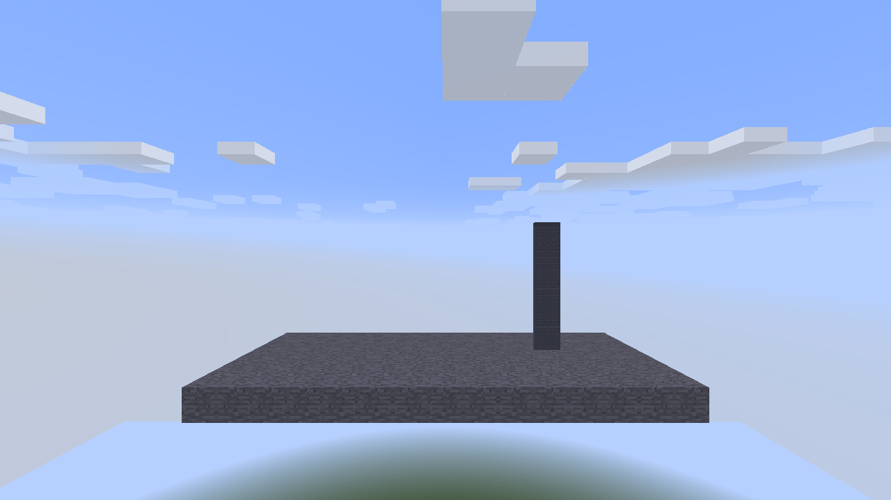

3. Place adjacent columns to the same height and facing. The example is nine columns wide and five sections high. Columns of a different height remain separate.

   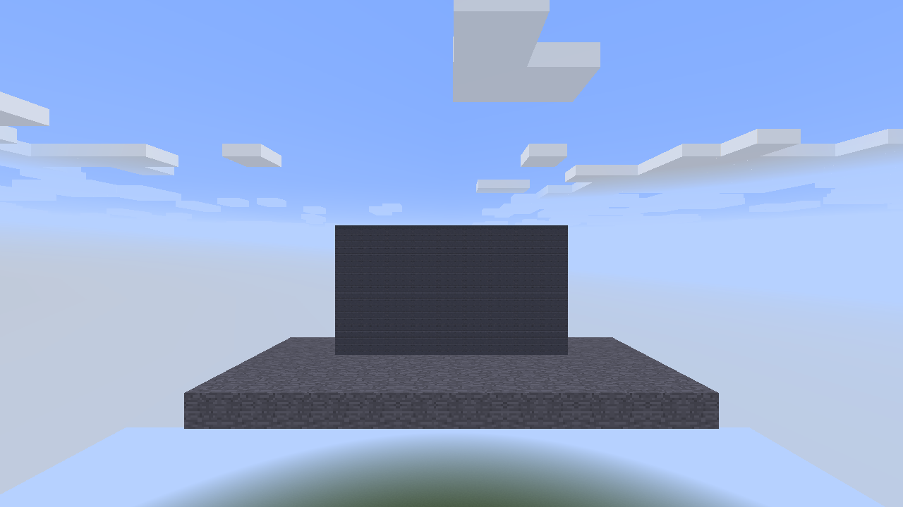

4. Right-click a section to toggle the linked door. The panels rise, turn over the header and retract overhead. Once open, right-click any visible panel to close the door. The narrow border follows the selected slide edge.

   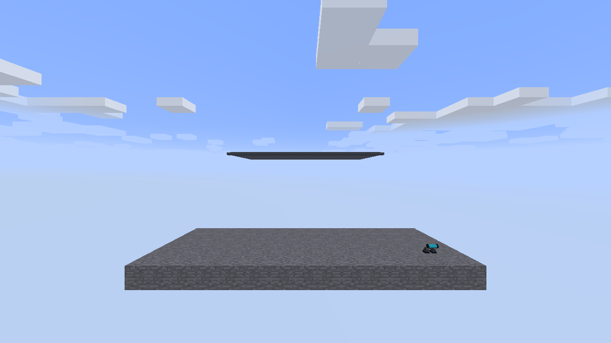

5. Use the Configurizer, or sneak-right-click, to open the dedicated configuration dialog. **Door** selects **Slide: Up / Down / Left / Right**, **Angle: Perpendicular / Straight**, **Speed: Slow / Medium / Fast**, and **Pos: Middle / Near / Far**, to the right of the artwork picker. Perpendicular turns the panels behind the opening; Straight keeps them in the door plane and leaves a one-pixel edge exposed when open. **Tread Px** uses the Ramp Controller's numeric field and minus/plus controls to choose 1, 2, 4, 8 or 16 pixels per bending strip. It is disabled for Straight travel. Existing doors default to 16. Travel, position, tread size, texture layout and activation settings apply to the linked door. Artwork changes the selected section; use the Copifier to share settings. Right-click an option to cycle backwards.

   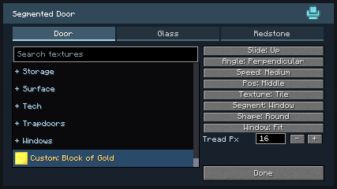

6. In Redstone, enter the usual channel list and choose whether to accept local redstone. Choose **Activation: Manual / Redstone ON / Redstone OFF**, using the same selector as Programmable Doors. Manual allows hand operation. Redstone ON opens while any enabled input is powered; Redstone OFF reverses that condition. Both redstone modes block manual opening and closing. The default activation remains manual until a redstone mode is selected.

   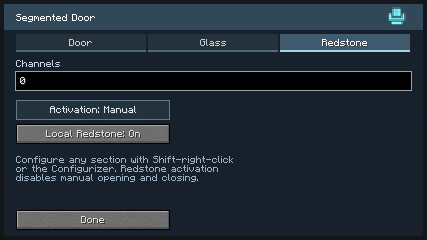

Craft eight sections from six iron ingots, two pistons and one redstone dust. Mining the top section promotes the remaining top section and preserves its column settings. Changing a door requires its complete linked structure to be loaded and editable.

## Rendering and saved state

Closed, settled plain tiled panels render in Minecraft's chunk geometry. Window panels and other layout modes retain cached per-column geometry. Moving panels share the atlas batch and reuse bounded geometry templates at a 120 Hz animation cadence. Raised panels use the same template cache. The cache retains vertex-format information and clears on atlas reload or a format change. Authored gate models and fractional-alpha image rows stream their fixed prepared meshes at the pause-aware presentation pose; they do not require a mesh for every animation sample.

The client retains closed fallback panels until all affected chunk sections finish uploading their replacement mesh. Off-screen sections are queued asynchronously through Minecraft's chunk dispatcher, with duplicate sections combined and at most eight submissions per client tick. Opening begins after the closed terrain panels are removed; closing switches back to terrain only after the closed panels have uploaded. All columns and rows in one opening or closing operation share the same server start, phase, duration and speed, including columns with different saved speed histories. Their client motion also shares one pause-aware clock, including delayed column updates. Repeated or older motion packets do not restart it.

The server owns collision and the saved motion timeline. Sections remain native world blocks throughout motion; opening never transfers blocks or inventories. Only the top tile of each column advances motion, and only those owners send motion updates. Channel and topology work runs after chunk loading, with bounded loaded-block searches.

## Panel artwork

Open **Door** to select general materials, Frame, Trapdoors, Doors or Large Doors artwork. Use **Custom...** to sample a block from your inventory without consuming it. Custom artwork is not reflected across neighbouring segments. **Texture: Tile / Stretch / Fit (aspect)** uses the same layout choices as Programmable Door. Artwork selection changes the block whose dialog you opened. Use the Copifier to share its selected settings with other sections. Old doors without overrides keep their original artwork. The original dark slatted panel remains the default; **Doors → Segmented → Dark Segmented Panel / Light Segmented Panel** exposes its two finishes. Their saved choices and general-material availability remain unchanged. The original artwork is the standalone `segmented/segmented_panel.png` texture. Changing artwork preserves the door’s channels, motion and saved section ownership.

**Doors → Segmented** also contains **Raised Black Panels**, **Ribbed Blue Steel**, **Spiral Aluminum Glazing**, and the **Picket**, **Industrial** and **Lattice** gate models. These choices retain their identities through configured picking and copied settings. Spiral Aluminum Glazing has four real openings with solid metal borders and inner reveals. Open **Glass** to select its pane material and tint.

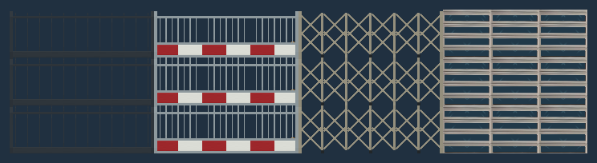

Gate models replace the panel/window faces with their authored bars. Matching neighbouring models join only where their posed edges meet; different styles, mounting planes or incompatible motion stay separate. Bars keep their authored scale. The gate choice hides inapplicable window, shape and image-layout controls, while preserving those settings for a later return to panel artwork. Motion, speed, position and Tread Px remain available. Sections retain the same two-pixel collision/fluid envelope and a single selection outline; precise interaction rays pass through the authored openings.

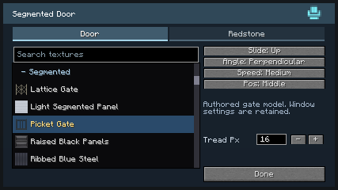

## Sideways gate examples

Choose **Slide: Left** and **Angle: Straight** for a gate that slides in its own plane. Gate tops provide a placement face across the section width, so columns can be extended from above while front rays still pass through the openings.

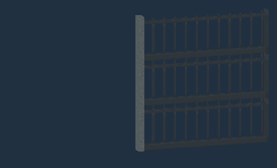

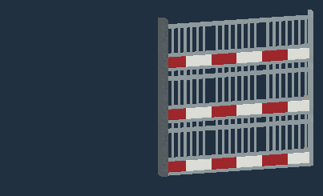

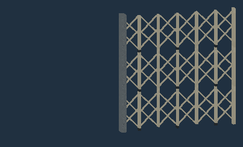

Choose **Angle: Perpendicular** and reduce **Tread Px** for finer bending behind the opening.

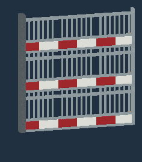

Additional bending examples: [Picket](images/segmented-2.9-picket-bend.gif) and [Lattice](images/segmented-2.9-lattice-bend.gif).

## Window segments

1. Configure the specific block you want to change. Opening shape, Window Tile/Fit and glass settings belong to that block; artwork also belongs to that block, while Texture Tile/Stretch/Fit still applies across the linked door. To make a window row, configure each block in that row. On **Door**, change **Segment: Solid** to **Window**. Choose **Hexagon**, **Octagon**, **Square** or **Round**, using the same outlines as Programmable Porthole.
2. Choose **Window: Tile** to fit the opening to the selected section, or **Fit** to share an opening only with edge-connected Window sections of the same Shape. Solid sections, different shapes and gaps split the window group. Each panel still moves independently along the selected path.
3. Open the **Glass** tab to choose the glass shade or replacement material and its tint. The Glass tab appears for Window segments, Frame artwork and Spiral Aluminum Glazing. Selecting glass for a Frame enables its square opening on the configured block. All tabs keep the same dialog dimensions.

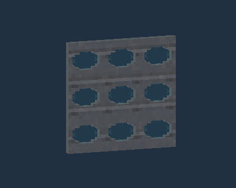

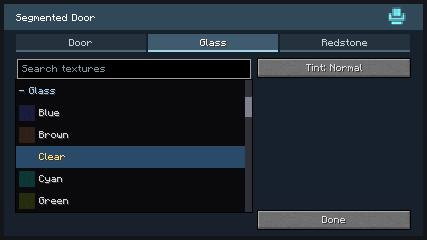

Keep enough space above, below or beside the opening for Straight travel, and behind the opening for Perpendicular travel. A sideways door travels by its linked width; an upward or downward door travels by its height.

Better Builder’s Wands can extend the top row. Extending the top row updates each column’s height and header while preserving its settings.

## Contained water

Use a filled or empty bucket on either side to store or remove its fluid independently. Stored sides survive saving and door movement. Opening connects water across the aperture and supplies ordinary flowing water on the opposite side; closing drains the outlets created by the door while preserving its stored water. Middle/Near/Far placement also moves the fluid partition. Water remains in the native door cells as the panels retract.

## Identifier change

The block, item and tile now use `vandorlabs:segmented_door`. Old door identifiers and saved field names are deliberately unsupported. Existing doors, items and snapshots using the former identifiers do not load; rebuild them with the current block. This also applies to saved vehicles or designs containing those doors.

Middle-click and the Duplifier copy the complete segment configuration, including window shape, Fit/Tile, glass, artwork, motion and channel choices. They do not copy assembly identity or an active motion.

Individual artwork is included in configured picking and copied settings. Tile uses the door’s existing column/row phase even when adjacent cells select different artwork; Window groups do not rescale the panel image. Segment bodies remain two pixels thick and the top border four pixels.
