# Texture overview

[Open the interactive texture browser](https://rheide.github.io/vandorlabs/texture-browser/). Search by name or category, expand nested categories, and click a thumbnail for a larger preview. The [local browser](texture-browser/index.html) also works without a server.

These collages cover the built-in texture picker, including both light states and the native glass finishes. Hidden compatibility aliases and duplicate resolution tiers are omitted. Custom textures from local installations are not included.

## Controls

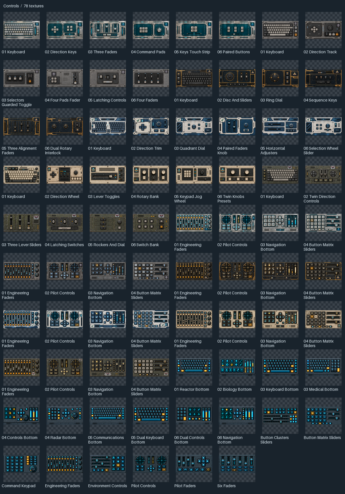

## Corp

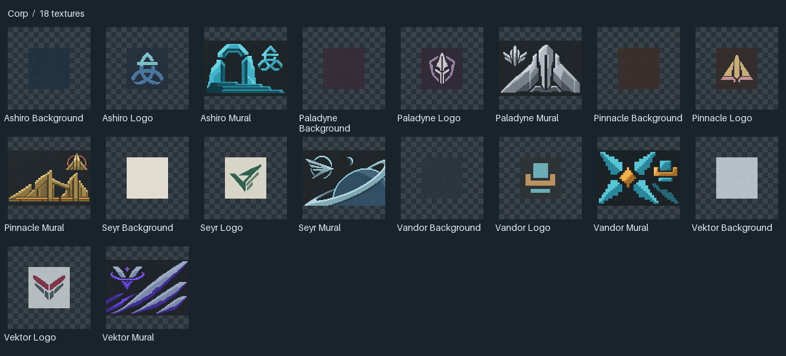

## Doors

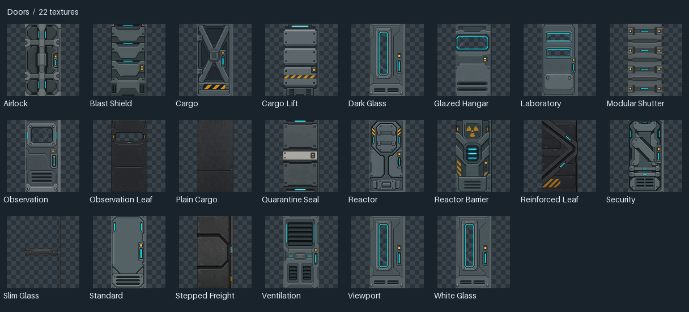

## Double Doors

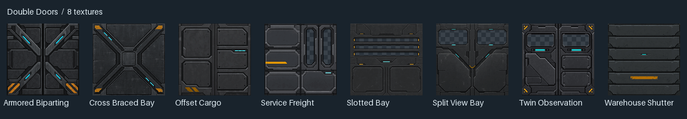

## Frame

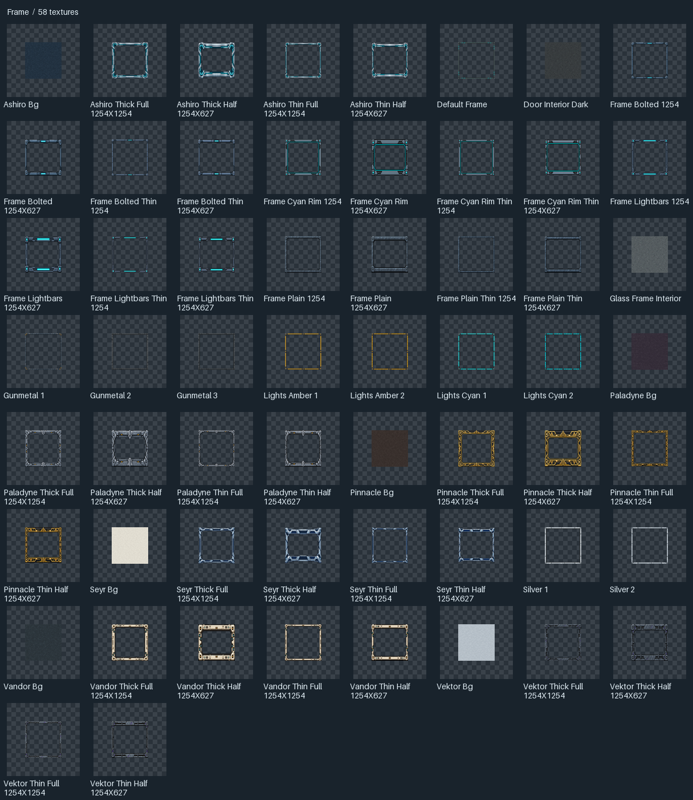

## Glass

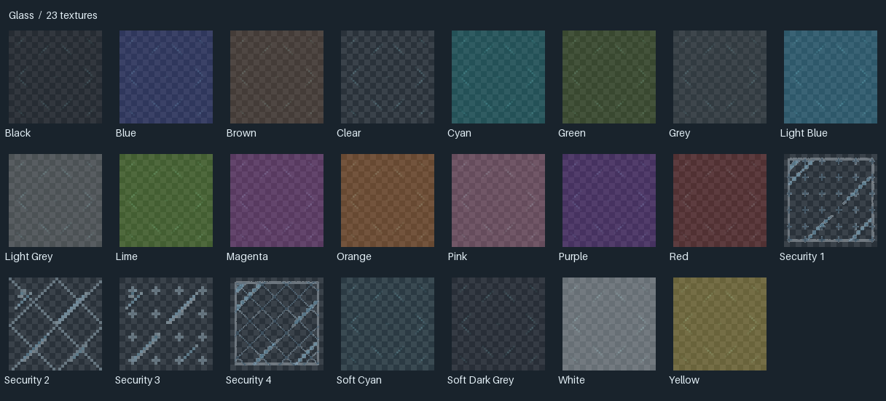

## Hull

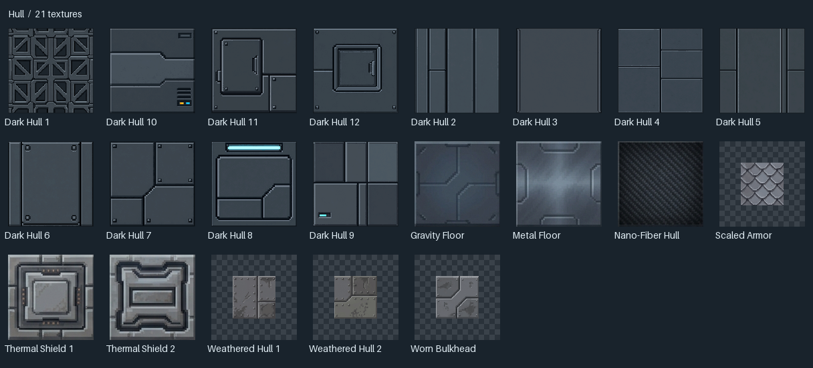

## Industrial

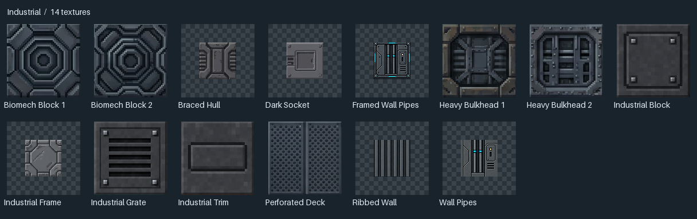

## Lights

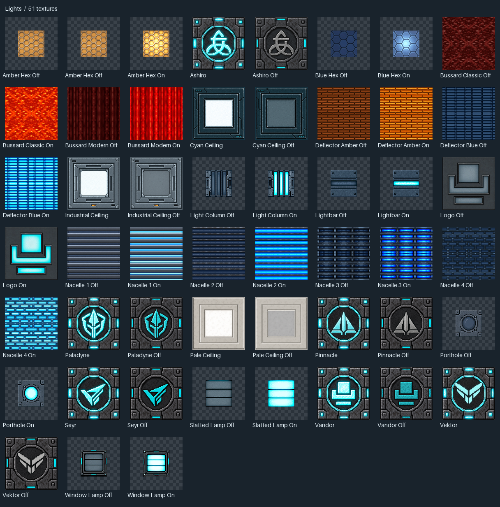

## Materials

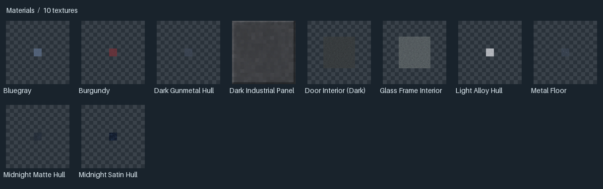

## Panels

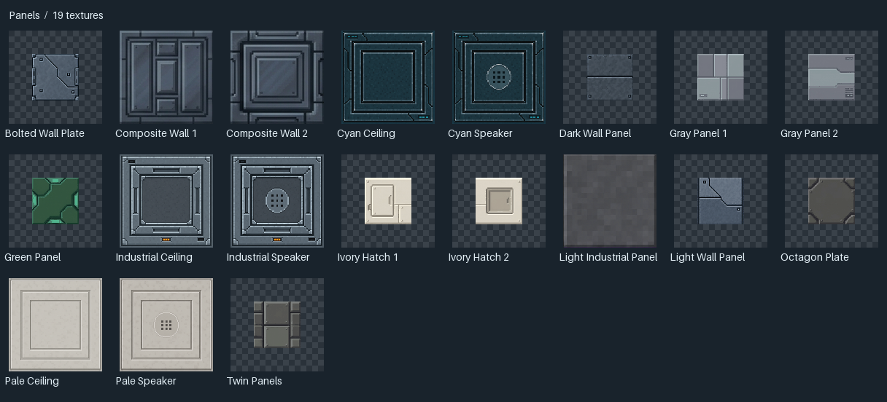

## Screens

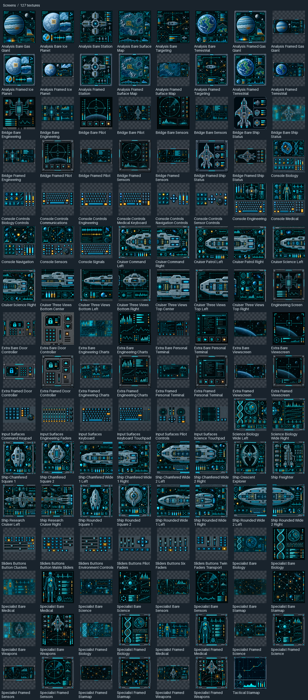

## Storage

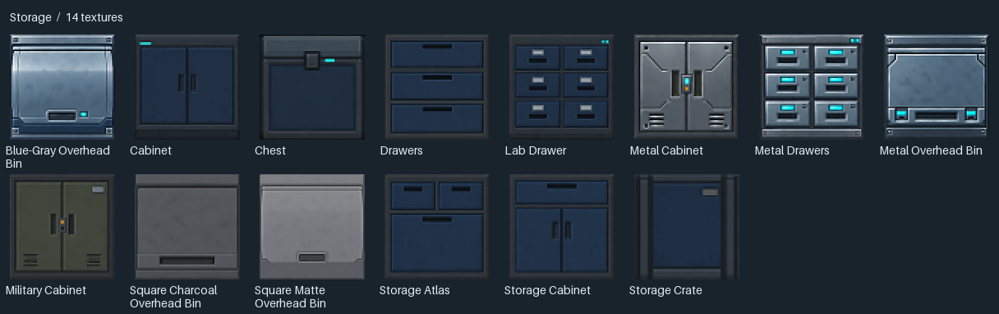

## Surface

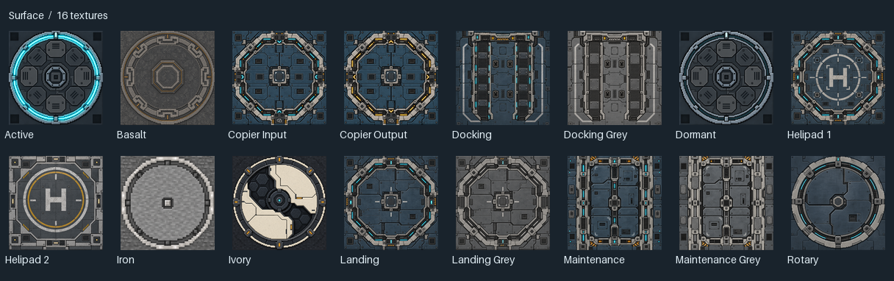

## Tech

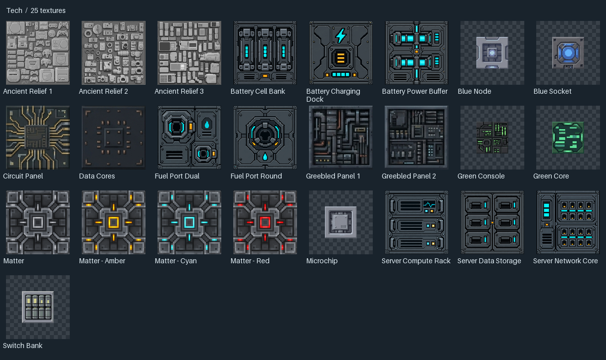

## Trapdoors

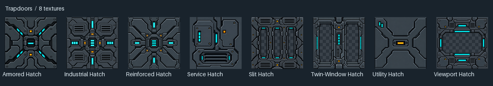

## Windows

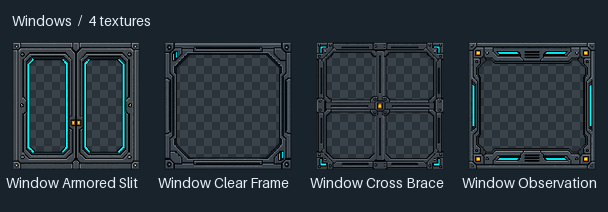
