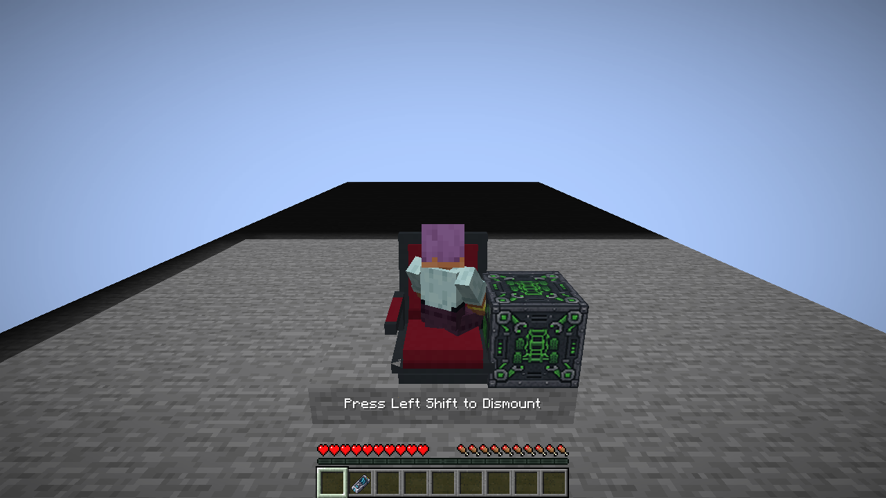
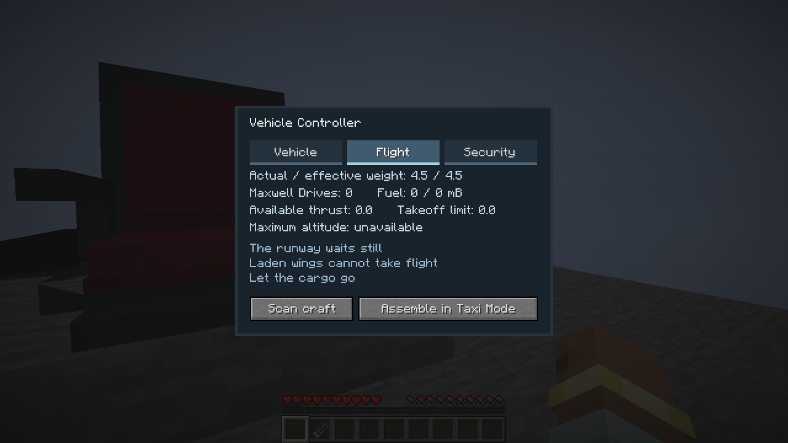
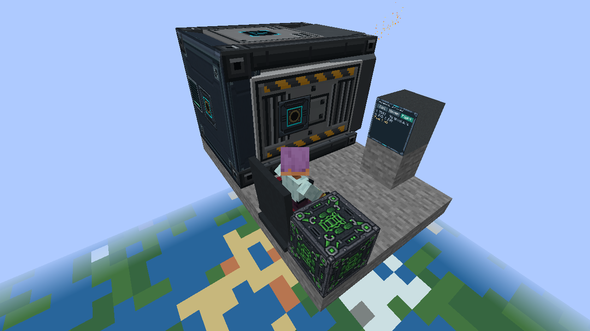
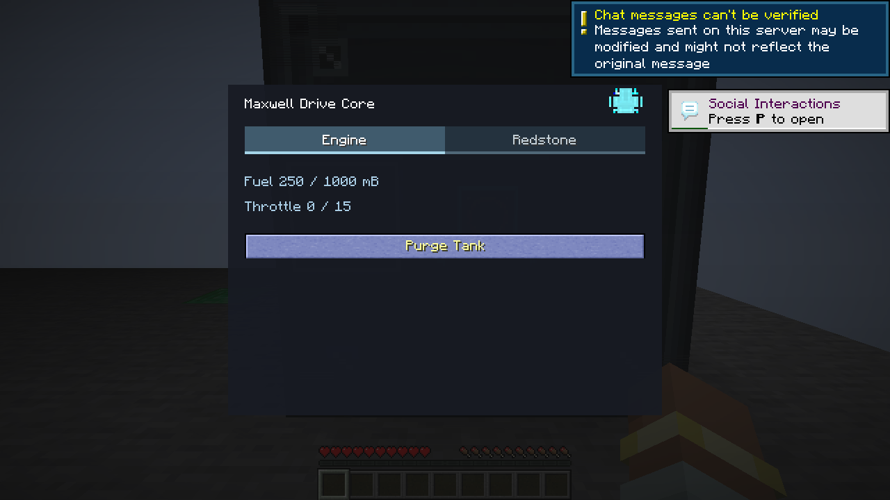

# Vehicle Mode on Minecraft 1.21.1

## Build a small taxi

1. Choose a flat road with room to drive and stop. Build a deck three blocks wide and two blocks deep from **top stone slabs**. Leave a half-block gap below the slabs so the scanner can distinguish the deck from the road.
2. Place a **Vehicle Controller** on a corner of the deck. Place one **Pilot Seat** beside it, facing the direction of travel. Leave space above the seat for its backrest and around the deck for the assembled craft.
3. Right-click the Controller to open its dialog. **Scan craft** shows how many blocks the Controller can carry and their weight. The **Flight** tab compares the effective weight to the lift available from fueled Maxwell Drives. A vehicle with only a seat and Controller can taxi.
4. Stand beside the craft and select **Assemble in Taxi Mode**. Once the vehicle appears, right-click the Pilot Seat. Use **W/S** to drive forward or reverse, **A/D** to steer while moving, and **Space** to brake.
5. Stop on clear ground and align the deck with the block grid. Dismount, right-click the carried Controller, and select **Park as blocks**. A Configurizer can open the same dialog from the hull. The vehicle stays assembled if the parking site is obstructed.

A Creative owner holding a Configurizer can use **Emergency Park** on Vehicle
Status or on the carried Controller’s Vehicle tab below the cruise band.
The craft comes down, stops and aligns with the grid before restoring its blocks.

Craft a Vehicle Controller with four iron ingots in the corners, four redstone dust on the edges, and a Programmable Matter Ingot in the center. It is also a Catalog design for the Synthesis Tower.

On the parked Controller’s **Security** tab, the owner can require an accepted Access Card.
Mount a Card Slot on the Controller, configure its accepted company, and insert the card before assembly.

## Construction limits

Keep the vehicle and its boundary in loaded chunks. The native scanner accepts one Controller and one complete Pilot Seat. Its limit is 2,048 cells and 32 blocks from the Controller on each axis. A storage block or machine must have a supported transfer adapter before it can move with the hull. Scanning reports an unsupported block before assembly.

For an engine, follow the [Maxwell Drive construction guide](multiblocks/maxwell-drive/README.md). Feed fuel through any of the three marked inlet faces.

## Fuel and Flight

Use a formed Maxwell Drive and install an onboard Vehicle Status screen. Set its thrust
and check the Controller’s Flight tab before boarding. The tab shows total weight,
weight after antigravity, available thrust and the highest altitude the current thrust can sustain.
Select Flight from Vehicle Status. On a runway, build forward speed and then hold **S**
to raise the nose. **W** lowers it and **A/D** steer. Above Y=256 the pilot sees a
seed map of the Overworld and the instruments follow the aircraft’s geographic
coordinates. The departure area stays loaded while occupied. Terrain along the
route can stay unloaded until the craft descends at its destination. An aircraft
with sufficient thrust reaches Y=10,000 and up to 75 blocks per tick.

Installed Batteries and Hex Tanks can send their fullness on a channel. Open **Redstone**,
choose transmit channels and range, and set a screen row to **Channel status** to see
the received level as bars. A Battery’s receive channel still controls its resource transfers.

Right-click the carried Maxwell Drive or use the Configurizer on one of its casing
blocks. The Engine tab shows remaining fuel and offers **Purge Tank**. On
**Redstone**, choose digital or analog throttle and set the receive channels.
Those settings follow the engine when you park.

Place native Power, Fluid and Matter Ports with their faces pointing between supported
owners. A carried Survey Dish needs an RF source. The Maxwell inlet accepts compatible
fuel from an onboard tank. A settled onboard Arm can pass RF, fluids or items
between its base and tip. Configure its resource and direction before assembly,
then use its redstone channel to move it. Transfer resumes at a connected endpoint.

Onboard screen rows can also toggle a channel, pulse it for one second or set an
analog level. Configure the rows on the parked screen, then use the controls on
the assembled craft. For example, a pulse can briefly enable a Power Port while
a **Channel status** row shows the received level.

With Mekanism installed, a Basic, Advanced, Elite or Ultimate Fluid Tank can supply
a Fluid Port. An Energy Cube of the same four tiers can exchange energy through a
Power Port. Set the Cube’s faces and empty its charging slots before assembly.
Mekanism’s owner and security settings still apply. Face settings rotate with the
parked vehicle. Immersive Engineering ethanol works in the Maxwell tank.

RFTools Power’s Simple, regular and Advanced **Dimensional Cells** can exchange
FE while carried when they store it locally. Unlink the cell and empty its
card and charging slots before assembly. Cells protected by a security channel
and the network-based Power Cells must stay in the world.

To assemble two parked sections as one rigid hull, mount matching
[Vehicle Couplers](couplers.md#neoforge-1211) with their heads facing each other
and engage both before scanning with the Vehicle Controller. The completed
hull still needs one Controller and one Pilot Seat. Dynamic pickup, articulated
joints, moving separation and external-mod conduit networks remain outside the
current native vehicle adapter set.
