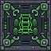
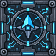
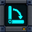
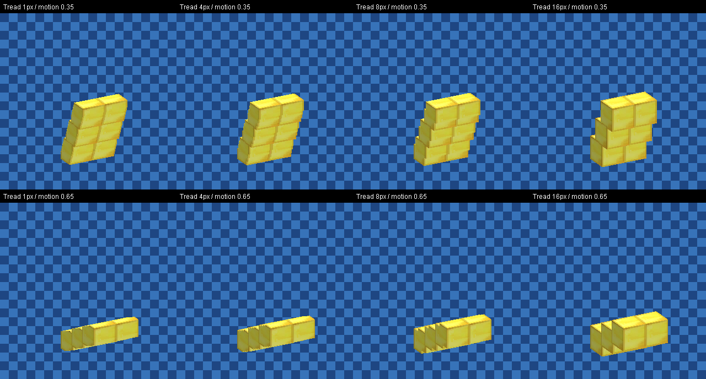

# Vandor Labs 2.1: hover, navigate, unfold

[All version guides](README.md)

Lift your craft off the ground, send it between waypoints, and build a cockpit with working status displays and momentary controls. Version 2.1 adds Hover and Autopilot, separates vehicle assembly from the Pilot Seat, and turns a stored tower of blocks into a deployable Moat bridge.

## Three blocks for a working vehicle

| Block | Role |
| --- | --- |
|  **Vehicle Controller** | Inspect the connected build, assemble it, and park it as blocks. Holds assembly redstone settings and separate Park, Taxi, and Hover channel lists. |
|  **Autopilot** | Follow a route beneath the craft. Choose its marker material from the inventory picker, including the selected block variant. |
|  **Waypoint** | Make a stop, wait, change travel mode, or depart after a delay or signal. |

Use one Vehicle Controller and at least one Pilot Seat. Multiple seats work: the first seated pilot controls the craft until they get up, then control passes to another seated pilot. Each seat keeps its own height and automatic Taxi Mode setting. Vehicle assembly and redstone mode controls live on the Vehicle Controller.

Park, Taxi, and Hover each have a channel field and switch button on the main Controller screen. The current mode's button is disabled. Leaving or parking a craft prefers collision-free standing space near your seat, including space inside the cockpit.

Right-click Vehicle Controller, Programmable Ramp, Autopilot, or Waypoint to open its settings. The Configurizer opens the same dialog. Pilot Seat settings use a compact chair-style preview, and changes apply immediately without a Save step. Left-click option buttons for the next value; right-click for the previous value.

See [Pilot Seat and Taxi Mode](../pilot-seat-taxi.md) and [vehicle compatibility](../vehicle-compatibility.md).

## Hover where you leave it

Fit the required propulsion and at least three supported lift blocks, then double-tap **Space** in Taxi mode to enter Hover. Antigravity Plates, Repulsor Arrays, and Vertical Hover Thrusters provide lift. Forward movement while holding Sprint emits sparse particles matching each thruster family; ordinary movement emits none. Antigravity Plates and Repulsor Arrays do not emit forward exhaust.

| Input | Hover action |
| --- | --- |
| W / S | Move forward or backward |
| A / D | Turn, including while stationary |
| Sprint | Increase cruising speed by 25% |
| Space | Rise |
| Crouch | Descend |
| Release Space and Crouch | Hold altitude |
| Sprint + Crouch | Leave the seat |

A manually piloted craft stops and holds its position, heading, and height when the pilot exits. An enabled Autopilot continues its journey. To park, fully extend the landing gear and descend to within three blocks of solid ground, double-tap Space to select Taxi, then use the normal parking controls. Hover cannot convert directly to blocks.

Landing gear follows its redstone channels and animates with matching collision in Taxi and Hover. It can retract only in Hover, and extension stops when terrain obstructs the feet. Gear no longer retracts automatically with altitude. Hover controls use the latest input state so delayed commands do not keep movement queued after release.

Small, Medium, and Large Wheels now roll with travel, reverse with the craft, and swivel with steering. Their inventory icons show distinct sizes with padding, and the held Large Wheel no longer dominates the view.

## Give your craft a route

Mount Autopilot on the underside of the craft and lay a continuous route of face-adjacent marker blocks. Replace selected markers with Waypoints to define stops. The sensor follows the first solid surface below it, within sixteen blocks, and stops at gaps, ambiguous junctions, or obstacles rather than choosing a branch.

Autopilot uses the same forward direction as manual Pilot Seat driving. It uses a longer lookahead on repeating diagonal stair-steps to reduce zigzagging, while retaining the usual lookahead for 90-degree corners. The sensor stays on the exact marker line and respects waypoint stops. A connected loop can run repeated laps; waypoints configured for manual departure still wait for another pulse.

Waypoints can wait for a signal or depart automatically after a delay. They can select Block, Taxi, or Hover for the stop, then Taxi or Hover for departure. Hover stops support heights up to sixteen blocks. A pulse starts a journey to a waypoint; a continuously active signal can continue through stops.

Choose **Vehicle Status** on a Programmable Screen, Input, or Console surface to show the current vehicle mode, clearance, and navigation status. Click its Autopilot row to toggle navigation, or **Next >** to activate departure from the current waypoint, including when parked as blocks. The **Block**, **Taxi**, and **Hover** buttons switch modes directly from the surface, highlighting the active mode and preserving normal permission, gear, clearance, and parking checks. The controls also fit half-height inputs and consoles. Activating Autopilot on a craft parked as blocks can inspect and assemble it without a seated pilot, using the normal permission and transfer checks while the owner is online. Status messages explain blocked starts, including when the selected route material is not directly beneath the Autopilot sensor. A surface can switch back to ordinary artwork or Redstone controls whenever needed.

See the [Autopilot and Waypoint guide](../vehicle-autopilot.md) for route construction and departure settings.

## Fold a bridge out of a tower

Select **Moat** on Programmable Ramp and build a vertical tower directly in front of its active face. Activating the controller deploys that tower into a horizontal bridge. A three-block-high tower becomes three blocks long. Slabs retain their thickness, and supported stairs keep their shape.

**Tread px** slices the stored material into sections that move together around the controller. **Start offset** leans the stored tower toward or away from the controller. **End offset** spreads the deployed rise or drop along the full bridge: an End offset of -1 across three blocks gives the same descending tread profile as an ordinary three-block Ramp. Choose **Linear**, **Curve In**, or **Curve Out** interpolation.

These live client renders show two points during deployment. Smaller Tread px values divide the tower into finer sections while preserving its material.

At zero Start offset, the inactive tower returns to editable ordinary blocks. Generated moving sections cannot open the controller dialog. Full vanilla and Vandor glass blocks, slabs, and supported vanilla and Vandor stairs work across the applicable ramp modes. Each mode has distinct artwork on the controller's front and top; the other direction markings make its active side easier to identify.

An open canopy can share a redstone channel with a Moat ramp. The ramp waits for the canopy to open; the canopy stays fully open until a matching Moat finishes retracting. This also applies to manual close requests while the bridge is deployed. Ramp parts below or beside the canopy's path do not prevent closure. Blocks placed in released canopy space are preserved and can delay closure until removed. Pilot Seat backrest reservations remain compatible with closing Canopies, including joined assemblies. Manual canopy clicks work with a configured redstone channel until the next signal change.

See [Programmable Ramp](../landing-ramps.md) for material, offset, and movement details.

## More cockpit space and useful buttons

**Long Canopy** adds a three-block depth and an Extra Long Angled profile. Matching opening Canopies can join up to nine columns. Clicking a joined constituent removes that constituent, and released helper cells keep open cockpit space available without leaving invisible blockers after removal.

Canopy and both Front Canopy sizes support **Disabled**, **Redstone ON**, and **Redstone OFF** triggers. Fixed glass retains its frame beside a moving shell, and broad front-window backs meet diagonal walls without overlapping glass surfaces.

Canopy glazing draws after opaque walls and screen artwork so its tint remains visible from either side. Third-person Pilot Seat cameras orbit the parked craft as well as the assembled vehicle, while surrounding blocks still limit the camera distance.

Programmable Screen, Input, and Console Redstone rows now offer **Pulse** alongside Toggle and Slider. Use a momentary button for departures or other brief channel activations, including aboard a vehicle.

## Convert the complete craft together

Extended ramps carry their geometry and original-block journal into Taxi mode. Conversion settles Vandor redstone channels after the entire structure has transferred, and removed tiles receive no further channel commands. Doors, trapdoors, lamps, and linked controls therefore see the completed result. Cancelled transfers restore the craft, source data, and occupied seat assignments.

Compatibility remains specific to each block. Supported external machines retain their saved data and stay paused while carried; unknown tile entities are refused before assembly. The transfer safeguards do not replace an adapter for another mod's private network, multiblock, or unload behavior.

Vehicle movement also spends less time rebuilding canopy collision geometry and querying nearby terrain. Canopy animations, ramp materials, landing gear, and console rendering avoid repeated allocations and lookups while preserving their shapes and materials.

Conversion prepares collision geometry and durable recovery records on bounded workers before changing world ownership. Lighting and neighbor updates are deferred, and affected chunks are checkpointed incrementally without waiting for disk on the server thread. The craft stays still until the handoff is complete; clients receive this hold before predicting movement. Source machines pause while assembly is pending and resume if it is cancelled.

Conversion builds the craft's current collision shape before driving. On supported craft with one opening canopy assembly, its poses prepare incrementally afterward, with canopy subdivision and coordinate merging on a background worker and a bounded cache for reuse. An immediate opening or closing request can briefly hold the current pose until the next collision shape is ready, while driving continues. Changes to captured blocks or settings discard outdated preparation. Collision preparation retains the last exact pose until its replacement is ready, without falling back to a blocking rebuild after a worker delay or failure.

Canopy collision queries use a spatial index and deduplicate candidates before testing, so particles and nearby entities examine only relevant surfaces while preserving the existing collision shape. Canopy closure compares ramp geometry against a cached spatial index of the swept path instead of repeating every box pair. Cold swept geometry is prepared on a bounded worker; the canopy holds its safe pose until preparation finishes without blocking the server thread. Cold collision indexes also prepare on a bounded worker, with exact ordered collision checks available while preparation is pending. Picking uses primitive triangle math, and landing-gear rendering reuses prepared model vertices. Canopy rendering reuses vertex buffers, and selection rays transform into the local canopy pose to avoid rebuilding its surfaces for each ray.

See the [complete changelog](../../CHANGELOG.md) for fixes and smaller changes.
