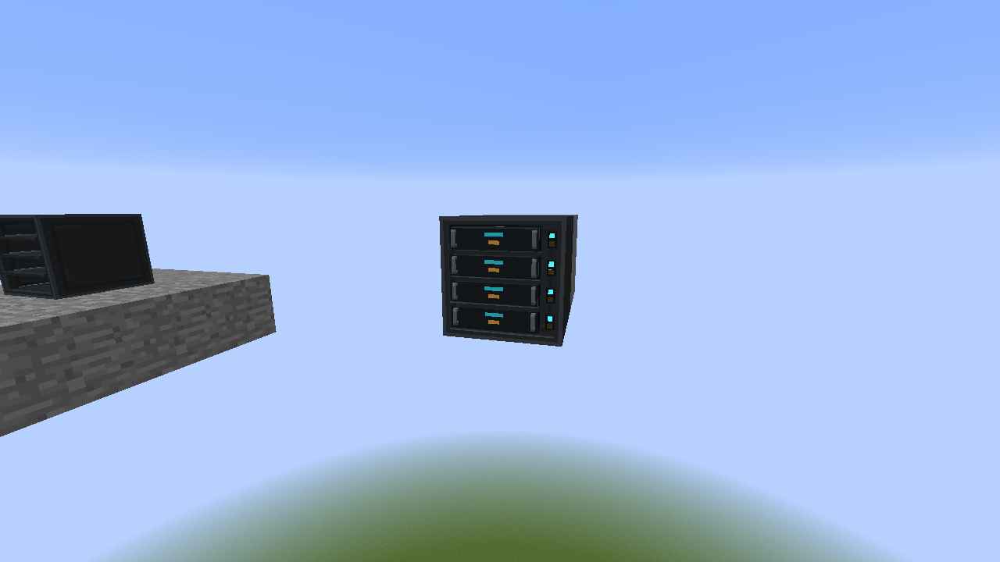
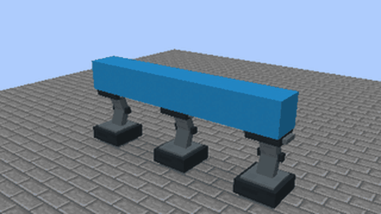
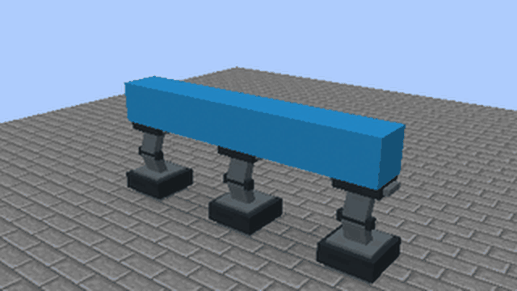

# Vandor Labs 2.10.0

Build folding platforms with double-hinge Rotating Arms, fit an Autopilot Module
into a compact rack, and move power, fluids and items through configurable ports.
Vandor Labs 2.10 also expands directional artwork joining and brings more
building, furniture and mechanism families to Minecraft 1.21.1.

**Development preview:** user testing is underway; final release validation is
pending. Forge 1.12.2 remains the main target. NeoForge 1.21.1 is experimental,
and its converted standalone features do not include Vehicle Mode.

On Forge 1.12.2, animated Core machines keep their client animation phase while
arms capture and restore them. Dish scanning continues through native endpoints
and reversal without restarting; a replacement at the old position animates
independently.

## Module Rack and Autopilot

Module Racks are available on Forge 1.12.2 and NeoForge 1.21.1. Autopilot fits
inside them with an abstract cyan/amber route indicator and
four animated bays, with per-module route, activation and receiving controls. On Forge 1.12.2, existing Autopilot computers
migrate after chunk loading while preserving navigation, authorization and saved
data. Rack placement, extraction animation, housing and proportional Redstone
controls follow the standard dialogs. Native captured Racks retain every module
through mining and abrupt recovery; Vehicle navigation remains Forge-only.
Custom housing affects only the five exterior faces, leaving the front and bay interiors unchanged. Mounted module edits belong to the physical module immediately and survive extraction, relocation and reload independently of the rack housing/output settings.
Insert a Blank Module by clicking its bay; retrieve it with an empty hand.
Racks mount on walls, floors and ceilings, and their module animations follow
the mounting direction.

See the [Module Rack guide](../module-rack.md) for placement, crafting and module controls.

## Materials and joined artwork

The new **Tiles** category contains thirteen finishes, including coloured tiles,
staggered tiles, limestone and terrazzo designs. **Doors / Utility** gains
Bathroom White, Modern Oak Windowed, Windowed Utility, Windowed White, Bathroom
and Stall.
Existing saved texture choices keep their identities.
The **Hull** category also includes the supplied **Port Hull** face. Fuel Port Dual and Fuel Port Round have been removed from the picker and artwork; their old saved slots use the standard fallback.

Filesystem Door artwork now mirrors correctly across double-door leaves,
matching the behavior of selected vanilla-block textures.

Material dialogs consistently call image mapping **Texture: Tile / Fit (Aspect)
/ Stretch**. Connected surfaces offer Vertical, Horizontal, North/South and East/West joining. Both neighbours must allow the shared axis: Vertical can join Vertical or On above and below, but cannot join a Horizontal-only neighbour.
Older saved Even/Odd choices now behave as All. Copifier batch changes refresh
previously joined surfaces immediately. See [texture layout and joining](../texture-joining.md)
for examples, axis meanings and supported families.

The Duplifier's **Respect block joins** option restricts Connected Matching
Blocks to the clicked joined artwork. Leave it off to retain the existing
matching-region behavior. Hover tooltips explain all three connected selection options.
Full-depth Porthole Blocks match by their actual plane, so unused depth flags do
not split a connected selection. Editing a neighbour also refreshes the original
joined group, including unchanged members and cached frames; thin Porthole Walls
still require matching depths on both versions.

## Native tables, controls and surfaces

**Programmable Chair, Luxury Seat, Military Seat and Pilot Seat** are available as native stationary furniture. They retain authored styles, heights, connected benches and configured items, with the same dedicated editor through ordinary Creative sneak-right-click and the Configurizer. Right-click to sit and sneak to dismount. Pilot Seat keeps saved dormant data and compatible Canopy backrest sharing; Vehicle/Taxi behavior and carried seats remain excluded. See [Native seating](../native-seating.md).

NeoForge 1.21.1 now includes the existing **Industrial Table** and **Programmable Pressure Plate**. Table modules connect only to matching neighbors and support ordinary or inverted placement; their authored end struts refresh after placement and mining without table entities or tickers.

Pressure Plates share Forge's Wood, Gold and Iron entity-count sensing and release cadence. Their dedicated General/Redstone dialog uses the normal material picker, reverse-value clicks and inline transmission controls. Physical analogue power stays independent of copied channel settings. Native Vehicle Mode and vehicle-carried sensing remain excluded. See [Industrial Tables](../industrial-tables.md) and [Pressure Plates](../programmable-pressure-plate.md).

Programmable Surfaces are available on NeoForge 1.21.1 with the same Active/Inactive picker, saved layouts and six-face construction as Forge 1.12.2. Joined drawings keep opaque surviving faces through mining and repair; settings changes refresh terrain meshes, including cropped and non-square artwork. Native Turntable and Copy Controllers remain separate conversions. See [Programmable Surfaces](../programmable-surfaces.md).

## Canopy items

Canopy inventory, held, displayed and dropped items use prepared item geometry
and smaller display transforms. World Canopy geometry remains detailed. Item
meshes retain the authored materials and visible shell outline while avoiding
the cost and oversized appearance of drawing a complete multiblock in hand.

## Arms and landing gear

Forge assemblies have a separate **Foot** direction option for Skis and Wheels,
including sideways mounts and Large Wheels. It changes the foot's facing without
changing the supporting blocks' ownership footprint.

Grid-aligned activated Rotating Arm sockets accept Plates, Skis and matching
Wheels, including complete Large Wheels. Connected native feet can join an
existing joined arm group. Ownership changes use the durable recovery journal;
fractional endpoints refuse placement without consuming the held item.

Rotating Arms offer **Hinge: Single / Double**. Double shares the angle between
the base and elbow while preserving the total foot or payload rotation. **Kink**
chooses **Inward / Outward** relative to **Fold**, keeping that relationship when Fold changes. Older saved middle-only
strokes finish with their original motion before adopting Double at native
zero-degree rest. Payload motion and collision use the same shared geometry.

| Double hinge, Kink Inward | Double hinge, Kink Outward |
| --- | --- |
|  |  |

These joined arms carry a level platform through a complete fold and return.
See the [rotating-arm construction and animated examples](../joined-arm-platforms.md#double-hinge-examples).

The **Mechanism** tab exposes **Start** and **End** angle sliders for attached
Plates, Skis, Wheels and Tracks as well as bare arms. Change angles in 15-degree
steps. Landing gear requires at least one endpoint that can return to ordinary
world blocks; unsupported endpoints remain captured. **Join range** stays beside
**Join arms**, while activation and channels use the standard **Redstone** tab.

Forge arms can also carry a complete formed Core construction, selected through
either its Core or a reserved part. Chips, settings and original capability data
stay with the complete machine. Joined Rotating Arms include the whole validated
Core footprint from their contact layer. Set the same Join, range, fold, payload
mode, hinge and kink on every supporting column; independent neighbouring arms
remain real obstacles. At a fractional captured pose, body clicks cycle the
machine’s activity and the Configurizer opens its existing settings dialog
without moving the arm. Settings remain with the machine through saving and
native restoration. Chip insertion/removal and dismantling require a supported
native endpoint; unsupported tilts stay captured. See the
[Core construction guide](../universal-constructors.md).

Taxi conversion keeps its inspected geometry separate from the geometry prepared with new Coupler ownership data. Valid Couplers can assemble, park and recapture; actual source edits during preparation still refuse without removing the craft.

Vehicles using two independent complete Ski supports can enter Taxi mode. A
single Ski remains insufficient, and other support families keep their existing
admission rules. See the [modular landing gear guide](../modular-landing-gear.md).

### Native Minecraft 1.21.1 arms

NeoForge now includes regular and Large Extenders, Rotating Arms, mounts, Plates,
Skis and Wheels as ten ordinary creative/search items. Six-face placement, joined
platforms, Foot direction, Single / Double hinges, relative Inward / Outward Kink and the dedicated
Configurizer dialog use
the Forge 1.12.2 construction rules. Duplifier copying and Undo transfer settings only.
Native/captured payload handoffs, active-foot attachment and captured-block mining
use durable recovery, and platforms carry native players through motion.

Horizontal Extenders also support **Push blocks** for ordinary solid terrain,
including joined platforms. Pushed terrain stays in place when the original
platform retracts. Tracks now join regular and Large arm groups with Compact, Armoured and Bogie styles. Small, Medium and Large stationary side wheels mount on supported slab sides; see [native Tracks and side wheels](../native-tracks-and-wheels.md). Vehicle Mode remains unavailable on this target. Unsupported vanilla endpoint orientations stay captured and selectable
until they reach a representable endpoint. See the
[native arm construction guide](../native-joined-arm-platforms.md).

## Resource Ports

Forge 1.12.2 and NeoForge 1.21.1 add **Power Port**, **Fluid Port** and **Matter Port** for transferring RF,
fluids and items. Configure all six faces, an optional shared output limit, input
pulling and Redstone conditions in their dedicated dialog. The **Housing** tab
selects artwork for disabled faces; port faces retain their resource artwork.
The output-limit label identifies a blank field as unlimited. Sharpened artwork
and red/yellow/blue inventory accents distinguish the three resource types. Stored resources remain
in one configured item when mined; Duplifier copying transfers settings only.
See [Resource Ports](../resource-ports.md) for recipes, connections and buffer limits.

NeoForge 1.21.1 includes the Battery Block and Hexagonal Fuel Tank with the same capacities, shapes and complete joined sections. Their dedicated dialogs show live contents and reuse the casing picker. Mining and placement retain each cell's stored resources, including when a tank section is split. See [matter and storage](../matter-and-storage.md) and the [joined tank construction guide](../multiblocks/hexagonal-tank/README.md).

## Stationary Glass and Portholes

Existing full-depth Porthole Blocks join even when old saves contain different
unused wall-depth values. Thin Porthole Walls still need matching planes.

On Forge 1.12.2, eligible stationary Glass panes use ordinary translucent chunk
geometry. Other stationary panes, partially transparent emissive frames and
Porthole geometry reuse retained render groups, with separate ownership for
frames and panes. Joined holes remain holes, and each surface retains its
artwork, lighting and opacity. Moving, animated and fluid cases retain their
appropriate fallbacks. See [stationary Glass and Porthole rendering](../stationary-glass-rendering.md)
for the supported paths and diagnostic command.

## Coupler ownership recovery

Forge Couplers retain their Amber and Cyan face artwork through Arm motion and
native endpoint handoffs. Old payload mappings remain readable and upgrade when
ownership transfers. Slab Couplers keep a horizontal housing; unsupported tilted
endpoints remain captured until a representable pose.

On Forge 1.12.2, Couplers can travel on moving Arm payloads. Linked Arms preserve every head contact while passive peers retain their own control settings. Rigid connections retain the full head orientation; articulated connections permit their configured motion. Arm, payload and vehicle animation share one coherent frame during lag, reversal and reload.

Release preserves both sections and cargo. Return general body poses and connected Arms to their assembly reference before separation when requested, open the other head independently if needed, and drive the sections apart. Nearby Arms use actual vehicle surfaces for pushes instead of the empty space inside an enclosing hull. See the [Coupler guide](../couplers.md).

Native arm-endpoint attachment and release retain their original physical before
images while renewing the receiving vehicle association. Interrupted transfers
recover through their durable journals, including copied capability data.

Failed structural updates restore the original cargo, seats and vehicle position.
If the original source cannot be reinstalled, the vehicle remains inert and keeps
that complete snapshot for recovery.

## Existing-world fixes

Older Battery saves load without recursively reading their own chunk; stored
energy and side configuration are retained. Taxi assembly accepts unchanged
Coupler-equipped craft while still refusing actual edits during preparation.

For detailed changes, read the [2.10 changelog](../../CHANGELOG.md#unreleased--2100).
Use the [1.21.1 coverage inventory](../development/feature-coverage.md) for the
current conversion boundaries.
