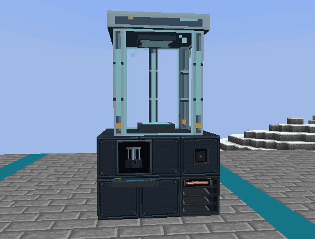
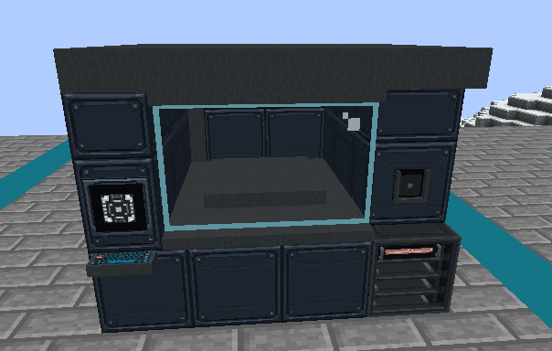

# Vandor Labs 2.11

Build a workshop that makes its own machinery, then chart the world from a Navigation Table. The four clips below show the Forge 1.12.2 versions in Minecraft.

- **Watch parts take shape.** The Synthesis Tower grows Cores beneath four scanning beams. The Assembly Press builds flat electronics with green corner beams. The Enclosed Gantry sweeps a blue fan beam over mechanical parts as its head travels along the rail.
- **See the world beneath the sweep.** Pan and zoom across seven levels, with a quick preview that sharpens once you stop moving the map. A red Sentinel Array sweep or cyan Survey Dish sweep reveals real surface detail and nearby players. Save a snapshot to a Navigation Chip or revisit recordings from a removable Navigation Data Module.
- **Turn a block into a recipe.** Scan an eligible block in the Synthesis Tower’s Digitize mode and store its design and supported appearance settings on a Catalog Chip. Browse the new chip artwork and rotating previews, including material-coloured Vehicle Chip previews.
- **Power your workshop.** Charge removable Battery Modules in the Matter Infuser and slide up to four into a builder. The new open-frame Core models have their own colours and detailed corners. JEI shows Infuser and Synthesis Tower recipes.
- **Print and scan documents.** Print a book or map from a chip, or scan a written book, enchanted book or map while keeping the original. Run either device from redstone and connect item ducts to feed supplies and collect results. Furnish the room with dark cyan or silver Indoor AC slabs and Outdoor AC cubes.
- **Fly and drive faster on Forge.** Hover at 16 blocks per second, or Sprint to reach 20. A ship with an observer can map terrain in flight. Taxi reaches 6 blocks per second without a thruster or 8 with an active one.
- **Build bigger observers and more flexible ramps.** Form Survey Dishes and Sentinel Arrays upright or inverted. Larger, higher installations can see farther. Side-mounted Ramp Controllers can use either horizontal axis, and NeoForge adds the seven Ramp Controller modes and their dedicated configuration dialog. The NeoForge Infuser, Ramp and builder screens also pick up the familiar Vandor Labs controls and styling.

## Synthesis Tower

Supply Programmable Matter and power to build a Core. The four beams trace the growing block, and pausing power or redstone holds the work in place. Insert a Master Catalog for more Forge designs, or switch to Digitize and create a recipe from a block you already have. [Build a Synthesis Tower](../multiblocks/synthesis-tower/README.md) · [Learn about Digitize](../universal-constructors.md#digitize-a-block)

## Assembly Press

A Matter Ingot becomes a flat component such as a Data Chip or Access Card. Green beams work the corners of the tray as coloured Matter fills the part. Catalog recipes unlock Battery, Autopilot and Navigation Data Modules on Forge. [Build an Assembly Press](../multiblocks/assembly-press/README.md)

## Enclosed Gantry

The moving rail and head sweep a blue beam over the growing part in a four-block-high bay. Build Extenders, Swing Arms, landing gear and couplers on Forge, then collect the finished part from the chamber. [Build an Enclosed Gantry](../multiblocks/enclosed-gantry/README.md)

## Navigation Table

Join table sections to see more area at the same zoom. Pan across biomes, then let the view settle to sharpen its boundaries. Recenter on your position or a saved pin. Link several observers to see each coverage ring and sweep on the same display. The lighter inner ring marks the area where an active observer reveals surface colors from loaded chunks and detects visible, uncrouched players above sea level.

Fit a Navigation Data Module to reopen recordings on another table in the same world. Overlapping scans share their stored surface pixels. Use **SET** inside a recorded sweep to copy its image to a Navigation Chip, or use the Scanner to preserve the original pixels of a vanilla map. [Explore Navigation Tables and Screens](../navigation-displays.md) · [Use the Printer and Scanner](../appliances.md)

## Developer Notes

So many cool things this time! This version marks the synthesis(..) of this mod's tech tree: all three multiblock builders are hooked up: the Synthesis Tower produces Core blocks and Controller blocks, the Assembly Press builds mechanical blocks and the Enclosed Gantry manufactures Data Chips, Access Cards and anything smaller and electronic. All the machines now require RF, which can be supplied through other mods, or via the Battery Module, which can be charged in the Infuser. Did I mention all the builders have lasers? Lasers! Oh, and you can reverse engineer vanilla blocks with the Digitize mode, which writes a block recipe to a Data Chip for future synthesis. Progmatter, it's just so versatile. (and probably too cheap - we'll work on balancing that better in versions to come).

The other major cool thing this time is a functional Navigation Table! Build a Survey Dish or Sentinel Array, assign it a redstone channel and pair it with a Nav Table to see a map of the area around you. Short range scans will form an image of the actual world blocks and any nearby players. Long range scans use a seed browser to project a wider area. But there's more! Stick a Nav Table and Survey Dish onto your vehicle and you can go around and map the world! Insert a Navigation Data Module into your Nav Table and it will store where you've been. More to come on this later. Did I mention you can make the Survey Dish and Sentinel Array in any size you like, as long as it's a multiple of its base size? Woohoo!

Next up: more mod blocks for our three builder structures, and perhaps some fun engine and autopilot improvements. And eventually... SPACE. 

## Version notes

All observer ranges are horizontal radii from the Core. Higher mounting and larger frames extend terrain coverage. The live sweep radii are fixed.

| Observer | Terrain radius at Y=64 | Terrain radius at Y=128, smallest to largest | Live radius | Full sweep |
| --- | ---: | ---: | ---: | ---: |
| Sentinel Array | 250 blocks | 500–1,000 blocks | 128 blocks | 8 seconds |
| Survey Dish | 1,000 blocks | 2,000–4,000 blocks | 256 blocks | 24 seconds |

The Printer and Scanner share stable Inventory and Redstone tabs on Forge. Programmable Surface artwork uses the matching orientation and Fit Aspect layout in Dynmap.

The builder clips are sped up. Tower Core fabrication uses 16,000 RF over forty seconds at full power. On Forge the Press and Gantry each use 8,000 RF over ten seconds. If you have a three-high Gantry from 2.10, dismantle it to recover the original frame materials and rebuild it four blocks high.

NeoForge 1.21.1 includes all three builder structures, powered Synthesis and Digitize, Assembly Press production for Navigation Data Modules, the Matter Infuser, Navigation Tables, live observer sweeps and appliances. The extended Press catalog, Gantry production and vehicle-carried navigation shown here use Forge 1.12.2. [NeoForge builder guide](../builders-1.21.md) · [Full changelog](../../CHANGELOG.md#2110-in-development)
