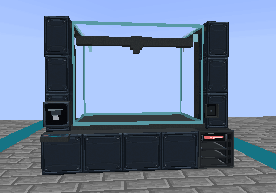
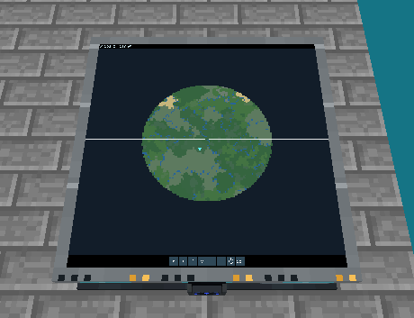

# Vandor Labs 2.11

Build a workshop that makes its own machinery, then chart the world from a Navigation Table. The four clips below show the Forge 1.12.2 versions in Minecraft.

- **Watch parts take shape.** The Synthesis Tower grows Cores beneath four scanning beams. The Assembly Press builds flat electronics with green corner beams. The Enclosed Gantry sweeps a blue fan beam over mechanical parts as its head travels along the rail.
- **Explore the map from your bridge.** Glide between biomes with smooth pan and zoom, mark places on Navigation Chips, and save surveyed areas to a removable Navigation Data Module. On Forge, a ship with an observer can map terrain as it flies.
- **Turn a block into a recipe.** Scan an eligible block in the Synthesis Tower’s Digitize mode and store its design and supported appearance settings on a Catalog Chip. Browse the new chip artwork and rotating previews, including material-coloured Vehicle Chip previews.
- **Power your workshop.** Charge removable Battery Modules in the Matter Infuser and slide up to four into a builder. The new open-frame Core models have their own colours and detailed corners. JEI shows Infuser and Synthesis Tower recipes.
- **Print and scan documents.** Print a book or map from a chip, or scan a written book, enchanted book or map while keeping the original. Furnish the room with dark cyan or silver Indoor AC slabs and Outdoor AC cubes.
- **Build bigger observers and more flexible ramps.** Form Survey Dishes and Sentinel Arrays upright or inverted. Larger, higher installations can see farther. Side-mounted Ramp Controllers can use either horizontal axis, and NeoForge adds the seven Ramp Controller modes and their dedicated configuration dialog. The NeoForge Infuser, Ramp and builder screens also pick up the familiar Vandor Labs controls and styling.

## Synthesis Tower

Supply Programmable Matter and power to build a Core. The four beams trace the growing block, and pausing power or redstone holds the work in place. Insert a Master Catalog for more Forge designs, or switch to Digitize and create a recipe from a block you already have. [Build a Synthesis Tower](../multiblocks/synthesis-tower/README.md) · [Learn about Digitize](../universal-constructors.md#digitize-a-block)

## Assembly Press

A Matter Ingot becomes a flat component such as a Data Chip or Access Card. Green beams work the corners of the tray as coloured Matter fills the part. Catalog recipes unlock Battery, Autopilot and Navigation Data Modules on Forge. [Build an Assembly Press](../multiblocks/assembly-press/README.md)

## Enclosed Gantry

The moving rail and head sweep a blue beam over the growing part in a four-block-high bay. Build Extenders, Swing Arms, landing gear and couplers on Forge, then collect the finished part from the chamber. [Build an Enclosed Gantry](../multiblocks/enclosed-gantry/README.md)

## Navigation Table

Join table sections to see more of the seed map at the same physical scale. Pan across biomes, zoom in to see finer boundaries, and recenter on your location or saved pin. Link a Survey Dish or Sentinel Array to extend coverage, or fit a Navigation Data Module and take the surveyed area with you. The Scanner can also turn a vanilla map into a Navigation Chip with its original pixels. [Explore Navigation Tables and Screens](../navigation-displays.md) · [Use the Printer and Scanner](../appliances.md)

## Version notes

The builder clips are sped up. On Forge the Tower uses 8,000 RF over twenty seconds at full power. The Press and Gantry use the same energy over ten seconds. If you have a three-high Gantry from 2.10, dismantle it to recover the original frame materials and rebuild it four blocks high.

NeoForge 1.21.1 includes all three builder structures, powered Synthesis and Digitize, Assembly Press production for Navigation Data Modules, the Matter Infuser, seed navigation, observers and appliances. The extended Press catalog, Gantry production and vehicle-carried navigation shown here use Forge 1.12.2. [NeoForge builder guide](../builders-1.21.md) · [Full changelog](../../CHANGELOG.md#2110-in-development)
