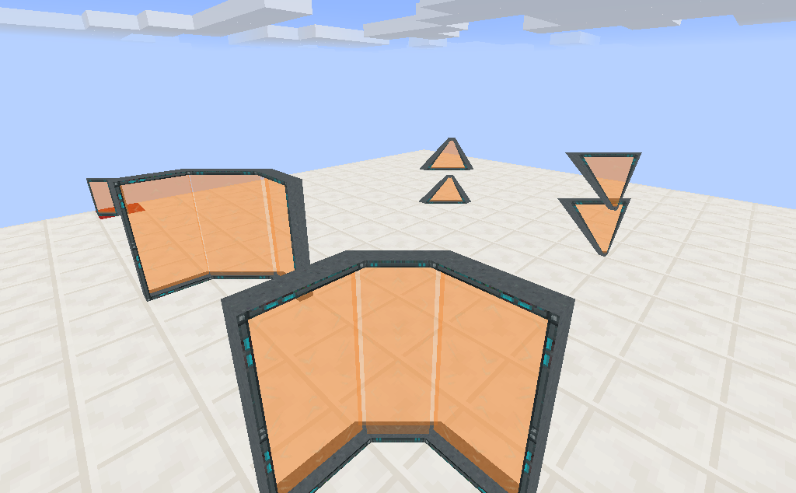
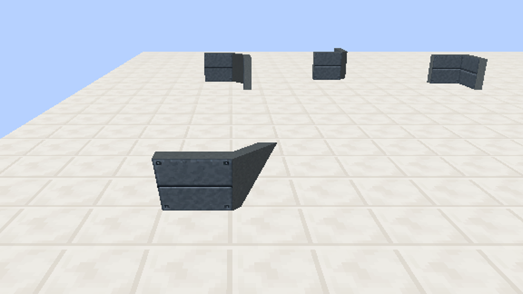
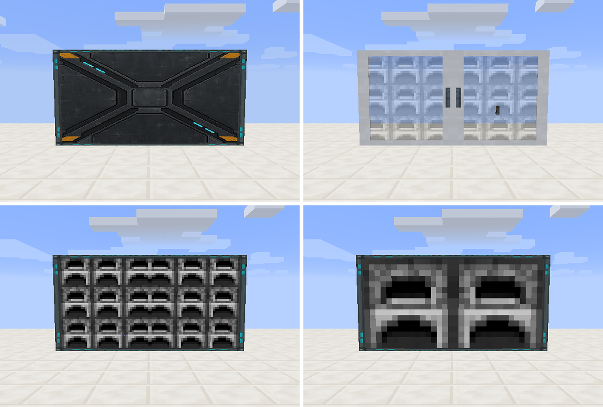

# Vandor Labs 2.12

Turn crisp 45° corners in glass and walls, join Large Doors into openings up to 6×6, and put Arms to work moving power, fluids and items. The images below show the Forge 1.12.2 versions in Minecraft.

- **Turn corners.** Programmable Corner Glass and Corner Walls bevel the gap where two panels meet at a right angle. Diagonal versions continue a sloped wall's size, lean and position, so a sloped run of glass or wall turns a corner without a seam.
- **Open big doorways.** Turn **Join** on and two or four Large Programmable Doors become one 3×6, 6×3 or 6×6 opening. Sneak-click a door's edge or face to place the next one, whichever wall you stand behind. **Sliding Split** opens from a horizontal seam, and a Large Door mounted against a block side becomes a hatch.
- **Put Arms to work.** An Arm can route RF, fluids or items between its base and an aligned endpoint, with In/Out artwork and an activity bar on its mounting face. Arm columns run straight through open Large Doors, and wide attachments such as a 3×3 Turntable Surface pass the doorway. Arms carry RFTools machines and Power Cells, and Thermal and Mekanism machines with their tank contents.
- **Feed your machines.** A Module Rack charges or discharges its Battery Modules through a rear Power Port. Survey Dishes and Sentinel Arrays open with ordinary right-click, show their RF connection and use power only while Scanning.
- **Wear your work.** Press Programmable Plates in the Assembly Press and craft four programmable armor pieces, each with its own role, company or material artwork.
- **Catch up on NeoForge.** NeoForge 1.21.1 adds the Copy Controller, Press and Gantry production, the Advanced Pilot Chair and Cockpit, programmable armor, and an experimental Turntable. It also has every new corner block and the joined Large Door improvements.

## Corner Glass and Corner Walls

Place **Corner Glass** against the end of a glass panel. It lines up with the glass you click, bends towards your side, and its frame runs through the corner as one mitred frame. Stacked corners stay drawn with OptiFine and shaders. **Diagonal Corner Glass** takes the size, lean and near or far position of the diagonal glass it continues. Change its **Size** and **Slope** in the glass dialog. [Corner Glass placement and recipes](../gallery/building.md#programmable-corner-glass)

**Corner Walls** do the same for Programmable Walls, using the wall material and editor. Each corner shows the whole artwork on its bevel, and the rims hide where it meets a wall. The **Diagonal Corner Wall** continues diagonal walls exactly and joins only walls with a matching slope. [Corner Wall placement and recipes](../gallery/building.md#programmable-corner-wall)

## Joined Large Doors

Turn **Join** on in compatible doors to open them together. Doors placed one by one join into a 2×2 door from any side: a new door with Join on takes the orientation of the joining door beside it. Sneak-click an installed door's edge to place the next one beside it with the same settings. Sneak-click a joined door's face to place the next door beyond the group on that side. A joined door stays drawn while only part of it is on screen. Rotating leaves open to the full width of the group, and glass materials tile across the whole opening. Dialog changes apply to the whole group. [Space Doors guide](../space-doors.md)

## Arms

Route RF, fluids or items through an Arm's endpoint, in either direction. Transfers are off by default. Build Arm columns through open Large Doors, including joined groups: the door stays open while the arm runs through it, and carried blocks pass through the doorway. RFTools machines, logic blocks, screens and Power Cells ride on Arms, vehicles and Turntables. Power Cells keep their network's energy and rejoin it where they land. Thermal Dynamics ducts and Mekanism pipes on an Arm's tip connect to it instead of being carried. [Arm guide](../modular-landing-gear.md)

## Version notes

Programmable Blocks now default to the former Programmable Matter finish, and multiblocks accept any Programmable Block finish. Existing standalone Matter blocks convert to Programmable Blocks when their world loads.

Joined Programmable Trapdoors can split at the geometric centre, even in odd-width groups, or move together in a chosen cardinal direction. Every leaf of a group up to eight wide stays solid and selectable wherever it moves. Canopy and Long Canopy rears are open, and the side glass gaps are closed. Segmented Doors pasted elsewhere with WorldEdit animate independently.

RFTools blocks tied to fixed coordinates, such as Matter Transmitters, Monitors and Elevators, are refused on Arms; the Arm dialog names the reason.

## NeoForge 1.21.1

NeoForge 1.21.1 includes:
- every corner block;
- the joined Large Door improvements: edge and face placement, full-width rotating leaves, Tile glass and group-wide edits;
- horizontal hatches and Sliding Split;
- Arm resource routing and In/Out artwork;
- Module Rack charging and the observer power changes;
- programmable armor and the wide-trapdoor fixes.

It also adds:
- the Copy Controller, including Survival copying of builders, Navigation Tables, observers, Screens and double chests;
- Press and Gantry production;
- the Paladyne and Seyr Navigation Computers;
- the Advanced Pilot Chair and Cockpit.

The Turntable Controller is experimental; enable it with `-Dvandorlabs.turntableControllers=true`. [NeoForge coverage](../development/feature-coverage.md)

These 2.12 features remain Forge 1.12.2 only:
- Building Arm columns through open Large Doors, and seating a Large Door across a retracted Extender. NeoForge Arms already move through open doors.
- Everything involving vehicles, which are not yet ported to NeoForge.
- RFTools, Thermal and Mekanism support, because those integrations exist only for the 1.12.2 versions of the mods.

[Full changelog](../../CHANGELOG.md#2120)
