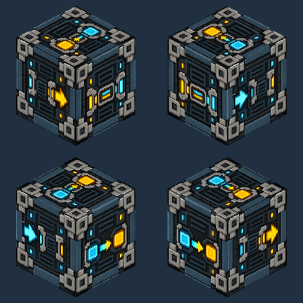
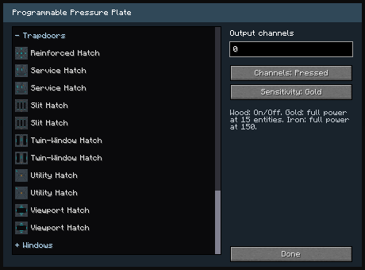
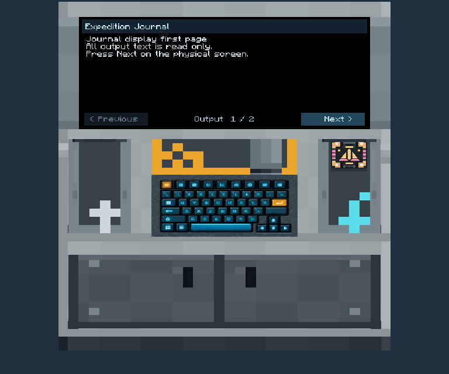
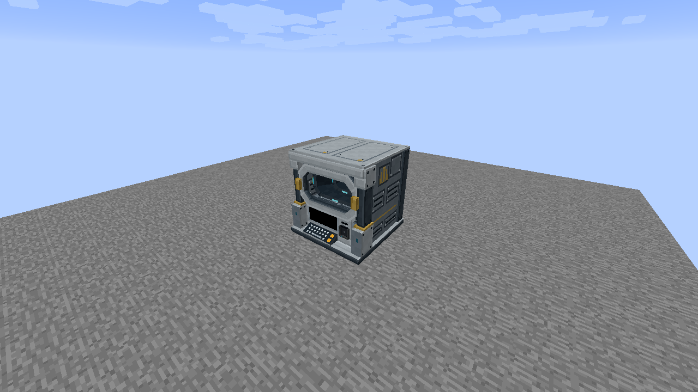
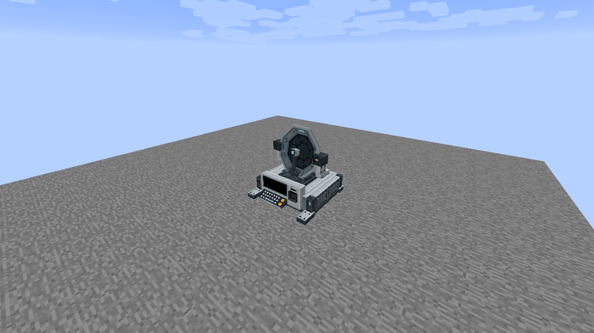

# Vandor Labs 2.6

Version 2.6 adds programmable copying, configurable surfaces and pressure plates, journal programming, reusable arm mechanisms and connected vehicle sections. See the [changelog](../../CHANGELOG.md) for the complete change list.

Arm attachments, Copy Controllers and Vehicle Couplers support Windows and Linux journal handling. An arm keeps its requested motion while the attachment is saved for recovery; a single right-click retracts a stacked Extender Arm with its payload. Pending arm journals recover on world load, restoring access to the affected blocks.

## Copying and programmable surfaces

The [Copy Controller](../copy-controller.md) duplicates a square input volume onto a matching square output surface. Place input surfaces on its left, output surfaces on its right and a material chest behind it. The front faces the placing player: cyan input is on your left and amber output on your right. Configure scan height and an optional signed redstone-channel offset in the dialog. Creative copies require no materials; Survival copies consume matching building materials and the exact items stored inside copied inventories. Missing materials and incompatible areas appear in the dialog before copying.

Copying and vehicle coupling prepare recovery records in the background, then check the live blocks and inventories again before changing ownership. Lighting and neighboring blocks update over subsequent ticks after the changed chunks are saved. Carried chest edits keep the same exact saved-data size limit without serializing the whole vehicle for each click.

[Programmable Surfaces](../turntables.md) replace Turntable Surfaces without changing their saved block ID. Select active and inactive materials through the standard texture tabs and Fit/Tile mapping on the surfaces. New surfaces default to Fit; the Configurizer opens their appearance settings even when claimed by a controller. The shared **Surface** texture category includes all fourteen turntable, landing, docking, maintenance and copier designs and is available in the general material picker for programmable blocks. Turntable Controllers keep their existing motion and scan behavior.

The [Programmable Pressure Plate](../programmable-pressure-plate.md) offers vanilla Wood, Gold and Iron sensitivity. Wood supplies full power when triggered; Gold reaches full power at 15 entities and Iron at 150. Its dialog selects a material, output channels and Pressed, Released or Disabled channel behavior. Pressed channels follow the measured signal level, while physical redstone remains independent of the channel mode.

Vehicle Mode, Turntable Controller and Copy Controller use the same supported-block policy. Copies preserve complete block properties and persistent tile data; blocks whose data cannot survive an exact round trip are refused.

## Cards and journals

The [Card / Chip Programmer](../card-chip-programmer.md) keeps a company Master, an Input item and an Output item in three physical sockets. Click a socket with a suitable held item to insert it, or use an empty hand to remove its item, without opening the dialog. Other console surfaces open the standard dark dialog. Its Journal editor shows eight lines on taller screens and has a draggable scrollbar. Its keyboard uses the established keyboard artwork. Its large display shows Journal Chip contents with clickable page buttons and stays black when no journal is present.

Put a blank Access Card or Data Chip in Input and leave Output empty. **Program** consumes Input and moves the programmed result to Output, retaining the company Master. Program requires an empty Output slot. With matching card/card or chip/chip items in both slots, **Copy** replaces the Output item’s data with an exact copy of Input while retaining Input and Master. Output items may belong to any company. A selected Master can also overwrite a foreign-company Input during Program. Move a result back to Input to program it again. Data Chip types include Master and Journal; Access Cards disable the Type selector.

A Journal Chip in Input loads its title and eight text pages into the Journal view. Edit and paginate there, then Program to write the chip and move it to Output. The Journal button appears only for an Input Data Chip whose selected type is Journal. Pending input edits save automatically; Inventory and Journal tabs sit on their own row below **Type**, above a bordered content area. Clicking Master, Input or Output selects Inventory. The status line and Program, Copy and Done actions sit below the tab content. **Done** closes either dialog page. Items stay in their sockets when the dialog closes.

## Arms, tracks and couplers

[Joined arm platforms](../joined-arm-platforms.md) connect matching Extenders across a rectangle, including hollow frames and intermediate supports such as a six-arm 2×3 layout. Enable joining on every arm and choose a neighbour range from 1 to 32 blocks. Rotating Arms join along their common hinge axis and must agree on rotation direction. Vertically moving Extenders can also carry a connected load above the platform, with a separate height setting from 1 to 32 blocks. Vehicles and their inventories can ride within that rectangle and height limit. Joined groups pause when a required member chunk unloads and resume after it returns. Arms and ramps share standing-player transport; arm collision and rider corrections stay synchronized when server ticks are delayed.

Controller authorization survives reconnecting. Captured payload blocks can be mined without removing their supporting arm; inventory drops use the same durable ownership rules as arm transfers.

[Extender, Rotating and Fixed Arms](../modular-landing-gear.md) can form mechanisms without a landing foot or hull above them. Place arms on floors, ceilings or walls to choose their motion axis. A generic mechanism's Off state is its construction pose. Standalone extenders retract on activation: half a block for one section, one block for two sections, and one fewer block than the section count for longer stacks. They never extend beyond their placed length. The single-page dialog configures motion, appearance and joined-platform settings without Angle or Active reach fields. The payload can stay level or rotate with the arm. Ordinary clicks on the exposed tip place the next arm or payload outside the arm's occupied cell, and one-section extenders retain half a block of clearance.

Unjoined Extenders move only their tip block, leaving touching surroundings in place. Ordinary attachments become placed blocks again at exact whole-block translation endpoints. New attachments in rotating payload mode align with the block grid at quarter-turn endpoints; level payloads stay connected to their swivels. Full blocks with safely representable rotated states can become ordinary blocks there; unsupported rotations and fractional translations retain their data in a moving snapshot. Existing saved attachments preserve their alignment. Captured machinery pauses while held, as it does in vehicle snapshots. Ownership changes use a recovery journal before world edits and keep affected inventories locked until the changed chunks are saved; interrupted transfers recover on restart. Cosmetic arm motion uses a pause-aware client clock so delayed server updates do not repeatedly restart the animation. Discovery and motion remain bounded and require loaded cells and permission to move the attachment.

One **Track** block offers Compact, Armoured and Bogie styles in its dialog. Place tracks against an arm tip, beside a slab or against another track; placement follows the clicked mounting direction. Two track blocks are enough for vehicle support. Native tread geometry supplies the selection and collision bounds. Track settings have their own dialog, and the belts animate with Taxi travel, reverse and steering while remaining still in Hover. Nested landing groups can include connecting blocks and lower landing assemblies; inspection uses the outer supports and excludes the ground beyond them.

[Vehicle Couplers](../couplers.md) and their horizontal slab variant connect opposing sections. Both halves support channel inputs and inverted activation. Ordinary right-click couples or uncouples; sneak-right-click and the Configurizer open their settings. In Taxi/Hover mode, enabled pairs can collect a parked section made of world blocks. Releasing a pair restores the detached section as blocks only when alignment, permissions, loaded chunks and clear space make parking safe. Otherwise it stays attached. This does not merge two moving vehicle entities.

Taxi turning accounts for wheel type and wheelbase: smaller wheels turn tighter, longer wheelbases turn wider, and pure tracked vehicles can pivot while stationary on the ground. Mixed vehicles average their active physical wheels and tracks; higher carried landing gear is cargo and its wheels, deployment and automatic propulsion remain inactive. Same-level running gear attached through Vehicle Couplers stays active. Reverse steering stays consistent and Hover turning is unchanged.

Right-click a carried vanilla chest to open its normal inventory dialog. Single and double chests retain their names, locks and item changes while the vehicle moves and when it saves or parks.

## Core assemblies

Five new assemblies use the existing Core and Programmable Matter workflow:

- [Pinnacle Oculus Drive](../multiblocks/oculus-drive/README.md), with split shutters and an energized field.
- [Survey Dish](../multiblocks/survey-dish/README.md), with an animated dish.
- [Sentinel Array](../multiblocks/sentinel-array/README.md).
- [Standalone Dish](../multiblocks/standalone-dish/README.md).
- [Standalone Antenna](../multiblocks/standalone-antenna/README.md).

Each linked guide includes five construction stages: the base, pillars or middle layers, roof completion, assembly, and Data Chip insertion. Core and navigation assemblies provide configurable input channels and visible, retained Data Chip holders. Data Chips store data; they do not gate activation, and these dialogs have no Security section. These models do not perform radar detection or dimensional travel.

Longburn Drive is now **Maxwell Drive**. Pinnacle Meridian Drive is now **Seyr Meridian Drive**, with one Seyr nameplate. Saved registry IDs remain unchanged. Maxwell, Seyr Meridian and Oculus Drives share the Rocket Thruster’s redstone activation and levels. Only Maxwell offers particle settings and emits warm yellow/white exhaust, with matching warm artwork when Off. Meridian only pulses its cyan front lights, and Oculus retains its field and shutters; neither emits particles. These decorative drives do not provide Vehicle, Taxi or Hover thrust.

## Materials and vehicle compatibility

New programmable screens, inputs and consoles default to Door Interior (Dark). Existing saved finishes remain selected. The twelve ceiling textures now use their authored 64×64 artwork.

Strong programmable glass is opaque, including Clear and replacement materials. Its renderer writes depth in the opaque pass. Programmable Block texture mapping preserves the active vertex record format used by OptiFine.

Stationary vehicle controls now say **Park Mode**. Cockpit clipboard copies use relative reservation links and remain independent of their originals. Downward propulsion blocks terminate discovery alongside landing supports.

Vehicles built in 2.5 can still enter Taxi Mode when their Vehicle Controller sits between a Pilot Seat and programmable blocks. Conversion retains external capability data saved on those blocks and supported vanilla tiles, including signs, through rotation and parking.

[Joined 2×2 propulsion blocks](../propulsion-shapes.md) can switch between square and hexagonal shapes through their dialog. Two complete 2×2s also join independently when staggered by one row, preserving both groups despite their combined stepped outline. Complete 3×3 hexagonal groups also join, and middle-clicking picks the ordinary single propulsion block.

Ramp Controllers accept all steel and aluminum scaffolding patterns from Immersive Engineering. Additional explicit vehicle adapters cover complete IE posts and watermills, windmills, wallmounts, decorative metal blocks and Toolboxes, as well as Mekanism storage and glow panels; see [the supported block list](../vehicle-compatibility.md) for their limits.

[All version guides](README.md) · [Changelog](../../CHANGELOG.md)
