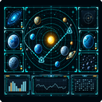
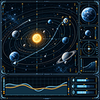
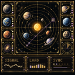
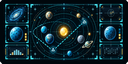
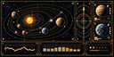
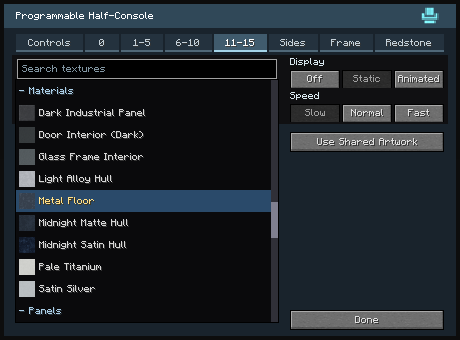
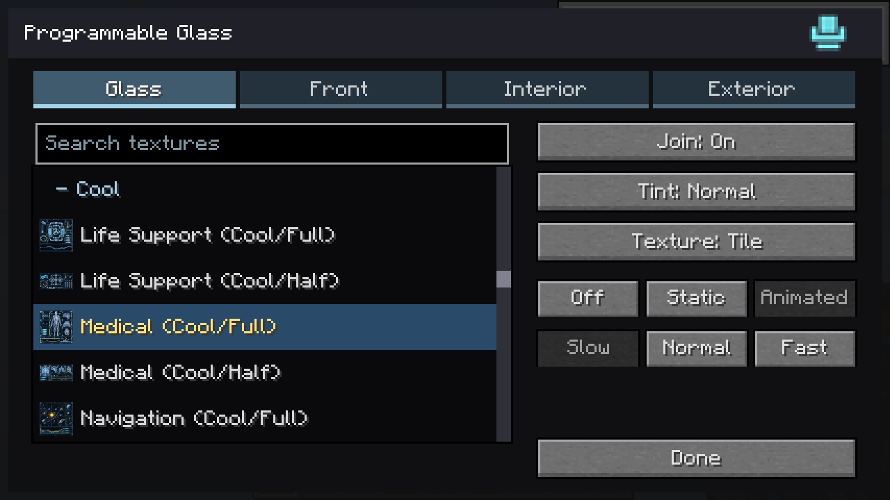
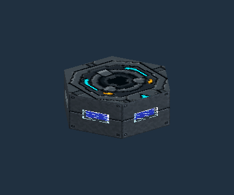

# Vandor Labs 2.7

Version 2.7 expands programmable displays, separates artwork from physical frame finishes, and adds more control over redstone, glass and moving mechanisms. Classic, Cool and Gold display libraries now cover matching Full and Half designs, with higher-resolution choices for larger installations.

Browse the [complete texture catalog](https://htmlpreview.github.io/?https://github.com/rheide/vandorlabs/blob/master/docs/texture-browser/index.html), compare the [display styles](../display-matrix.html) and [control panels](../control-matrix.html), or read the [complete changelog](../../CHANGELOG.md).

Animated displays reuse uploaded frame strips. Unrelated distant block updates preserve cached display layouts, and unavailable animation resources fall back to static artwork until resource reload.

## Developer Notes

This release is about solidifying the direction this mod is going. The big functionality change this time is around Redstone Channels, which are now limited in range. Transmitting blocks can set their range with a slider for now, though I'm still considering what this will look like in the final version in terms of gameplay and balancing. It's super useful though, because having a lower range means you can use the same channels for multiple vehicles without having to remap them (though you can still do that automatically with the Copy Controller as well).

Dialogs are much more consistent now. They all have the same tab design and terminology has been standardized, hopefully. Redstone lives in its own tab. Local redstone can be turned off. The texture editor now has a quick search field. 

I am trying out many new textures to see what will stick. These may disappear in a later version, but for now I want to add as many things as I can think of, just to see what they feel like. This means six new styles for inputs such as keyboard, sliders, knobs etc. - one for each corporation that's a part of this mod. There's a lot more screen animations, and all animations now come in three styles: Classic (pre-existing, now expanded with new screens), Cool and Gold, each catering to half of our fictional corporations. You can customize these further by setting screen border Frames, which I've included a bunch of, both generic and corporation-specific. These Frames can also be used for Portholes, Glass and Trapdoors.  Screen blocks can now be configured to show a different screen on a redstone signal, either on/off or analog for 4 different values.

Everything glass-related has had an overhaul: Canopy Glass is now a lot more performant. Canopy Glass, Programmable Glass, and some of the doors with high transparency can all configure their glass type, and there's now an explicit tint setting for Opaque.

What's next: no promises, but I intend to look more at survival mode and a plausible way to introduce all these fancy new block types. This needs a plausible tech tree that starts off from zero. On the other side of the tech tree, I want to work on making the multiblock machines work. Having my own space dimension is a long term goal, and all of the special propulsion drives, computers etc. will help us get there. One step at a time.

## Displays and control artwork

**Displays** replaces the Screens category. Classic, Cool and Gold use subject-first names such as **Navigation (Cool/Full)** and **Navigation (Cool/Half)**. Cruiser and ship views live in **Displays/Ship**. Full and Half describe the artwork's aspect ratio; Controls remain a separate, half-height collection.

| Navigation | Classic | Cool | Gold |
| --- | --- | --- | --- |
| Full |  |  |  |
| Half |  |  |  |

All three styles include the 17 expansion subjects in both heights: Airlock, Life Support, Power Grid Status, City Transit Map, Ship Deck Plan, Power Distribution, Shields, Damage Control, FTL Calibration, Station Berth Control, Industrial Fabrication, Industrial Refinery, Facility Access Control, Boot Sequence, Standby, Access Denied and Signal Lost. These animations have six distinct frames. Door Controller is also available in every style and both heights. Classic adds animated Half Station and Targeting designs and dedicated Half remakes for Medical, Ship Status, Engineering Charts, Starmap and Weapons.

Cool and Gold retain their Bridge versions of Biology, Communications, Medical, Navigation, Radar and Reactor as the primary designs. Other additions include planetary views, Station, Surface Map, Targeting, Engineering, Pilot, Ship Status, Engineering Charts, Personal Terminal, Viewscreen, Science, Starmap and Weapons. The [display matrix](../display-matrix.html) shows every subject and its available styles and sizes.

**Large** entries preserve animation and aspect ratio while offering more detail:

| Artwork | Classic | Cool | Gold |
| --- | --- | --- | --- |
| Viewscreen Large, Full and Half | 256px wide | 512px wide | 512px wide |
| City Transit Map Large, Full and Half | 512px wide | 512px wide | 512px wide |

Standard choices retain their native 128px width. Full frames are square; Half frames are half as tall as their width.

**Controls/Classic** contains 20 panels, including Keyboard Touchpad and Keyboard Full. Each of the six company folders contains ten controls, with Dense designs merged into their company folder. Common layouts use consistent names such as Navigation Controls, Fader Bank, Directional Controls and Keypad And Dial, while retaining their own artwork. Numeric prefixes and the redundant Bottom suffix are removed. See the [control matrix](../control-matrix.html) and [company comparison](../company-controls.md).

Texture lists support case-insensitive, multiword search by name, category or identifier. Click the search field or press **Ctrl+F**. Filtering preserves the selected texture; both wheel scrolling and scrollbar dragging remain available. Switching tabs reveals the current selection.

## Joined screens and redstone artwork

Programmable Screens, Flatscreens, diagonal screens, inputs and consoles offer **Disabled**, **Digital** and four-band **Analog** activation on Redstone. Digital exposes Off and On artwork; Analog exposes four signal-band tabs. Each state retains its own artwork, Off/Static/Animated playback and speed. Console Controls stay shared while the Display changes. Half Console uses the inclined surface as Display and keeps its flat Controls shared.

Enabling or switching modes preserves the existing artwork and playback settings where possible. Editing a state updates the whole matching authored display rectangle, including when powered blocks currently show different states. Search and scroll-to-selection work in every state tab. Nearby local redstone activates the whole joined display rather than only the adjacent block. See [redstone display artwork](../redstone-displays.md).

Wide joined Screens and Flatscreens offer Half designs when the joined shape suits them, such as a 4×2 group. Single blocks and square groups retain the Full choices. Configurizer and Copifier edits refresh joining without requiring a block to be replaced.

The **Programmable Trigger** retains static Off/On or analog-band artwork. Choose **All Faces** or **Front Only**; Front Only adds a separate Sides texture for the other faces. Displays are selectable there as static artwork.

Programmable Input is now named **Programmable Flatscreen**, retaining its saved registry ID. Programmable Light, Half-Input and Flatscreen share a single **Size: Small/Full** toggle. A Small Flatscreen is half a block square, matching Small Programmable Light. Its frame remains individual across gaps; Full Flatscreens retain connected frames. Wall, floor and ceiling mounts keep matching bounds and click surfaces.

## Frames, glazing and doors

Frame finishes are independent of display artwork. Choose **Bare** or a separate border, with independent material and layout controls. A joined frame keeps its original border thickness, extends edge pieces and preserves authored corners. Stepped and unequal glass layouts follow their outer contour without internal rectangle rails. Concave corners retain solid frame faces.

Programmable Glass and Diagonal Glass expose **Glass**, **Front**, **Interior** and **Exterior** as top-level tabs. Portholes use **Main** artwork for the front and separate **Glass**, **Interior** and **Exterior** tabs. Walls and diagonal walls label their frame finish **Exterior**. Interior and Exterior offer general materials alongside frame artwork.

Glass material lists include Displays. Selecting one reveals Off/Static/Animated and Slow/Normal/Fast directly on **Glass**; ordinary glass hides those controls. Playback is independent of a porthole's Main artwork, and joined images require matching playback settings.

Mild, Normal, Strong and Opaque are separate finishes. General materials use 35%, 65%, 85% and 100% opacity respectively: Strong remains translucent, while Opaque explicitly fills the pane. The policy also applies to portholes and canopies. Cyan and Amber light frames backlight Opaque replacement artwork in programmable Glass and Diagonal Glass; translucent and native glass retain world lighting. Glazing draws back to front, including native Front Canopy Glass behind programmable panes.

Full-height screens can show separate Half images with **Split display**, **Top** and **Bottom** on Display. Both images share one outer frame. Display Fit spans matching joined rectangles. Split display Fit supports square groups; frame Fit surrounds rectangular groups at constant border thickness. Frame artwork keeps its native depth and opaque inner surfaces. See [frames and displays](../frames-and-displays.md).

White Glass, Dark Glass and Slim Glass doors, in regular and Large sizes, have a **Glass** tab with native shades, general materials, tint and layout controls. **Original** restores the supplied pane. Slim Glass includes opaque inner reveal walls; Interior finishes affect the leaf reveals and fixed frame. Front finishes remain separate, and square frame materials tile at world-sized pixels on both door sizes.

Programmable Trapdoors and Diagonal Trapdoors accept authored Frame artwork with transparent centers and physical inner borders. Thin side textures retain ordinary trapdoor pixel scale. Joined borders disappear only between two cutout-frame leaves, preserving the boundary beside a regular material. Tile keeps a frame per leaf; joined Fit/Stretch keeps an outer frame.

Diagonal artwork retains a mapping tradeoff: **Tile** preserves square pixels by repeating artwork, while **Stretch** preserves the complete image and its border. Diagonal trapdoors compensate for slope length in Tile mode; their Fit (aspect) mode also tiles when the image aspect does not fit. Diagonal walls retain their existing complete-image mapping.

## Redstone transmission and dialogs

Transmitting blocks use a built-in **Range** slider: **4, 8, 16, 32, 64, 128 or 256 blocks**. **Local Redstone: On/Off** controls ordinary world output independently of channel output. No transmitter item insertion is required. Screen control rows and cockpit controls share their host's range and local-output settings while retaining independent channel targets.

[Handheld Redstone Transmitters](../redstone-transmitters.md) remain in creative with their existing manual signals and item ranges, including unlimited same-dimension transmission. Receivers use the strongest signal that reaches their position; different receivers can receive different levels on the same channel. Linked controls share latch state within range, while a distant On source can continue supplying a signal.

Dialogs use consistent top-level tabs, block titles and the Vandor logo, with Redstone last and no transmitter controls on passive receivers. Persistent Rocker Switches publish their final latch before notifying local redstone, so repeated On/Off toggles update adjacent devices. Powered Wall Sliders retain their analog level across reloads, and solid Programmable Blocks conduct lever power from below across the display family.

Dedicated Redstone pages use the available width on regular and Large arms, thrusters and other receivers. Autopilot combines route selection into General and selects markers from the nine hotbar slots without consuming items.

## Arms, surfaces, ramps and tanks

[Extender and Rotating Arms](../joined-arm-platforms.md) discover a connected layer of Programmable Surfaces in its placed plane, including overhangs beyond joined supports. Shared pads spanning several supports require compatible **Join Arms** settings. Regular and Large mechanisms retain all six mounting faces, endpoint edits and safe obstruction checks.

Surfaces list **Inactive** before **Active**. On an attached arm they use Inactive at the start/retracted endpoint and Active at the end/extended endpoint, keeping the departure artwork until the other endpoint is reached. Reversals and reloads retain that choice. Native endpoint publication keeps the carried decal until all Surface tile data is ready, avoiding a blank or duplicate renderer.

Horizontal Extenders offer optional push mode: the original attachment returns, while newly pushed blocks remain forward. Rotating Arms offer separate Start and End sliders in 15-degree steps and check the complete swept path before changing their Start pose. Blocked or interrupted transfers retain recoverable attachments. Standing riders follow the rendered support pose through delayed updates and reversals while server collision remains authoritative.

The Copifier's **Arm / Track Settings** includes Join Arms, neighbour range, load and motion options. Copying or applying through a member section resolves its controller and preserves the target's mounting orientation, live pose and payload ownership.

[Ramp Controllers](../landing-ramps.md) support proportional deployment from redstone levels 0–15, retaining analog mode, offsets and channel lists together. Stationary full-height ramp faces accept doors. Authorized configuration or interaction permits later automation and safe recovery of existing ramps.

[Hexagonal Tanks](../multiblocks/hexagonal-tank/README.md) join into complete **2×2** and **3×3** sections while keeping native storage in each block.

## Copying and vehicle improvements

The Duplifier places **Connected Matching Blocks** and **Ignore directionality** in separate columns. Ignore directionality includes otherwise matching blocks with different orientations without rotating targets. Both choices stay on the tool. **Undo last application** restores one previous settings operation, including connected groups, after checking permissions, loaded chunks and subsequent edits. Undo preserves inventories and has a bounded memory budget; oversized applications report when undo is unavailable. See the [Duplifier guide](../DUPLIFIER.md).

Eligible matched wheel/track supports can change Taxi chassis height while keeping their feet grounded. Stop and align the craft for modular support changes; supported integral landing gear can adjust while driving. Retained modular sections survive parking, rotation and recapture and remain protected until raised before dismantling. See [modular landing gear](../modular-landing-gear.md).

Native paintings retain their artwork and facing through vehicle movement, rotation and parking. Carried signs retain their text, paintings use the craft's lighting, and lamps illuminate carried blocks. OptiFine dynamic lights can also illuminate nearby terrain when enabled. Vehicle visibility ignores shader shadow-map draws so interior views remain available.

Vehicle discovery respects water, Surface boundaries and ramps owned by another controller. Coupled cargo and arm payloads retain recovery data through interrupted ownership transfers and partial cross-chunk saves. Saved data that cannot be restored safely stays recoverable rather than becoming a partially installed live structure.

## Materials, shaders and rendering costs

Materials adds **Satin Silver**, **Cool Steel** and **Pale Titanium** at native 128px resolution. Corporate armor artwork is refreshed, and Surface artwork includes the additional helipads. The [texture browser](https://htmlpreview.github.io/?https://github.com/rheide/vandorlabs/blob/master/docs/texture-browser/index.html) shows the current selectable catalog.

Every runtime texture has a LabPBR specular companion, with shared maps for equivalent finishes. Bare metal, painted machinery, glass, fabric and composite surfaces receive distinct material properties without altering diffuse artwork or adding emission. In Complementary Unbound, select **RP Support: labPBR** and enable specular maps. Atlas companions follow the diffuse sprite's crop and dimensions, including Half displays, avoiding OptiFine startup/reload crashes. See [shader material maps](../shader-materials.md).

Plain fixed **Canopy Glass** uses Minecraft's solid and translucent chunk meshes while preserving frames, joins, collision, opening-canopy roof contacts and cockpit sharing. Opening and carried canopies retain their existing geometry/render paths. Held Canopy Glass uses ordinary block sizing with a padded inventory icon.

The measured 256-block Normal sheet uses **2 chunk-layer submissions**, compared with **316** on the carried tile-renderer path and **1** for vanilla glass in the same occupied chunk section. Canopy geometry remains more detailed than vanilla glass. These CPU/submission measurements do not establish hardware FPS; see the [full performance comparison](../performance/canopy-glass.md).

Programmable Blocks, Slabs and Stairs share empty face-configuration and fluid data. Stairs build compact render-state snapshots instead of temporary property maps. Unchanged settings avoid unnecessary saves, block updates and cache invalidation. Texture resolution, face overrides, stair profiles, fluids and saved block IDs retain their behavior. Static opaque vehicle artwork also reuses geometry and draw order between frames.

## Existing worlds and artwork cleanup

Saved texture indices remain stable where artwork is renamed or aliased. Former Vektor display choices use Gold; retired Ashiro, Seyr and Vandor company displays use Cool, while original Seyr Communications, Navigation and Reactor remain available in Classic. Root Engineering Screen resolves to Engineering (Classic/Full). Older frame defaults retain their appearance until edited; development-era inserted transmitter modules migrate to built-in transmission settings without retaining or dropping inventory items.

Root Controls are merged into Classic, keeping the existing Classic design for duplicate names. Retired duplicate animations and unlisted paired framed screens are omitted from the JAR; retained animations and Off artwork remain available. Tactical Starmap, Science Biology Wide Left/Right and the old Console display designs were removed without replacement mappings. Console blocks remain available.

The Redstone Receiver Block now uses **`vandorlabs:redstone_receiver_block`**. The old **`vandorlabs:redstone_receiver`** ID has no remap; blocks, items and saved assemblies using it are not migrated. Handheld transmitters retain their separate item IDs. See the [changelog](../../CHANGELOG.md) for the detailed compatibility and recovery fixes.

Canopy Glass side faces now sit slightly inside their block to prevent flickering against adjacent solid blocks. The render clearance also applies to carried copies; collision and saved layouts remain unchanged.
