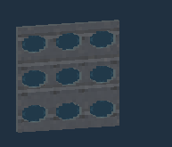
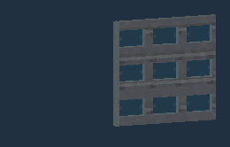
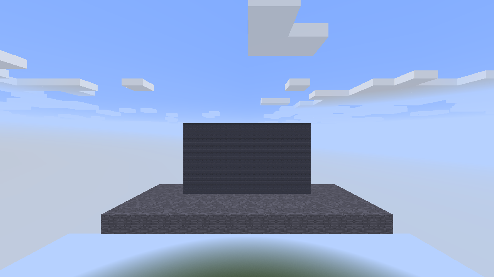

# Vandor Labs 2.8

Build windowed hangar doors, drive articulated trailers, save a favourite vehicle to a chip and build another from its design. Version 2.8 brings more expressive moving builds, more flexible vehicle controls and faster rendering for dense structures.

## Segmented doors in motion

The new [Segmented Door](../segmented-doors.md) can slide **Up, Down, Left or Right**. Choose **Perpendicular** travel to fold panels behind the opening, or **Straight** travel to keep them in the door plane. Select Slow, Medium or Fast motion, then operate the door by hand or with Redstone Channels.

*Round windows travel with each panel as the door retracts overhead. These loops show the native renderer at evenly spaced motion positions.*

*Square windows move with the panels during Straight sideways travel.*

Mix solid and window sections, choose Hexagon, Octagon, Square or Round openings, and configure the glass separately. Tile windows per segment or fit them across connected sections of the same shape. Tile, Stretch and Fit artwork, custom block samples, Frame textures and Middle/Near/Far placement let one mechanism suit garages, hangars and interior partitions. Follow the [step-by-step construction guide](../segmented-doors.md).

## Articulated vehicles and independent sections

Enable articulation on a coupler for trailers that follow with independent yaw and pitch, constrained by hull and terrain collision and a combined 75-degree joint limit. Parallel coupling pairs stay rigid. The controller in the piloted section controls the vehicle; controllers in other sections remain available for later separation.

Stopped Taxi or Hover vehicles can separate one clicked coupling pair into two complete vehicle entities, preserving headings, fractional positions, inventories and joint poses. Each half needs its own controller, driver seat and mode equipment, and detached seats must be empty. See [releasing a section](../couplers.md#releasing-a-section).

Taxi now works without propulsion at 0.23 blocks per tick; powered Taxi retains 0.28. Hover still needs propulsion and three lift blocks in **every** connected coupler section. Stopped Hover vehicles can park directly near the ground with extended gear. Gentle vertical trailer motion follows ascent and descent, then settles level.

The configurable articulation limit defaults to seven hinge points, allowing eight independent segments in new assemblies. Lowering it does not prevent saved longer vehicles from loading or parking. Failed vehicle loads preserve both original block data and joint poses for recovery; repeated collision safety queries reuse their array storage.

See the [compatibility and performance review](../release-compatibility-2.8.md) for upgrade boundaries and validation scope.

## Vehicle designs and security

Couplers now offer optional articulation for independent trailer yaw and pitch, constrained by hull and terrain collision and a combined 75-degree joint limit. Parallel pairs remain rigid. Joint poses persist with the vehicle; see [Vehicle Couplers](../couplers.md#articulated-trailers).

Vehicle Controllers now retain a name and a small rotating shape preview. Vehicle Status screens display the name and conversion activity while bounded scan/preflight work prepares Taxi or Hover mode. Controllers also retain a last-scanned weight estimate, including supported inventory and fluid contents; it is informational and does not change driving or flight.

An attached Data Chip Mount lets the controller write its exact design to a Vehicle Chip. The [Card / Chip Programmer](../card-chip-programmer.md) creates blank Vehicle Chips, previews their shape and duplicates their full saved contents. The [Copy Controller](../copy-controller.md) can build directly from a Vehicle Chip using an output Surface and the usual materials and recovery checks. Copies are centered on the output Surface; oversized designs are refused before spending materials or placing blocks.

The controller’s Security tab enables security and explains the attached mount. Configure the accepted Access Card using the Access Card Mount’s standard Security selector. Leave that card inserted to allow Taxi/Hover conversion; removing it blocks future conversions while parking remains available. See [Vehicle controls](../pilot-seat-taxi.md).

When a mount is missing, the Vehicle tab explains how to attach a Data Chip Mount to write vehicle data, and the Security tab explains that an Access Card Mount enables security.

Taxi also works without a propulsion block at 0.23 blocks per tick, about 18% below the powered 0.28 speed, with no Sprint boost. Hover retains its propulsion and lift requirements.

## Screen chip readers

[Screen chip readers](../screen-chip-readers.md) add a Chip choice on the Displays tab to Programmable Diagonal Half Screens, Diagonal Screens, Half Consoles and regular Consoles. Console slots open toward the player at the bottom; the Diagonal Screen slot animates sideways. The slots disappear when another artwork choice is selected. Inserted chips remain stored while hidden. Half Consoles put Displays before Controls and reserve the right edge of the lower controls deck for the slot without stretching its texture. Regular Programmable Screens share an attached Data Chip Mount across their joined rectangle. Chip contents stretch across the whole display. Vehicle Chip previews use their company colours (gold for Pinnacle, cyan for Vandor, silver for generic chips). Slow/Normal/Fast controls Vehicle Chip rotation, immutable shape geometry is cached, and company Master Data Chips display their Corp logos.

Data Chip Mounts and Access Card Mounts now share the Thruster Lever's base height, tilt and tilt direction controls. Configure these on the Security tab; right-click a button to cycle backwards. The inserted token follows the mount pose.

Programmable Doors can insert an accepted Access Card from inventory without changing the selected hotbar item. Custom block artwork mirrors across double and Large door leaves. Programmable Glass and doors now follow the Wall/Porthole loaded-chunk render range.

## Retired cockpit glass

Clear Cockpit Glass now becomes vanilla Glass, Pale Cyan Cockpit Glass becomes cyan Stained Glass, and Smoked Cockpit Glass becomes gray Stained Glass. The three mod blocks and their alloy recipes are removed. Existing placed blocks, inventory stacks and saved designs migrate with their colours preserved; names, counts and other item data remain intact.

## Segmented doors

Segmented Door is new in 2.8 and uses `vandorlabs:segmented_door`. Interim development identifiers are unsupported; this is not a change to a block from 2.7.

The new [Segmented Door](../segmented-doors.md) lifts linked columns and retracts them overhead. It supports ordinary right-click operation, Redstone Channels and the standard Configurizer workflow. A dedicated dialog controls travel time, local redstone and signal polarity.

Settled closed panels use chunk geometry. Moving and raised panels share a batched renderer and a bounded mesh cache. Client animation tolerates repeated updates, clock corrections and reversals; server collision and saved timelines remain authoritative.

See the [rendering measurements and validation scope](../render-performance.md).

## Segmented Door controls and windows

Segmented Doors now slide Up, Down, Left or Right and can bend Perpendicularly behind the opening or travel Straight in the door plane. Mechanism speed uses Fast, Medium and Slow, and Ramp Controller uses the same **Speed** label. Manual/Redstone ON/Redstone OFF activation matches Programmable Door; redstone activation disables manual operation.

The fixed-size dialog has a **Door** tab with Tile/Stretch/Fit, inventory-based **Custom...** artwork and the Frame category. Window segments offer Hexagon, Octagon, Square and Round openings, tiled per segment or fitted across connected Window sections of the same Shape, with a separate Glass tab. Better Builder’s Wands extrusion now repairs every top-row header after copying settings. See the [construction and configuration guide](../segmented-doors.md).

## Coupled vehicle lift

Hover now requires at least three lift blocks in each section connected by
couplers, including rigid and parallel connections. Taxi does not gain this
lift requirement. See [Vehicle Couplers](../couplers.md#hover-lift-per-section).

## Ramp Controller axes

The full and slab Ramp Controllers now have an Axis selector on the Ramp tab.
East/west side mounts offer X/Y; north/south side mounts offer Z/Y; up/down
mounts offer X/Z. Y selects an upright source panel and runs tread sections
up its height, with outward/inward or sideways travel. Existing horizontal
layouts retain their saved behavior. See [upright source panels](../landing-ramps.md#upright-source-panels)
for building steps and the mode details.

## Builder compatibility

Canopy Glass now remains in place when an RFTools Builder fills a Shape Card. Automatic placement initializes the pending canopy tile and its footprint before normal membership repair runs. Ordinary placement and broken-footprint cleanup retain their existing behavior.

## Dense rendering

Neighbouring Surfaces with different active/inactive artwork form separate join groups. Matching Copy Controller pads may be rectangles; Turntables still require squares.

Unclaimed single Surface blocks share Forge's atlas batch and use tighter visibility bounds. Joined and controller-owned surfaces retain their established renderer. Ordinary planar translucent glazing batches consecutive compatible panes while preserving glass ordering and special finishes.

Stationary opaque ramp endpoints reuse VBO meshes. Motion, unsupported finishes and special ramp modes retain their existing geometry path. Opaque diagonal wall fallback rendering can join the fast batch; ordinary in-section walls continue to use terrain geometry.

Canopy and moved-door collision queries search nearby loaded-owner buckets instead of every loaded tile. Empty turntable searches no longer traverse unrelated entity lists for each particle collision.

## Rain beneath fixed Canopy Glass

Fixed glass already stops native rain columns. Complementary's wind effect can treat transparent roofs as outdoors because skylight remains high. Sheltered precipitation now scopes the wind uniform to the weather pass and restores it afterwards, preserving ordinary lighting. Hardware verification with Complementary Unbound remains part of manual testing.

Large vehicles reuse opaque wall sections with shader-sized vertex records, including per-block material IDs. Fixed Canopy Glass misses no longer rebuild neighbour geometry during collision searches, and loaded trapdoors use owner indices. Large flat hulls query shallower, wider collision regions. Geometry caches respond to carried artwork updates and neighbouring edits. Contained-fluid cells are compacted, and rendering skips unused voxel volumes. See the [performance notes](../render-performance.md) for measured comparisons and test conditions, and the [performance summary](../performance/2.8-summary.md) for the next priorities.

The main 2.8 performance candidate passed the Java 8 release gate, including shader startup, rendering, glass and fluid contacts, shared surfaces, arm motion and saved Vehicle/Taxi regressions. Later screen readers, mount adjustments and Copy Controller refinements use focused live checks and dedicated-server linkage; the full release gate was not rerun for these changes. Hardware shader acceptance remains a separate manual check. The [vehicle follow-up measurements](../performance/2.8-followup.md) distinguish scan latency, terrain allocation and remaining shader/publication costs.

## Larger joined areas and Segmented Door artwork

Programmable Surfaces now support up to 32 blocks on each side. Copy Controllers accept filled rectangles with matching input/output dimensions; Turntables retain filled squares. Screen artwork retains its previous 1,024-cell scan cutoff. Snapshot, capture-height and payload limits remain independent.

The new Segmented Door uses `vandorlabs:segmented_door`. Its Door tab includes general materials, Trapdoors, Doors and Large Doors. Original and light grey Segmented Panels are also available in the general Industrial category.

## Diagonal Half Screen rename

**Programmable Diagonal Half Console** is now **Programmable Diagonal Half Screen**, with block and item ID `vandorlabs:programmable_diagonal_half_screen`. Existing `vandorlabs:programmable_diagonal_half_console` placements and item stacks remap to the new ID. Facing, upper/lower placement, selected artwork, controls and stored chips are preserved. Saved Vehicle Chips, vehicle/turntable snapshots and retained arm/ramp references also accept the old ID. The tile-entity ID and block metadata format are unchanged.

## Company doors

The Doors texture category now includes six company folders: Pinnacle, Ashiro-Mai, Paladyne, Vektor, Seyr and Vandor. Each contains Standard, Security and Light artwork. The 128×256 textures retain their authored alpha, including the Light designs’ window openings with faint native glass shimmer, and work on normal and Large Programmable Doors. All company artworks mirror across paired leaves in Fit, Tile and Auto layouts. Vektor, Pinnacle, Paladyne and Ashiro-Mai reverse their base artwork so the handle matches Seyr/Vandor on a single leaf. Browse the [texture catalog](../texture-browser/) for previews.

## Chair angle and single-Track steering

Programmable Chairs have an Angle slider from 0–315° in 45° steps, relative to their placed facing. Configured items and saved vehicle designs retain the angle; the Duplifier can copy it separately. Lone top-mounted Tracks swivel like Landing Gear Wheels in Vehicle Mode, while their supports remain fixed. Joined and arm-mounted Tracks retain their alignment.

Console and Half Console frame finishes now affect only the Displays surface. Controls retain their original artwork area. Screens, consoles, cockpits, navigation tables and other multiblock display tabs/categories consistently use **Displays**.
