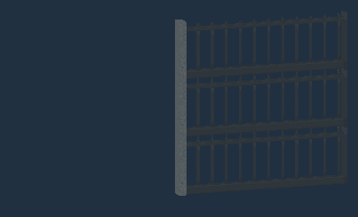
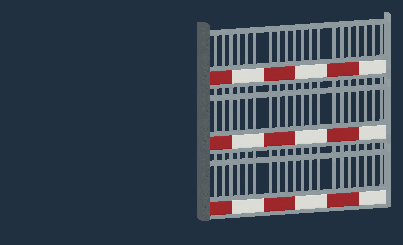
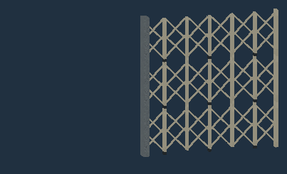
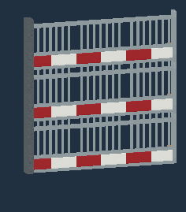
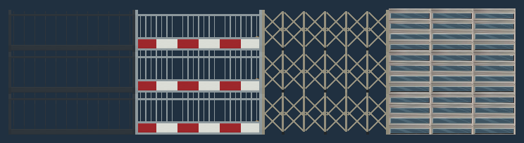

# Vandor Labs 2.9

Version 2.9 expands Segmented Doors with authored gates, panel finishes and finer bending motion, adds new ordinary and Large Door artwork, and improves placement, copying and vehicle parking. Forge **1.12.2** remains the main release target. The **NeoForge 1.21.1** build is experimental and does not yet provide complete feature parity.

## Sliding gates and Segmented Doors

Build **Picket**, **Industrial** and **Lattice** gates from ordinary Segmented Door blocks. Matching models join horizontally and vertically while retaining their bars and openings. Choose **Slide: Up / Down / Left / Right** and **Angle: Straight / Perpendicular**. Straight gates retract along their plane; Perpendicular gates turn behind the opening.

**Tread Px** uses the Ramp Controller's numeric field and minus/plus controls, with **1, 2, 4, 8 or 16 pixels** per bending strip. Smaller values produce finer articulation; existing saves default to sixteen-pixel treads. Straight travel retains its existing behavior. Perpendicular travel stops as the final tread completes its bend, without the extra run along the open track; bend height can vary with tread size. Panels remain solid while moving and open, including outside their original block cells.

Additional bending examples: [Picket](../images/segmented-2.9-picket-bend.gif) and [Lattice](../images/segmented-2.9-lattice-bend.gif).

The **Doors → Segmented** group includes **Raised Black Panels**, **Ribbed Blue Steel**, **Spiral Aluminum Glazing**, **Dark Segmented Panel** and **Light Segmented Panel**. Spiral Aluminum Glazing has four real window openings with solid metal frames, inner reveals and a selectable glass material. Its metal no longer shares the transparent image pass. The original full texture remains mapped across the slit geometry, honoring Tile, Stretch and Fit.

Select artwork for the section whose dialog you open; use the Copifier to share settings. The redundant artwork-scope and reset buttons are removed. Saved shared artwork and individual overrides remain compatible. Panels retain continuous tiled artwork across solid and Window sections, two-pixel bodies and a four-pixel header. Placement chooses Middle/Near/Far from the clicked face and continues an existing door's plane. Gate top faces remain available for extending a column.

Follow the [Segmented Door construction and configuration guide](../segmented-doors.md).

## New ordinary and Large Door artwork

The **Doors → Utility** group adds twelve 128×256 artwork choices: Blue, Green and Warm Utility with matching Modern variants; Factory; Industrial and Industrial Modern; Reactor; Warehouse and Warehouse Modern. Dark, Slim and White Glass designs are grouped under **Doors → Glass**. Renamed entries keep their saved texture identities. Selecting a Reactor pane from the Glass tab retains the Reactor artwork.

**Reactor** has a transparent octagonal window, selectable glass and an inner border. The same artwork and glazing work on ordinary and Large Doors, including paired leaves and their configured items. See the [Door guide](../space-doors.md) and [texture browser](https://htmlpreview.github.io/?https://github.com/rheide/vandorlabs/blob/master/docs/texture-browser/index.html).

## Creative Safe Park

The Creative Configurizer offers **Safe Park** for captured vehicles. It aligns the craft and existing articulated sections, searches for a fitting flat area within sixteen horizontal blocks in already loaded chunks, then restores world blocks through the durable parking transfer. Supported fractional arm endpoints are resolved before native blocks are published. Refused or interrupted transfers retain recoverable ownership, including the original Hover mode and target height.

Safe Park supplements ordinary parking; it is a Creative tool. See the [Pilot Seat and vehicle guide](../pilot-seat-taxi.md).

## Building and control fixes

Carried tracks retain their own tile identity and topology when vehicle collision snapshots are prepared.

- Flat Programmable Walls, Glass and Porthole Walls anchor against a clicked horizontal support. Continuing an existing panel retains its depth; full-cell Porthole Blocks keep full-cell placement.
- Copy Controller pads accept connected Surface blocks with different artwork. Individual finishes remain distinct, and Turntables retain their existing artwork-sensitive grouping.
- Redstone channel editors share the positive 32-bit range: **1–2,147,483,647**, zero disconnected, and up to 64 channels per bank. Copy Controller translation checks overflow before changing blocks.
- Connected Duplifier Undo records the whole selection before applying linked settings, so Door direction, speed, layout and channels restore correctly.
- Configured Canopy placement checks its stored footprint before modifying blocks or supports.
- Taxi/Hover double-jump taps clear when the driving context changes. Centered vertical articulated couplers retain the child's heading when the parent turns.
- Hidden/restored screen pulses retain their original expiry. Texture quicksearch matches useful names, categories and filenames while preserving explicit qualified-ID search.

Arm-mounted multi-Coupler articulation remains private development work. Version 2.9 does not advertise public activation of that unfinished runtime.

## Rendering and performance

Equivalent blocks share more prepared geometry while retaining individual lighting and placement. Caches have retained-memory limits and retire stale atlas data on resource reload or world unload.

- **Forge Glass and Portholes:** warmed UV and flat-frame lookups avoid temporary strings, boxed keys and frame allocations; equivalent diagonal owners share prepared contact-trimmed meshes.
- **Segmented Doors:** equivalent moving columns share render descriptors. The measured 512-column comparison reduced allocation by **51%**. Settled ordinary tiled panels retain their chunk-rendering path; authored gates use prepared meshes.
- **Programmable Lights:** warmed mixed-housing lookup and emission allocate no bytes across the measured 64-profile set, with exact emitted-record checks.
- **Native rendering:** ordinary and diagonal Glass/Porthole projections share prepared values across equivalent owners; Lights prepare facing and atlas coordinates once per mesh. Mounted-control hovering uses one enclosing outline without rebuilding detailed collision geometry.
- **Shared kernels:** stair collision, mounted-control transforms and panel/fluid helpers reuse scalar geometry and cached results while preserving existing UVs, lighting and saved defaults.

These are allocation, geometry and focused-render measurements; they do not establish a hardware FPS gain. See the [Glass](../development/glass-render-caches.md), [Light](../development/light-render-caches.md) and [Segmented Door](../development/segmented-render-caches.md) cache notes.

The ramp renderer also avoids a Java 8u51 C2 compiler failure encountered when entering a world, while preserving its rendered geometry and artwork mapping.

## Experimental Minecraft 1.21.1 conversion

The native target uses **NeoForge and Java 21**; the Forge 1.12.2 target retains **Java 8**. Shared policies cover material identities, typed persistence, geometry, dialogs, redstone banks and input rules; platform adapters own registries, world lifecycle, transport and rendering APIs.

Converted public families include programmable cubes and building-shape foundations; Trigger and wireless controls; buttons, rockers, power levers, throttles and sliders; ordinary/Large Doors, Segmented Doors and Trapdoors; ordinary Glass and standalone Canopy components; Programmable Lights; standalone propulsion and redstone lights; seven Screen roles; Programmable Storage; Card/Data Chip readers; the Card / Chip Programmer; and the Duplifier/Copifier tooling for converted targets. Filesystem PNGs, inventory material sampling, configured items, dedicated editors and contained-fluid behavior are integrated where their family supports them.

Native saved-data and ownership work retains failed snapshots, prevents opaque recovery items from ordinary placement, and preserves physical reader/programmer inventories. Native credential, canopy and programmer construction guides accompany their accepted families.

Remaining standalone mechanisms, Ramp/Copifier integration, Copy Controllers, Turntables and other unconverted families still need acceptance. Vehicle driving, articulation and carried/cockpit integration remain deferred. Focused native acceptance is separate from full non-vehicle parity and installer or hardware acceptance. Consult the current [coverage inventory](../development/feature-coverage.md), [multiversion checkpoint](../development/multiversion-checkpoint.md) and [architecture](../development/multiversion.md) for exact boundaries.

Previous highlights: [Vandor Labs 2.8](version-2.8.md). Detailed changes: [changelog](../../CHANGELOG.md).
