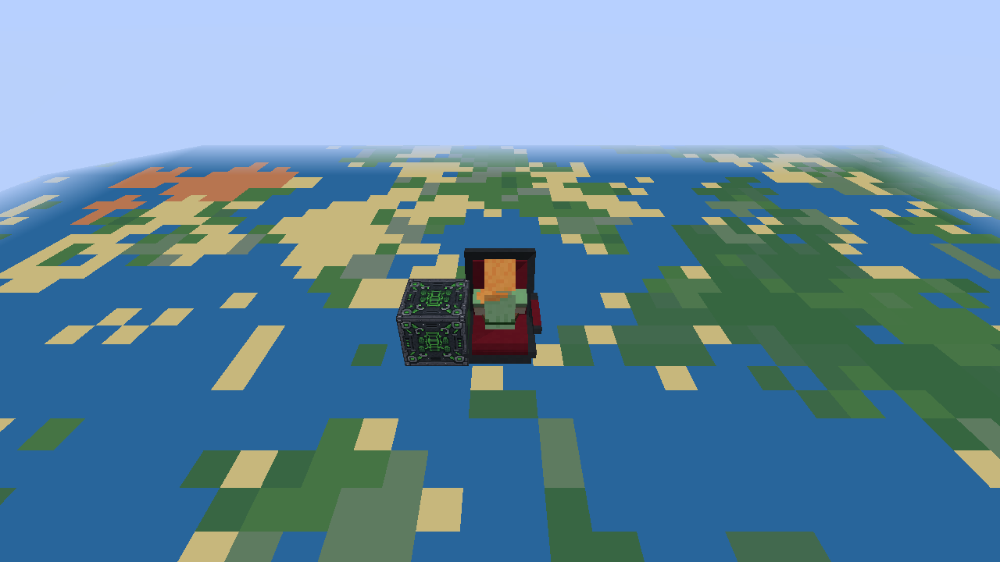

# Vandor Labs 3.0

## Maxwell Drive

The Maxwell Drive gives a Forge 1.12.2 vehicle sustained forward thrust. Build a frame **3 × 3 × 4**, **4 × 4 × 5**, **5 × 5 × 7**, **6 × 6 × 8** or **9 × 9 × 12** (width × height × depth). Each drive has a **1,000 mB** tank. Connect a fluid line to the marked inlet on the front or either side. The front gauge shows the remaining fuel.

See the [illustrated Maxwell build guide](../multiblocks/maxwell-drive/README.md) for frame counts, port positions and a table of how much each drive lifts at takeoff and at altitude.

Use Refined Fuel, Ethanol, Fuelium or Rocket Fuel. Right-click the drive to choose **Redstone ON** or **Redstone OFF** as its activation, select a **Digital** or **Analog** signal, or purge the tank before changing fuels. At full thrust, a drive uses **1 mB every 10 seconds** at 20 ticks per second. Analog signal strength scales thrust and consumption together. A signaled drive can burn fuel while placed, taxiing or hovering. With **Activation: Disabled**, the drive starts automatically when the pilot engages Flight.

## Taking off

1. Assemble a craft with a Vehicle Controller, Pilot Seat, Vehicle Status screen and at least one fueled Maxwell Drive. Open the Controller's **Flight** tab to compare the effective weight to the weight the available thrust can lift. Antigravity Plates and Repulsor Arrays reduce effective weight.
2. Sit in the Pilot Seat and select **Flight** on Vehicle Status. Park and Taxi occupy the top row, Hover and Flight the bottom row. Gray buttons show modes the craft cannot currently select. From Hover, the craft starts accelerating forward. From Taxi, use a clear runway to build takeoff speed, then press **S** to lift the nose.
3. Use **A/D** to turn and **W/S** to pitch the nose down or up. Below Y=256 the target flight speed is 1.5 times Hover sprint speed. The Vehicle Status screen shows speed, altitude and combined fuel.
4. A collision or a loss of thrust starts recovery. A craft equipped for Hover can level out and hold altitude. A Maxwell-only aircraft descends toward the ground.

For recovery below the cruise band, Creative players holding a Configurizer can select **Emergency Park** on Vehicle Status. It uses the Controller’s Safe Park search to find space for the craft.

## Flight instruments

In the Forge screen or cockpit artwork picker, expand **Vehicle Status** and choose a display for that surface. **Status** keeps the mode controls and fuel readout. The **Attitude Indicator** shows pitch and bank, **Compass** shows heading, **Altimeter** shows elevation, and **Airspeed Indicator** shows speed in m/s. The airspeed dial scales to the craft’s projected maximum.

Open the Controller’s **Flight** tab for projected maximum speed and altitude at full installed Maxwell thrust. The projections account for effective weight and the dimension’s ceiling. Below Y=256 the thrust speed target stays at 30 m/s. A light craft with one Maxwell can build toward 100 m/s in the first part of its climb above that height.

## Overworld cruise

Above Y=256 the rider travels over a seed-colored view of the Overworld. The route uses virtual X/Z coordinates. The departure area stays loaded while occupied. Descent loads terrain at the destination. The instruments show altitude during cruise and omit ground clearance.

Available thrust and effective weight determine the altitude ceiling. A sufficiently powerful craft can reach **Y=10,000**, where its target speed is 50 times the low-altitude flight speed. Reducing thrust lowers the attainable ceiling. The craft descends until its thrust can support flight again.

One full 3 × 3 × 4 drive supports 512 effective weight units at takeoff. Larger drives scale by volume. Above Y=256, multiply the takeoff thrust requirement by `1 + 24 × (Y − 256) / (100,000 − Y)`. For example, twice the takeoff thrust reaches about **Y=4,246**. Reaching **Y=10,000** takes about **3.60 times** the takeoff thrust.

## Supplying engines and observers on board

Connect an onboard tank's output to a Maxwell inlet with a compatible fluid pipe. For example, a Mekanism Mechanical Pipe can supply the engine from storage, and a Thermal Dynamics Fluxduct can carry RF from an unlinked RFTools Power Cell to the bottom of a Survey Dish. An Arm can pass its selected resource between its base and tip once it reaches a settled position. See the [onboard connection guide](../resource-ports.md#vehicle-mode-on-forge-1122) for supported pipes, storage and endpoint settings.

## Reading a channel

Choose **Channel status** in the Redstone row editor to display the strongest received level as five battery bars. A level of zero leaves the battery empty. Each bar covers three signal levels. Use a Tank or Battery's transmitter channel to monitor its fullness on a screen or cockpit panel.

## Minecraft 1.21.1

The experimental NeoForge build supports Taxi, Hover and Maxwell Flight, including a return to the same aircraft after a server restart in high cruise. Operate redstone controls from the assembled hull and feed engines or observers through native Ports and settled Arms. Finite Mekanism Fluid Tanks and Energy Cubes and unlinked RFTools Dimensional Cells retain their contents through parking.

The native Gantry makes both Vehicle Couplers. Engage a pair before assembly to join two parked sections into one rigid hull. The stationary Cockpit offers seven configurable surfaces. See the [1.21.1 vehicle construction and operating guide](../vehicles-1.21.md).
