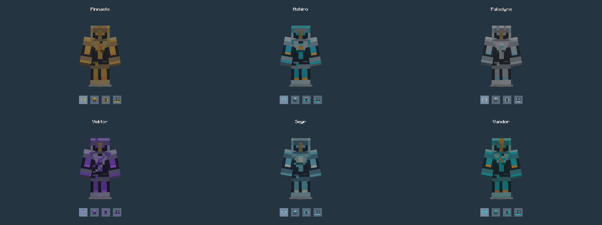

# Vandor Labs 2.2

Build working landing gear, showcase your creations on rotating platforms, and give your ships new controls and industrial detail.

The two cockpit consoles, chair with side rests and yoke/screen remain work in progress and are temporarily hidden from creative menus while their models are refined. Existing placed blocks remain supported.

## Landing gear you can build your way

Choose fixed **Mounts**, or combine **Extenders or Swing Arms** with separate **Plates, Skis or Wheels**. Stack arm sections for longer travel, connect matching feet into a shared assembly, and choose standard or **Large** parts with compact one-block arm mounts and oversized wheels to suit your ship. Swing arms fold while keeping their feet level; collision and selection follow the moving mechanism. Contacted entities move with the gear during a stroke.

Settings apply immediately. Operate visible feet by hand or use redstone and channels, including aboard captured vehicles. Adjacent trapdoor covers open for deployment and stay clear until the gear finishes retracting.

Wheeled craft can Taxi with tyres that roll, reverse and steer. **Ski-only craft can Taxi on ice, packed ice and frosted ice**, stopping before their runners leave the ice. Hover retains its normal hardware requirements. Hold Sprint for twice the normal hover cruise speed, with continuous, light engine-specific exhaust. Lift blocks keep their own gentle particle effects while holding position, including with no pilot aboard. Thruster lighting follows the engines pushing against your travel direction, including when reversing.

Existing integrated wheel gear can migrate into matching modular arms and wheels, retaining its facing, deployment and controls. Conversion waits when the new footprint or mounting support is blocked; old saved IDs remain readable.

[Build modular landing gear](docs/modular-landing-gear.md)

## Put your builds in motion

**Turntables** turn block-built displays on floor, wall or ceiling platforms. Build a square surface, add a controller, choose the capture height and Scan. Redstone controls rotation, with configurable direction and speed.

Only the circular surface disc rotates; its square housing corners stay still. Scan captures the build across the full square footprint, so overhangs move together. Players and loose items travel with floor platforms, and players can walk and jump freely. Stopping at 0, 90, 180 or 270 degrees automatically returns editable blocks at that heading. Other stops hold the captured pose; adjust it with the Angle slider or use Restore to return blocks at the nearest quarter turn. Supported block directions, inventories and entity headings are preserved. Obstructed return positions retain their captured contents until cleared.

[Build a turntable](docs/turntables.md)

## Give your workshop a centerpiece

Three **Universal Constructors**—the Assembly Press, Synthesis Tower and Enclosed Gantry—bring large industrial models and updated company artwork to your builds. Assemble them from a matching Core and Programmable Matter frame. The Core can occupy any bottom corner, along either horizontal axis. Failed assembly identifies a mismatched cell; dismantling returns the frame.

These are decorative multiblocks with creative-only Cores; they do not process recipes yet.

[Constructor frame dimensions and assembly](docs/universal-constructors.md)

## Matter, power and visible storage

The sunlight-powered **Programmable Matter Infuser** converts iron using redstone fuel, with hopper and item-handler automation. Pack nine Matter Ingots into a building block or unpack them again. Both forms have new artwork.

**Fuel Tanks** have hollow interiors, side windows and actual fluid volumes that stay level as they fill. Horizontal hexagonal tanks keep flat top and bottom faces, with square windows on the diagonal sides. Choose Hexagon or Block instantly, place the connections vertically or horizontally, and join tanks along their axis for pooled storage. **Battery Blocks** offer directional RF input and output, configurable casing textures, Block/Hexagon shape selection and green charge bars on their top and bottom. Place their ports on any axis, with the same flat-topped horizontal hexagon profile as tanks. Both have live current/max readouts and vertical fullness meters. Tank shape, casing, Tile/Fit artwork and contents share one compact dialog. Hexagonal tanks match thruster dimensions and shell shading, with straight engine rear rims for clean joins.

[Matter and storage details](docs/matter-and-storage.md)

## Outfit the cockpit—and the crew

Two multiblock cockpits, a chair with side controls, and a separate yoke/screen assembly add independent displays, touch controls and physical throttle outputs. Seated assemblies support normal vehicle conversion and parking.

Programmable armor gains complete **Pinnacle, Ashiro, Paladyne, Vektor, Seyr and Vandor** sets. Choose company designs independently for helmets, chestplates, leggings and boots in the Armor category, alongside the existing role designs.

Seven **Data Cards** and seven matching **Data Chips** add handheld props in unbranded, Pinnacle, Ashiro, Paladyne, Vektor, Seyr and Vandor designs. Their models retain the original transparent front/back artwork, with continuous opaque side walls following the outer silhouette. They are creative-catalog items, with no placement or data-storage behavior.

Material tools also gain Stretch, Tile and Fit layouts, independent ON/OFF light artwork, nested texture folders, and water-filled programmable Slabs and Stairs.

[Cockpit controls](docs/cockpits.md) · [Material settings](docs/unified-materials.md) · [Full changelog](CHANGELOG.md)

Company logos, backgrounds and murals now have their own **Corp** material category. Six company light designs add matching On/Off artwork in **Lights**, available specifically for programmable lights.

See every small and large Extender and Swing Arm in motion with Plates, Skis and Wheels in the [animated landing gear guide](docs/modular-landing-gear.md#animated-combinations).

Turntable direction and Restore have independent redstone pulse channels.
Speed is adjustable from 0.5 to 10 RPM in 0.5 RPM steps, and scanned
surfaces remain protected until Restore. Programmable Block Stretch/Fit artwork
joins across matching faces, including chunk borders. Device renderers reuse
stationary gear transforms and constructor orientations, and the standard JAR
shares duplicate artwork and losslessly compresses PNGs.

[Device rendering and package-size measurements](docs/performance/2.2-devices.md).

The Configurizer can open controllers through generated ramp cells and captured
turntable blocks, and handles Taxi/Hover entity clicks. Command-driven controller
removal recovers remaining generated parts and preserves blocked turntable returns.
